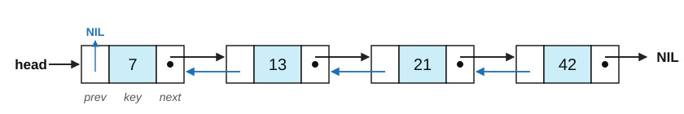

# Exercise Sheet 3: Data Structures

*Introduction to Computing for the Social Sciences · Prof. Dr. David Garcia*

> Exercises 1–3 will be covered in the exercise session. The *Additional
> practice* section is for self-study and to be covered if time allows.

---

## Exercise 1: Hash tables

When building a hash table you are given the following sequence of inputs:

$$6,\; 0,\; 2,\; 12,\; 3,\; 11,\; 10,\; 1,\; 14,\; 9$$

Your hash function is $h(x) = (2x + 3) \bmod m$, where $m$ is the size of the
hash table.

Consider a hash table with $m = 8$ and **separate chaining**. Show the final
state of the table after filling it with the above sequence.

Then answer: is $m = 8$ a good choice for this hash function? What do you observe
about which slots get used?

---

## Exercise 2: Binary search and binary search trees

a) Construct a **binary search tree** by adding the numbers in the indicated
   order: 4, 6, 2, 1, 3, 10, 12. You only need to draw the final BST after all
   the numbers have been added.

b) Show how the resulting BST of the previous step can be changed to have lower
   depth on its nodes.

c) Show how to remove element 10 from the resulting BST of the previous step.

d) Based on the list below, show the steps of the execution of **binary search**
   to find the element with key 33. Explain in your own words how you reach that result.

   $$10\quad 33\quad 19\quad 26\quad 27\quad 31\quad 34\quad 35\quad 42\quad 44$$

  

---

## Exercise 3: Linked lists

In the lecture, every node of a linked list has a key (with its data) and a
pointer `next` to the following node. A **doubly linked list** adds a second
pointer to every node: `prev`, which points to the node before it. The `prev`
of the first node and the `next` of the last node are NIL, and `L.head` points
to the first node:

a) Write the pseudocode of a procedure SEARCH($L$, $k$) that returns the node
   of the doubly linked list $L$ whose key is $k$, or NIL if there is none.

b) Write the pseudocode of a procedure DELETE($L$, $x$) that removes the node
   $x$ from the doubly linked list $L$. Think about what has to change when $x$
   is the first or the last node.

c) What are the advantages and disadvantages of a singly linked list compared
   to a doubly linked list?

---

## Additional practice

### A1. Choosing a structure

For each scenario, say which structure you would use (array, linked list, BST,
hash table) and justify it in one sentence.

a) A fixed-size lookup table of the 26 letters of the alphabet to their
   frequencies in a corpus.
b) A leaderboard that must always be read in score order and that changes
   after every game.
c) Counting how many times each of ~2 million distinct URLs appears in a web
   crawl.
d) A queue of survey responses waiting to be processed, first-in, first-out.

### A2. Hash function quality

You must hash German postal codes (five digits, 01067–99998) into a table.

a) What goes wrong with $h(k) = k \bmod 10$?
b) What goes wrong with $h(k) = k \bmod 1000$?
c) Suggest a better $m$ and explain your choice.
d) A colleague proposes $h(k) = \text{random}(0, m-1)$, arguing it distributes
   very well over the table. What is wrong with this?

### A3. BST operations, end to end

Start from an empty BST and insert: 50, 30, 70, 20, 40, 60, 80, 35.

a) Draw the tree.
b) Search for 35 and list the comparisons made.
c) Delete 20. Which case is it?
d) Delete 30. Which case is it? Show the result.
e) Delete 50. Which case is it? Show both possible results.

### A4. Depth and balance

a) What is the minimum possible depth of a BST holding $n$ keys? The maximum?
b) Insert 1…7 in increasing order into a BST and give the depth. Now find an
   insertion order for the same seven keys that gives the minimum depth.
c) Explain in one sentence why the depth is what determines search cost.

### A5. Pseudonymization

A researcher publishes a dataset of football matches in which the `HomeTeam`
column has been replaced by its SHA-256 hash.

a) Explain how an attacker could recover the team names.
b) What would make this harder?
c) Does hashing make the dataset anonymous in the legal sense?

### A6. Linked list surgery (pseudocode practice)

Write pseudocode for each, assuming a singly linked list where each node has
`node.value` and `node.next`, and `head` points to the first node:

a) Count the number of nodes.
b) Insert a new node with value $v$ immediately *after* a given node $p$.
c) Delete the node immediately after a given node $p$.
d) Why is "delete the node $p$ itself" harder than "delete the node after $p$"?

---

## Sources

- Exercises 1 and 2 are adapted from the 2023/24 sheet 3 of this course; exercise 3
  was rewritten in 2026/27.
- **Cormen, T. H., Leiserson, C. E., Rivest, R. L. & Stein, C. (2009).**
  *Introduction to Algorithms*, 3rd ed., MIT Press, ch. 10–12.: Reading for
  this session; A3 and A4 follow its treatment of BST deletion and depth.
- **Cormen, T. H. (2013).** *Algorithms Unlocked*, MIT Press.: Source of the
  BINARY-SEARCH pseudocode used in exercise 2.
- **Article 4(5) GDPR** defines pseudonymization and distinguishes it from
  anonymization; relevant to A5(c).
  <https://gdpr-info.eu/art-4-gdpr/>
