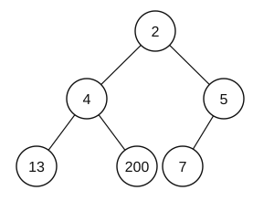

# Exercise Sheet 6: Recursion

<style>
table { width: auto !important; margin: 1.2em auto 1.8em auto; }
table th, table td { padding: 0.35em 1.1em !important; }
</style>

*Introduction to Computing for the Social Sciences · Prof. Dr. David Garcia*

Exercises 1 to 3 will be covered in the exercise session. The *Additional practice* section is for self-study and to be covered if time allows.

---

## Exercise 1: Recursive algorithms

A **min-heap** is a data structure similar to a binary search tree but simpler.
Min-heaps take the form of a nearly-complete binary tree, i.e. all levels are
full except the last one, which may be partly filled and is filled from the
leftmost leaf. They satisfy the condition that **each node contains a key that
is smaller than or equal to the keys of its children**. Below is an example:



Min-heaps can be implemented in arrays such that the levels of the tree are
stored sequentially in the array positions between 1 and $N$, where $N$ is the
total size of the min-heap. This way you can calculate the left child, right
child and parent of a node in position $x$ as:

$$\text{left-child}(x) = 2x \qquad \text{right-child}(x) = 2x+1 \qquad \text{parent}(x) = \lfloor x/2 \rfloor$$

a) Write the pseudocode of an **iterative** function `reduce(H, x, y)` that takes
   a min-heap $H$ and reduces the value of the node in position $x$ to the value
   $y$, assuming $y$ is lower than the current value stored in position $x$. The
   function has to change the min-heap so the result is still a min-heap. Use and
   manipulate $H$ with indices as you would with an array.

b) Write the **recursive** version of your code above. Which type of recursion
   have you implemented?

c) Show how `reduce(H, x, y)` can be applied to the min-heap of the example to
   reduce the value of the last node (the one that contains 7) to the value 1.
   Indicate any swaps or value changes and the final state of the min-heap.

Be careful with the direction, because reducing a value can only break the heap
property **upwards**, i.e. between the node and its parent. Convince yourself of
that before you write any pseudocode.

---

## Exercise 2: Depth-First Search

Given the following adjacency matrix:

| | A | B | C | D | E | F |
|:---|:---:|:---:|:---:|:---:|:---:|:---:|
| **A** | 0 | 1 | 1 | 0 | 0 | 0 |
| **B** | 1 | 0 | 1 | 0 | 0 | 0 |
| **C** | 1 | 1 | 0 | 1 | 1 | 0 |
| **D** | 0 | 0 | 1 | 0 | 0 | 1 |
| **E** | 0 | 0 | 1 | 0 | 0 | 1 |
| **F** | 0 | 0 | 0 | 1 | 1 | 0 |

a) Draw its corresponding graph.

b) Starting from node **B**, show the result of running Depth-First Search on the
   graph. Indicate the resulting discovery and finishing times for each node and
   the parent relationships on the graph. When processing the neighbors of a
   node, do it in alphabetical order.

---

## Exercise 3: Euclid's algorithm

a) Write the **recursive** version of Euclid's algorithm and a **non-recursive**
   version. *(Hint: remember that Euclid's algorithm is based on the equation
   $\gcd(a,b) = \gcd(b, a \bmod b)$.)* Explain the kind of recursion of Euclid's
   algorithm.

b) Show how the recursive version of Euclid's algorithm finds the gcd of **210** and **45**. How many calls to the algorithm happen in this case?

---

## Additional practice

### A1. Base cases and abort cases

For each recursive definition, identify the base case(s) and say whether the
recursion terminates for all valid inputs. If not, add an abort case.

a) $f(n) = f(n-1) + 2$, with $f(0) = 0$. Consider the calls with $n = 5$ and
   with $n = -3$.
b) "The number of files in a directory is the number of files directly in it,
   plus the number of files in each of its subdirectories."
c) $g(n) = g(n/2)$ if $n$ is even, $g(3n+1)$ if $n$ is odd, with $g(1) = 1$.

### A2. Recursive to iterative

Convert each of the three recursive procedures below to an iterative one, and
say whether the conversion was mechanical (tail recursion) or required a stack
or an accumulator.

a) `SUM(A, n)` returns $A[1] + \dots + A[n]$.

```
Procedure SUM(A, n)
Inputs:
      A: an array of numbers
      n: how many of its elements to add
Result: A[1] + … + A[n]
If n = 0
      then return 0
      else return A[n] + SUM(A, n - 1)
```

b) `POWER(x, n)` returns $x^n$.

```
Procedure POWER(x, n)
Inputs:
      x: a number
      n: a non-negative integer
Result: x to the power of n
If n = 0
      then return 1
      else return x · POWER(x, n - 1)
```

c) `REVERSE(L)` returns the list reversed.

```
Procedure REVERSE(L)
Inputs:
      L: a list
Result: a list with the elements of L in reverse order
If L is empty
      then return L
      else return REVERSE(L without its first element) followed by
                  the first element of L
```

### A3. Searching recursively

a) Write the pseudocode of a recursive algorithm that determines if a linked 
  list contains an element with a given key. Which kind of recursion
   did you use?

b) Write the pseudocode of a recursive algorithm that determines if a binary
   search tree contains a key. Which kind of recursion did you use, and how
   many recursive calls are executed in each call of your procedure?

### A4. The minimum of a binary search tree

a) Write the pseudocode of a recursive algorithm to find the minimum value of
   the keys of a binary search tree. Which kind of recursion did you use?

b) Write an iterative version of your pseudocode. What is the main difference
   when running the iterative and the recursive versions?

### A5. From a loop to a recursion

The procedure below is the iterative implementation of the method `unknown(n)`
from the flowchart in the exercise sheet of the Algorithms session.

```
Procedure UNKNOWN(n)
Inputs:
      n: a non-negative integer
Result: ?
x ← 1
i ← 0
While i < n:
      x ← x · 2
      i ← i + 1
return x
```

a) Write the pseudocode of the same method using recursion.

b) What type of recursion have you implemented?

c) How many frames are on the stack at the deepest point of `unknown(10)`, and
   how many does the iterative version need?

### A6. Everyone below a manager

A company stores, for every employee, the list of the employees that this
person manages directly:

| employee | manages directly |
|:---|:---|
| Ana | Ben, Cem |
| Ben | Dua, Eli |
| Cem | Fay |
| Dua | nobody |
| Eli | nobody |
| Fay | nobody |

a) Write the pseudocode of a recursive procedure `ALL-REPORTS(e)` that returns
   all the employees that are managed by employee `e`, either directly or
   indirectly. Your procedure has to keep working if the company adds more
   levels to its hierarchy.

b) Which list does your procedure return for Ben, and which for Ana?

c) What is the base case of your procedure, and which type of recursion is
   it?

---

## Sources

- **Zelle, J. M. (2016).** *Python Programming*, 3rd ed., ch. 13. Reading for
  this session.
- **Cormen, T. H., Leiserson, C. E., Rivest, R. L. & Stein, C. (2009).**
  *Introduction to Algorithms*, 3rd ed., ch. 6 (heaps), ch. 12 (binary search
  trees), ch. 22.3 (DFS). Source of the heap index formulas in exercise 1 and
  the DFS conventions in exercise 2.
- **Lagarias, J. C. (2010).** *The Ultimate Challenge: The 3x+1 Problem*. AMS.
  The Collatz conjecture in A1(c).
