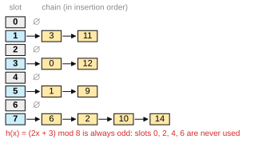
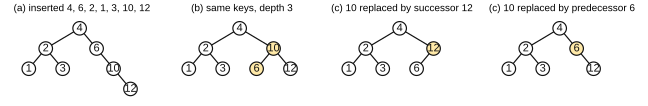
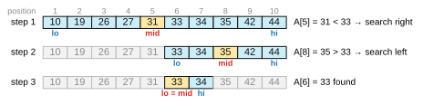

# Solutions to Exercise Sheet 3: Data Structures

*Introduction to Computing for the Social Sciences · Prof. Dr. David Garcia*

---

## Exercise 1: Hash tables

Compute $h(x) = (2x + 3) \bmod 8$ for each input in order and append the key
to the chain of its slot:

| $x$ | $2x + 3$ | $h(x)$ |
|---|---|---|
| 6 | 15 | 7 |
| 0 | 3 | 3 |
| 2 | 7 | 7 |
| 12 | 27 | 3 |
| 3 | 9 | 1 |
| 11 | 25 | 1 |
| 10 | 23 | 7 |
| 1 | 5 | 5 |
| 14 | 31 | 7 |
| 9 | 21 | 5 |

Final state, with chains in insertion order:



**Is $m = 8$ a good choice?** No. $2x + 3$ is odd for every integer $x$, and
taking it modulo 8, an even number, keeps the parity, so only the odd slots 1,
3, 5 and 7 can ever be used. Half of the table is wasted, the effective size is
4, and the chains are twice as long as they should be; the chain in slot 7
already holds four of the ten keys. The problem is that the multiplier 2 and
the table size 8 share a factor. With an odd $m$, best of all a prime such as
7 or 11, every slot is reachable and the keys spread out.

## Exercise 2: Binary search and binary search trees

a) Insert 4, 6, 2, 1, 3, 10, 12 in that order. Every key walks down from the
root, left when smaller and right when larger, and becomes a leaf where it
stops. The result is the first tree of the figure:



b) The right side of the tree is a chain 6 → 10 → 12, so the depth is 4
(counting levels, with the root at level 1) while seven keys fit in a tree of
depth 3. A BST holds the same keys in many shapes; to lower the depth, put the
median at the root and the medians of the halves below it. Inserting in the
order 4, 2, 10, 1, 3, 6, 12 gives the second tree of the figure, which has
depth 3, the minimum for seven keys ($\lceil \log_2 8 \rceil = 3$).
Equivalently, rotate the subtree at 6 so that 10 comes up and 6 becomes its
left child. Search now takes at most 3 comparisons instead of 4.

c) In the tree of (b), 10 has two children, so it is the third case of
deletion: replace it by the leftmost key of its right subtree, which is 12 (a
leaf), or by the rightmost key of its left subtree, which is 6 (also a leaf).
Both give a valid BST, the third and fourth trees of the figure.

Had you removed 10 from the tree of (a) instead, 10 would have had one child
(12), which is the second case: 12 simply takes its place under 6.

d) The precondition of binary search is that the array is sorted, and the list
as printed is not: 33 comes before 19. Run on the list as printed, binary
search would look at the middle element 27 (position 5), decide that 33 must
be to the right, and never look at position 2 again, reporting NOT-FOUND
for an element that is present. The list has to be sorted first:

```
10  19  26  27  31  33  34  35  42  44
```

Now the search for 33, with positions 1 to 10 and the variables of the
lecture's BINARY-SEARCH:

| step | $p$ | $r$ | $q$ | $A[q]$ | comparison | next |
|---|---|---|---|---|---|---|
| 1 | 1 | 10 | 5 | 31 | $31 < 33$ | $p$ ← 6 |
| 2 | 6 | 10 | 8 | 35 | $35 > 33$ | $r$ ← 7 |
| 3 | 6 | 7 | 6 | 33 | found | return 6 |



In words: $p$ and $r$ mark the part of the list where 33 can still be, at first
the whole list. Each step looks at the middle element $q$ of that part. The
middle of positions 1 to 10 holds 31, which is smaller than 33, so 33 can only
be to its right and positions 1 to 5 are dropped. The middle of positions 6 to
10 holds 35, which is larger, so 33 can only be to its left and positions 8 to
10 are dropped. Of the two positions left, the middle is 6, which holds 33: the
search returns position 6. Three comparisons, against up to ten for a linear
scan, because every comparison halves the part of the list that is left.

## Exercise 3: Linked lists

a) The search walks the list from the head and follows the `next` pointers,
exactly as in a singly linked list:

```
Procedure SEARCH(L, k)
Inputs:
      L: a doubly linked list, reached through L.head
      k: the key to find
Result: the node of L whose key is k, or NIL if there is none
x ← L.head
While x ≠ NIL and x.key ≠ k:
      x ← x.next
return x
```

The `prev` pointers do not help here: a search still has to visit the nodes
one after the other, so in the worst case it looks at every node. On the list
of the figure, SEARCH($L$, 21) compares 7, 13 and 21 and returns the third
node; SEARCH($L$, 5) compares all four keys and returns NIL.

b) The node $x$ knows both of its neighbors, so two pointers change: the
`next` of the node before $x$ and the `prev` of the node after $x$. When $x$
is the first node there is no node before it, and `L.head` has to move
instead; when $x$ is the last node there is no node after it:

```
Procedure DELETE(L, x)
Inputs:
      L: a doubly linked list, reached through L.head
      x: a node of L
Result: L without the node x
If x.prev ≠ NIL
      then x.prev.next ← x.next
      else L.head ← x.next
If x.next ≠ NIL
      then x.next.prev ← x.prev
```

Deleting 13 from the list of the figure sets `7.next` to the node 21 and
`21.prev` to the node 7. The procedure takes the same few steps however long
the list is. To delete the node with a given key, first call SEARCH and then
DELETE on the node it returns, if it is not NIL; the search is then the
expensive part.

c) Compared to a doubly linked list, a **singly linked list**

- needs less memory: one pointer per node instead of two;
- is simpler to change: every insertion or deletion updates fewer pointers, so
  there are fewer chances for a bug;

but

- cannot delete a given node, or insert before it, without first walking from
  the head to find the node before it, which takes as many steps as the list
  is long; a doubly linked list does it in a constant number of steps, as in (b);
- can only be walked in one direction; a doubly linked list can also go
  backward, which is what back and forward buttons or undo and redo need.

Both are equally slow to search, as (a) shows, and neither can jump to the
$i$-th node the way an array can.

## Additional practice

### A1. Choosing a structure

a) **Array**, indexed by letter position. The index range is exactly the data
range, so none of the array disadvantages apply.
b) **Balanced BST**. It keeps keys in sorted order, so you can read the
leaderboard off in order, and supports cheap insertion and deletion when
scores change. A sorted array would need shifting on every update; a hash
table has no order at all.
c) **Hash table**. Only exact-match lookup by URL is needed, and the number of
possible URLs is astronomically larger than the number observed.
d) A **linked list** with a pointer to each end: new responses are appended
at the end and processed from the head, both in one step. This is a queue,
which session 5 covers explicitly.

### A2. Hash function quality

a) Only 10 slots for about 8,000 codes, so every slot has a chain of hundreds.
Also the last digit of a postal code is not uniformly distributed.
b) 1,000 slots, but $k \bmod 1000$ keeps only the last three digits, which
discards the region information carried by the first two. Codes from the same
region will not spread out any better, and codes from different regions will
collide systematically.
c) Any prime comfortably larger than the number of stored items, for example
$m = 10007$ if you expect about 8,000 codes. A prime shares no factor with the
decimal structure of the keys, so all digits contribute to the result.
d) It is not **deterministic**. You could insert a key and then never find it
again, because the second call to `random` gives a different slot. Determinism
is the one requirement a hash function cannot trade away.

### A3. BST operations, end to end

a)
```
            50
       30        70
    20    40   60   80
        35
```
b) $35 < 50$ → left; $35 > 30$ → right; $35 < 40$ → left; found. Three
comparisons.
c) 20 is a **leaf** (case 1). Remove the reference from 30.
d) 30 now has **one child**, 40, whose subtree contains 35 (case 2). Replace 30
by 40:
```
            50
       40        70
    35    …    60   80
```
35 remains the left child of 40.
e) 50 is the root with **two children** (case 3).
- Using the successor, the leftmost node of the right subtree, which is 60: 60
  becomes the root, and since 60 was a leaf nothing else changes.
- Using the predecessor, the rightmost node of the left subtree, which is 40:
  40 becomes the root, and since 40 had a left child 35, that child takes the
  old place of 40.

Both results are valid BSTs. Implementations pick one convention and stick to it.

### A4. Depth and balance

a) Minimum $\lceil \log_2(n+1) \rceil$ (a complete tree); maximum $n$ (a chain).
b) In increasing order the tree is a chain of depth 7. The minimum depth, 3,
comes from inserting the median first and recursing: **4, 2, 6, 1, 3, 5, 7**.
c) Because search follows one path from the root to a leaf, so the number of
comparisons is at most the depth.

### A5. Pseudonymization

a) There are only a few hundred professional football teams. The attacker
hashes every team name and matches the results, a *dictionary attack*.
Hashing is deterministic, and that is exactly what makes it reversible when the
input space is small.
b) Hashing each name together with a **secret** (a salt) that only the
research team knows, as in the lecture's example, and never publishing it. Then
the attacker cannot compute the hashes of candidate names.
c) No. Pseudonymization replaces identifiers with pseudonyms but leaves the
records linkable; if the pseudonyms can be re-identified, through a dictionary
attack or by joining with another dataset, the data is still personal data.
This distinction matters under the GDPR.

### A6. Linked list surgery (pseudocode practice)

a)
```
Procedure LENGTH(head)
count ← 0
current ← head
While current ≠ NIL:
      count ← count + 1
      current ← current.next
return count
```
b)
```
Procedure INSERT-AFTER(p, v)
new ← a new node with new.value ← v
new.next ← p.next
p.next ← new
```
Note the order of the two assignments: swap them and you lose the rest of the
list.
c)
```
Procedure DELETE-AFTER(p)
If p.next ≠ NIL
      then p.next ← p.next.next
```
d) Deleting $p$ means changing the `next` pointer of the node **before** $p$,
and a singly linked list gives no way to reach that node except by walking
from `head`, a linear scan. Deleting the node after $p$ only changes `p.next`,
which we can reach directly. (The `prev` pointer of exercise 3 removes this
difference.)
