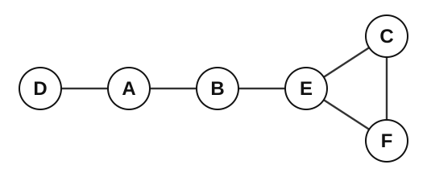
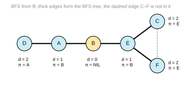
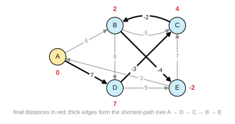
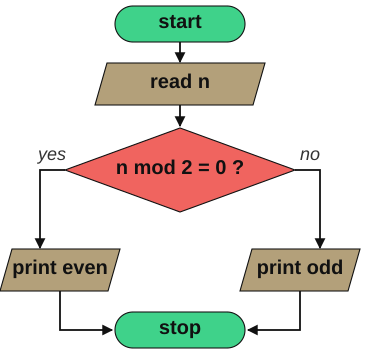
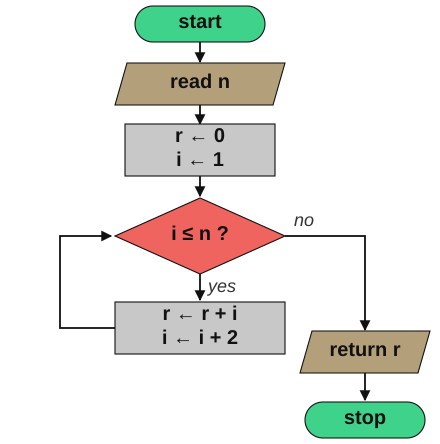

# Solutions to Exercise Sheet 5: Algorithms

*Introduction to Computing for the Social Sciences · Prof. Dr. David Garcia*

---

## Exercise 1: Flow charts

a) The method reads an integer $n$ and starts with $x = 1$ and a counter $i = 0$.
As long as $i$ is smaller than $n$, it doubles $x$ and increases $i$ by one,
and when $i$ reaches $n$ it returns $x$. After $n$ doublings $x$ is $2^n$, so
`unknown(n)` computes **$2^n$**. For $n \le 0$ the loop never runs and the
method returns 1, which is $2^0$ and is the usual convention for negative
inputs as well.

b) We read the diamond as the condition of a loop:

```
Procedure UNKNOWN(n)
Inputs:
      n: an integer
Result: 2^n (and 1 when n ≤ 0)
x ← 1
i ← 0
While i < n:
      x ← x · 2
      i ← i + 1
return x
```

The diamond in the flowchart tests `i ≥ n` and leaves the loop on *true*, so
the `While` condition is its negation, `i < n`.

## Exercise 2: Graphs and algorithms

a) The matrix is symmetric, so the graph is undirected. A 1 in row $u$ and
column $v$ is an edge between $u$ and $v$, and there are six edges:

$$\{A,B\},\ \{A,D\},\ \{B,E\},\ \{C,E\},\ \{C,F\},\ \{E,F\}.$$

The drawing is a path D – A – B – E with a triangle formed by C, E and F
attached to E.



b) There is one list per vertex with its neighbors:

```
A → [B, D]
B → [A, E]
C → [E, F]
D → [A]
E → [B, C, F]
F → [C, E]
```

The lists have twelve entries for six edges, because each undirected edge
appears in the lists of both endpoints.

c) The table shows breadth-first search from B, with the queue written after
each step and neighbors enqueued in alphabetical order:

| step | dequeue | discovered (gray) | queue after |
|---|---|---|---|
| 0 | – | B ($d = 0$) | `[B]` |
| 1 | B | A ($d=1$, $\pi=B$), E ($d=1$, $\pi=B$) | `[A, E]` |
| 2 | A | D ($d=2$, $\pi=A$); B is already seen | `[E, D]` |
| 3 | E | C ($d=2$, $\pi=E$), F ($d=2$, $\pi=E$); B is already seen | `[D, C, F]` |
| 4 | D | nothing new | `[C, F]` |
| 5 | C | nothing new (E and F are seen) | `[F]` |
| 6 | F | nothing new | `[ ]` |

The final distances and parents are the following:

| vertex | A | B | C | D | E | F |
|---|:---:|:---:|:---:|:---:|:---:|:---:|
| $d$ | 1 | **0** | 2 | 2 | 1 | 2 |
| $\pi$ | B | NIL | E | A | B | E |



The BFS tree has the edges B–A, B–E, A–D, E–C and E–F. The edge C–F is not in
the tree, because F was discovered from E before C was dequeued.

## Exercise 3: More about graphs and algorithms

a) A non-zero entry in row $u$ and column $v$ is a directed edge $u \to v$
with that weight. There are ten edges in all:

$$A \xrightarrow{6} B,\ A \xrightarrow{7} D,\ B \xrightarrow{5} C,\ B \xrightarrow{8} D,\ B \xrightarrow{-4} E,\ C \xrightarrow{-2} B,\ D \xrightarrow{-3} C,\ D \xrightarrow{9} E,\ E \xrightarrow{3} A,\ E \xrightarrow{7} C.$$

The matrix is not symmetric, for example $B \to C$ has weight 5 and $C \to B$
has weight $-2$, so the graph is directed. A zero means that there is no edge
and not that there is an edge of weight zero.

b) The edges are taken in the order $(A,B), (A,D), (B,C), (B,D), (B,E), (C,B),
(D,C), (D,E), (E,A), (E,C)$. Initially $A = 0$ and every other distance is
$\infty$.

*Iteration 1.* $(A,B)$: $\infty > 0 + 6$, so $B \leftarrow 6$, $\pi_B = A$.
$(A,D)$: $D \leftarrow 7$, $\pi_D = A$. $(B,C)$: $C \leftarrow 11$, $\pi_C = B$.
$(B,D)$: $7 > 14$? no. $(B,E)$: $E \leftarrow 2$, $\pi_E = B$. $(C,B)$:
$6 > 9$? no. $(D,C)$: $11 > 4$, so $C \leftarrow 4$, $\pi_C = D$. $(D,E)$:
$2 > 16$? no. $(E,A)$: $0 > 5$? no. $(E,C)$: $4 > 9$? no.
After iteration 1: $A = 0$, $B = 6$, $C = 4$, $D = 7$, $E = 2$.

*Iteration 2.* Only $(C,B)$ relaxes, because $6 > 4 - 2 = 2$, so $B \leftarrow 2$
and $\pi_B = C$. After iteration 2: $A = 0$, $B = 2$, $C = 4$, $D = 7$, $E = 2$.

*Iteration 3.* Only $(B,E)$ relaxes, because $2 > 2 - 4 = -2$, so $E \leftarrow -2$
and $\pi_E = B$. After iteration 3: $A = 0$, $B = 2$, $C = 4$, $D = 7$, $E = -2$.

*Iteration 4.* No relaxation succeeds.

| vertex | A | B | C | D | E |
|---|:---:|:---:|:---:|:---:|:---:|
| distance | **0** | 2 | 4 | 7 | −2 |
| parent | NIL | C | D | A | B |



The shortest-path tree is the single path $A \to D \to C \to B \to E$. Three
iterations were needed because each pass extends the path by one more edge.

c) With $C \to B$ at $-4$ the cycle $B \to E \to C \to B$ has weight
$-4 + 7 - 4 = -1$, while with $-2$ it had weight $+1$. A negative cycle means that
there is no shortest path at all, because going around it once more always makes the
path cheaper. The distances of every vertex on the cycle or reachable from it
therefore have no lower bound. The algorithm does not notice this. It still stops after
$|V| - 1 = 4$ passes, because line 6 fixes the number of iterations, but the
relaxations do not converge. In the trace, iteration 2 lowers $B$ to 0,
iteration 3 lowers $E$ to $-4$, $A$ to $-1$ and $C$ to 3, and iteration 4 still
lowers $D$ to 6 and $B$ to $-1$. The values it returns are not the lengths of
any simple path, and the parent pointers contain a cycle instead of forming a
tree. The remedy is one extra pass over the edges after the loop. If any
relaxation still succeeds, a negative cycle is reachable from the source and
the result must be reported as invalid. This also explains why BFS assigns each
distance exactly once while Bellman-Ford relaxes the same edge again and again.
With unit weights a vertex cannot be reached more cheaply later, whereas with
arbitrary weights a path with more edges can have a smaller weight.

## Additional practice

### A1. Reading and writing flowcharts

a) The program reads $n$ and tests whether $n \bmod 2 = 0$. The yes branch
prints "even" and the no branch prints "odd". Both branches then join again
at the stop symbol.



b) After reading $n$, the program sets $r \leftarrow 0$ and $i \leftarrow 1$
and tests $i \le n$. While the test is true, it adds $i$ to $r$, increases $i$
by 2 and returns to the test. When the test is false, it returns $r$ and stops.
The procedure therefore sums the **odd numbers** up to $n$, i.e.
$1 + 3 + 5 + \dots$. This sum is always a perfect square, for example
$1 + 3 + 5 + 7 = 16$.



### A2. Graph representations

a)

$$
\begin{array}{c|cccc}
  & 1 & 2 & 3 & 4 \\
\hline
1 & 0 & 1 & 0 & 0 \\
2 & 0 & 0 & 1 & 0 \\
3 & 1 & 0 & 0 & 1 \\
4 & 0 & 0 & 0 & 0
\end{array}
$$

b) The lists are $1 \rightarrow 2$, $2 \rightarrow 3$, $3 \rightarrow 1 \rightarrow 4$
and $4 \rightarrow$ (empty).
c) No, it is not symmetric. A symmetric adjacency matrix means that the graph
is **undirected**, i.e. every edge goes both ways.
d) In the matrix, store $w(u,v)$ in the cell instead of 1, with a sentinel
value such as 0 or $\infty$ for "no edge". Note that 0 is a bad sentinel if 0
is a valid weight. In the list, store pairs (neighbor, weight) in each list.

### A3. BFS with pen and paper

a) First A is enqueued. Dequeuing A enqueues B and C, so the queue is `[B, C]`.
Dequeuing B enqueues D, so the queue is `[C, D]`. Dequeuing C adds nothing
because D is already discovered, so the queue is `[D]`. Dequeuing D enqueues E,
so the queue is `[E]`. Dequeuing E enqueues F, so the queue is `[F]`. Dequeuing
F adds nothing and the queue is empty.
b) The distances $d$ are A 0, B 1, C 1, D 2, E 3 and F 4.
The parents $\pi$ are A NIL, B A, C A, D **B** (discovered from B first, in
alphabetical order), E D and F E.
c) A shortest path is A → B → D → E → F, with length 4.
d) The length is unique but the path is not, because A → C → D → E → F also
has length 4. BFS returns one shortest path per node, determined by the order
in which neighbors are examined. For this reason the sheet fixes alphabetical
order.

### A4. Sparse graphs and memory

a) $(2\times10^8)^2 = 4\times10^{16}$ bits $= 5\times10^{15}$ bytes, i.e.
**5 petabytes**.
b) About $|V| + |E| = 2\times10^8 + 2\times10^{10} \approx 2\times10^{10}$
entries. At 8 bytes per entry, for example, this is 160 GB, which is large but
fits on a disk.
c) The ratio is about $3 \times 10^{4}$ in favor of the list, i.e. 5 PB against
160 GB. If we count bits against entries instead, i.e. $4\times10^{16}$ against
$2\times10^{10}$, the ratio is $2 \times 10^{6}$. In both cases the matrix is
not feasible.
d) The matrix costs $|V|^2$ and the list roughly $|V| + |E|$, so the matrix
is competitive only when $|E|$ approaches $|V|^2$, i.e. when a large fraction
of all possible pairs are connected. Social networks are far from this, because
here the density is $|E|/|V|^2 = 5 \times 10^{-7}$.
