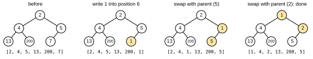
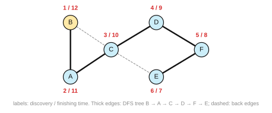

# Solutions to Exercise Sheet 6: Recursion

<style>
table { width: auto !important; margin: 1.2em auto 1.8em auto; }
table th, table td { padding: 0.35em 1.1em !important; }
</style>

*Introduction to Computing for the Social Sciences · Prof. Dr. David Garcia*

---

## Exercise 1: Recursive algorithms

Lowering a value can only break the heap property between the node and its
parent and never between the node and its children, because the children were
already larger than the old value, so they are also larger than the new one.
The node therefore has to move up, swapping with its parent as long as the
parent is larger.

a) Iterative version:

```
Procedure REDUCE(H, x, y)
Inputs:
      H: a min-heap stored in an array, positions 1 to N
      x: the position of the node to change
      y: the new value, with y < H[x]
Result: H[x] holds y and H is again a min-heap
H[x] ← y
While x > 1 and H[⌊x/2⌋] > H[x]:
      swap H[x] with H[⌊x/2⌋]
      x ← ⌊x/2⌋
```

The loop stops at the root ($x = 1$) or as soon as the parent is not larger.
It runs at most as many times as the tree is deep, i.e. about $\log_2 N$ times.

b) Recursive version, with the comparison against the parent as the recursive
case and "at the root, or the parent is smaller" as the base case:

```
Procedure REDUCE-REC(H, x, y)
Inputs:
      H, x, y as above
Result: H[x] holds y and H is again a min-heap
H[x] ← y
SIFT-UP(H, x)

Procedure SIFT-UP(H, x)
Inputs:
      H: a min-heap, except possibly between position x and its parent
      x: a position in H
Result: the heap property holds everywhere
If x > 1 and H[⌊x/2⌋] > H[x]
      then swap H[x] with H[⌊x/2⌋]
           SIFT-UP(H, ⌊x/2⌋)
```

This is **linear recursion** and in particular **tail recursion**, because
there is a single recursive call, it is the last thing the procedure does, and
nothing is left to compute when it returns. That is why the iterative version
of (a) is a mechanical translation of it.

c) The heap of the figure as an array, level by level, is
`[2, 4, 5, 13, 200, 7]`. The node with 7 is at position 6, which is the left
child of position 3. Calling `reduce(H, 6, 1)` runs these steps:

| step | action | array |
|:---:|:---|:---|
| 0 | write $y = 1$ into position 6 | `[2, 4, 5, 13, 200, 1]` |
| 1 | parent of 6 is position 3, value 5; $5 > 1$, swap | `[2, 4, 1, 13, 200, 5]` |
| 2 | parent of 3 is position 1, value 2; $2 > 1$, swap | `[1, 4, 2, 13, 200, 5]` |
| 3 | $x = 1$ is the root, stop | |



The final min-heap has 1 at the root, children 4 and 2, and below them 13 and
200 under 4 and 5 under 2. Every node is smaller than its children, and the
tree is still nearly complete because only values were changed and not the
shape of the tree.

## Exercise 2: Depth-First Search

a) The matrix is symmetric, so the graph is undirected, with seven edges:
$\{A,B\}, \{A,C\}, \{B,C\}, \{C,D\}, \{C,E\}, \{D,F\}, \{E,F\}$. It is a
triangle A, B, C joined through C to a square C, D, F, E.

b) DFS from B, taking neighbors in alphabetical order, with discovery time $d$
and finishing time $f$:

- Visit **B** ($d = 1$). Its neighbors are A and C, and A is white.
  - Visit **A** ($d = 2$, $\pi = B$). Neighbors B (gray) and C (white).
    - Visit **C** ($d = 3$, $\pi = A$). Neighbors A (gray), B (gray), D (white).
      - Visit **D** ($d = 4$, $\pi = C$). Neighbors C (gray), F (white).
        - Visit **F** ($d = 5$, $\pi = D$). Neighbors D (gray), E (white).
          - Visit **E** ($d = 6$, $\pi = F$). Neighbors C (gray), F (gray), so
            nothing is white. Finish E ($f = 7$).
          Finish F ($f = 8$).
        Finish D ($f = 9$).
      Back in C, E is now black. Finish C ($f = 10$).
    Finish A ($f = 11$).
  Back in B, C is black. Finish B ($f = 12$).

| vertex | A | B | C | D | E | F |
|:---|:---:|:---:|:---:|:---:|:---:|:---:|
| $d$ | 2 | **1** | 3 | 4 | 6 | 5 |
| $f$ | 11 | 12 | 10 | 9 | 7 | 8 |
| $\pi$ | B | NIL | A | C | F | D |



The DFS tree is the single path B → A → C → D → F → E, because depth-first
search commits to one neighbor and goes as deep as it can, so on this graph it
never branches. The two edges not in the tree, B–C and C–E, are back edges.
When C looks at B and when E looks at C, the other vertex is still gray, so
each back edge reveals a cycle, namely B–A–C–B and C–D–F–E–C.

## Exercise 3: Euclid's algorithm

a) The recursive version follows directly from $\gcd(a, b) = \gcd(b, a \bmod b)$
with $\gcd(a, 0) = a$ as the base case:

```
Procedure GCD(a, b)
Inputs:
      a, b: non-negative integers, not both zero
Result: the greatest common divisor of a and b
If b = 0
      then return a
      else return GCD(b, a mod b)
```

Iterative version:

```
Procedure GCD-ITER(a, b)
Inputs:
      a, b: non-negative integers, not both zero
Result: the greatest common divisor of a and b
While b ≠ 0:
      r ← a mod b
      a ← b
      b ← r
return a
```

The recursion is **linear** and, more precisely, **tail recursion**, because
there is one recursive call per invocation, it is in the last position, and no
work is pending when it returns. The iterative version simply overwrites $a$
and $b$ with the arguments of the next call.

b) $\gcd(210, 45) \to \gcd(45, 210 \bmod 45) = \gcd(45, 30) \to \gcd(30, 45
\bmod 30) = \gcd(30, 15) \to \gcd(15, 30 \bmod 15) = \gcd(15, 0) = 15$.

There are **four calls** in total, counting the initial one and the base case
$\gcd(15, 0)$, and three of them are recursive calls. The remainders 30, 15 and
0 shrink quickly, which is why the algorithm needs so few calls.

## Additional practice

### A1. Base cases and abort cases

a) The base case is $f(0) = 0$. The recursion terminates for $n \ge 0$, so it
terminates for $n = 5$. For $n = -3$ it runs forever ($-3, -4, -5, \ldots$), so
we add an abort case, for example `if n < 0 then error`.
b) The base case is a directory with no subdirectories. The recursion
terminates if the filesystem is a tree. Real filesystems have symbolic links,
which can create cycles, so you need an abort case that tracks visited
directories. This is the same idea as the WHITE/GRAY/BLACK coloring of DFS.
c) This is the **Collatz conjecture**. Nobody knows whether it terminates for
all $n$. It has been verified for enormous ranges but it has no proof. It shows
that the question "does this recursion terminate?" can be an open research
problem, which is related to the halting problem that we will learn in the
Theoretical Computer Science session.

### A2. Recursive to iterative

a)
```
Procedure SUM-ITER(A, n)
Inputs:
      A: an array; n: how many of its elements to add
Result: A[1] + … + A[n]
s ← 0
For i = 1 to n:
      s ← s + A[i]
return s
```
This required an **accumulator**, because the recursive version is not
tail-recursive, since `return A[n] + SUM(A, n-1)` does work after the call
returns.

b)
```
Procedure POWER-ITER(x, n)
Inputs:
      x: a number; n: a non-negative integer
Result: x^n
r ← 1
For i = 1 to n:
      r ← r · x
return r
```
This is the same situation as in (a). The recursive version can be made
tail-recursive by carrying
the accumulator as a parameter, `POWER(x, n, acc)`.

c) Iteratively, you can walk from the end and append, or swap ends inwards. The
recursive version (`REVERSE(rest) + [first]`) is not tail-recursive, while the
iterative version needs no stack because a list gives random access.

### A3. Searching recursively

a) The list ends at NIL, which is one base case, and finding the key is the
other one.

```
Procedure LIST-CONTAINS(node, k)
Inputs:
      node: the head of a singly linked list, possibly NIL
      k: the key looked for
Result: TRUE if some node holds key k, FALSE otherwise
If node = NIL
      then return FALSE                 # base case: end of the list
If node.key = k
      then return TRUE                  # base case: found
return LIST-CONTAINS(node.next, k)      # recursion case
```

This is **linear recursion** and, more precisely, **tail-end recursion**,
because there is one recursive call and it is the last step.

b) In a binary search tree the comparison with the key of the node tells us
which subtree can contain the key.

```
Procedure BST-CONTAINS(node, k)
Inputs:
      node: the root of a binary search tree, possibly NIL
      k: the key looked for
Result: TRUE if some node holds key k, FALSE otherwise
If node = NIL
      then return FALSE
If node.key = k
      then return TRUE
If k < node.key
      then return BST-CONTAINS(node.left, k)
      else return BST-CONTAINS(node.right, k)
```

This is also **linear (tail-end) recursion**. There are two recursive calls in
the code but only one of them is executed in each call of the procedure, so
the calls form a chain and not a tree. Compare it with the recursive Fibonacci
procedure, in which both calls are executed.

### A4. The minimum of a binary search tree

a) Every key in the left subtree of a node is smaller than the key of the
node, so the minimum is the leftmost node.

```
Procedure BST-MINIMUM(node)
Inputs:
      node: the root of a non-empty binary search tree
Result: the smallest key in the tree
If node.left = NIL
      then return node.key
      else return BST-MINIMUM(node.left)
```

This is **linear recursion** and specifically **tail-end recursion**, because
the result of the recursive call is returned without further calculation.

b)

```
Procedure BST-MINIMUM-ITERATIVE(node)
Inputs:
      node: the root of a non-empty binary search tree
Result: the smallest key in the tree
While node.left ≠ NIL:
      node ← node.left
return node.key
```

The main difference is the **memory**. Both versions visit the same nodes, but
the recursive version puts one frame on the stack for every level of the tree,
so it can cause a stack overflow on a very unbalanced tree. The iterative
version needs one frame, whatever the height of the tree is. Each call also
takes some time, so the iterative version is slightly faster.

### A5. From a loop to a recursion

a) The loop doubles `x` once for every value of `i` from 0 to $n - 1$, so the
method computes $2^n$. Recursively, $2^n = 2 \cdot 2^{n-1}$ and $2^0 = 1$.

```
Procedure UNKNOWN(n)
Inputs:
      n: a non-negative integer
Result: 2 to the power of n
If n = 0
      then return 1
      else return 2 · UNKNOWN(n - 1)
```

b) It is **linear recursion**, because the procedure calls itself once. It is
not tail-end recursion, because the result of the recursive call still has to
be multiplied by 2.

c) `unknown(10)` calls `unknown(9)`, and so on down to `unknown(0)`, so there
are **11 frames** on the stack at the deepest point. The iterative version
needs **one frame**, with the two variables `x` and `i`.

### A6. Everyone below a manager

a)

```
Procedure ALL-REPORTS(e)
Inputs:
      e: an employee, with the list reports[e] of the employees
         that e manages directly
Result: the list of all the employees that e manages directly or indirectly
result ← an empty list
For each employee r in reports[e]:
      append r to result
      append every element of ALL-REPORTS(r) to result
return result
```

The procedure does not mention the number of levels, so it keeps working when
the hierarchy changes.

b) For Ben it returns `[Dua, Eli]`. For Ana it returns
`[Ben, Dua, Eli, Cem, Fay]`, because after Ben it appends everyone below Ben,
and after Cem it appends everyone below Cem.

c) The base case is an employee who manages nobody. The For loop does not run
and the procedure returns the empty list without calling itself. It is **tree
recursion**, because the procedure calls itself once for every employee that
`e` manages directly, which can be several times.
