## About me {.fit1}

:::: {.columns}
::: {.column width="74%"}
::: {.xs}
- B.Sc. Computer Science &ndash; Universidad Autónoma de Madrid
- M.Sc. Computer Science &ndash; ETH Zurich
  - Theory of computation track
- Doctorate at ETH Zurich: Department of Management, Technology and Economics
- Habilitation at ETH Zurich &ndash; Now Privatdozent teaching Social Data Science
- Group leader at the Medical University of Vienna
- Faculty member at the Complexity Science Hub Vienna


- Professor for Computational Behavioral and Social Sciences<br>Graz University of Technology


- Since 1.10.2022:<br>Professor for Social and Behavioral Data Science &ndash; University of Konstanz<br>Leading the [Social Data Science lab](https://www.polver.uni-konstanz.de/social-data-science-lab/)
:::
:::

::: {.column width="26%"}
::: {.logos}
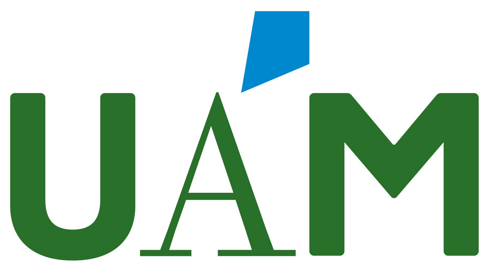{height="70px"}

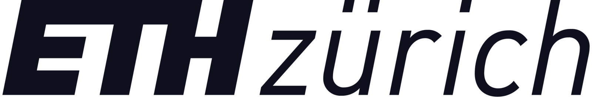{height="48px"}

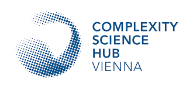{height="70px"}

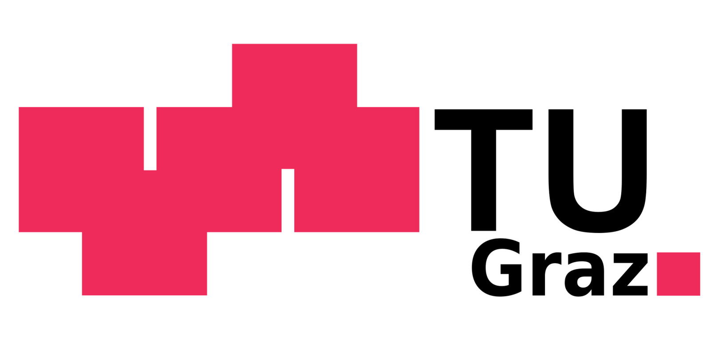{height="62px"}
:::
:::
::::

## The Social Data Science Lab

::: {.center-h}
{width="95%"}
:::

## Our Research Topics

::: {.center-h}
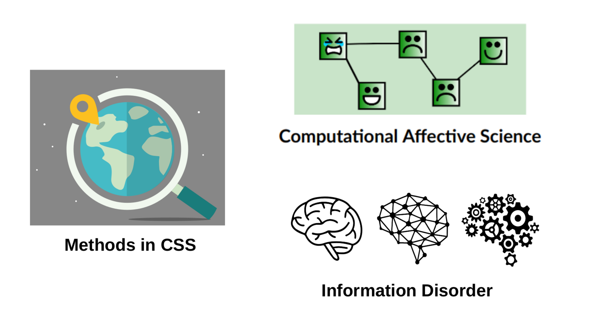{width="90%"}
:::

## The ICSS Team

**Lecturer:** Prof. Dr. David Garcia<br>
Consultation: book a consultation hour by email, I come to the university every week

**Lecturers of Practice part:** Elena Solar, David Garcia

**Tutors for Practice part:** Aaron Siebert, Eli Schwarer, Anna Luise Harnischmacher

**Lecture:** Wednesdays 10:00-11:30, D301

**Exercises:** Tuesdays 15:15-16:45, D301

## Outline

::: {.outline}
1. Course Motivations and Objectives
2. Course Overview
3. Course Formalities
4. A Brief Introduction to Computer Science
:::

## The Digital Society

:::: {.columns}
::: {.column width="56%"}
More and more of our actions happen through digital technologies, e.g.:

::: {.sm}
- Searching for a job online
- Talking with a family member over the phone
- Sharing open source code
- Posting a video on a social networking site
- Paying at the supermarket with a credit card
- Chatting with your boss on a company instant messenger
:::
:::

::: {.column width="44%"}
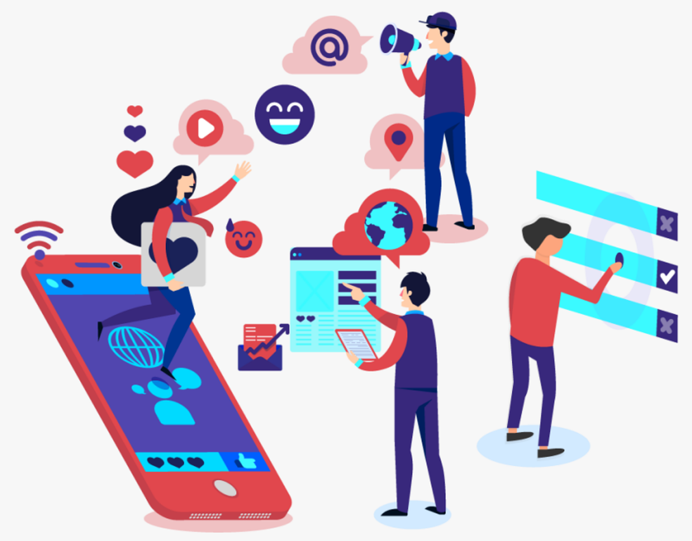{width="96%"}
:::
::::

## Motivation I: The Digital Transformation

The growth in adoption and evolution of these technologies is the **digital transformation** of society, which has some consequences:

::: {.sm}
- **Datafication:** Digital technologies generate data traces that can persist and be analyzed

- How individuals interact with digital technologies is based on the code of software running on them. The design of that code is based on algorithms that describe the rules of how the technology operates

- Digital technologies might use data produce by humans in their algorithms, for example through machine learning models to personalize content or make predictions
:::

## Digital trace data

::: {.center-h}
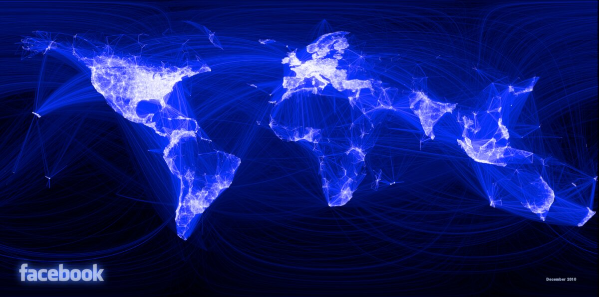{width="80%"}

::: {.source}
[Facebook: Visualizing Friendships](https://www.facebook.com/notes/10158791468612200/)
:::
:::

## Motivation II: the Computational revolution

::: {.sm}
- Computational methods to handle and analyze new social data
  - automation and scalability: we cannot process everything by hand
  - robustness: analysis changing assumptions or parameters
  - reproducibility: code for anyone to build and replicate
- BuT lack of fundamental understanding of the "tools" we use
  - often only a working knowledge of high-level software programs<br>&nbsp;&nbsp;&nbsp;&nbsp;&nbsp;e.g. Excel, SPSS, STATA
  - complex research problems require more **advanced computational skills**
    - automate data retrieval and handling
    - design efficient algorithms and run them in computational infrastructure
    - develop software that implement specific methods or solutions
:::

## Motivation III: Challenges in Data Science {.fit1}

Understanding computation is a requirement to understand current issues in the digital society, technology, and social science research

::: {.xs}
- **Platform biases:** The design of platforms and their algorithms can affect the behavior we observe. Some platforms have non-human actors (e.g. bots) that affect the data.
- **Data gatekeepers:** Not everyone can access the same data. Some research might be impossible to reproduce.
- **Performative behavior:** Talking online is not the same than offline. We have to consider what is the purpose of the people involved and if that distorts their behavior.
- **Representativity issues:** Not everyone leaves digital traces and measurement methods or predictive models can have biases that lead to discriminatory outcomes.
- **Privacy and ethics:** data is people &ndash; privacy expectations and downstream consequences of technology are new ethical issues.
- **The data deluge:** Too much data enables black-box predictions that can be useful but limit our understanding.
:::

## Goals of the Course

:::: {.columns}
::: {.column width="52%"}
::: {.sm}
- **Overarching goal: being able to solve problems computationally**

- Appreciate, understand and use ideas at the core of computer science and programming

- Demonstrate familiarity with major algorithms and data structures

- Use computational techniques for solving problems in the social sciences

- Have familiarity with Python programming language for simple computational tasks
:::
:::

::: {.column width="48%"}
::: {.center-h}
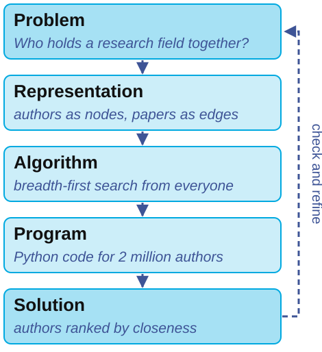{height="14em"}
Example of computational solution
:::
:::
::::

## Course Overview

::: {.outline .focus}
1. Course Motivations and Objectives
2. [Course Overview]{.current}
3. Course Formalities
4. A Brief Introduction to Computer Science
:::

## Overview of the Course

::: {.sm}
- Fundamental principles of Computer Science & basic programming concepts
  - Topics covered:
    - Principles of information coding
    - Computer systems & information storage
    - Data types, data structures & algorithms
    - Programming paradigms and basic software engineering
    - Basic database and parallel programming concepts
  - Format:
    - Concepts and theory are taught in the lectures
    - **Pen-and-paper exercises apply concepts: Knowing is doing**
    - Link to practical part, course calendars algined
:::

## Lectures Outline

:::: {.columns}
::: {.column width="50%"}
::: {.sm}
- Session 1: Introduction
- Session 2: Information Coding
- Session 3: Data Structures
- Session 4: Software
- Session 5: Algorithms
- Session 6: Recursion
- Session 7: Sorting Algorithms
:::
:::

::: {.column width="50%"}
::: {.sm}
- Session 8: Algorithmic Complexity
- Session 9: Theoretical Computer Science
- Session 10: Databases
- Session 11: Machine Learning
- Session 12: Parallel Programming
- Session 13: Social Science Applications
- Session 14: Exam Review
:::
:::
::::

## Course calendar

:::: {.columns}
::: {.column width="50%"}
::: {.sm}
- **01** Introduction (21.10 – 27.10)
- **02** Information coding (28.10 – 03.11)
- **03** Data Structures (4.11 – 13.11)
- [No class on 10.11 nor 11.11.  
Instead on 13.11 in A702:  
Exercise 03 at 10:00-11:30,  
Lecture 04 at 13:30-15:00]{style="color:#8e2043;font-style:italic"}
- **04** Software (13.11 – 17.11)
- **05** Algorithms (18.11 – 24.11)
- **06** Recursive algorithms (25.11 – 01.12)
:::
:::

::: {.column width="50%"}
::: {.sm}
- **07** Sorting Algorithms (02.12 – 08.12)
- **08** Algorithmic Complexity (09.12 – 15.12)
- [No class on 22.12 nor 23.12]{style="color:#8e2043;font-style:italic"}
- **09** Theoretical Computer Science (16.12 - 12.01)
- **10** Databases (13.01 - 19.01)
- **11** Machine Learning (20.01 - 26.01)
- **12** Parallel Programming (27.01 – 02.02)
- **13** Social Science Applications (03.02)
:::
:::
::::

## Course Formalities

::: {.outline .focus}
1. Course Motivations and Objectives
2. Course Overview
3. [Course Formalities]{.current}
4. A Brief Introduction to Computer Science
:::

## Structure

- Theory course: lectures + exercises
  - 90 min lecture (David): Wednesdays 10:00 &ndash; 11:30 in D301
  - 90 min exercise session: Tuesdays 15:15 &ndash; 16:45 in D301
    - Pen-and-paper exercises linked to the lecture content
    - Only useful if you work on them in advance
- Practice course: tutorials and the four programming assignments
  - Separate course with its own schedule, see its syllabus

## ICCS (Theory) Grading

**Introduction to Computing for the Social Sciences (Theory)  
POL-31760 (6 ECTS)**

- Final 90-minute written exam on concepts and foundations explained in lectures

- Pen-and-paper exercises are examples of exam questions

- First date in February. Resit in March. You cannot go to the resit if you passed the first

- Grade completely independent from ICSS (Practice)

- You will have to register for both exams (and the Python block course exam) in Dec/Jan.


## Final written exam

::: {.sm}
- The final exam will take 90 minutes and its grade will be the final grade of the theory part of the course
- Closed book, no calculators allowed


- Pen-and-paper exercises are examples of written exam exercises. Do try them before the solutions session and come to show your solutions.
- Early February: extra Q&A and exam example session
- Learning in Computer Science means generalizing. To learn more, do other exercises, check reading materials, and ask for more in our sessions.
  - For example, you have to be able to approach a computational problem we have never seen in class and to understand the properties of the solution.
:::

## Materials: Github and Ilias {.fit1}

::: {.sm}

- You will find all course materials on Github:

::: {.center-h}
[https://github.com/dgarcia-eu/ICSS](https://github.com/dgarcia-eu/ICSS)
:::

- Includes Lecture slides, exercise sheets, and solutions

- New this year: AI-assisted transcripts. All content is approved by the lecturer
  - Extra appendix in transcripts with interesting context on the topic
  - Feedback on quality, improvements, or errors is welcome

- Read the syllabus carefully. It includes a calendar and grading information

- Join the course Ilias to stay up to date:

::: {.center-h}
[https://ilias.uni-konstanz.de/goto.php/crs/2103977](https://ilias.uni-konstanz.de/goto.php/crs/2103977)
:::

- Email announcements are sent to students enrolled in Ilias


:::

## A Brief Introduction to Computer Science

::: {.outline .focus}
1. Course Motivations and Objectives
2. Course Overview
3. Course Formalities
4. [A Brief Introduction to Computer Science]{.current}
:::

## What is a Computer?

::: {.sm}
- What is a computer?
- "A machine that stores and manipulates information under the control of a changeable program" (Zelle, 2016)
:::

::: {.imgrow}
<figure>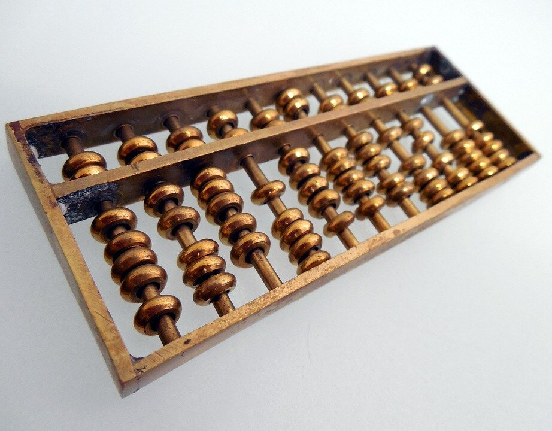<figcaption>stores and manipulates<br>information but not a machine<br>(not automated)</figcaption></figure>
<figure>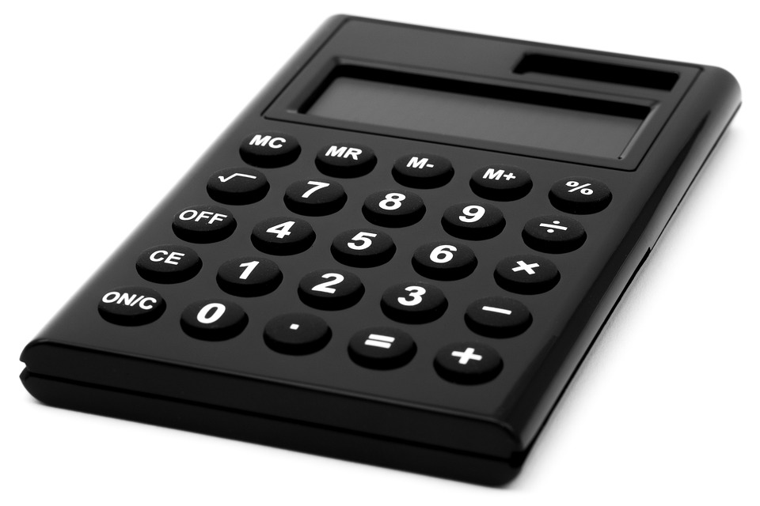<figcaption>automatically stores and<br>manipulates information but<br>not programmable</figcaption></figure>
<figure>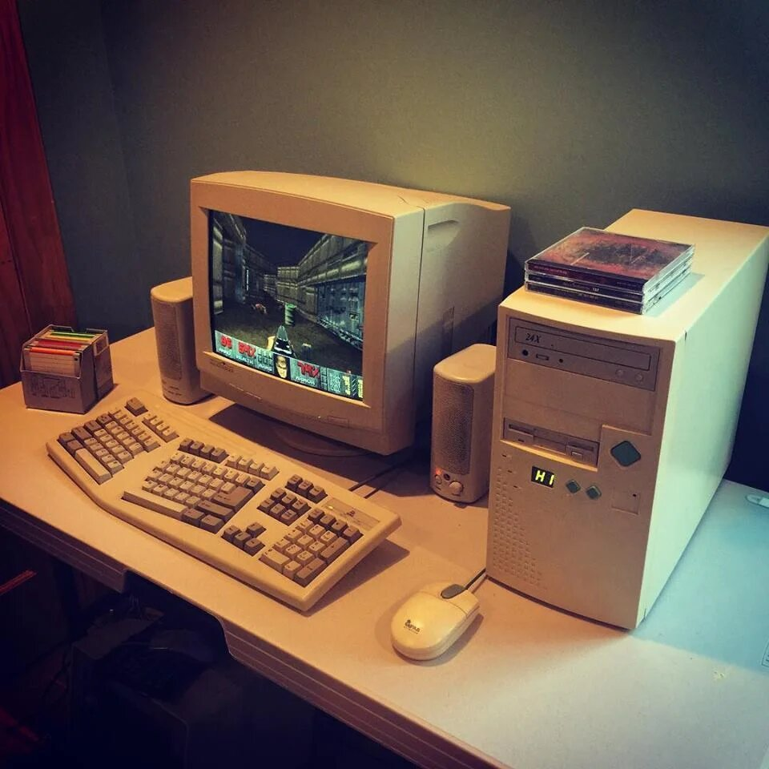<figcaption>Today: Personal computers,<br>servers, smartphones, fridges,<br>photo cameras, watches, etc</figcaption></figure>
:::

## What is Computer Science?

::: {.sm}
- What is computer science?
  - scientific and practical approach to computation
  - enable collection, representation, processing, storage and access to information
  - study of theory of computation, algorithmic processes, and design of computational machines
  - "Computer science is no more about computers than astronomy is about telescopes."<br>&nbsp;&nbsp;&nbsp;&nbsp;&nbsp;&nbsp;*(Attributed to Edsger W. Dijkstra)*
- Questions in computer science
  - What can be computed? (Finding what is computable)
  - How can we solve a problem with computation?<br>(Designing algorithms, i.e. recipes to solve problems)
:::

## What is an algorithm?

An algorithm is a self-contained step-by-step set of operations to solve a given problem. Algorithms perform calculation, data processing, and/or automated reasoning tasks.

:::: {.columns}
::: {.column width="48%"}
::: {.sm}
- Example: SelectionSort
- Problem: Sort a list of elements
- The algorithm is the set of step-by-step operations to solve the problem
- Idea: find the smallest and swap it with the first one not sorted yet
:::
:::

::: {.column width="52%"}
<pre class="pseudocode"><b>Procedure</b> SELECTION-SORT(<i>A</i>, <i>n</i>)
<i>Inputs:</i>
  <i>A</i>: an array
  <i>n</i>: the number of elements in <i>A</i> to sort
<i>Result:</i> the elements of <i>A</i> are sorted into nondecreasing order
<b>For</b> <i>i</i> = 1 to <i>n</i> - 1:
      <i>smallest</i> &larr; <i>i</i>
      <b>For</b> <i>j</i> = <i>i</i> + 1 to <i>n</i>:
            <b>If</b> <i>A</i>[<i>j</i>] &lt; <i>A</i>[<i>smallest</i>]
                  <b>then</b> <i>smallest</i> &larr; <i>j</i>
      swap <i>A</i>[<i>i</i>] with <i>A</i>[<i>smallest</i>]</pre>
:::
::::

## What is an algorithm?

:::: {.columns}
::: {.column width="50%"}
**Python Code:**

::: {style="font-size:0.84em"}
```python
def selection_sort(A, n):
    for i in range(n-1):
        smallest = i
        for j in range(i+1, n):
            if A[j] < A[smallest]:
                smallest = j
        # Swap
        temp = A[i]
        A[i] = A[smallest]
        A[smallest] = temp
    return A
```
:::
:::

::: {.column width="50%"}
**Pseudocode:**

<pre class="pseudocode" style="font-size:0.62em"><b>Procedure</b> SELECTION-SORT(<i>A</i>, <i>n</i>)
<i>Inputs:</i>
  <i>A</i>: an array
  <i>n</i>: the number of elements in <i>A</i> to sort
<i>Result:</i> the elements of <i>A</i> are sorted into nondecreasing order
<b>For</b> <i>i</i> = 1 to <i>n</i> - 1:
      <i>smallest</i> &larr; <i>i</i>
      <b>For</b> <i>j</i> = <i>i</i> + 1 to <i>n</i>:
            <b>If</b> <i>A</i>[<i>j</i>] &lt; <i>A</i>[<i>smallest</i>]
                  <b>then</b> <i>smallest</i> &larr; <i>j</i>
      swap <i>A</i>[<i>i</i>] with <i>A</i>[<i>smallest</i>]</pre>
:::
::::

## The Sciences of the Artificial

:::: {.columns}
::: {.column width="69%"}
::: {.xs}
- Herbert Simon (1916 &ndash; 2001): Political scientist with great influence in Economics (Nobel Prize) and Computer Science
- Artificial Sciences versus Natural Sciences
  - Artificial sciences study what humans create
  - Artificial sciences are not only *descriptive* but also ***prescriptive***: they try to find what we should do, not just how things are
  - E.g. economists look for a tax incentive to drive innovation
  - E.g. sociologists look for a policy to reduce gender inequality
  - E.g. computer scientists look for programs that guide a robot through a maze, or decide whom to interview for a job, who gets parole, or where to place refugees
- Prescriptive sciences study phenomena with a *purpose*
:::
:::

::: {.column width="30%"}
::: {.imgcol}
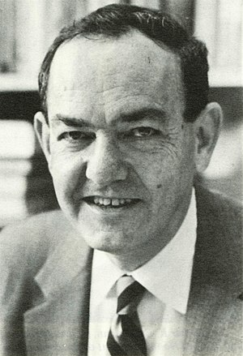{height="7.5em"}

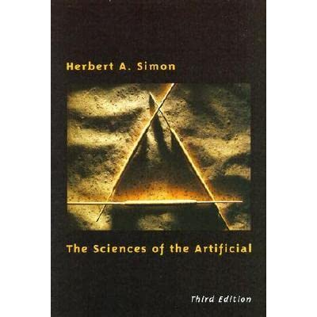{height="7.5em"}
:::
:::
::::

## Antecessors of Computer Science

::: {.timeline}
<span class="year">~ 300 B.C.</span><span class="event">Euclidian algorithm</span>
<span class="year">820 A.D.</span><span class="event">Al-Khwarizmi lays foundation for "algorithms"</span>
<span class="year">1305</span><span class="event">Ramon Llull's mechanical logic</span>
:::

::: {.imgrow}
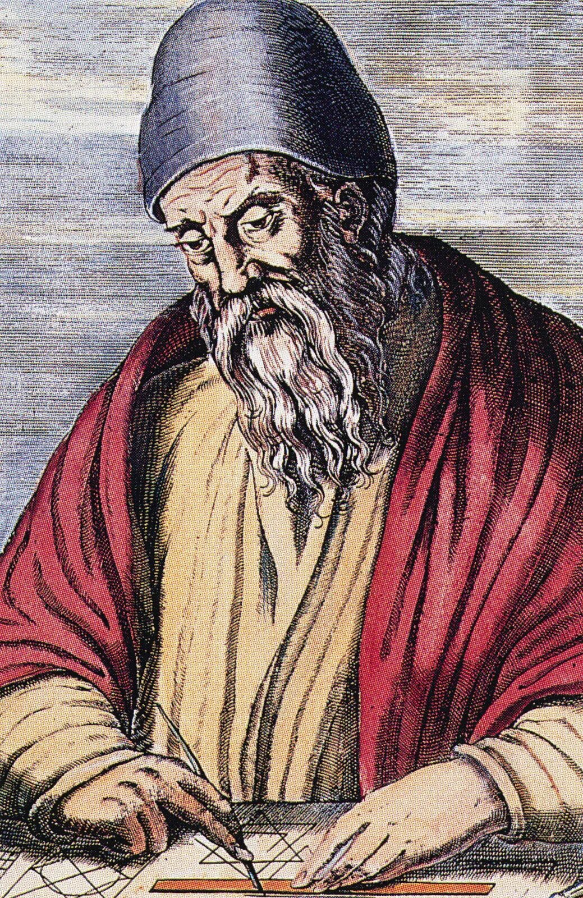{height="6.08em"}
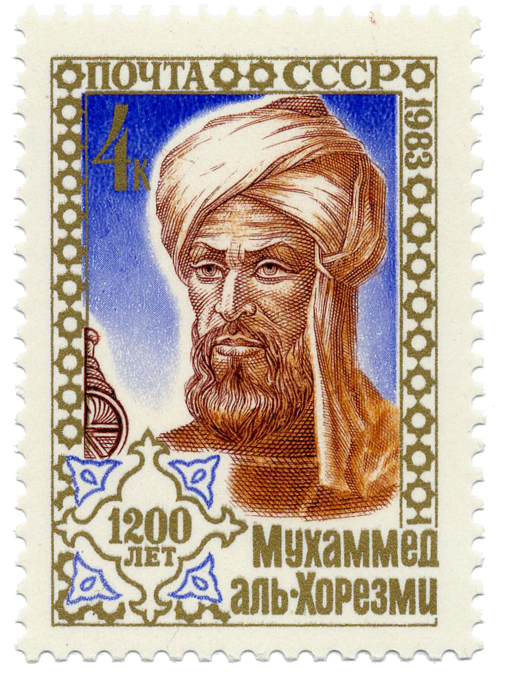{height="6.64em"}
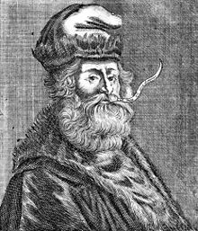{height="8.16em"}
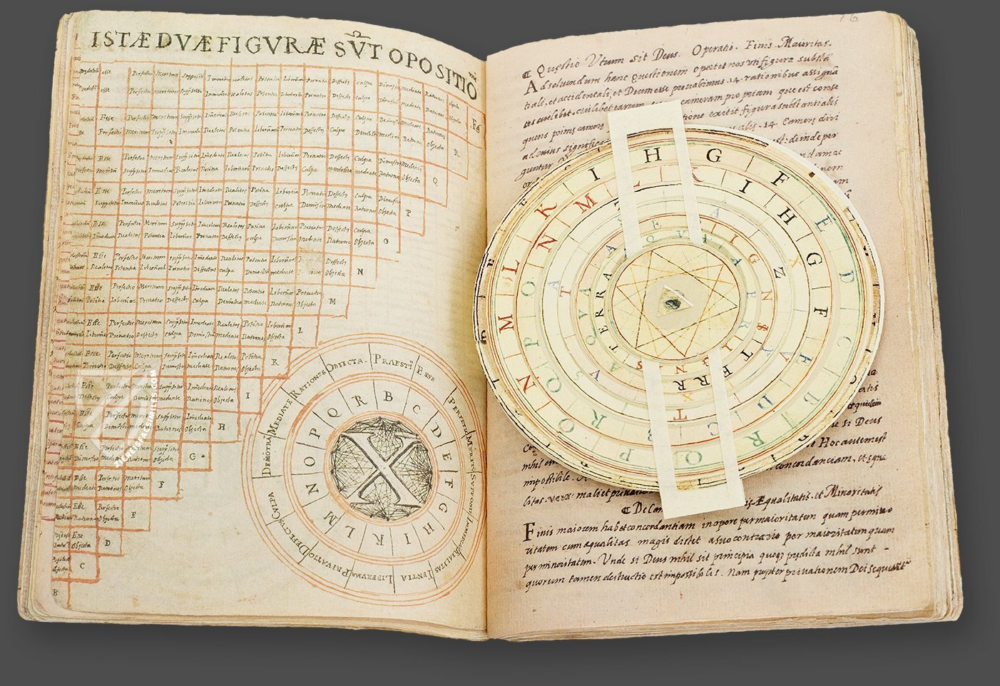{height="7.68em"}
:::

## The First Concept of Computers

::: {.timeline}
<span class="year">1837</span><span class="event">Charles Babbage's Analytical Engine</span>
<span class="year">1843</span><span class="event">Ada Lovelace's first computer program</span>
:::
</br>

::: {.imgrow}
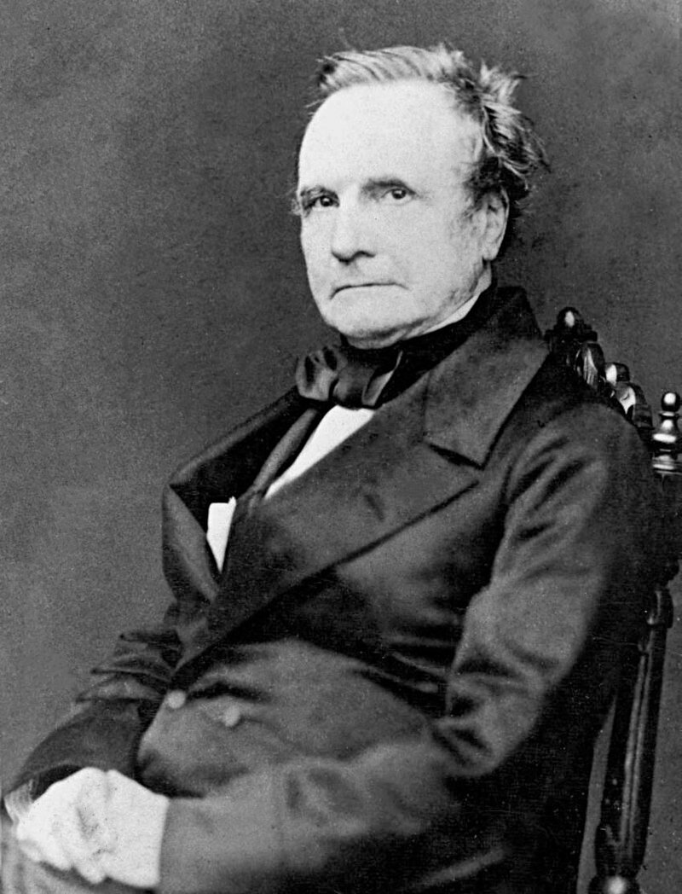{height="7.36em"}
{height="7.36em"}
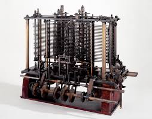{height="5.92em"}
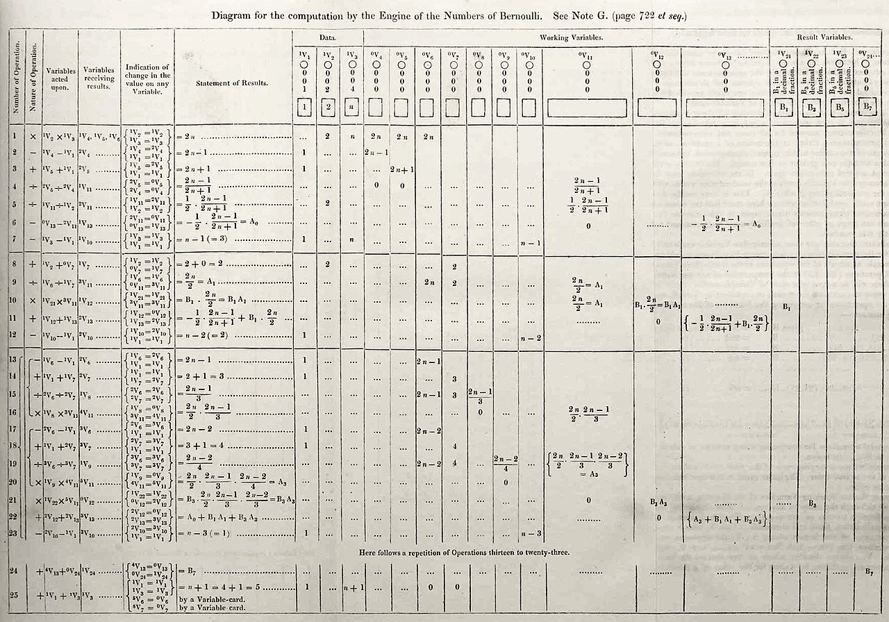{height="5.76em"}
:::

## The First Real Computers

::: {.timeline}
<span class="year">1941</span><span class="event">Konrad Zuse's first functioning computer Z3</span>
<span class="year">1944</span><span class="event">Colossus Mark 2 computer breaks the Lorenz cipher</span>
:::

::: {.imgrow}
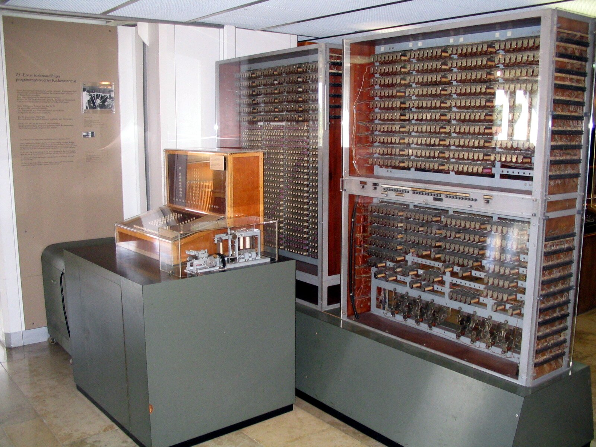{height="10.24em"}
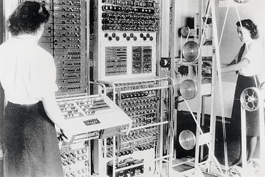{height="10.24em"}
:::

## Computing Goes Industrial

::: {.timeline}
<span class="year">1954</span><span class="event">First transistor computer TRADIC at Bell Labs</span>
<span class="year">1969</span><span class="event">First message sent via the *ARPANET*</span>
:::

::: {.imgrow}
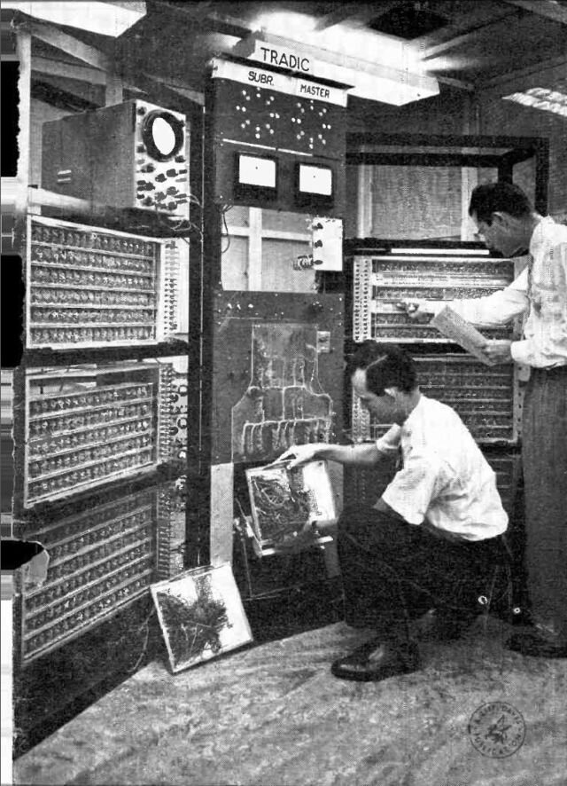{height="12.16em"}
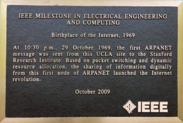{height="10.24em"}
:::

## The PC era

::: {.timeline}
<span class="year">1972</span><span class="event">Introduction of the *C* programming language</span>
<span class="year">1981</span><span class="event">IBM PC delivered</span>
<span class="year">1990 -</span><span class="event">Development of the WWW at CERN, Switzerland</span>
:::

::: {.imgrow}
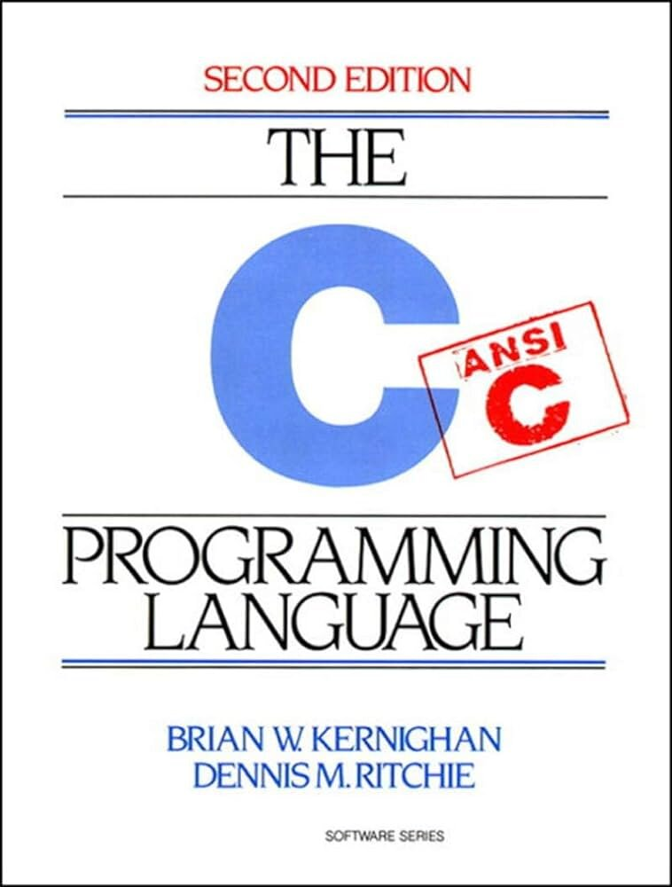{height="8.8em"}
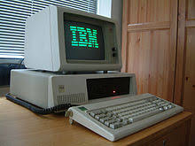{height="7.2em"}
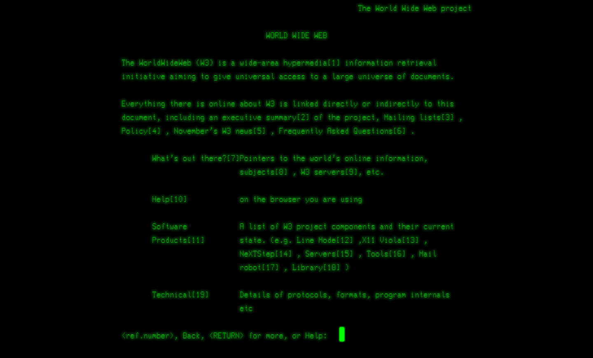{height="8.32em"}
:::

## The AI era

:::: {.columns}
::: {.column width="42%"}
::: {.imgcol}
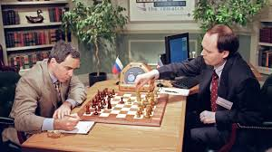{height="9.0em"}

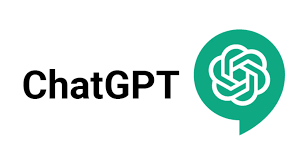{height="4.6em"}
:::
:::

::: {.column width="58%"}
::: {.timeline}
<span class="year">1997</span><span class="event">Deep Blue beats Garry Kasparov</span>
<span class="year">2016</span><span class="event">AlphaGo beats Lee Sedol</span>
<span class="year">2022</span><span class="event">AI becomes popular with ChatGPT</span>
:::

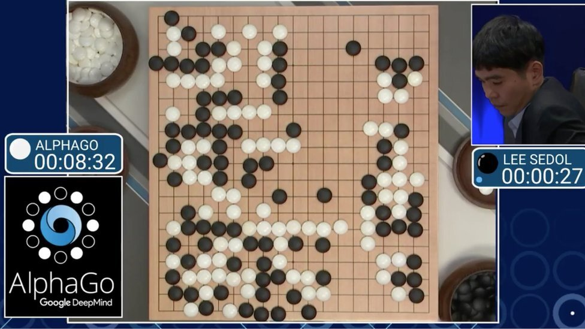{height="10.4em"}
:::
::::

## Subfields of Computer Science

:::: {.columns}
::: {.column width="46%"}
::: {.sm}
**Computer Engineering**

- Microprocessor technology
- Computer architecture
- Communication between machines
:::

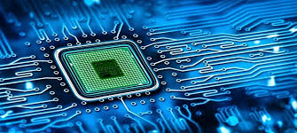{height="6.56em"}
:::

::: {.column width="54%"}
::: {.imgcol}
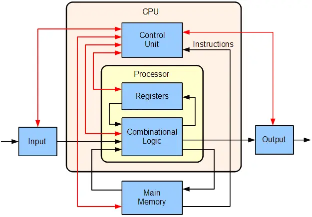{height="8.8em"}

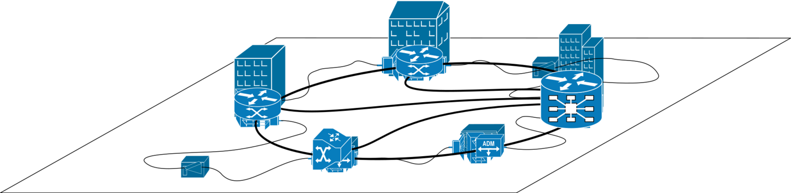{height="4.32em"}
:::
:::
::::

## Subfields of Computer Science

:::: {.columns}
::: {.column width="46%"}
::: {.sm}
**Theoretical Computer Science**

- Automata theory and formal languages
- Complexity theory
- Quantum computing
:::

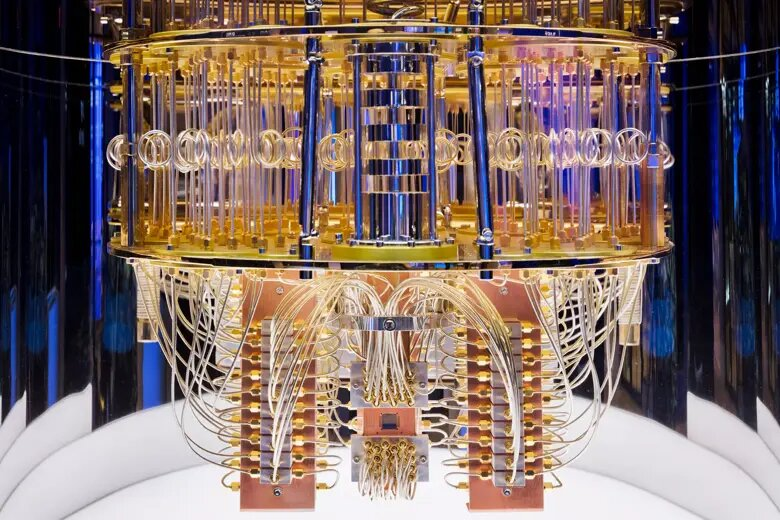{height="6.6em"}
:::

::: {.column width="54%"}
::: {.imgcol}
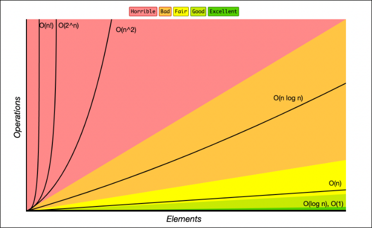{height="8em"}

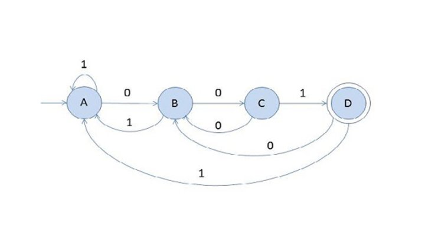{height="8.0em"}
:::
:::
::::

## Subfields of Computer Science

:::: {.columns}
::: {.column width="46%"}
::: {.sm}
**Applied Computer Science**

- Programming languages
- Algorithms and data structures
- Operating systems
- Databases
- Software development
:::

:::

::: {.column width="54%"}
::: {.imgcol}
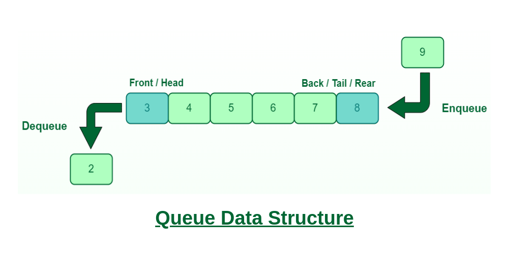{height="6.4em"}

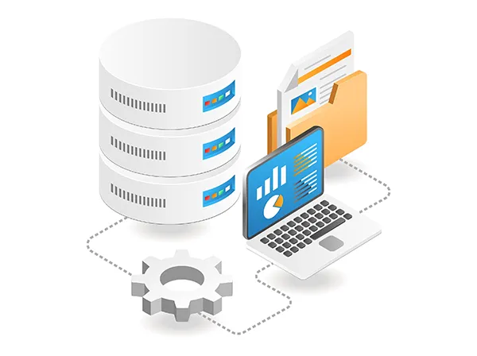{height="8em"}
:::
:::
::::

## Subfields of Computer Science

:::: {.columns}
::: {.column width="46%"}
::: {.sm}
**Interdisciplinary Fields**

- Business informatics
- Computer vision
- Artificial intelligence
- Computational linguistics
- Bioinformatics
- Medical informatics
- Media informatics
- Human-Computer Interaction (HCI)
- **Computational Social Science**
:::
:::

::: {.column width="54%"}
::: {.imgcol}
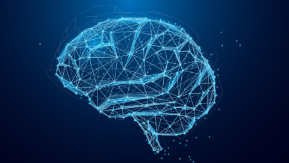{height="7.04em"}

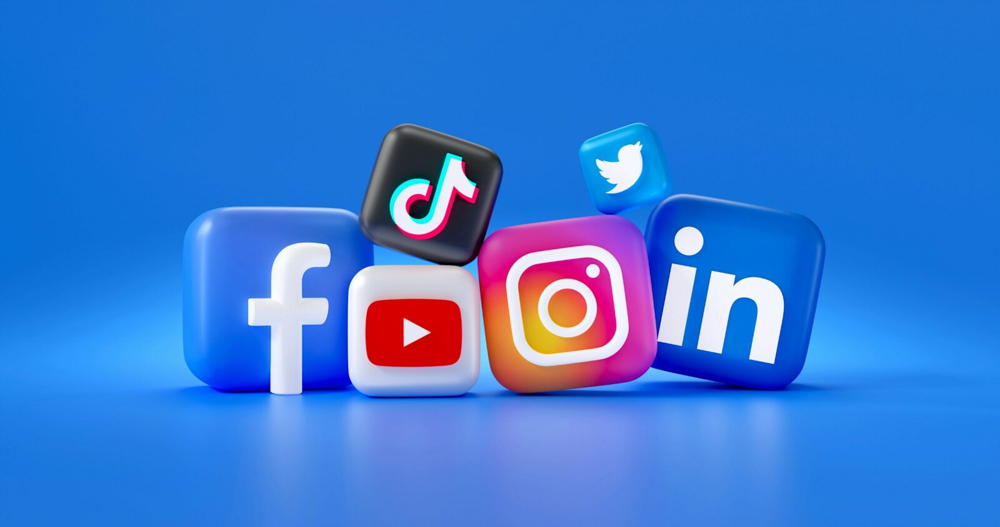{height="6.72em"}
:::
:::
::::

## Literature {.fit1}


- No single book covers the course; each lecture gives references for its topic
- Two broader reference books complement the content taught in the lectures
  - 'Introduction to Computing - Explorations in Language, Logic, and Machines' by Evans
  - Algorithms Unlocked by Thomas H. Cormen
  - 'Introduction to Computation and Programming Using Python' by Guttag
- For advanced reading on algorithm and data structures:<br>'Introduction to Algorithms' by Cormen, Leiserson, Rivest, and Stein 
- Aim of new transcripts: To provide a self-contained alternative to jumping around book chapters and to harmonize terminology and nomenclature over the whole course


## Summary {.fit1}

- Computing is now part of how social science collects, measures and models data
- A computer is a machine that executes a stored program on data, following instructions exactly
- Computer science studies what can be computed, and how efficiently
- An algorithm is a self-contained, step-by-step set of operations; selection sort was our first example
- Computing is a science of the artificial, with a history from the abacus to AI
- The course pairs theory (lectures and exercises) with practice (Python tutorials)

> **Next session:** Information Coding

