## Course Outline

:::: {.columns}
::: {.column width="50%"}
::: {.sm}
- *Session 1: Introduction*
- **Session 2: Information Coding**
- Session 3: Data Structures
- Session 4: Programming
- Session 5: Algorithms
- Session 6: Recursion
- Session 7: Sorting Algorithms
:::
:::

::: {.column width="50%"}
::: {.sm}
- Session 8: Time Complexity
- Session 9: Theoretical Computer Science
- Session 10: Machine Learning
- Session 11: Databases
- Session 12: Parallel Programming
- Session 13: Social Science Applications
- Session 14: Exam Review
:::
:::
::::

## Outline

::: {.outline}
1. Information Coding
2. Conversion Between Number Coding Systems
3. Character Coding
4. Python Data Types and Binary Operations
:::


<!-- MOTIVATION:M02-A:BEGIN -->
## Information coding matters (I) {.fit1}

::: {.motivation}
[Excel renaming genes]{.label}
An audit of 3,597 published genetics papers found that **704 of them, one in
five, contained corrupted gene names.** The spreadsheet had read `SEPT2` as a
date and stored it as `2-Sep`; identifiers like `2310009E13` became
`2.31E+13`.
:::

- **20%** of papers affected
- **0** warnings shown
- **27** genes renamed in 2020 so the software would stop breaking them

[What is a spreadsheet actually storing when it shows you `SEPT2`, and who decided what it means?]{.ask}

::: {.source}
Ziemann, Eren & El-Osta, *Genome Biology* (2016); Bruford et al., *Nature Genetics* (2020)
:::
<!-- MOTIVATION:M02-A:END -->


<!-- MOTIVATION:M02-C:BEGIN -->
## Information coding matters (II) {.fit1}

::: {.motivation}
[The stock index that lost half of its value]{.label}
The Vancouver Stock Exchange index opened at **1000.000** in 1982 and
was recomputed after every trade. Months later it read **524.811**, while
the shares it tracked had risen. Each
recomputation **truncated** the fourth decimal instead of rounding, thousands of
times a day.
:::

- **1000.000:** when launced launch in Jan 1982
- **524.811:** value displayed in Nov 1983
- **1098.892:** true value, once recomputed

[Why can't a computer store 0.1 exactly, and what does that cost after a million additions?]{.ask}

::: {.source}
Toronto Star, 29 Nov 1983; discussed in Higham, *Accuracy and Stability of Numerical Algorithms*
:::
<!-- MOTIVATION:M02-C:END -->

## What is information?

::: {.center-h}
{width="86%"}

In Computer Science, information is the representation of knowledge
:::

## Encoding information

Information is encoded by recording changes in knowledge.<br>
For example, what we learn from the answer to a question

::: {.imgrow .middle}
{height="9.4em"}
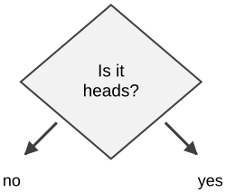{height="8.6em"}
:::

## Measuring information in bits

:::: {.columns}
::: {.column width="42%"}
::: {.sm}
Each yes/no question gives us a **bit** of information.

How many bits do we learn from the result of a dice throw?

This depends on how we ask to find out the dice result, i.e. **how we encode the information**
:::

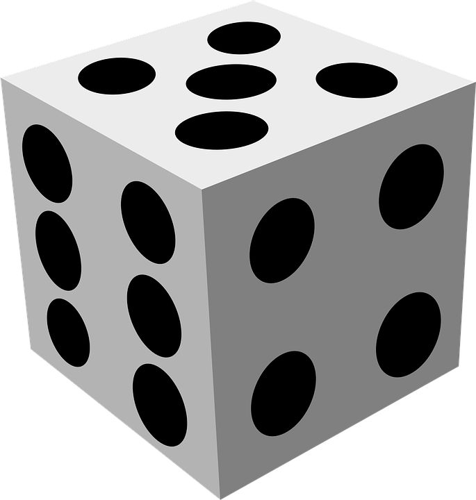{height="3.8em"}
:::

::: {.column width="58%"}
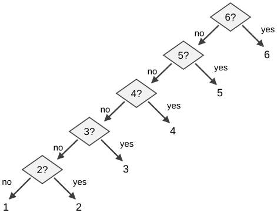{height="9.2em"}
:::
::::

## Measuring information in bits

:::: {.columns}
::: {.column width="42%"}
::: {.sm}
Each yes/no question gives us a **bit** of information.

How many bits do we learn from the result of a dice throw?

This depends on how we ask to find out the dice result, i.e. **how we encode the information**
:::

{height="3.8em"}
:::

::: {.column width="58%"}
{height="9.2em"}
:::
::::

::: {.sm}
On average we will need to ask 20/6 questions (3.33). Can we do better?
:::

## Encoding information more efficiently

::: {.center-h}
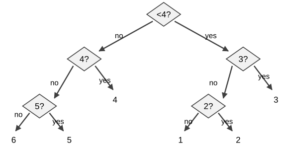{height="10.3em"}
:::

::: {.sm}
- This way we only need 16/6 questions on average (2.66)
- Each yes/no question doubles the number of possibilities,
  - e.g. a result with 8 equally likely possibilities has 3 bits of information
:::

## Encoding information more efficiently

::: {.center-h}
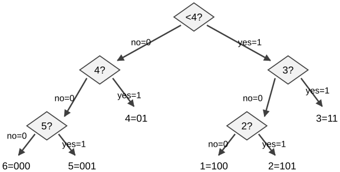{height="10.3em"}
:::

::: {.sm}
- Encoding the result of a dice (1-6) with three bits (0 or 1)
- **Prefix code**: no coding is a prefix of another, allows unambiguous encoding
:::

## Decoding information

::: {.center-h}
{height="10.3em"}
:::

::: {.sm}
- To decode, we translate codes back to the values they mean
- For example, if we encoded the following bits, what were the results of the dice?

::: {.center-h}
`1101000100101`
:::
:::

## Storing information digitally

:::: {.columns}
::: {.column width="55%"}
::: {.sm}
- Smallest physical information unit is 1 **bit**
  - no/yes is represented as 0/1
  - memory: a capacitor or a capacitor and several transistors
  - hard disk: magnetization

<br>

- Smallest logical unit is 1 **byte**: 8 bit
  - *logical* means that it can be accesses with a memory address and operated on
  - processors can usually only address entire bytes, i.e. information in chunks of 8 bits
:::
:::

::: {.column width="45%"}
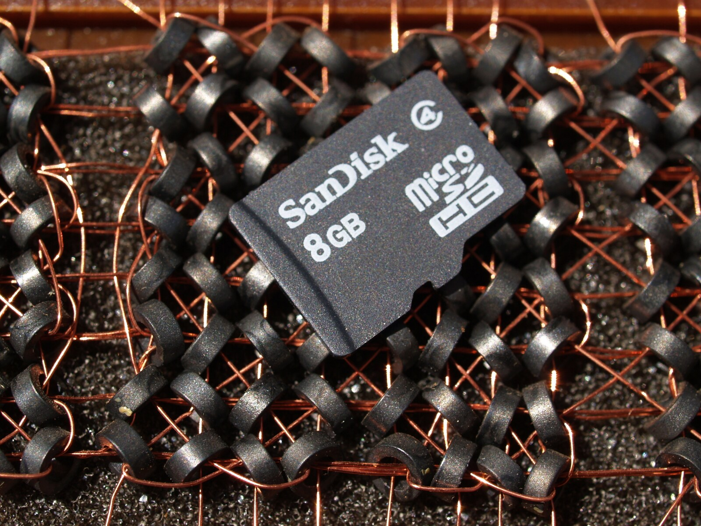{height="9.6em"}
:::
::::

## How memory works

:::: {.columns}
::: {.column width="52%"}
::: {.xs}
- Bits in chips are encoded as voltage values (e.g. 0 = 0 Volts, 1 = +5 Volts)
- Memory chips have three inputs
  - A line called "select" to activate
  - A line to specify read/write
  - An address line with several bits to select the row where to read/write
- The address decoder activates the corresponding row of the chip
- The data bus outputs the content of the row (read case) or contains the new value (write case)
:::
:::

::: {.column width="48%"}
::: {.imgcol}
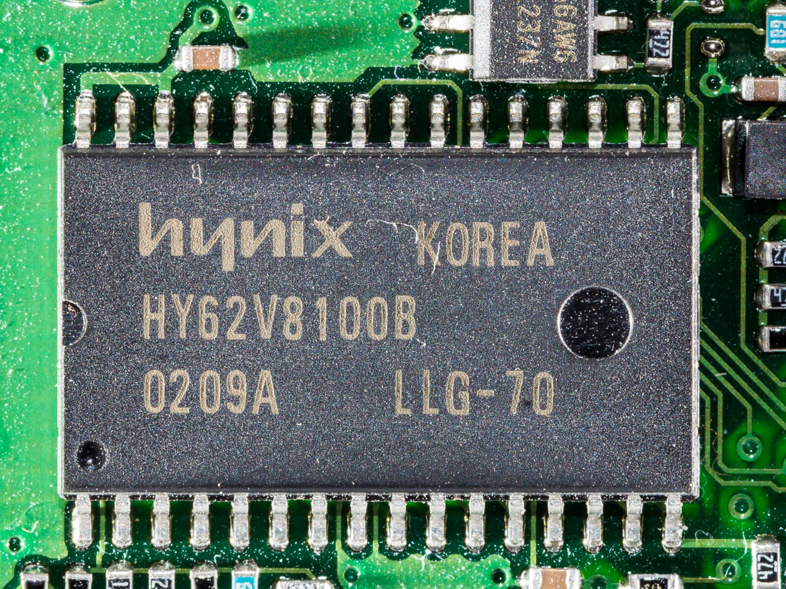{height="4.6em"}

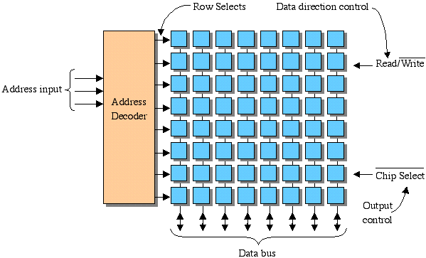{height="8.4em"}
:::

::: {.source}
[Tarnoff, ETSU: computer memory](https://faculty.etsu.edu/tarnoff/ntes2150/memory/memory.htm)
:::
:::
::::

## Conversion Between Number Coding Systems

::: {.outline .focus}
1. Information Coding
2. [Conversion Between Number Coding Systems]{.current}
3. Character Coding
4. Python Data Types and Binary Operations
:::

## Positional number systems

:::: {.columns}
::: {.column width="70%"}
::: {.xs}
- Value of digit depends on its position
- Composed of a finite number of numeric symbols (a.k.a. alphabet)
- Each position represents a specific value $\text{base}^k$  
($\text{base}^3\ \text{base}^2\ \text{base}^1\ \text{base}^0$)
- Examples:
  - Decimal number system:
    - In 12, digit 1 has value 10
    - in 1200 digit 1 has value 1000
  - Unary number system: to represent number $N$, an arbitrary symbol representing 1 is repeated $N$ times
- Positional number systems require a symbol for zero.
  - e.g. the Mayas are a base-20 positional number system
:::
:::

::: {.column width="30%"}
{width="100%"}

::: {.source}
[Wikipedia: Maya numerals](https://en.wikipedia.org/wiki/Maya_numerals)
:::
:::
::::

## The base of a positional number system

::: {.sm}
- Base is also often referred to as **radix**
  - base 10: decimal notation (0 &ndash; 9)
  - base 2: binary notation (0, 1)
  - base 8: octal notation (0 &ndash; 7)
  - base 16: hexadecimal notation (0 &ndash; 9, A &ndash; F)

<br>

- Notation convention is to indicate the base, if not clearly known, as subscript
  - $7_{10} = 7_8 = 111_2$
  - $9_{10} = 11_8 = 1001_2$
  - $14_{10} = 16_8 = 1110_2$
:::

## Conversions Between Systems: Informal Example

- Which is greater: $47_8$ or $43_{10}$ ?

## Conversions Between Systems: Informal Example

- Which is greater: $47_8$ or $43_{10}$ ?

<br>

- Convert from octal to decimal notation

<br>

::: {.center-h}
$47_8 = 7 \times 8^0 + 4 \times 8^1 = 39_{10}$
:::

## Conversions Between Systems: Informal Example

- Which is greater: $47_8$ or $43_{10}$ ?

<br>

- Convert from decimal to octal notation

<br>

::: {.center-h}
$43_{10} = 3 \times 8^0 + 5 \times 8^1 = 53_8$
:::

## Informal examples

::: {.sm}
**Decimal notation**

- $5648_{10} = 8 \times 10^0 + 4 \times 10^1 + 6 \times 10^2 + 5 \times 10^3$

<br>

**Octal to decimal**

- $1346_8 = 6 \times 8^0 + 4 \times 8^1 + 3 \times 8^2 + 1 \times 8^3 = 742_{10}$

<br>

**Hexadecimal to decimal**

- $\text{CB6}_{16} = 6 \times 16^0 + 11 \times 16^1 + 12 \times 16^2 = 3254_{10}$
:::

**How can we do this formally for any base?**


## Conversions Between Number Systems: Algorithm {.fit1}

::: {.sm}
- Conversion of a **decimalinteger $n \geq 0$ to binary** notation
:::

:::: {.columns}
::: {.column width="56%"}
<pre class="pseudocode"><b>Procedure</b> DECIMAL-TO-BINARY(<i>n</i>)
<i>Inputs:</i>
  <i>n</i>: a positive integer written in decimal
<i>Result:</i> the binary digits of <i>n</i>, written as <i>x</i><sub><i>k</i>-1</sub> … <i>x</i><sub>1</sub> <i>x</i><sub>0</sub>
<i>k</i> &larr; 0
<b>While</b> <i>n</i> &gt; 0:
      <i>x</i><sub><i>k</i></sub> &larr; <i>n</i> <b>mod</b> 2
      <i>n</i> &larr; ⌊<i>n</i>/2⌋
      <i>k</i> &larr; <i>k</i> + 1
<b>return</b> <i>x</i><sub><i>k</i>-1</sub> … <i>x</i><sub>1</sub> <i>x</i><sub>0</sub></pre>
:::

::: {.column width="44%"}
::: {.center-h}
**Example**

::: {.tbl-grid .xs style="display:inline-block"}
| Division | Quotient | Remainder |
|---|---|---|
| 190 : 2 = | 95 | 0 |
| 95 : 2 = | 47 | 1 |
| 47 : 2 = | 23 | 1 |
| 23 : 2 = | 11 | 1 |
| 11 : 2 = | 5 | 1 |
| 5 : 2 = | 2 | 1 |
| 2 : 2 = | 1 | 0 |
| 1 : 2 = | 0 | 1 |
:::

$190_{10} = 1011\,1110_2$
:::
:::
::::

## Conversions Between Number Systems: Algorithm

::: {.sm}
- Generalization: conversion of a **decimal integer $n \geq 0$ to base-$\beta$** notation
:::

<pre class="pseudocode" style="width:70%"><b>Procedure</b> DECIMAL-TO-BASE(<i>n</i>, <i>β</i>)
<i>Inputs:</i>
  <i>n</i>: a positive integer written in decimal
  <i>β</i>: the target base
<i>Result:</i> the digits of <i>n</i> in base <i>β</i>, written as <i>x</i><sub><i>k</i>-1</sub> … <i>x</i><sub>1</sub> <i>x</i><sub>0</sub>
<i>k</i> &larr; 0
<b>While</b> <i>n</i> &gt; 0:
      <i>x</i><sub><i>k</i></sub> &larr; <i>n</i> <b>mod</b> <i>β</i>
      <i>n</i> &larr; ⌊<i>n</i>/<i>β</i>⌋
      <i>k</i> &larr; <i>k</i> + 1
<b>return</b> <i>x</i><sub><i>k</i>-1</sub> … <i>x</i><sub>1</sub> <i>x</i><sub>0</sub></pre>


## Converting between power of 2 bases

::: {.sm}
- Conversion of **octal to binary** notation
  - every digit 0 - 7 can be represented exactly by 3 binary digits
    - allows for elegant and fast conversion digit by digit using blocks of 3 binary digits
:::

::: {.example style="width:60%;margin:0.6em auto"}
[Examples]{.label}

- $47_8 = 39_{10} = ?_2$
:::

## Converting between power of 2 bases {.fit1}

::: {.sm}
- Conversion of **octal to binary** notation
  - every digit 0 &ndash; 7 can be represented exactly by 3 binary digits
    - allows for elegant and fast conversion digit by digit using blocks of 3 binary digits
:::

::: {.example .sm style="width:96%;margin:0.6em auto"}
[Examples]{.label}

- $47_8 = 39_{10} = 1 \times 2^0 + 1 \times 2^1 + 1 \times 2^2 + 0 \times 2^3 + 0 \times 2^4 + 1 \times 2^5 = 100\,111_2$
:::

## Converting between power of 2 bases

::: {.sm}
- Conversion of **octal to binary** notation
  - every digit 0 &ndash; 7 can be represented exactly by 3 binary digits
    - allows for elegant and fast conversion digit by digit using blocks of 3 binary digits
:::

::: {.example .sm style="width:52%;margin:0.4em auto"}
[Examples]{.label}

- $47_8 = 100\,111_2$
- $134_8 = ?_2$
- $460231_8 = ?_2$
:::

::: {.tbl-seeblau .sm}
| Oct | 0 | 1 | 2 | 3 | 4 | 5 | 6 | 7 |
|---|---|---|---|---|---|---|---|---|
| **Binary** | 000 | 001 | 010 | 011 | 100 | 101 | 110 | 111 |
:::

## Converting between power of 2 bases

::: {.sm}
- Conversion of **binary to octal** notation
  - divide binary digits into groups of three bits and convert each group of bits to an octal digit
:::

::: {.example style="width:52%;margin:0.4em auto"}
[Examples]{.label}

- $101\,011_2 = 53_8$
- $010\,011\,100\,101\,111_2 = 23457_8$
:::

::: {.tbl-seeblau .sm}
| Oct | 0 | 1 | 2 | 3 | 4 | 5 | 6 | 7 |
|---|---|---|---|---|---|---|---|---|
| **Binary** | 000 | 001 | 010 | 011 | 100 | 101 | 110 | 111 |
:::

## Converting between power of 2 bases

::: {.sm}
- Conversion of **hexadecimal to binary** notation (also noted with `0x` prefix)
  - every digit 0 &ndash; 9 and letters A &ndash; F can be represented by exactly 4 binary digits
  - allows for elegant and fast conversion digit by digit using blocks of 4 binary digits
:::

::: {.example style="width:70%;margin:0.4em auto"}
[Examples]{.label}

- `0x23A7` $= 23\text{A}7_{16} = 0010\,0011\,1010\,0111_2$
- `0xB3D2` $= \text{B}3\text{D}2_{16} = 1011\,0011\,1101\,0010_2$
:::

::: {.tbl-seeblau .xxs}
| Hex | 0 | 1 | 2 | 3 | 4 | 5 | 6 | 7 | 8 | 9 | A | B | C | D | E | F |
|---|---|---|---|---|---|---|---|---|---|---|---|---|---|---|---|---|
| **Binary** | 0000 | 0001 | 0010 | 0011 | 0100 | 0101 | 0110 | 0111 | 1000 | 1001 | 1010 | 1011 | 1100 | 1101 | 1110 | 1111 |
:::

## Converting fractions

::: {.sm}
- Conversion of a fractional number $n$ **with only decimal places to binary** notation
  - notation of a binary number with decimal places is $0.x_{-1} x_{-2} \dots x_{-k}$
:::

:::: {.columns}
::: {.column width="55%"}
<pre class="pseudocode"><b>Procedure</b> FRACTION-TO-BINARY(<i>n</i>)
<i>Inputs:</i>
  <i>n</i>: a number written in decimal, with 0 &lt; <i>n</i> &lt; 1
<i>Result:</i> the binary digits of <i>n</i>, written as 0.<i>x</i><sub>-1</sub> <i>x</i><sub>-2</sub> … <i>x</i><sub>-(<i>k</i>-1)</sub>
<i>k</i> &larr; 1
<b>While</b> <i>n</i> &gt; 0:
      <i>x</i><sub>-<i>k</i></sub> &larr; ⌊2<i>n</i>⌋
      <i>n</i> &larr; 2<i>n</i> - <i>x</i><sub>-<i>k</i></sub>
      <i>k</i> &larr; <i>k</i> + 1
<b>return</b> 0.<i>x</i><sub>-1</sub> <i>x</i><sub>-2</sub> … <i>x</i><sub>-(<i>k</i>-1)</sub></pre>
:::

::: {.column width="45%"}
::: {.sm}
**Example:**

| | | Value |
|---|---|---|
| 0.34375 | × 2 = 0.6875 | 0 |
| 0.6875 | × 2 = **1**.375 | 1 |
| 0.375 | × 2 = 0.75 | 0 |
| 0.75 | × 2 = **1**.5 | 1 |
| 0.5 | × 2 = **1**.0 | 1 |

$0.34375_{10} = 0.01011_2$
:::
:::
::::

## Negative Binary Numbers: One's Complement

:::: {.columns}
::: {.column width="60%"}
::: {.sm}
- **Ones' Complement**
  - leading bit codes the sign (0: +, 1: &ndash;)
  - $k-1$ digits to represent the absolute value of a given number
  - negation by inverting of the number
    - bit-wise flipping of 1s and 0s
  - Problem: there are two representations of 0:
    - `0000 0000`
    - `1111 1111`
  - Why is this a problem?
:::
:::

::: {.column width="40%"}
::: {.example}
[Example]{.label}

- $\underline{0}001\,1011_2 = 27_{10}$
- $\underline{1}110\,0100_2 = -27_{10}$
:::
:::
::::

## Negative Binary Numbers: Two's Complement

:::: {.columns}
::: {.column width="58%"}
::: {.sm}
- **Two's Complement**
  - leading bit codes the sign (0: +, 1: &ndash;)
  - negation by:
    1. flipping the bits of the number
    2. adding one
  - unique representation of 0: `0000 0000`
:::

::: {.example}
[Example]{.label}

$27_{10} = 0001\,1011_2$

$\phantom{27_{10} = {}} 1110\,0100_2$ &nbsp;&nbsp;(inverted)

$\phantom{27_{10} = {}} 1110\,0101_2 = -27_{10}$
:::
:::

::: {.column width="42%"}
{height="12.0em"}
:::
::::

## Overflow {.fit1}

:::: {.columns}
::: {.column width="55%"}
::: {.sm}
- **When an operation causes a value to go beyond the limits of its encoding**
:::

::: {.example}
[Example in 2's complement:]{.label}

::: {.sm}
$0111\,1111$ &nbsp; $(127_{10})$<br>
$+$<br>
$0000\,0111$ &nbsp; $(7_{10})$<br>
$1000\,0110$ &nbsp; $(134_{10}?$ No! $-122_{10})$
:::
:::

::: {.sm}
- Other typical example is division by zero
- Operating system or programming language throws a warning or an error.
:::
:::

::: {.column width="45%"}
{height="15em"}
:::
::::

## Floating-Point numbers: IEEE 754

::: {.sm}
- Standardized according to IEEE 754:
  - single or double precision (32 or 64 bit, `float` or `double`)
  - 1 bit for the **sign of mantissa**: $s = (-1)^S$
  - 8/11 bit **biased exponent**: $e = E - B$
    - bias permits to have a longer range of negative exponents
    - $B = 127$ or $B = 1023$
  - 23/52 bit **normalized mantissa** with implicit 1: $m = 1.M$
    - leading 1 is not explicitly stored
    - mantissa and exponent are adjusted accordingly (normalized)
:::

## Floating-Point numbers: IEEE 754

::: {.xs}
- Standardized according to IEEE 754:
  - single or double precision (32 or 64 bit, `float` or `double`)
  - 1 bit for the **sign of mantissa**: $s = (-1)^S$
  - 8/11 bit **biased exponent**: $e = E - B$
  - 23/52 bit **normalized mantissa** with implicit 1: $m = 1.M$
:::

::: {.imgrow .middle}
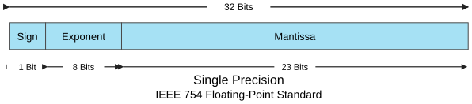{width="49%"}
{width="49%"}
:::

## Floating-Point numbers: IEEE 754

::: {.imgrow .middle}
{width="49%"}
{width="49%"}
:::

::: {.sm}
- Special representation for
  - 0 : exponent and mantissa are both 0
    - there is a positive and a negative 0
  - infinity : exponent $E$ only 1s, mantissa $M = 0$
- Value ranges: &nbsp; single precision: $1.4 \cdot 10^{-45} \leq |z| \leq 3.4 \cdot 10^{38}$
- <span style="visibility:hidden">Value ranges:</span> &nbsp; double precision: $4.9 \cdot 10^{-324} \leq |z| \leq 1.7 \cdot 10^{308}$
:::

## Floating-Point numbers: IEEE 754

::: {.example}
[Example: Decimal value to float value]{.label}

::: {.sm}
**18.625** in single precision

- bias $B = 127 = 2^7 - 1$
- transform to binary notation: $18.625_{10} = 10010.101000\dots_2$
- normalize to calculate exponent: $10010.101000\dots_2 = 1.0010101000\dots \cdot 2^4$
- exponent with bias: $E = 4_{10} + 127_{10} = 131_{10} = 1000\,0011_2$
- sign $S = 0$
- result: `0|10000011|00101010000000000000000`
:::
:::

## Floating-Point numbers: IEEE 754

::: {.example}
[Example: Float value to decimal value]{.label}

::: {.sm}
`1|10010011|10100000000000000000000` in single precision

- sign $S = 1$, i.e., a negative number
- exponent $E = 147 = 127 + 20$, i.e., $e = 20$
- mantissa $m = 1 + 1 \cdot 2^{-1} + 1 \cdot 2^{-3} = 1.625$
- result
  - $-1.625 \cdot 2^{20} = -1\,703\,936.0$
:::
:::

## Numerical formats matter in AI

::: {.sm}
AI models require a lot of memory in GPU (VRAM). Models are based on parameters that are often fitted as floating-point numbers.
:::

:::: {.columns}
::: {.column width="52%"}
::: {.sm}
Common formats in AI:

- FP32 (32-bit Floating-Point)
- FP16 (16-bit Floating-Point / Half-Precision)
- BF16 (bfloat16 / Brain Floating Point)
- FP8 (8-bit Floating-Point)
- INT8 (8-bit Integer, for Quantized Models)
- INT4 / INT2 (Quantized, Low-Bit Formats)
:::
:::

::: {.column width="48%"}
::: {.tbl-grid .sm}
| Model Size | FP16 | FP8 | INT4 |
|---|---|---|---|
| 8B | 16 GB | 8 GB | 4 GB |
| 70B | 140 GB | 70 GB | 35 GB |
| 405B | 810 GB | 405 GB | 203 GB |
:::
</br>

- Llama 3.1 &ndash; 405B, 70B & 8B<br>memory requirements by precision
- Lower precision affects model performance

:::
::::

## Underflow: Rounding errors in Floating-Point

:::: {.columns}
::: {.column width="55%"}
::: {.sm}
- Limited value range
  - can not represent every possible number
  - in practice double precision does cover most cases though


- Limited precision, rounding errors
  - limited room for decimal places
  - certain decimal numbers can not be expressed precisely in binary notation:
    - very common example: 0.1
  - accumulation of small rounding errors possible
:::
:::

::: {.column width="45%"}
::: {.example}
[Rounding error example]{.label}

::: {style="font-size:0.85em"}
```python
f = 2
for i in range(1, 100):
    f += 10 ** (-1)
    print(f)
```
:::

::: {.xs}
```
>> 2.1
>> 2.2
>> 2.3000000000000003
>> 2.4000000000000004
```
:::
:::
:::
::::

## Rounding and floating point errors {.fit1}

:::: {.columns}
::: {.column width="50%"}
::: {.center-h}
{height="5.4em"}
:::
::: {.xs}
- Gulf War, 1991: Iraqi Scud missile hit American barracks in Dhahran, Saudi Arabia, killing 28 soldiers and wounding 260.
- "A 24-bit representation of 0.1 was used to multiply the clocktime, yielding a result in a pair of 24-bit registers. This was transformed into a 48-bit floating-point number."
- [“Roundoff Error and the Patriot Missile”, Robert Skeel, SIAM News (1992)](https://www.cs.unc.edu/~smp/COMP205/LECTURES/ERROR/lec23/node4.html)
:::
:::

::: {.column width="50%"}
::: {.center-h}
{height="5.4em"}
:::
::: {.xs}
- Ariane 5 maiden flight, 1996: Rocket exploded 39 seconds after liftoff.
- Error when converting horizontal velocity from a 64-bit floating point number to a 16-bit signed integer between the software of Ariane 5 and Ariane 4.
- [N° 33–1996: Ariane 501 - Presentation of Inquiry Board report](https://www.esa.int/Newsroom/Press_Releases/Ariane_501_-_Presentation_of_Inquiry_Board_report)
:::
:::
::::


## COBOL and Grace Hopper

:::: {.columns}
::: {.column width="62%"}
::: {.sm}
- COBOL is a very old programming language, designed in 1959 but still very used in banking, finance, and government
- COBOL does no rounding by default on fractions, minimizing the risk of rounding errors
- Grace Hopper, a.k.a. grandma COBOL, was an American military computer scientist that invented machine-independent programming languages, COBOL being one of the first
:::

::: {.source}
<https://www.tpr.org/technology-entrepreneurship/2019-05-23/how-cobol-still-powers-the-global-economy-at-60-years-old>
:::
:::

::: {.column width="38%"}
::: {.center-h}
{height="12.0em"}
:::
:::
::::

## Character Coding

::: {.outline .focus}
1. Information Coding
2. Conversion Between Number Coding Systems
3. [Character Coding]{.current}
4. Python Data Types and Binary Operations
:::

## ASCII &ndash; Code {.fit1}

::: {.sm}
- *American Standard Code for Information Interchange*
- Standard since 1963, still in use today
:::

::: {.center-h}
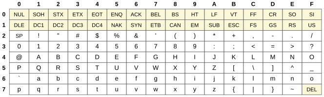{height="8.6em"}
:::

::: {.xs}
- initially 7 bit code for tele printers, all codes of US keyboard in one byte
  - 128 characters, 33 control characters, 95 printable characters
- Missing characters for other keyboards
:::

## Unicode

::: {.sm}
- In ASCII, not all possible characters can be represented, e.g., kanji, chinese
- Solution: development of standardized **Unicode**
  - simultaneous representation of all possible characters
  - version 1.0 in 1991 with a 16-bit code space (65 536 code points)
  - 2022 version (15.0) has 149,186 characters
  - Notation: `U+` and at least 4 hexadecimal numbers
    - e.g.: `U+00DF` = ß
:::

## Representation of Unicode

::: {.sm}
- 3 bytes are necessary for all possible characters
  - wasting memory in many geographical regions, e.g. Europe
- Definition of **Unicode Transformation Formats (UTF)** as solution
- **UTF-16**
  - 2 byte per characters but still wastes memory
  - other areas are covered by combination of UTF-16 characters
- **UTF-8**
  - 1 byte per character, covers most important Western characters
  - Compatible with ASCII Codes
  - other characters use a sequence of up to four bytes
:::

## Usual Character Encoding Issues

::: {.sm}
- Character encoding is a usual source of problems with social science data
- Try to control coding in documentation and keep it general (e.g. UTF-8)
:::

::: {style="font-size:0.8em"}
```
>>> u = chr(40960) + 'abcd' + chr(1972)
>>> u.encode('utf-8')
b'\xea\x80\x80abcd\xde\xb4'
>>> u.encode('ascii')
Traceback (most recent call last):
  File "<stdin>", line 1, in <module>
UnicodeEncodeError: 'ascii' codec can't encode character '\ua000' in position 0:
    ordinal not in range(128)
>>> u.encode('ascii', 'ignore')
b'abcd'
>>> u.encode('ascii', 'replace')
b'?abcd?'
>>> u.encode('ascii', 'xmlcharrefreplace')
b'&#40960;abcd&#1972;'
```
:::

## Python Data Types and Binary Operations

::: {.outline .focus}
1. Information Coding
2. Conversion Between Number Coding Systems
3. Character Coding
4. [Python Data Types and Binary Operations]{.current}
:::

## Primitive Data Types {.fit1}

::: {.tbl-seeblau .sm}
| Type | Bits | Coding | Minimum | Maximum |
|---|---|---|---|---|
| `boolean` | 1/8 | truth value | false | true |
| `byte` | 8 | two's complement | -128 | 127 |
| `short` | 16 | two's complement | -32 768 | 32 767 |
| `int` | 32 | two's complement | -2 147 483 648 | 2 147 483 647 |
| `long` | 64 | two's complement | -9 223 372 036 854 775 808 | 9 223 372 036 854 775 807 |
| `char` | 8-32 | UTF-8 (standard) | 0 (U+0000) | 1 114 111 (U+10FFFF) |
| `float` | 32 | IEEE 754 | | |
| `double` | 64 | IEEE 754 | | |
:::

::: {.xs}
These are the primitive types of languages like C and Java. Python hides them behind `bool`, `int` (unbounded), `float` (a 64-bit `double`) and `str` (Unicode text).
:::

## Type Conversion

::: {.sm}
- Expressions can be turned into other types
  - general rules are:
    - conversion to a "larger" data type can be done without loss of precision
    - conversion to a "smaller" data type usually leads to loss of precision
    - conversion of a floating point number to an integer cuts the decimal places
  - general type hierarchy:
    - `byte` $\subset$ `short` = `char` $\subset$ `int` $\subset$ `long`
    - `float` $\subset$ `double`
- Python "hides" most of this complexity
  - you can, for example, add or multiply numbers of different type and the number formats are correctly managed
:::

## Automatic Type Conversion

::: {.sm}
- Automatic type conversion is especially important for arithmetic operations

<br>

- binary operators are only defined for the same data type:

  - `double` + `int`, requires conversion of `int` to `double`<br>e.g. $10.5 + 5 = 15.5$

  - `double` + `float`, requires conversion of `float` to `double`<br>e.g. $10.5f + 5.2 = 15.7$

  - resulting type is always the "larger" type
:::

## Operators

::: {.sm}
- Simple mathematical operations `+`, `-`, `*`, `/`
- Comparison operators `<`, `>`, `<=`, `>=`, `==`, `!=`
- Brackets for mathematical operations
- Modulo operator `%`
  - `a % b` yields the remainder of the integer division of `a` by `b`
- Logical operators (only for truth values)
  - `not`: logical negation
  - `and`: logical and (True and True = True, else False)
  - `or`: logical or (False or False = False, else True)
  - `^`: exclusive or (`False ^ True = True`, `True ^ False = True`, else `False`)
:::

## Operators

::: {.sm}
- Bitwise operators (only for integers)

  - `~` &nbsp;&nbsp; bitwise complement: flips every bit (in two's complement `~x = -x - 1`)
  - `&` &nbsp;&nbsp; bitwise and (`1 & 1 = 1`, else 0)
  - `|` &nbsp;&nbsp; bitwise or (`0 | 0 = 0`, else 1)
  - `^` &nbsp;&nbsp; bitwise exclusive or (`1^0 = 1`, `0^1 = 1`, else 0)
  - `<<` &nbsp; bitwise shift to the left (`0010 << 2 = 1000`)
  - `>>` &nbsp; bitwise shift to the right (`0110 >> 2 = 0001`)
:::

::: {.refresh}
Python Refresh: Try yourself with some binary or hexadecimal operations
:::

## Social Science Application: the secret of Twitter snowflakes

:::: {.columns}
::: {.column width="30%"}
::: {.sm}
`"id": 10765432100123456789`
:::
:::

::: {.column width="70%"}
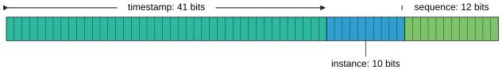{height="3.4em"}
:::
::::

::: {.xs}
```python
def get_tweet_timestamp(tid):
    offset = 1288834974657
    tstamp = (tid >> 22) + offset
    utcdttime = datetime.utcfromtimestamp(tstamp/1000)
    print(str(tid) + " : " + str(tstamp) + " => " + str(utcdttime))
```
:::

::: {.source}
<https://github.com/oduwsdl/tweetedat><br>
<https://ws-dl.blogspot.com/2019/08/2019-08-03-tweetedat-finding-tweet.html>
:::

## Summary {.fit1}

- Information answers a question: one bit is one yes/no answer, and frequent outcomes deserve shorter codes
- Computers store everything as bits; binary, octal and hexadecimal are ways to write them
- Negative integers use two's complement; fixed-width integers can overflow
- IEEE 754 floating point approximates real numbers, so rounding errors appear and add up
- Text needs a character encoding (ASCII, Unicode, UTF-8); reading with the wrong one corrupts it
- Data types decide what the bits mean and which operations apply

**Next session:** Data Structures
