## Course Outline

:::: {.columns}
::: {.column width="50%"}
::: {.sm}
- *Session 1: Introduction*
- *Session 2: Information Coding*
- **Session 3: Data Structures**
- Session 4: Software
- Session 5: Algorithms
- Session 6: Recursion
- Session 7: Sorting Algorithms
:::
:::

::: {.column width="50%"}
::: {.sm}
- Session 8: Time Complexity
- Session 9: Theoretical Computer Science
- Session 10: Machine Learning
- Session 11: Databases
- Session 12: Parallel Programming
- Session 13: Social Science Applications
- Session 14: Exam Review
:::
:::
::::

## Outline

::: {.outline}
- Arrays
- Linked Lists
- Binary Search Trees
- Hash Tables
:::

## Arrays

::: {.outline .focus}
- [Arrays]{.current}
- Linked Lists
- Binary Search Trees
- Hash Tables
:::

<!-- MOTIVATION:M03-A:BEGIN -->
## Two million respondents, one duplicate

::: {.motivation}
[Motivating example]{.label}
- Your panel has **2 million** responses and you need to find the duplicates.   
- Naive approach: compare every response with every other  
  - Takes **2 × 10¹² comparisons**, hours to days on a laptop  
- One pass with the right data structure does it in **seconds**.
:::

:::: {.figures}
::: {.fq}
[$2 * 10^{12}$]{.big}[comparisons, comparing every pair]{.cap}
:::
::: {.fq}
[$2 * 10^{6}$]{.big}[operations, with a hash set]{.cap}
:::
::::

[Why is "have I seen this before?" is nearly free in one structure and hopeless in another?]{.ask}
<!-- MOTIVATION:M03-A:END -->

<!-- MOTIVATION:M03-C:BEGIN -->
## Six thousand rows in only 13 steps

::: {.motivation}
[Motivating example]{.label}
A codebook has **6,000** entries and your script looks up a code for each of
**40 million** observations. Checking the entries one at a time costs
**6,000 comparisons** per lookup. If the codebook is sorted, it costs **13**.
:::

:::: {.figures}
::: {.fq}
[6,000]{.big}[comparisons, scanning the list]{.cap}
:::
::: {.fq}
[13]{.big}[comparisons with binary search]{.cap}
:::
::: {.fq}
[460×]{.big}[less work but the list must be sorted]{.cap}
:::
::::

[Why is this much faster and what is the problem if the codebook changes every day?]{.ask}
<!-- MOTIVATION:M03-C:END -->

## Data Structures {.fit2}

::: {.definition}
[Definition]{.label}
**Data types** together with **operations** defined on these data that enable and realize access to and management of these data.
:::

::: {.center-h}
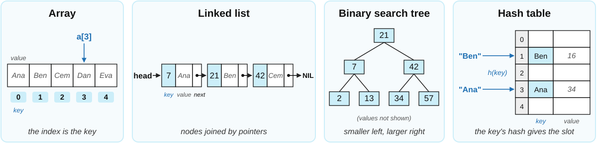{width="86%"}
:::

::: {.s}
- We focus on data structures with particular relevance for information storage
- A search is not just to check if a **key** is there, also to retrieve **value** stored with it
- Diagrams often show only the keys; the values are implicit
:::

## Arrays

::: {.definition}
[Definition]{.label}
Systematic arrangement of similar objects, usually in rows and columns.
:::

::: {.center-h}
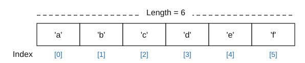{height="5.0em"}
:::

::: {.sm}
- We address/access elements using the **index**
- in most programming languages indices range from *0* to *n-1* for an array of length *n*
- in MATLAB, R or [in pseudo-code we use indices *1* to *n*]{.hl-orange}
:::

## Arrays: advantages and disadvantages {.fit1}

:::: {.columns}
::: {.column width="68%"}
::: {.sm}
**Advantages**

- Very fast access: if you know the index you only need one operation
- Standard structure implemented in most languages

**Disadvantages**

- Memory requirement depends on range of index values
  - If you have 4 entries with indices between 1 and 1,000,000, you need 1,000,000 cells in memory
- If just filling linearly, adding or removing in the middle leaves gaps or requires moving the rest of the content
- **What if you want indices that are not integers?**
:::
:::

::: {.column width="32%"}
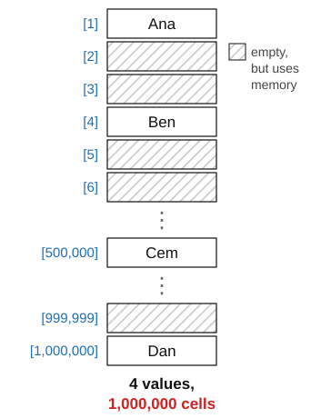{height="13.4em"}
:::
::::

## Linked Lists and Dictionaries

::: {.outline .focus}
- Arrays
- [Linked Lists]{.current}
- Binary Search Trees
- Hash Tables
:::

## Linked Lists

::: {style="height:150px"}
::: {.definition}
[Definition]{.label}
Linear collection of data elements, called nodes, each pointing to the next node by means of a *pointer*.
:::
:::

::: {.center-h}
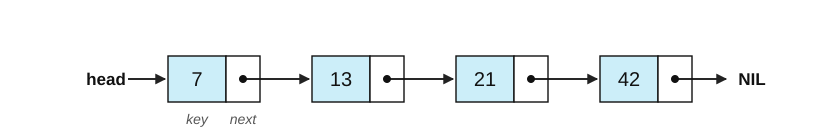{width="1100px"}
:::

::: {.sm}
- Each node holds a **key** (and its data) and a pointer **next** to the following node
- The list is reached through a pointer **head** to the first node; the last node points to NIL
- Keys could be anything that can be checked for equality, not necessarily integers. E.g. strings, other pointers.
:::

## Linked Lists: advantages and disadvantages {.fit1}

Deleting a node only changes the pointer of its predecessor.

 

::: {.center-h}
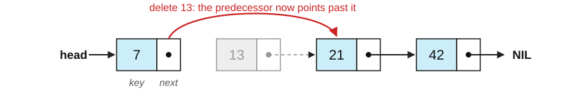{width="1100px"}
:::

:::: {.columns}
::: {.column width="50%"}
::: {.sm}
**Advantages**

- easy to edit: only adjacent pointers change
- memory grows with the number of nodes
:::
:::

::: {.column width="50%"}
::: {.sm}
**Disadvantages**

- hard to index, slow to iterate through
- extra memory for the pointers
:::
:::
::::

## Binary Search Trees

::: {.outline .focus}
- Arrays
- Linked Lists
- [Binary Search Trees]{.current}
- Hash Tables
:::

## The question of editing vs search

:::: {.columns}
::: {.column width="55%"}
::: {.sm}
- Linked lists have efficient editing but very slow (linear) search
- Arrays have fast search but inefficient editing
- Can we have some kind of search that is faster than linear but allows editing without moving all the data?
- When lists are sorted but we cannot directly index: **binary search**
:::

::: {.xs}
Remember: we don't search just for keys, we also retrieve values associated with them
:::
:::

::: {.column width="45%"}
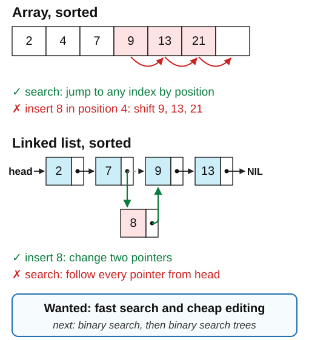{height="540px"}
:::
::::

## Binary Trees {.fit1}

::: {.definition}
[Definition: Binary Tree]{.label}

::: {.sm}
A binary tree is a tree data structure that is either empty or it consists of a node (or root) $S$ that has at most two children, which are referred to as the left child $L$ and the right child $R$, both of which are also binary trees.
:::
:::

:::: {.columns}
::: {.column width="32%"}
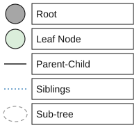{height="9.2em"}
:::

::: {.column width="68%"}
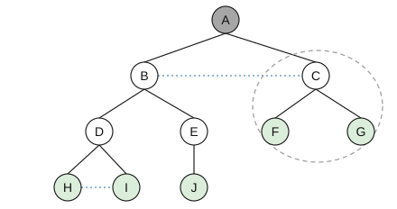{height="9.2em"}
:::
::::

## Binary Search Trees {.fit1}

::: {.definition}
[Definition: Binary Search Tree]{.label}

::: {.xs}
A binary search tree is a binary tree with comparable keys where the key in the root has to be

- **larger than or equal to** all keys in the left sub-tree, and
- **strictly smaller** than all keys in the right sub-tree.
:::
:::

:::: {.columns}
::: {.column width="62%"}
{height="318px"}
:::

::: {.column width="38%"}
::: {.sm}
- Remember that every element in the tree has a key but also contains data
- Here we assume that no duplicate keys are allowed
:::
:::
::::

## Binary Search Trees

::: {style="height:135px"}
::: {.center-h .sm}
The tree we will use as the running example: ten keys
:::
:::

::: {.center-h}
{height="420px"}
:::

## Binary Search Trees

::: {style="height:135px"}
:::: {.columns}
::: {.column width="34%"}
::: {.sm}
the <u>root</u> has to be **larger or equal** to all keys in the **left sub-tree** and …
:::
:::

::: {.column width="32%"}
:::

::: {.column width="34%"}
::: {.sm}
… **strictly smaller** than all keys in the **right sub-tree**
:::
:::
::::
:::

::: {.center-h}
{height="420px"}
:::

## Binary Search Trees

::: {style="height:135px"}
:::: {.columns}
::: {.column width="34%"}
::: {.sm}
the <u>root</u> has to be **larger or equal** to all keys in the **left sub-tree** and …
:::
:::

::: {.column width="32%"}
:::

::: {.column width="34%"}
::: {.sm}
… **strictly smaller** than all keys in the **right sub-tree**
:::
:::
::::
:::

::: {.center-h}
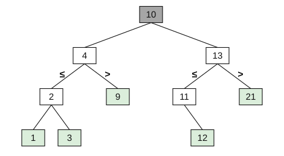{height="420px"}
:::

## Binary Search Trees

::: {style="height:135px"}
:::: {.columns}
::: {.column width="34%"}
::: {.sm}
the <u>root</u> has to be **larger or equal** to all keys in the **left sub-tree** and …
:::
:::

::: {.column width="32%"}
:::

::: {.column width="34%"}
::: {.sm}
… **strictly smaller** than all keys in the **right sub-tree**
:::
:::
::::
:::

::: {.center-h}
{height="420px"}
:::

## Binary Search Trees

::: {style="height:135px"}
::: {.center-h}
Is this a binary search tree?
:::
:::

::: {.center-h}
{height="420px"}
:::

## Binary Search Trees

::: {style="height:135px"}
::: {.center-h}
Is this a binary search tree? &nbsp;&nbsp; **No!**

::: {.sm}
15 is in the left sub-tree of 13 but larger than 13; 5 is in the left sub-trees of 2 and 4 but larger than both
:::
:::
:::

::: {.center-h}
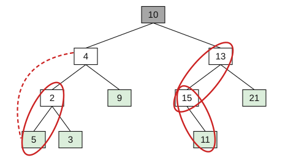{height="420px"}
:::

## Binary Search Trees

:::: {.columns}
::: {.column width="42%"}
::: {.sm}
**Searching** for a given key:

- compare the key you are looking for with the root
  - depending on whether it is smaller (larger) continue searching in left (right) sub-tree
  - return the value or *key not found*
:::
:::

::: {.column width="58%"}
::: {.tag style="visibility:hidden"}
Search for 11:
:::

{width="600px"}
:::
::::

## Binary Search Trees

:::: {.columns}
::: {.column width="42%"}
::: {.sm}
**Searching** for a given key:

- compare the key you are looking for with the root
  - depending on whether it is smaller (larger) continue searching in left (right) sub-tree
  - return the value or *key not found*
- Remember the Binary Search Algorithm
:::
:::

::: {.column width="58%"}
::: {.tag}
Search for 11:
:::

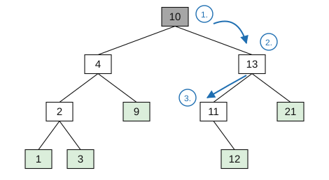{width="600px"}

::: {.xs}
1. $11 > 10$ (root) &rarr; search on the right
2. $11 < 13$ &rarr; search on the left
3. $11 = 11$ &rarr; **Found 11**
:::
:::
::::

## Binary Search Trees

::: {.sm}
- **Adding** a new key at the correct position
  - assumption: key to be added is not yet in the tree
    - simply find appropriate empty slot and add the key as a [“leaf”]{.hl}
    - only way to add keys and preserve binary search tree structure
:::

:::: {.columns}
::: {.column width="43%"}
{width="100%"}
:::

::: {.column width="14%"}
::: {.tag .xs}
Add key **6**:
:::
:::

::: {.column width="43%"}
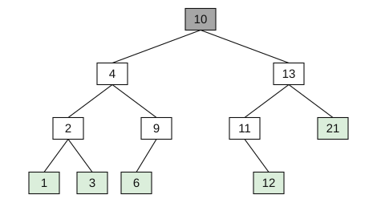{width="100%"}
:::
::::

## Binary Search Trees

::: {style="height:215px"}
::: {.sm}
- **Delete** specific key while preserving a binary search tree structure
  - three cases: the node has no children (a [“leaf”]{.hl} node), [one child]{.hl}, or [two children]{.hl}
:::
:::

:::: {.columns}
::: {.column width="22%"}
::: {.tag .xs style="visibility:hidden"}
Delete key **6**:
:::
:::

::: {.column width="78%"}
{height="350px"}
:::
::::

## Binary Search Trees

::: {style="height:215px"}
::: {.sm}
- **Delete** specific key while preserving a binary search tree structure
  - deleting a [leaf]{.hl} node is simple:
    - search for key
    - in preceding node, remove reference to child
:::
:::

:::: {.columns}
::: {.column width="22%"}
::: {.tag .xs}
Delete key **6**:
:::
:::

::: {.column width="78%"}
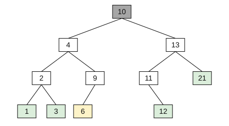{height="350px"}
:::
::::

## Binary Search Trees

::: {style="height:215px"}
::: {.sm}
- **Delete** specific key while preserving a binary search tree structure
  - deleting a [leaf]{.hl} node is simple:
    - search for key
    - in preceding node, remove reference to child
:::
:::

:::: {.columns}
::: {.column width="22%"}
::: {.tag .xs}
After deleting **6**:
:::
:::

::: {.column width="78%"}
{height="318px"}
:::
::::

## Binary Search Trees

::: {style="height:215px"}
::: {.sm}
- **Delete** specific key while preserving a binary search tree structure
  - deleting a node with [one child]{.hl} is still relatively simple
    - replace it with its only child
:::
:::

:::: {.columns}
::: {.column width="14%"}
::: {.tag .xs}
Delete key **11**:
:::
:::

::: {.column width="43%"}
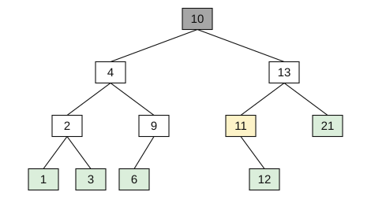{width="100%"}
:::

::: {.column width="43%"}
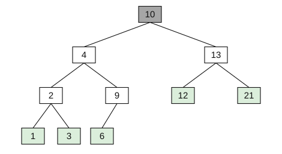{width="100%"}
:::
::::

## Binary Search Trees

::: {.sm}
- Deleting a node with [two children]{.hl} is the most complicated case: replace it with the leftmost node of its right sub-tree (or the rightmost node of its left sub-tree), then restore the tree there, as in the one-child case
:::

[Delete the root **10**:]{.tag .xs}

:::: {.columns}
::: {.column width="33%"}
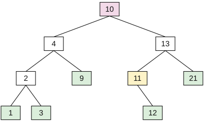{width="100%"}

::: {.xs .center-h}
**1.** the leftmost key of the right sub-tree is **11**
:::
:::

::: {.column width="33%"}
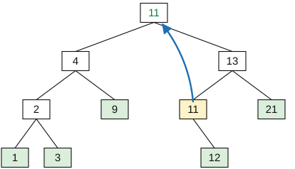{width="100%"}

::: {.xs .center-h}
**2.** copy **11** into the root
:::
:::

::: {.column width="33%"}
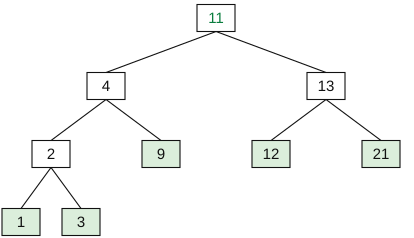{width="100%"}

::: {.xs .center-h}
**3.** remove the old **11**: its only child **12** takes its place
:::
:::
::::

## Binary Search Trees: advantages and applications {.fit1}

::: {.sm}
**Advantages**

- lookup for keys is much faster than in an unsorted array
  - same efficiency as sorted array with binary search
- adding/removing values is much faster than in a sorted array
  - just pointers are updated similarly to what is done in a linked list
  - in a sorted array all values to the "right" of the key have to be shifted

**Practical applications**

- used in look-up tables or dynamic sets
  - can vary in size but still efficient "housekeeping" of index keys
- it is ultimately most useful when paired up with data
  - fast look-up of data paired with each key, e.g. in database indices
:::

## Binary Search Trees: disadvantages

:::: {.columns}
::: {.column width="28%"}
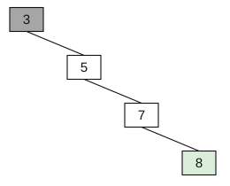{height="300px"}
:::

::: {.column width="72%"}
::: {.sm}
- Disadvantages of binary search trees
  - lookup takes a number of steps that depends on tree depth
  - if we add keys in an impractical order
    - many operations for deleting and adding
    - may arrive at a very unbalanced structure
    - in such a case no better than sequential search
    - need algorithms for balancing trees etc.
:::
:::
::::

## Hash Tables

::: {.outline .focus}
- Arrays
- Linked Lists
- Binary Search Trees
- [Hash Tables]{.current}
:::

## Hashing {.fit1}

::: {.concept .sm}
- Can we have very fast lookup (about one operation per access) but not have the index range problem of arrays?
- Can we use other indices besides integers?
:::

::: {.sm}
- Examples:
  - student ID numbers
    - 6-digit number, i.e. 1,000,000 possible values
    - BUT only 10,000 are used at the same time
    - can map all numbers onto 10,000 slots, no need for 1,000,000
  - books in the library
    - book titles have maybe 100 characters, that means $30^{100}$ possible titles
    - BUT the library has "only" about ~2 million books
:::

## Hash Functions {.fit2}

::: {.definition}
[Definition: hash function]{.label}
A hash function $h: K \rightarrow \{0, 1, \dots, m-1\}$ assigns to any given key $k$ an index $0 \leq h(k) \leq m-1$.
:::

::::: {.columns}
:::: {.column width="64%"}
::: {.s}
Requirements for $h(k)$:

- $|K| \gg m$, i.e. many more possible keys $k$  
  than values $h(k)$ maps to
- fast to compute, deterministic
- balanced distribution to available indices to avoid collisions
- (dynamically) adjustable to the number of free slots $m$
:::
::::

:::: {.column width="36%"}
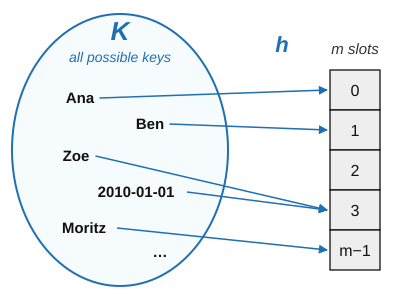{width="100%"}
::::
:::::

hash functions are usually based on natural numbers (with 0), i.e., usually direct calculation of the hash value of a given key (e.g., as a character string)

## Hash Tables

::: {.sm}
Operations on hash tables: each item says how to do one operation for a key $k$

- searching for an entry:
  - calculate hash function $h(k)$ and read position $h(k)$

- adding an entry:
  - calculate hash function $h(k)$ and write at position $h(k)$ (what if the position is used?)

- deleting an entry:
  - calculate hash function $h(k)$ and empty position $h(k)$
:::

::: {.sm}
**Time required for operations:** just one step in the best case
:::

## Hash Collisions

::: {.sm}
**Hash collisions** happen when two keys are mapped to the same position by the hash function
:::

::: {.center-h}
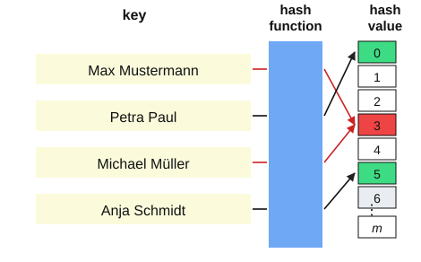{height="11.6em"}
:::

## Hash Tables {.fit2}

:::: {.columns}
::: {.column width="50%"}
- Modulo operation
  - automatically yields values in the range 0 to $m-1$
    - ideal hash function since it homogeneously distributes values
  - important to select the "right" $m$ to avoid hash collisions
    - best choice are prime numbers
    - worst choice are powers of the base of the number system used
- Example with problems:
  - dates represented as numbers
:::

::: {.column width="50%"}
::: {.tbl-grid .s}
| key $k$ | $k \bmod 97$ | $k \bmod 100$ |
|---|---|---|
| 20100101 | 52 | 1 |
| 20100227 | 81 | **27** |
| 20100427 | 87 | **27** |
| 20110527 | **2** | **27** |
| 20090811 | 74 | **11** |
| 20101224 | 11 | **24** |
| 20111111 | **4** | **11** |
| 20120229 | **4** | 29 |
| 20091224 | **2** | **24** |
:::

Bold: collisions. $\bmod 100$ keeps only the day
:::
::::

## Hash Collisions - Separate Chaining

::: {.sm}
**Separate chaining** is one solution to collisions: every slot holds a linked list of all the keys hashed to it.

Operations on hash tables with separate chaining:

- **searching** for an entry: calculate $h(k)$, then search through the linked list of that slot from front to end
- **adding** an entry: calculate $h(k)$, search the list, and append the new element if it is not there
- **deleting** an entry: calculate $h(k)$, search the list, and remove the element from it

**Time required for operations:** just one step in the best case, $n$ steps in the worst case
:::

## Hash Collisions - Separate Chaining

::: {style="height:150px"}
::: {.sm}
Dealing with hash collisions through **separate chaining**: each entry of the hash table is a linked list, and colliding entries are appended to it
:::
:::

::: {.center-h}
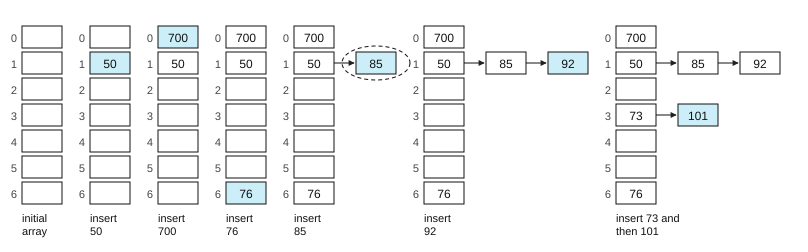{height="340px"}
:::

::: {.xs .center-h}
Example: $m = 7$, $h(k) = k \bmod 7$
:::

## Hash Collisions - Linear Probing

::: {style="height:150px"}
::: {.sm}
**Open addressing** stores every key in the table itself. **Linear probing**: if slot $h(k)$ is taken, try $h(k)+1$, $h(k)+2$, … (mod $m$). **Write** in the first free slot; **read** by following the same probes until the key or an empty slot
:::
:::

::: {.center-h}
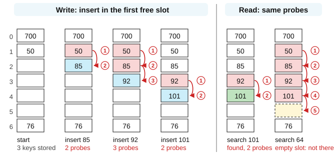{height="362px"}
:::

::: {.xs .center-h}
$m = 7$, $h(k) = k \bmod 7$; 700, 50 and 76 are already stored; circled numbers: order of probes
:::

## Hash Collisions - Random Probing

::: {style="height:150px"}
::: {.sm}
**Random probing**: if slot $h(k)$ is taken, try $h(k)+r_1$, $h(k)+r_2$, … (mod $m$), with a fixed pseudo-random sequence $r$ (here 3, 6, 2, 5, 1, 4) that a search can repeat. After inserting 92 the keys are spread out, not in one run
:::
:::

::: {.center-h}
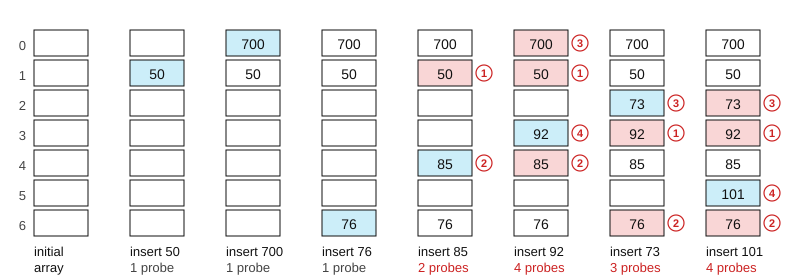{height="340px"}
:::

::: {.xs .center-h}
Keys 50, 700, 76, 85, 92, 73, 101 inserted in this order: $m = 7$, $h(k) = k \bmod 7$. Circled numbers give the order of the probes
:::

## Hash Collisions - Probing: what to watch {.fit1}

::: {.sm}
- **Clustering**: with linear probing, occupied slots form runs, and every key that hashes into a run walks to its end and makes it longer. In the linear probing example, a new key hashing to any slot except 5 ends in slot 5
- **Random probing** avoids these runs, but its sequence must be reproducible (fixed, or computed from the key), or a search could not find the key again
- **Load**: both slow down sharply as the table fills. With $n$ keys in $m$ slots, keep $n/m$ well below 1: Python's `dict` grows when it is two thirds full
- **Deletion**: emptying a slot would cut the probe sequence of the keys stored after it. Mark the slot as *deleted* instead: searches skip it, insertions may reuse it
:::

::: {.concept .xs}
**Home exercise.** In the linear probing example, delete 85 by marking its slot as *deleted*. Then search for 92 and for 101: which slots are probed? Then insert 64: where does it go? What would go wrong if slot 2 were simply emptied?
:::

## Dictionaries {.fit1}

::: {.definition}
[Definition]{.label}
Abstract data type composed of a collection of (key, value) pairs, such that each possible key appears at most once in the collection.
:::

::: {.sm}
- Generalized keys (not just indices):
  - characters, words, names etc.
- Characteristics
  - keys are not necessarily homogeneously distributed
    - using an array spanning the whole range of values would be a waste of memory
  - use list of keys to index the dictionary
    - if no further conditions applied: sequential search
    - worst case: have to search through ALL $n$ entries
:::

## Dictionaries in Python

:::: {.columns}
::: {.column width="36%"}
::: {.sm}
- Python uses **hash tables** to store dictionaries
  - **Collisions are solved with random probing:** when a slot is full, move to another slot in a pseudo-random sequence that is computed from the key, so a search can repeat it
  - Hashes start with 8 slots and are resized when ⅔ of entries are full
:::
:::

::: {.column width="64%"}
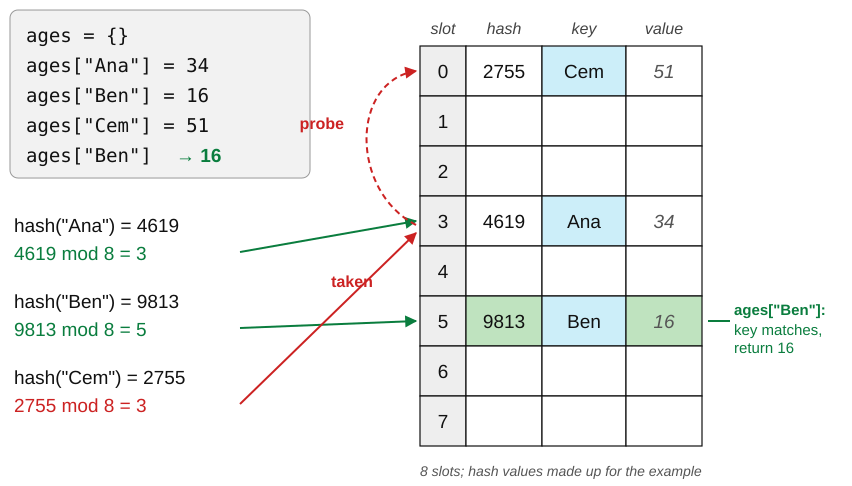{width="100%"}
:::
::::

::: {.source}
<https://stackoverflow.com/questions/327311/how-are-pythons-built-in-dictionaries-implemented/>
:::

## Dataset pseudonymization {.fit2}

:::: {.columns}
::: {.column width="40%"}
::: {.tbl-grid}
| name | wave | age | vote |
|---|---|---|---|
| Ana Weber | 1 | 34 | yes |
| Ben Koch | 1 | 27 | no |
| Clara Roth | 1 | 45 | yes |
| Ana Weber | 2 | 35 | no |
:::
:::

::: {.column width="14%"}
::: {.center-hs}
 $h$(secret + name) **&rarr;**
:::
:::

::: {.column width="46%"}
::: {.tbl-grid}
| person | wave | age | vote |
|---|---|---|---|
| `c3305900d9` | 1 | 34 | yes |
| `f61798a8f3` | 1 | 27 | no |
| `f109d00beb` | 1 | 45 | yes |
| `c3305900d9` | 2 | 35 | no |
:::
:::
::::

- Replace the identifying column by its hash: the same name always gives the same code, so the two waves of Ana Weber can still be linked
- A hash cannot be turned back into the name, but it can be **guessed with a lot of effort**: hash every name in a phone book and compare
- Approach: hash the name together with a **secret** that only the research team knows
- Pseudonymized is not anonymous: age and answers together may still identify a person
- In the example, the code is the first 10 characters of SHA-256 of the secret followed by the name.

## Brian Kernighan and AWK

:::: {.columns}
::: {.column width="72%"}
::: {.sm}
- The AWK language is a specialized language for string processing: a secret tool of many data scientists
- key component of UNIX, co-created by Brian Kernighan at Bell Labs
- AWK: Alfred **A**ho, Peter **W**einberger and Brian **K**ernighan
- Extremely efficient thanks to the use of regular expressions (we will learn them in session 9) and hash tables
- The default array structure is an associative memory (dictionary) based on a hash table
- MAWK: faster implementation and more memory efficient
:::
:::

::: {.column width="28%"}
{height="8.0em"}
:::
::::

::: {.source}
Brian Kernighan on hash tables: <https://www.youtube.com/watch?v=qTZJLJ3Gm6Q>
:::

## Summary

::: {.sm}
- A data structure combines data with operations; the right one makes the frequent operations cheap
- **Arrays**: one step to access by index, but a fixed index range and costly insertion in the middle
- **Linked lists**: cheap insertion and deletion, but a search walks the list
- **Binary search trees**: search, insert and delete in as many steps as the tree is deep
- **Hash tables**: about one step per lookup; collisions are handled by separate chaining or probing
- Python's `dict` is a hash table: use it for lookups by key, lists for ordered sequences
:::

**Next session:** Software: programming paradigms, good coding practices, software engineering

## Appendix: Binary Search {.fit1}

:::: {.columns}
::: {.column width="50%"}
<pre class="pseudocode"><b>Procedure</b> BINARY-SEARCH(<i>A</i>, <i>n</i>, <i>x</i>)
<i>Inputs:</i>
      <i>A</i>: a sorted array
      <i>n</i>: the number of elements in <i>A</i>
      <i>x</i>: the value to find
<i>Result:</i> an index <i>i</i> with <i>A</i>[<i>i</i>] = <i>x</i>, or NOT-FOUND if <i>x</i> is not in <i>A</i>
<i>p</i> &larr; 1; <i>r</i> &larr; <i>n</i>
<b>While</b> <i>p</i> &le; <i>r</i>:
      <i>q</i> &larr; ⌊(<i>p</i> + <i>r</i>)/2⌋
      <b>If</b> <i>A</i>[<i>q</i>] = <i>x</i>
            <b>then return</b> <i>q</i>
      <b>else if</b> <i>A</i>[<i>q</i>] &gt; <i>x</i>
            <b>then</b> <i>r</i> &larr; <i>q</i> - 1
      <b>else</b> <i>p</i> &larr; <i>q</i> + 1
<b>return</b> NOT-FOUND</pre>
:::

::: {.column width="50%"}
::: {.sm}
- In ordered array $A$ of size $n$, search for the value $x$

  

See Cormen (2013), pp. 28&ndash;30, for more on this algorithm
:::
:::
::::

## Appendix: Binary Search {.fit1}

:::: {.columns}
::: {.column width="50%"}
<pre class="pseudocode"><b>Procedure</b> BINARY-SEARCH(<i>A</i>, <i>n</i>, <i>x</i>)
<i>Inputs:</i>
      <i>A</i>: a sorted array
      <i>n</i>: the number of elements in <i>A</i>
      <i>x</i>: the value to find
<i>Result:</i> an index <i>i</i> with <i>A</i>[<i>i</i>] = <i>x</i>, or NOT-FOUND if <i>x</i> is not in <i>A</i>
<i>p</i> &larr; 1; <i>r</i> &larr; <i>n</i>
<b>While</b> <i>p</i> &le; <i>r</i>:
      <i>q</i> &larr; ⌊(<i>p</i> + <i>r</i>)/2⌋
      <b>If</b> <i>A</i>[<i>q</i>] = <i>x</i>
            <b>then return</b> <i>q</i>
      <b>else if</b> <i>A</i>[<i>q</i>] &gt; <i>x</i>
            <b>then</b> <i>r</i> &larr; <i>q</i> - 1
      <b>else</b> <i>p</i> &larr; <i>q</i> + 1
<b>return</b> NOT-FOUND</pre>
:::

::: {.column width="50%"}
::: {.center-h .sm}
Use binary search to **find 43**
:::

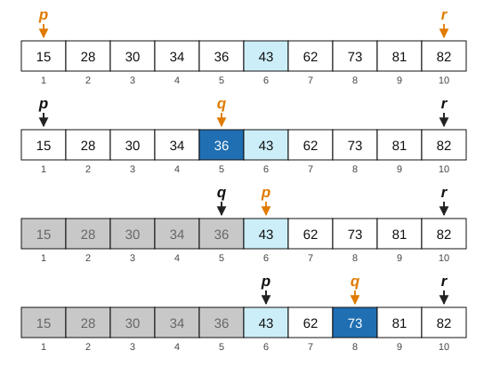{width="100%"}
:::
::::

## Appendix: Binary Search {.fit1}

:::: {.columns}
::: {.column width="50%"}
<pre class="pseudocode"><b>Procedure</b> BINARY-SEARCH(<i>A</i>, <i>n</i>, <i>x</i>)
<i>Inputs:</i>
      <i>A</i>: a sorted array
      <i>n</i>: the number of elements in <i>A</i>
      <i>x</i>: the value to find
<i>Result:</i> an index <i>i</i> with <i>A</i>[<i>i</i>] = <i>x</i>, or NOT-FOUND if <i>x</i> is not in <i>A</i>
<i>p</i> &larr; 1; <i>r</i> &larr; <i>n</i>
<b>While</b> <i>p</i> &le; <i>r</i>:
      <i>q</i> &larr; ⌊(<i>p</i> + <i>r</i>)/2⌋
      <b>If</b> <i>A</i>[<i>q</i>] = <i>x</i>
            <b>then return</b> <i>q</i>
      <b>else if</b> <i>A</i>[<i>q</i>] &gt; <i>x</i>
            <b>then</b> <i>r</i> &larr; <i>q</i> - 1
      <b>else</b> <i>p</i> &larr; <i>q</i> + 1
<b>return</b> NOT-FOUND</pre>
:::

::: {.column width="50%"}
::: {.center-h .sm}
Use binary search to **find 43**
:::

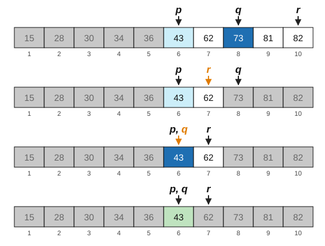{width="100%"}
:::
::::
