## Course Outline

:::: {.columns}
::: {.column width="50%"}
::: {.sm}
- *Session 1: Introduction*
- *Session 2: Information Coding*
- *Session 3: Data Structures*
- **Session 4: Software**
- Session 5: Algorithms
- Session 6: Recursion
- Session 7: Sorting Algorithms
:::
:::

::: {.column width="50%"}
::: {.sm}
- Session 8: Time Complexity
- Session 9: Theoretical Computer Science
- Session 10: Machine Learning
- Session 11: Databases
- Session 12: Parallel Programming
- Session 13: Social Science Applications
- Session 14: Exam Review
:::
:::
::::

## Outline

::: {.outline}
1. Programming in a nutshell
2. Software engineering
3. Requirements, specifications, and design
4. Testing
:::


<!-- MOTIVATION:M04-A:BEGIN -->
## The app that leaked 13,000 photo IDs {.fit1}

::: {.motivation}
[Motivating example]{.label}
**Tea**, a US app where women warn each other about men they date, asked every
new user for a selfie and a photo ID to prove she was a woman. In July 2025
someone posted the address of the storage contained all these data. There was **no login and no
access rule.** Anyone could download everything.
:::

:::: {.figures}
::: {.fq}
[72,000]{.big}[images downloaded]{.cap}
:::
::: {.fq}
[13,000]{.big}[selfies and photo IDs]{.cap}
:::
::: {.fq}
[1 million+]{.big}[private messages, in a second leak]{.cap}
:::
::::

[*"Only moderators may see the ID photos"* was obviously required. Why did nothing enforce it, and which test would have caught it?]{.ask}

::: {.source}
TechCrunch and CNN, 26 July 2025; 404 Media. Many blamed vibe coding; Tea says the code predates 2024.
:::
<!-- MOTIVATION:M04-A:END -->

<!-- MOTIVATION:M04-D:BEGIN -->
## 20 million lines of code to move 5 millimeters {.fit1}

::: {.motivation}
[Motivating example]{.label}
In the 2000s, **Symbian**, the system of Nokia's phones, ran most of the world's
smartphones. In 2010 a former Nokia design executive told how his team wanted to
move one element of a phone's screen up by 5 mm: *"We can't find the piece of code
that could shift it up 5mm."*
:::

:::: {.figures}
::: {.fq}
[20 million]{.big}[lines of code in one phone]{.cap}
:::
::: {.fq}
[40 million]{.big}[lines of Symbian released as open source, 2010]{.cap}
:::
::: {.fq}
[11 million]{.big}[lines of Android at the time]{.cap}
:::
::::

[Nobody wrote this code to be unchangeable. What makes working code impossible to change? What keeps a codebase changeable?]{.ask}

::: {.source}
Juhani Risku in The Register, 22 July 2010; All About Symbian, 4 February 2010. In 2011 Nokia replaced Symbian with Windows Phone.
:::
<!-- MOTIVATION:M04-D:END -->

## Programming in a nutshell

::: {.outline .focus}
1. [Programming in a nutshell]{.current}
2. Software engineering
3. Requirements, specifications, and design
4. Testing
:::

## What is programming? {.fit2}

::: {.definition}
[Definition: Programming]{.label}
Programming is the process of creating a set of instructions that tell a computer how to perform a task.
:::

::: {.definition}
[Definition: Programming Language]{.label}

::: {.sm}
A formal language for writing those instructions, either directly as machine code or as human-readable source code that is translated to machine code automatically.
:::
:::

::: {.concept .sm}
[Vibe coding is programming too]{.label}
A coding agent automatically converts natural language into machine code, thus vibe coding is a type of programming. The main difference with traditional coding is **flakiness**: the same natural language request can lead to very different codes as a result.
:::

## The first programmer: Ada Lovelace

:::: {.columns}
::: {.column width="41%"}
::: {.center-h}
{height="6em"}

:::

::: {.xs}
- **1843**: Ada Lovelace (1815–1852) writes notes on Babbage's **Analytical Engine**
- **Note G** (right): a program for the engine to compute Bernoulli numbers, the first published program
:::
:::

::: {.column width="59%"}
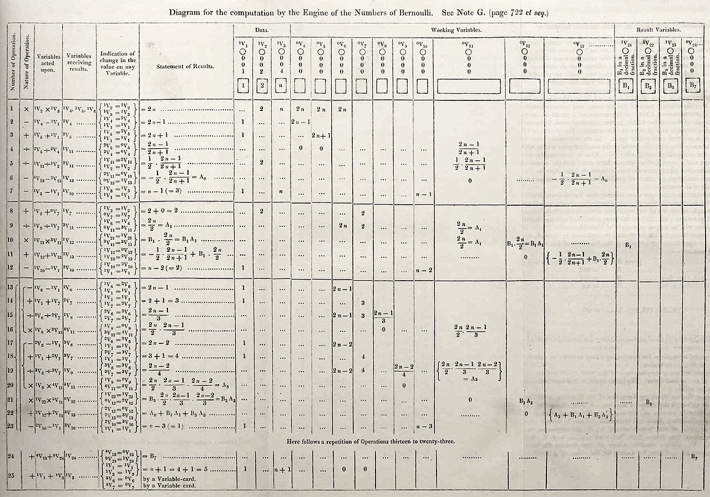{width="96%"}

::: {.source}
Portrait: A. E. Chalon, c. 1840. Note G: Lovelace, 1843
:::
:::
::::

## Levels of programming languages

::: {.tbl-lang}
<table style="border:1px solid #666;width:100%">
<tr><th style="width:15%">Type</th><th style="width:16%">Examples</th><th style="width:35%">What it is</th><th>The same computation</th></tr>
<tr><td class="type">High-level</td><td class="ex">Python, R,<br>Java, C</td><td class="desc">
<ul><li>Written for humans, portable</li>
<li>One line becomes many machine instructions</li></ul>
</td><td class="ex"><pre class="snippet" style="margin:0;font-size:1.0em">area = b * h / 2</pre></td></tr>
<tr><td class="type" rowspan="2">Low-level</td><td class="ex">Assembly</td><td class="desc">
<ul><li>Readable names for machine instructions. Machine dependent.</li></ul>
</td><td class="ex"><pre class="snippet" style="margin:0;font-size:1.0em">LOAD r1,b
LOAD r2,h
MUL  r1,r2
DIV  r1,#2</pre></td></tr>
<tr><td class="ex">Machine<br>code</td><td class="desc">
<ul><li>Binary instructions the CPU executes</li></ul>
</td><td class="ex"><pre class="snippet" style="margin:0;font-size:1.0em">0001001001000101
0010010011101100
10101101001...</pre></td></tr>
</table>
:::

## Interpreter vs. compiler

:::: {.columns}
::: {.column width="50%"}
::: {.concept .sm}
[Interpreter: Python, R, JavaScript]{.label}

- Translates and runs the code **one line at a time**, on every run
- Errors appear only when the line runs, never before
:::

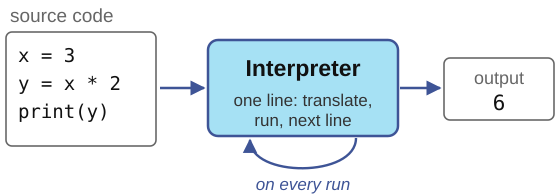{width="100%"}
:::

::: {.column width="50%"}
::: {.concept .sm}
[Compiler: C, C++, (Java)]{.label}

- Translates the **whole program** once into machine code binary file
- Some errors appear before it runs, others require a debugger
:::

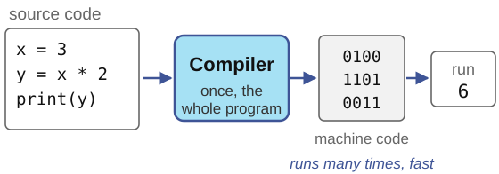{width="100%"}
:::
::::

## Programming paradigms

::: {.sm}
Paradigms classify languages and programs by **how** they express a computation
:::

:::: {.columns}
::: {.column width="50%"}
::: {.concept .sm}
[Imperative]{.label}
Statements that change the program's state step by step. Determines **how** to compute.
:::

::: {.concept .sm}
[Object-oriented]{.label}
Groups data and the instructions that operate on it into **objects**. Models what we compute on.
:::
:::

::: {.column width="50%"}
::: {.concept .sm}
[Declarative]{.label}
Describes **what** the result should be, not how to compute it.  
(for example SQL, session 11)
:::

::: {.concept .sm}
[Functional]{.label}
The result is the value of functions applied to functions  
(based on recursion, session 6)
:::
:::
::::

::: {.xs}
Python supports all of them: which one you use depends on how you write.
:::

## Imperative programming

:::: {.columns}
::: {.column width="50%"}
::: {.sm}
- The program has a **state** composed of the current values of its variables
- **Assignments** change the state
:::
:::

::: {.column width="50%"}
::: {.sm}
- **Control structures** choose what runs next, for example conditionals and loops
- **Functions** name a block of steps that can be reused and centrally changed
:::
:::
::::

:::: {.columns}
::: {.column width="62%"}
::: {style="font-size:1.06em"}
```python
total = 0             # assignment
for age in [34, 41]:  # loop
    if age >= 18:     # condition
        total += age

def mean(xs):         # function
    return sum(xs) / len(xs)
```
:::
:::

::: {.column width="38%"}
::: {.concept .sm}
[Etymology]{.label}
*imperare*, Latin: **to order, to command**. An imperative program is a sequence of orders, carried out one after the other.
:::
:::
::::

## Why do we use Object-Oriented Programming? {.fit1}

::: {.sm}
- Large programs are written by **teams** and **maintained** for years
- The main motivation is code management: OOP gives each part of the program **one responsibility**, in one class, owned by one person or team
- Others use a class only through its **methods**. Its code can change without affecting the other developers. Developers just need to know the object model, not the code inside.
:::
::: {.center-h}
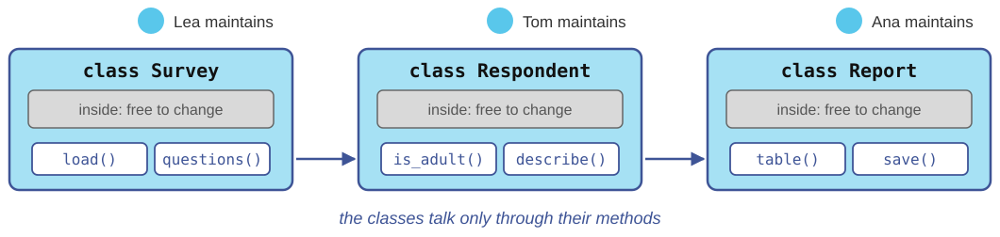{height="5.6em"}
:::
::: {.concept .xs}
[A note on scale]{.label}
For a one-person script, OOP adds little. But it has become a conceptual building block of many programming languages, Python included: every value in Python is an object.
:::

## Object-oriented programming

::: {.sm}
- An **object** bundles **data** (its *attributes*) with the **operations** on that data (its *methods*)
- A **class** is the blueprint. Every object is an **instance** of a class
- You query or change an object by calling its methods: `object.method(arguments)`
:::

:::: {.columns}
::: {.column width="58%"}
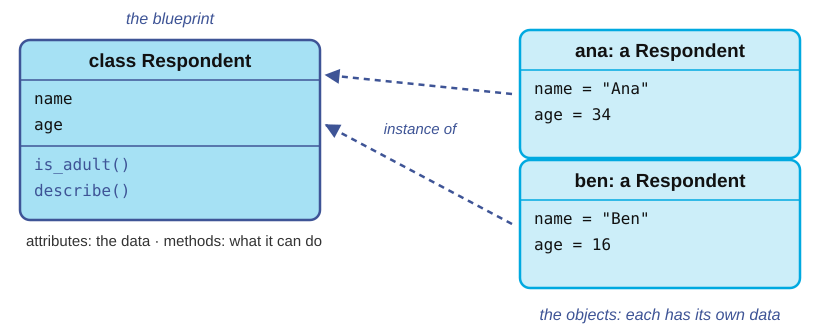{height="8.6em"}
:::

::: {.column width="42%"}
::: {style="font-size:0.66em; padding-top:6.2em"}
```python
ana = Respondent("Ana", 34)
ben = Respondent("Ben", 16)
ana.describe()   # 'Ana, 34 years'
ben.is_adult()   # False
```
:::
:::
::::

## You already use objects

:::: {.columns}
::: {.column width="50%"}
::: {.sm}
**Strings**
:::

::: {style="font-size:0.68em"}
```python
s = "Konstanz"
s.upper()     # 'KONSTANZ'
s.count("n")  # 2
```
:::
:::

::: {.column width="50%"}
::: {.sm}
**Dictionaries**
:::

::: {style="font-size:0.68em"}
```python
votes = {"yes": 12, "no": 7}
votes.get("no")        # 7
votes.get("maybe", 0)  # 0
list(votes.keys())     # ['yes', 'no']
```
:::
:::
::::

{height="9.2em"}

::: {.xs}
`s` is a `str` object, `votes` a `dict` object; lists and data frames work the same way.
:::

## Your own class and objects

::: {style="font-size:0.91em"}
```python
class Respondent:
    def __init__(self, name, age):      # runs when an object is created
        self.name = name                # attributes
        self.age = age

    def is_adult(self):                 # methods; self is the object
        return self.age >= 18

    def describe(self):
        return f"{self.name}, {self.age} years"
```
:::
</br>

:::: {.columns style="margin-top:2.0em"}
::: {.column width="50%"}
::: {style="font-size:0.91em"}
```python
ana = Respondent("Ana", 34)
ben = Respondent("Ben", 16)
ana.describe()
ben.is_adult()
```
:::
:::

::: {.column width="50%"}
::: {style="font-size:0.91em"}
```


'Ana, 34 years'
False
```
:::
:::
::::

## OOP concepts

:::: {.columns}
::: {.column width="42%"}
::: {.sm}
- **Encapsulation:** data and the methods that use it live together in one object.
:::
:::

::: {.column width="58%"}

::: {.center-h}
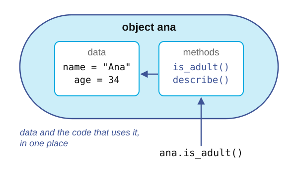{height="8.4em"}

:::

::: {style="font-size:1.2em"}
```python
ana = Respondent("Ana", 34)
ana.age         # 34
ana.is_adult()  # True
```
:::
:::
::::

## OOP concepts

:::: {.columns}
::: {.column width="42%"}
::: {.sm}
- Encapsulation: data and the methods that use it live together in one object
- **Abstraction:** you use an object through its methods, without knowing how it works inside
:::
:::

::: {.column width="58%"}
::: {.center-h}
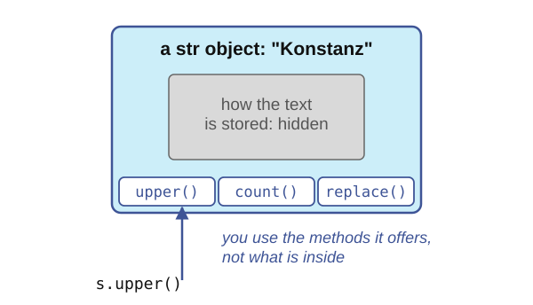{height="8.4em"}
:::

::: {style="font-size:0.99em"}
```python
s = "Konstanz"
s.upper()   # 'KONSTANZ', but how?
```
:::
:::
::::

## OOP concepts

:::: {.columns}
::: {.column width="42%"}
::: {.sm}
- Encapsulation: data and the methods that use it live together in one object
- Abstraction: you use an object through its methods, without knowing how it works inside
- **Inheritance:** a new class extends an existing one and reuses its methods: a student *is a* respondent
:::
:::

::: {.column width="58%"}
::: {.center-h}
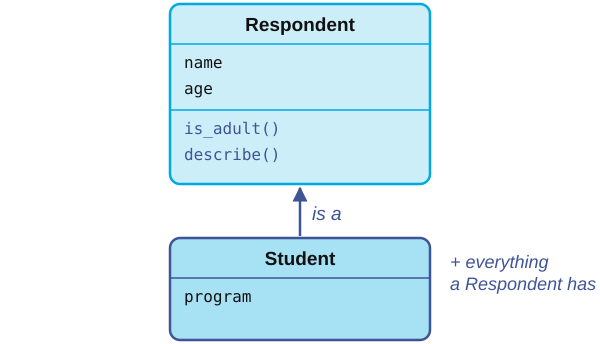{height="8.4em"}

:::

::: {style="font-size:0.81em"}
```python
class Student(Respondent):
    def __init__(self, name, age, program):
        super().__init__(name, age)
        self.program = program

bea = Student("Bea", 21, "SEDS")
bea.is_adult()  # True: inherited
```
:::
:::
::::

## OOP concepts

:::: {.columns}
::: {.column width="42%"}
::: {.sm}
- Encapsulation: data and the methods that use it live together in one object
- Abstraction: you use an object through its methods, without knowing how it works inside
- Inheritance: a new class extends an existing one and reuses its methods: a student *is a* respondent
- **Polymorphism:** the same call does the right thing for each class
:::
:::

::: {.column width="58%"}
::: {.center-h}
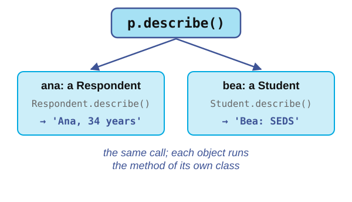{height="8.4em"}

:::

::: {style="font-size:0.79em"}
```python
class Student(Respondent):
    def describe(self):
        return f"{self.name}: {self.program}"
ana.describe()  # 'Ana, 34 years'
bea.describe()  # 'Bea: SEDS'
```
:::
:::
::::

## Software engineering

::: {.outline .focus}
1. Programming in a nutshell
2. [Software engineering]{.current}
3. Requirements, specifications, and design
4. Testing
:::

## What is software?

::: {.definition}
[Definition: Software]{.label}
Computer programs, procedures, and possibly associated documentation and data pertaining to the operation of a computer system.
:::

::: {.center-h}
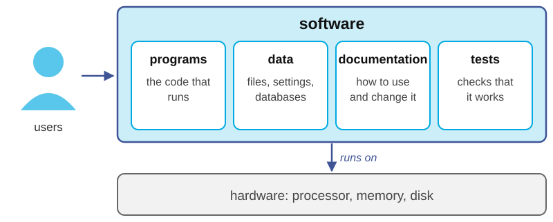{height="7.2em"}
:::

::: {.source}
IEEE Std 610.12-1990, *Standard Glossary of Software Engineering Terminology*
:::

## From a script to software

::: {.definition}
[Definition: Software engineering]{.label}

::: {.sm}
The application of a systematic, disciplined approach to the development, operation and maintenance of software.
:::
:::

::: {.center-h}
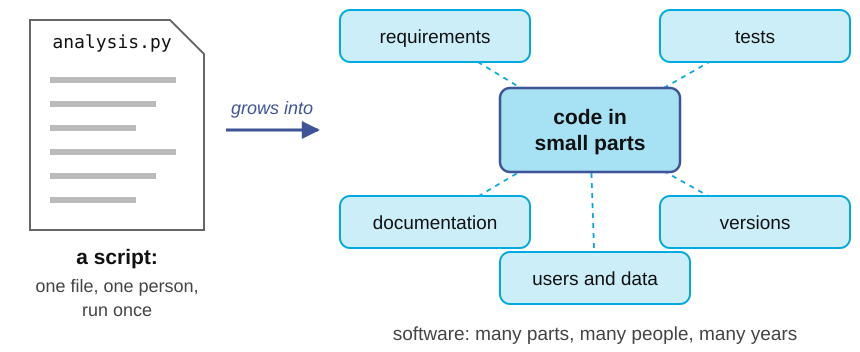{height="8.0em"}
:::

::: {.sm}
Research code needs this too. Software outlives the paper and others build on it.
:::

## A typical software engineering flow
</br>
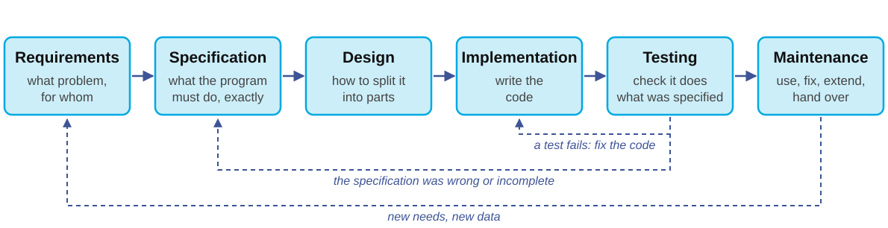{width="100%"}

::: {.sm}
- Real projects go around this loop many times, in small steps (**iterative** development)
- Two steps define correctness: the **specification** says what is right, **testing** checks it
:::

## Roles in a software team {.fit1}

::: {.center-h}
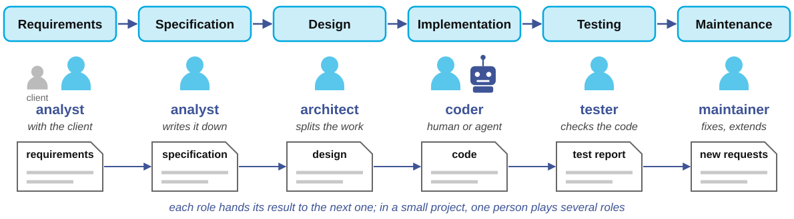{height="9.4em"}
:::

::: {.sm}
- Each stage has an owner: the **analyst** finds out what is needed, the **architect** splits the work, the **coder** implements, the **tester** checks, the **maintainer** keeps it running
- The **coder** can be a person or a coding agent: both work from the same instructions
- In academic research you often play every role yourself but in industry you will have to work with more people
:::

## Vibe coding done right

::: {.center-h}
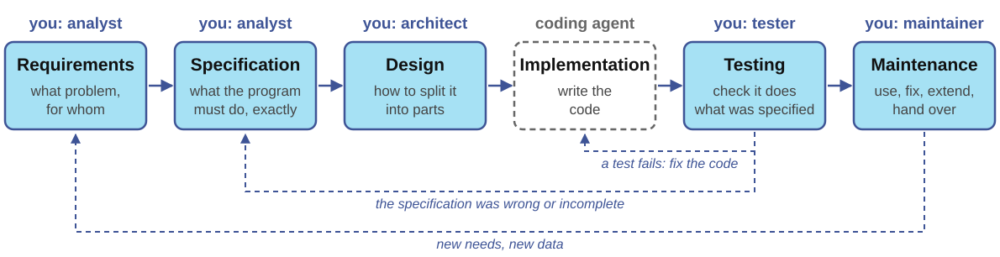{width="100%"}

:::

::: {.sm}
- **Vibe coding**: describe what you want, accept the generated code without reading it, and see whether it seems to work
- A coding agent can take the **coder's** role. Agents can sometimes help on the design and the testing but especially requirements and specifications are dangerous to vibe code
:::

## Requirements, specifications, and design

::: {.outline .focus}
1. Programming in a nutshell
2. Software engineering
3. [Requirements, specifications, and design]{.current}
4. Testing
:::

## Our example: a panel survey in two waves {.fit2}

::: {.example .sm}
Ana, the client, says: *"We asked the same people the same question in spring and in autumn. I need everyone's two answers side by side to see who changed their mind. Please, no email addresses in what I share with the team."*
:::

::: {.center-h}

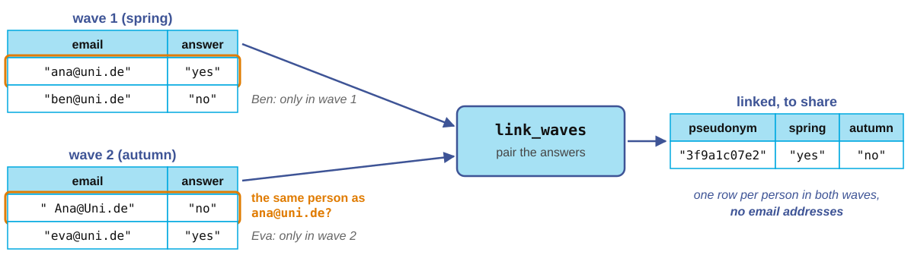{width="100%"}
:::

::: {.sm}
Here we use this request as an example that goes over each stage of the sofware engineering flow, from requirements to maintenance
:::

## What are requirements? {.fit1}

::: {.definition}
[Definition: Requirements]{.label}

::: {.sm}
Description of what the software must achieve, for whom, and under which constraints and conditions. This is written in the words of the people who need it.
:::
:::

::: {.sm}
- The **analyst** collects requirements from the **client**, who may be a research team, a colleague, a target user, or yourself in three months
- They describe the need, not the program. *"Everyone's two answers side by side, with no email addresses"* is a requirement
- Four questions find most of them. **Who** uses it? With **which data**? What must **never** happen? When is it **done**?
- A misunderstanding found here costs a conversation with the client. Found after the code is written, it costs work and risks that can be avoided.
:::

## Functional and non-functional requirements {.fit1}

:::: {.columns}
::: {.column width="50%"}
::: {.concept .sm}
[Functional]{.label}

**Functional requirements map inputs to outputs.**

In the example:

- Only people in both waves are paired, also if they typed their email differently. 

- People only in one wave do not appear in the output

- An empty wave raises an error

:::
:::

::: {.column width="50%"}
::: {.concept .sm}
[Non-functional]{.label}
**How the program must behave beyond its outputs**

In the example: 

- **security**: users see only their own data
- **privacy**: no email addresses in the output
- **safety**: never delete or change the original data
- performance, reproducibility
:::
:::
::::

::: {.sm}
Tea met its functional requirements because users could talk with each other as intended. Nobody had written down the non-functional requirements, especially not the one about who is allowed to access user pictures.
:::

## What is a specification?

::: {.definition}
[Definition: Specification]{.label}

::: {.sm}
A precise description of **what** a program must do, without saying **how**.
:::
:::

::: {.sm}
- Essentially a better-written version of a requirement.
- The **inputs**, and what may be assumed about them (the *preconditions*)
- The **outputs**, and what is guaranteed about them (the *postconditions*)
- What happens in **edge cases and errors** and what the program must **never** do
- The analyst writes it for two readers. The **coder** implements it, and the **tester** checks the code against it
:::

::: {.xs}
In this course, you find specifications for each algorithm next to `Inputs:` and `Result:`
:::

## From ambiguous request to specification

::: {.example}
::: {.sm}
*"Write a function that links the two waves of our panel survey, so we can see who changed their answer."*
:::
:::

::: {.sm}
A careful coder asks these five questions. A hurried coder, human or agent, answers them alone and in silence.
:::

::: {.sm}
1. When are two records the same person? Is `" Ana@Uni.de"` the same as `"ana@uni.de"`?
2. What if someone answered twice in the same wave?
3. What happens to people who answered only once?
4. May email addresses appear in the result?
5. May the function change the lists it was given?
:::

## Writing the specification

::: {style="font-size:0.94em"}
```python
def link_waves(wave1, wave2):
    """Pair the answers of the people in both waves.

    wave1, wave2: lists of (email, answer) pairs.
    Emails match ignoring case and surrounding spaces.
    If someone answered twice in a wave, the last answer counts.
    Returns: a dict from pseudonym(email) to (answer1, answer2),
      only for the people in both waves.
    Raises: ValueError if a wave is empty.
    Never: puts an email in the result or changes the lists.
    """
```
:::

::: {.sm}
- Each line answers one of the five questions
- One extra line settles the empty case
- Nothing here says **how** to link the waves, only **what** we want
:::

## The specification is the coder's instructions {.fit2}

:::: {.columns}
::: {.column width="44%"}
::: {.example .sm}
**Vague instructions**

*"Write a function that links the two waves."*
:::
:::

::: {.column width="56%"}
::: {.example .sm}
**Specified instructions**

*"Write `link_waves(wave1, wave2)`. Each wave is a list of (email, answer) pairs. Match emails ignoring case and spaces. If someone answered twice, keep the last answer. Return a dict from `pseudonym(email)` to the two answers, for the people in both waves. Raise `ValueError` if a wave is empty. Never put an email in the result or change the lists. Use only the standard library."*
:::
:::
::::

- Precise instructions get better code from any coder.
- **Important:** specifications give you something to **test** the code against
- A rule that must never be broken needs more than instructions. Enforce it with permissions, backups, and separate test and production data


## One specification, any coder

::: {.center-h}
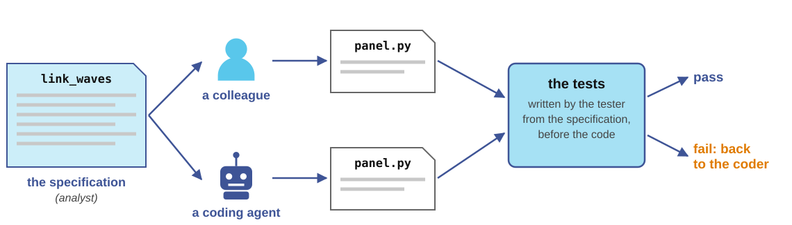{width="90%"}

:::

::: {.sm}
- A colleague and a coding agent receive **the same instructions** and their code has to pass **the same tests**
- The tester writes the tests from the specification, not from the code. Tests are done against was asked rather than what was coded.  
- Ideally, coders and testers are different people (and tend to hate each other)
:::

## What, not how

:::: {.columns}
::: {.column width="30%"}
::: {.center-h}
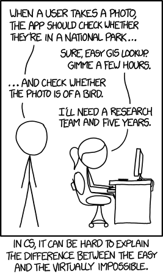{height="12.4em"}
:::
:::

::: {.column width="70%"}
::: {.sm}
- Requirements and the specification say **what** the software must do. The design says **how**
- Clients and analysts describe the need and the result, not the solution. *"Everyone's two answers side by side"* leaves the how open
- The how decides the **cost**. Two requests that sound alike can differ by years of work, as in the comic
- Estimates of cost and effort are made at the **design** stage, once the architect knows how the work will be split
:::
:::
::::

::: {.source}
xkcd 1425, "Tasks", by Randall Munroe (2014), CC BY-NC 2.5
:::

## Design: Small subtasks with clear connections {.fit1}

::: {.center-h}
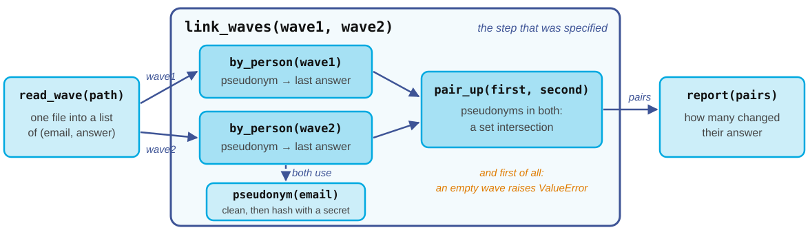{width="88%"}

:::

::: {.sm}
- The **architect** designs how to implement the specifications by breaking the  program into **small parts**, each with one job and its own specification
- The architect also decides **what data flows between the parts** and in which data structure
- Small parts are easier to test, easier to replace, and easier to hand to a coder. They are usually the size of a function or a kind of atomic component
:::

## Design: choosing the data structures

::: {.tbl-grid .sm}
| The program needs to... | Data structure (session 3) | Example |
|---|---|---|
| keep items in order | list | the (email, answer) pairs of a wave |
| look something up by a key | dictionary | pseudonym → answer, one per wave |
| check membership fast | set | the pseudonyms in both waves |
| serve first come, first served | queue | a waiting list for a seminar (to be covered in session 5)|
:::

</br>

A coder, human or agent, writes better code inside a structure the architect chose than inside one it invented on the spot

## Skipping the design: spaghetti code

::: {.center-h}
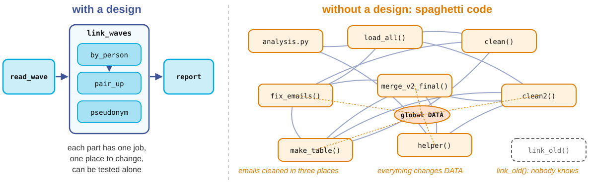{height="8.1em"}
:::

::: {.sm}
- Without a design, every new need is patched in wherever it fits: duplicated parts, a global variable that everything changes, code nobody dares to remove
- Every later change then touches many parts, and no part can be tested on its own
- Design is **pre-work**: an hour of design saves days of coding, debugging and testing down the road
:::


## Testing

::: {.outline .focus}
1. Programming in a nutshell
2. Software engineering
3. Requirements, specifications, and design
4. [Testing]{.current}
:::

## What is a test?

::: {.definition}
[Definition: Test]{.label}

::: {.sm}
A small program that runs your code on an input whose correct output you know, and checks that the code produces the expected output.
:::
:::

::: {style="font-size:0.8em"}
```python
w1 = [("ana@uni.de", "yes"), ("ben@uni.de", "no")]
w2 = [("ana@uni.de", "no"), ("eva@uni.de", "yes")]
assert list(link_waves(w1, w2).values()) == [("yes", "no")]
assert "ana@uni.de" not in str(link_waves(w1, w2))
```
:::

- The specification says what should happen. The **tester's** tests check that it does

- A failing `assert` stops the program with an error. This makes errors loud and prevent quiet errors that are only detected later


## What is pytest?

::: {.center-h}
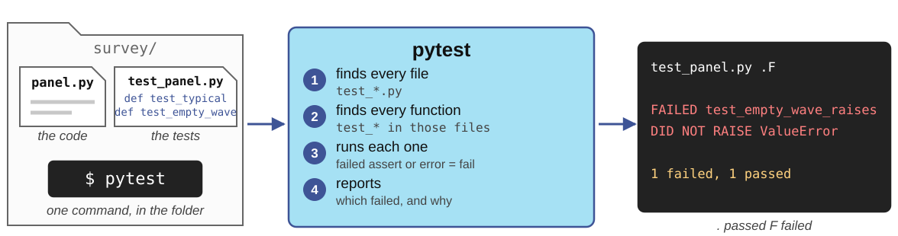{height="7.9em"}
:::

::: {.sm}
- **pytest** is a Python package for running tests
- You can install it with `pip install pytest`
- A test is a function named `test_...` in a file named `test_...`. It **passes** if it runs to the end and **fails** on a failed `assert` or an unexpected error
- One command finds all the tests, runs them, and reports which ones failed and why
:::

## Tests with pytest: the test file

:::: {.columns}
::: {.column width="64%"}
::: {style="font-size:0.78em"}
```python
# test_panel.py
import pytest
from panel import link_waves

W1 = [("ana@uni.de", "yes"),
      ("ben@uni.de", "no")]
W2 = [("ana@uni.de", "no"),
      ("eva@uni.de", "yes")]

def test_typical():
    pairs = link_waves(W1, W2)
    assert list(pairs.values()) == [("yes", "no")]
```
:::
:::

::: {.column width="36%"}
::: {.sm}
- The test file imports the function it tests from `panel.py`
- `W1` and `W2` are small test data, shared by all tests
- `test_typical` checks the ordinary case. Ana answered in both waves, so there is one pair
:::
:::
::::

## Tests with pytest: edge cases

::: {style="font-size:0.9em"}
```python
def test_case_and_spaces_are_ignored():
    w2 = [(" Ana@Uni.de", "no")]
    assert len(link_waves(W1, w2)) == 1

def test_no_emails_in_result():
    pairs = link_waves(W1, W2)
    assert "ana@uni.de" not in str(pairs)

def test_empty_wave_raises():
    with pytest.raises(ValueError):
        link_waves(W1, [])
```
:::

::: {.sm}
Each test checks one line of the specification. The last one uses `pytest.raises` to check that an error is raised
:::

# Example: A quick implementation meets the tests

:::: {.columns}
::: {.column width="50%"}
::: {style="font-size:0.73em"}
```python
def link_waves(wave1, wave2):
    first = dict(wave1)
    return {email: (first[email], answer)
            for email, answer in wave2
            if email in first}
```
:::

::: {.sm}
A coder's first try. Plausible, short, and wrong three times
:::
:::

::: {.column width="50%"}
::: {style="font-size:0.69em"}
```
$ pytest -q
.FFF
FAILED test_case_and_spaces_are_ignored
  assert 0 == 1
FAILED test_no_emails_in_result
  'ana@uni.de' is contained here
FAILED test_empty_wave_raises
  DID NOT RAISE ValueError
3 failed, 1 passed
```
:::
:::
::::

::: {.sm}
- It compares emails exactly, so `" Ana@Uni.de"` becomes a new person and panel members **quietly disappear**
- It keys the result by email, so the privacy requirement is broken without any error
- The fix is to clean each email, key the result by `pseudonym(email)`, and raise an error if a wave is empty. Then all four tests pass
:::

## Choosing test cases

::: {.tbl-grid}
| Kind | Example input | Expected |
|---|---|---|
| Typical | Ana in both waves, Ben and Eva in one | one pair, `("yes", "no")` |
| Spelling | `" Ana@Uni.de"` and `"ana@uni.de"` | the same person |
| Duplicates | Ana twice in wave 1 | her last answer |
| Boundary | nobody in both waves | `{}` |
| Empty | `[]` as a wave | `ValueError` |
| Must not happen | an email in the result, a changed list | never |
:::

::: {.sm}
Write one test for every line of the specification, and more wherever it draws a line, such as spelling, duplicates, nobody in common, and empty input
:::

## Test first, then implement


::: {.center-h}
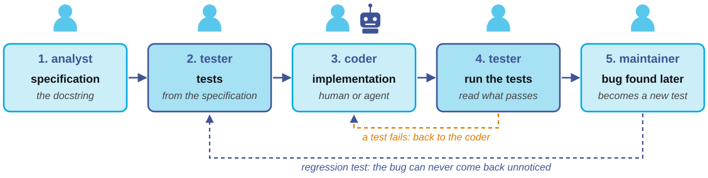{width="100%"}
:::

- The tests exist **before** the code, so they record what was meant and not what the code happens to do
- The tests are your measurement. They replace the feeling that the code works with evidence that it does. Adapting tests to existing code is a mistake that invalidates the original purpose of testing


## Maintenance example: the third wave arrives

::: {.example .sm}
*"Great! In spring we run a third wave. Can we link all three?"* (Ana, a year later)
:::

::: {.center-h}
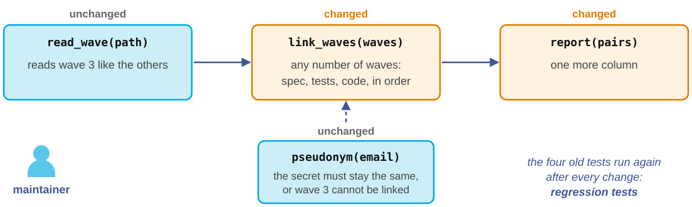{width="88%"}

:::

::: {.sm}
The **maintainer** goes through the flow again on a small scale. First the specification changes, then the tests, then the code
:::

## The flow leaves documentation behind

::: {.center-h}
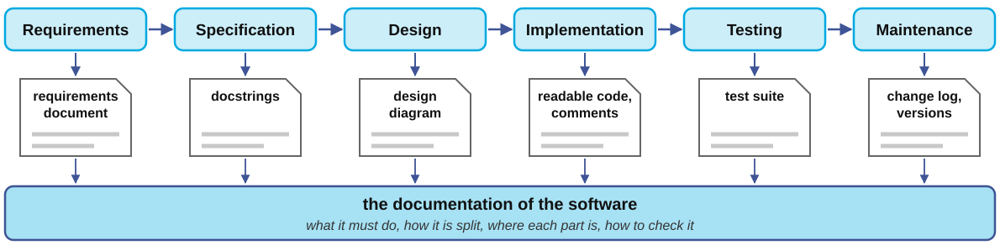{height="8.4em"}
:::

::: {.example .sm}
[Symbian]{.label}
20 million lines of code and no map of them. Moving an element by 5 mm needs to know which part draws the screen and what depends on it. A design document would have said where; tests would have said what breaks
:::

## What tests cannot do

::: {.example}
::: {.sm}
*"Program testing can be used to show the presence of bugs, but never to show their absence."*<br>
Edsger W. Dijkstra, *Notes on Structured Programming* (1970)
:::
:::

::: {.sm}
- Tests check only the cases you thought of. A missing requirement produces missing tests
- **Software verification** goes further. It *proves*, with mathematics, that a program meets its specification for **every** input. It is expensive, so it is used where failure is unacceptable, as in aircraft control, railway signaling and operating system kernels
- For research code, the practical combination is a specification, tests, and **reading** the code you did not write
:::

## A proof instead of a test: a loop invariant {.fit1}

::: {.concept .sm}
[Loop invariant]{.label}
A statement that is true before every turn of a loop. Here: `total` is the sum of the first `i` elements
:::

:::: {.columns}
::: {.column width="52%"}
::: {style="font-size:0.82em"}
```python
def mean(xs):
    """xs: a non-empty list of numbers.
    Returns: their mean."""
    total = 0
    i = 0
    while i < len(xs):
        # invariant: total == sum(xs[:i])
        total = total + xs[i]
        i = i + 1
    return total / len(xs)
```
:::
:::

::: {.column width="48%"}
::: {.sm}
1. **Before the loop**: `i` and `total` are 0, the sum of no elements
2. **Each turn**: `total` gains `xs[i]` and `i` grows by 1, so the invariant still holds
3. **After the loop**: `i == len(xs)`, so `total` is the sum of all elements. The list is not empty, so there is no division by zero
:::
:::
::::

::: {.sm}
A test checks one list. This argument covers **every** non-empty list. Verification tools check such arguments by computer
:::

## Summary {.fit2}

::: {.sm}
- A **program** is a precise list of instructions, run by an **interpreter** or translated by a **compiler**
- **Paradigms** differ in how they express a computation. Imperative programs change state step by step, and **objects** bundle data with methods, as in `s.upper()` or your own classes
- **Software engineering** puts coding inside a loop of requirements, specification, design, implementation, testing and maintenance
- **Requirements** say what is needed, the **specification** says exactly what the program must do, and the **design** splits it into small parts
- A **test** runs the code on cases with known answers. Write the tests first, then implement, whoever the coder is
- With coding agents, implementation is cheap. **Everything around it** is the part you cannot delegate
:::

::: {.concept .xs}
**Research assistant job opening:** help review the psychological literature for simulations of human behavior with LLMs. Interested? Drop me an email or talk to me after class
:::

**Next session:** Algorithms
