## Course Outline

:::: {.columns}
::: {.column width="50%"}
::: {}
- *Session 1: Introduction*
- *Session 2: Information Coding*
- *Session 3: Data Structures*
- *Session 4: Software*
- **Session 5: Algorithms**
- Session 6: Recursion
- Session 7: Sorting Algorithms
:::
:::

::: {.column width="50%"}
::: {}
- Session 8: Time Complexity
- Session 9: Theoretical Computer Science
- Session 10: Databases
- Session 11: Machine Learning
- Session 12: Parallel Programming
- Session 13: Social Science Applications
- Session 14: Exam Review
:::
:::
::::

## Outline

::: {.outline}
1. Algorithms
2. Representation of Algorithms
3. Abstract Data Structures
    - Queues and Stacks
    - Graphs
:::

<!-- MOTIVATION:M05-B:BEGIN -->
## Whose contacts, within two steps?

::: {.motivation}
[Motivating example]{.label}
A case is confirmed on Monday. Public health needs everyone this person met and
everyone **those** people met, without checking the whole population.
On the contact graph of a mid-sized city this is thousands of people, and the
answer is needed in **seconds**.
:::

- "Everyone within two steps" is easy to say, but a machine needs to know
  *which person you look at next* and *how you know you are finished*.

[What is the exact recipe to find them and how do you keep from going round in circles?]{.ask}
<!-- MOTIVATION:M05-B:END -->

<!-- MOTIVATION:M05-C:BEGIN -->
## The network that would not fit

::: {.motivation}
[Motivating example]{.label}
You want to store who is friends with whom among the **3 billion** users of
Facebook. Written as a table of everyone against everyone, this takes
**9 × 1018 cells**, i.e. about one exabyte at one bit each. Written
as a list of friends per user, with about 200 friends each, it takes about
2.4 terabytes and answers the same questions.
:::

:::: {.figures}
::: {.fq}
[9 × 1018]{.big}[cells, as a matrix]{.cap}
:::
::: {.fq}
[3 × 1011]{.big}[friendships, as adjacency lists]{.cap}
:::
::: {.fq}
[~500,000×]{.big}[smaller, same facts]{.cap}
:::
::::

[Why are the memory requirements so different and when could they be more similar?]{.ask}
<!-- MOTIVATION:M05-C:END -->

## What is an algorithm?

::: {.definition}
[Definition]{.label}

::: {.sm}
An algorithm is a self-contained step-by-step set of operations to solve a given problem. Algorithms perform calculation, data processing, and/or automated reasoning tasks.
:::
:::

::: {.center-h}
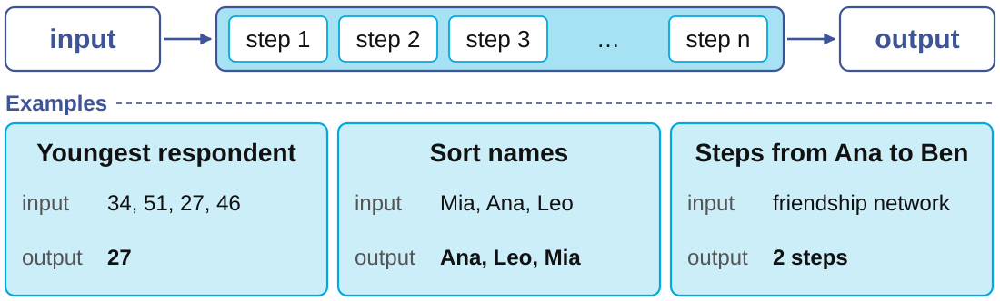{height="8.6em"}
:::

## Other uses of the word algorithm {.fit1}

:::: {.columns}
::: {.column width="66%"}
::: {.sm}
The word *algorithm* is commonly used nowadays with slightly different meanings, especially in the context of Artificial Intelligence:

- Algorithm as **method to fit a predictive model**. It can be as simple as least squares to fit linear regression and as complicated as distributed stochastic gradient descent to fit neural networks
- Algorithm as **the model after training**. This focuses on the predictive model as a program with a behavior that is not carefully designed, but learned from empirical data.
:::

::: {.center-h .sm}
Related terms to these other meanings: algorithmic bias, algorithmic media, machine behavior, algorithm auditing, algorithmic decision-making…
:::
:::

::: {.column width="34%"}
::: {.imgcol}
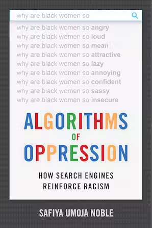{height="7.4em"}

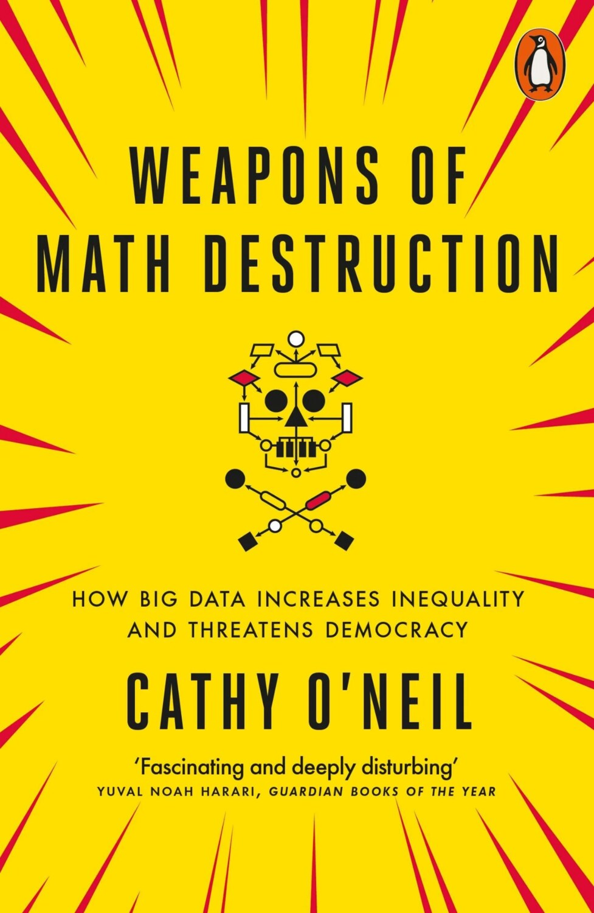{height="7.4em"}
:::
:::
::::

## al-Khwarizmi: the namesake of algorithms {.fit1}

:::: {.columns}
::: {.column width="62%"}
::: {.xs}
**Muhammad ibn Musa abu Djafar al-Khwarizmi** (780 – 850, Khwarazm, Uzbekistan)

- Popularized algebra and published the first systematic way to solve linear and quadratic equations
- His book on how to calculate with Hindu-Arabic numerals was translated into Latin with the title *Algoritmi de Numero Indorum*
- *Algoritmi* later changed to *Algorithmus* as a mix with *arithmos* in Greek (number)
:::
:::

::: {.column width="38%"}
::: {.center-h}
{height="9.0em"}
:::
:::
::::

::: {.xs}
- It is clear that algorithms predate him (e.g. in Babylon, Egypt, India, and Greece)
- He widely popularized the idea of systematic treatment of data (numbers)
- He emphasized doing this in as few steps as possible, thus using a decimal system with pen and paper rather than Roman numerals with an abacus
:::

## Example: finding the kth smallest element {.fit1}

:::: {.columns}
::: {.column width="56%"}
::: {.codewrap style="font-size:1.25em"}
<pre class="pseudocode"><b>Procedure</b> K-SMALLEST-ELEMENT(<i>M</i>, <i>n</i>, <i>k</i>)
<i>Inputs:</i>
      <i>M</i>: an array
      <i>n</i>: the number of elements in <i>M</i>
      <i>k</i>: the rank to find (<i>k</i> = 1 is the minimum)
<i>Result:</i> the <i>k</i>-th smallest element of <i>M</i>
<b>For</b> <i>i</i> = 1 to <i>k</i>:
      <i>smallest</i> &larr; <i>i</i>
      <b>For</b> <i>j</i> = <i>i</i> + 1 to <i>n</i>:
            <b>If</b> <i>M</i>[<i>j</i>] &lt; <i>M</i>[<i>smallest</i>]
                  <b>then</b> <i>smallest</i> &larr; <i>j</i>
      swap <i>M</i>[<i>i</i>] with <i>M</i>[<i>smallest</i>]
<b>return</b> <i>M</i>[<i>k</i>]</pre>
:::
:::

::: {.column width="44%"}
::: {.sm}
**The idea:** in round $i$, find the smallest of the elements not yet placed and swap it to position $i$. After $k$ rounds, position $k$ holds the $k$-th smallest element.

**Example:** $M = [34, 51, 27, 46]$, $k = 2$

- Round 1 swaps 27 to the front: $[27, 51, 34, 46]$
- Round 2 swaps 34 to position 2: $[27, 34, 51, 46]$
- The algorithm returns $M[2] = 34$
:::
:::
::::

## Properties of algorithms: specification {.fit1}

:::: {.columns}
::: {.column width="56%"}
::: {.codewrap style="font-size:1.25em"}
<pre class="pseudocode"><b>Procedure</b> K-SMALLEST-ELEMENT(<i>M</i>, <i>n</i>, <i>k</i>)
<i>Inputs:</i>
      <i>M</i>: an array
      <i>n</i>: the number of elements in <i>M</i>
      <i>k</i>: the rank to find (<i>k</i> = 1 is the minimum)
<i>Result:</i> the <i>k</i>-th smallest element of <i>M</i>
<b>For</b> <i>i</i> = 1 to <i>k</i>:
      <i>smallest</i> &larr; <i>i</i>
      <b>For</b> <i>j</i> = <i>i</i> + 1 to <i>n</i>:
            <b>If</b> <i>M</i>[<i>j</i>] &lt; <i>M</i>[<i>smallest</i>]
                  <b>then</b> <i>smallest</i> &larr; <i>j</i>
      swap <i>M</i>[<i>i</i>] with <i>M</i>[<i>smallest</i>]
<b>return</b> <i>M</i>[<i>k</i>]</pre>
:::
:::

::: {.column width="44%"}
::: {.sm}
**Specification:**

- **Input specification:** the input required so that the output can be produced (many inputs or none)
- **Output specification:** the result the algorithm produces

**In the example (highlighted):** the inputs are the array $M$, its length $n$ and the rank $k$. The result is the $k$-th smallest element of $M$.
:::
:::
::::

## Properties of algorithms: transferability {.fit1}

:::: {.columns}
::: {.column width="56%"}
::: {.codewrap style="font-size:1.25em"}
<pre class="pseudocode"><b>Procedure</b> K-SMALLEST-ELEMENT(<i>M</i>, <i>n</i>, <i>k</i>)
<i>Inputs:</i>
      <i>M</i>: an array
      <i>n</i>: the number of elements in <i>M</i>
      <i>k</i>: the rank to find (<i>k</i> = 1 is the minimum)
<i>Result:</i> the <i>k</i>-th smallest element of <i>M</i>
<b>For</b> <i>i</i> = 1 to <i>k</i>:
      <i>smallest</i> &larr; <i>i</i>
      <b>For</b> <i>j</i> = <i>i</i> + 1 to <i>n</i>:
            <b>If</b> <i>M</i>[<i>j</i>] &lt; <i>M</i>[<i>smallest</i>]
                  <b>then</b> <i>smallest</i> &larr; <i>j</i>
      swap <i>M</i>[<i>i</i>] with <i>M</i>[<i>smallest</i>]
<b>return</b> <i>M</i>[<i>k</i>]</pre>
:::
:::

::: {.column width="44%"}
::: {.sm}
**Transferability:**

- The input is given as parameters
- Different instances of the problem must be allowed as inputs

**In the example (highlighted):** $M$, $n$ and $k$ are parameters, so the same procedure works for an array of any length and for any $k$ from 1 to $n$, not for one fixed list.
:::
:::
::::

## Properties of algorithms: description and execution {.fit1}

:::: {.columns}
::: {.column width="56%"}
::: {.codewrap style="font-size:1.25em"}
<pre class="pseudocode"><b>Procedure</b> K-SMALLEST-ELEMENT(<i>M</i>, <i>n</i>, <i>k</i>)
<i>Inputs:</i>
      <i>M</i>: an array
      <i>n</i>: the number of elements in <i>M</i>
      <i>k</i>: the rank to find (<i>k</i> = 1 is the minimum)
<i>Result:</i> the <i>k</i>-th smallest element of <i>M</i>
<b>For</b> <i>i</i> = 1 to <i>k</i>:
      <i>smallest</i> &larr; <i>i</i>
      <b>For</b> <i>j</i> = <i>i</i> + 1 to <i>n</i>:
            <b>If</b> <i>M</i>[<i>j</i>] &lt; <i>M</i>[<i>smallest</i>]
                  <b>then</b> <i>smallest</i> &larr; <i>j</i>
      swap <i>M</i>[<i>i</i>] with <i>M</i>[<i>smallest</i>]
<b>return</b> <i>M</i>[<i>k</i>]</pre>
:::
:::

::: {.column width="44%"}
::: {.sm}
**Description:**

- **Finiteness:** it must terminate after a finite number of steps
- **Definiteness:** each step is clear, well defined and precise

**Execution:** **deterministic** (same input, same output) or **stochastic** (a random component makes the output vary)

**In the example (highlighted):** both loops have fixed bounds, so it stops after at most $k \cdot n$ steps. Nothing is random, so it is deterministic.
:::
:::
::::

## Properties of algorithms: time and memory complexity {.fit1}

:::: {.columns}
::: {.column width="56%"}
::: {.codewrap style="font-size:1.25em"}
<pre class="pseudocode"><b>Procedure</b> K-SMALLEST-ELEMENT(<i>M</i>, <i>n</i>, <i>k</i>)
<i>Inputs:</i>
      <i>M</i>: an array
      <i>n</i>: the number of elements in <i>M</i>
      <i>k</i>: the rank to find (<i>k</i> = 1 is the minimum)
<i>Result:</i> the <i>k</i>-th smallest element of <i>M</i>
<b>For</b> <i>i</i> = 1 to <i>k</i>:
      <i>smallest</i> &larr; <i>i</i>
      <b>For</b> <i>j</i> = <i>i</i> + 1 to <i>n</i>:
            <b>If</b> <i>M</i>[<i>j</i>] &lt; <i>M</i>[<i>smallest</i>]
                  <b>then</b> <i>smallest</i> &larr; <i>j</i>
      swap <i>M</i>[<i>i</i>] with <i>M</i>[<i>smallest</i>]
<b>return</b> <i>M</i>[<i>k</i>]</pre>
:::
:::

::: {.column width="44%"}
::: {.sm}
**Time complexity:** the effort the algorithm needs, measured by counting key operations such as comparisons

**Memory complexity:** the memory needed during execution, measured as the maximum space used

**In the example (highlighted):** the comparison runs fewer than $k \cdot n$ times. Besides $M$, the algorithm only stores $i$, $j$ and $smallest$, so its extra memory does not grow with $n$.
:::
:::
::::

## Properties of algorithms: correctness {.fit1}

:::: {.columns}
::: {.column width="56%"}
::: {.codewrap style="font-size:1.25em"}
<pre class="pseudocode"><b>Procedure</b> K-SMALLEST-ELEMENT(<i>M</i>, <i>n</i>, <i>k</i>)
<i>Inputs:</i>
      <i>M</i>: an array
      <i>n</i>: the number of elements in <i>M</i>
      <i>k</i>: the rank to find (<i>k</i> = 1 is the minimum)
<i>Result:</i> the <i>k</i>-th smallest element of <i>M</i>
<b>For</b> <i>i</i> = 1 to <i>k</i>:
      <i>smallest</i> &larr; <i>i</i>
      <b>For</b> <i>j</i> = <i>i</i> + 1 to <i>n</i>:
            <b>If</b> <i>M</i>[<i>j</i>] &lt; <i>M</i>[<i>smallest</i>]
                  <b>then</b> <i>smallest</i> &larr; <i>j</i>
      swap <i>M</i>[<i>i</i>] with <i>M</i>[<i>smallest</i>]
<b>return</b> <i>M</i>[<i>k</i>]</pre>
:::
:::

::: {.column width="44%"}
::: {.sm}
**Correctness:**

- **Partial correctness:** whenever the algorithm terminates, its output is correct
- **Termination:** for correct inputs, it always terminates in a finite number of steps

**In the example (highlighted):** after round $i$, positions 1 to $i$ hold the $i$ smallest elements in order. So $M[k]$ is the $k$-th smallest for any $1 \le k \le n$.
:::
:::
::::

## Representation of Algorithms

::: {.outline .focus}
1. Algorithms
2. [Representation of Algorithms]{.current}
3. Abstract Data Structures
    - Queues and Stacks
    - Graphs
:::

## Representation

::: {.center-h}
**How to create a new program?**
:::

::: {.example style="width:70%;margin:0.8em auto"}
::: {.sm}
- Evaluate your requirements

- Define a structure for programming with a method of representation for its algorithm:
  - Pseudocode
  - Structograms
  - Flow diagrams
  - UML Unified Modeling Language

- Start programming
:::
:::

## Representation

::: {.center-h}
**How to create a new program?**
:::

::: {.example style="width:70%;margin:0.8em auto"}
::: {.sm}
- Evaluate your requirements

- Define a structure for programming with a method of representation for its algorithm:
  - **Pseudocode**
  - Structograms
  - **Flow diagrams**
  - UML Unified Modeling Language

- Start programming
:::
:::

## Pseudocode

::: {.sm}
- representation of the steps in an algorithm as a combination of natural language and mathematical notation
- often uses structural conventions of a programming language
- not for machine interpretation but for illustration purposes among humans
:::

::: {.codewrap style="font-size:1.10em"}
<pre class="pseudocode" style="width:56%;margin:0.6em auto"><b>Procedure</b> NAME(<i>inputs</i>)
<i>Inputs:</i> input variables
<i>Data:</i> auxiliary variables
<i>Result:</i> output variables
preparation
<b>While</b> not the trivial case:
      work
bookkeeping</pre>
:::

## Good pseudocode

:::: {.columns}
::: {.column width="50%"}
::: {.codewrap style="font-size:1.10em"}
<pre class="pseudocode"><b>Procedure</b> NAME(<i>inputs</i>)
<i>Inputs:</i> input variables
<i>Data:</i> auxiliary variables
<i>Result:</i> output variables
preparation
<b>While</b> not the trivial case:
      work
bookkeeping</pre>
:::
:::

::: {.column width="50%"}
::: {.sm}
Specify **input** and **output** if not clear from the context (problem)

 

If you use auxiliary data structures, comment how to access and edit them

 

Make sure loops and conditional scopes are **unambiguous**
:::
:::
::::

::: {.sm}
**Bottom line:** using your pseudocode, another human has to be able to follow its instructions to solve the problem with pen and paper (and later program it)
:::

## Flowcharts {.fit1}

::: {}
- graphical representation of execution of an algorithm using symbols and transitions
- shows the steps as boxes, and their order by connecting the boxes with arrows
:::

::: {.center-h}
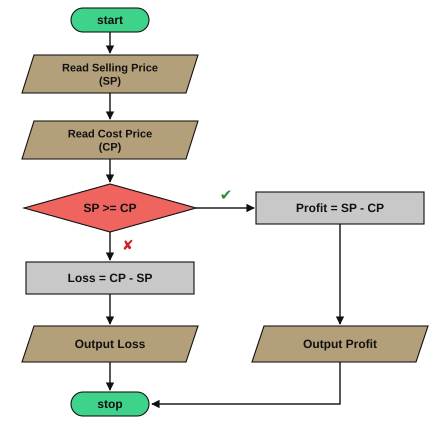{height="12.4em"}
:::

## Flowchart symbols {.fit2}

:::: {.columns}
::: {.column width="64%"}
- program start and end
  - beginning and ending of a program or sub-process

- data
  - process of inputting/entering and outputting/displaying data

- execute operations
  - set of operations that changes value, form, or location of data

- conditional split
  - conditional operation that determines the program path
  - commonly a yes/no question or true/false test
:::

::: {.column width="36%"}
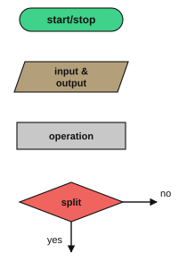{height="14.0em"}
:::
::::

## Example: a flowchart with a conditional

:::: {.columns}
::: {.column width="42%"}
{height="12.9em"}
:::

::: {.column width="58%"}
::: {.xs}
- The program starts and reads selling price as SP
- Then reads cost price as CP
- The program tests if SP is larger than or equal CP
- If the condition is true, it takes the right path:
  - Calculate profit as SP-CP
  - Output profit
- If the condition is false, it takes the bottom path:
  - Calculate loss as CP - SP
  - Then output loss
- Program ends
:::
:::
::::

## Example: a flowchart for the kth smallest element {.fit1}

:::: {.columns}
::: {.column width="54%"}
::: {.center-h}
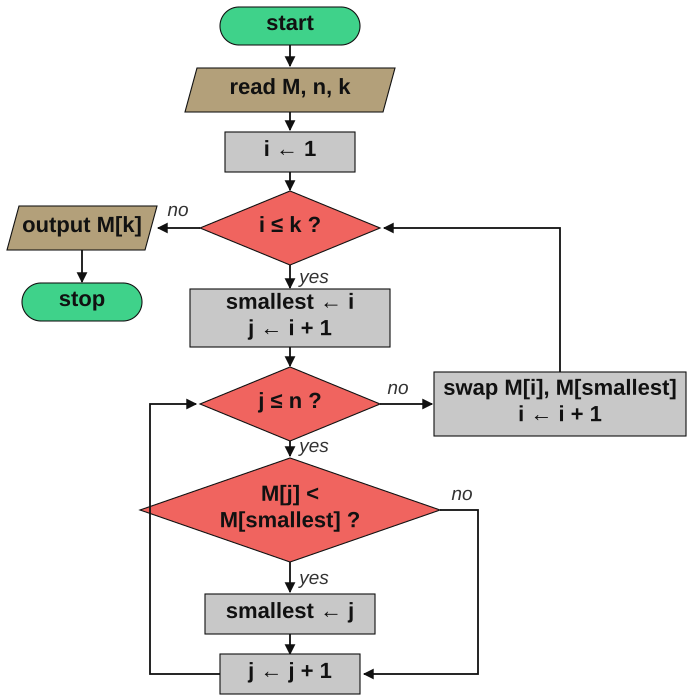{height="16.4em"}
:::
:::

::: {.column width="46%"}
::: {.sm}
- **Start and stop** (green): where the program begins and ends
- **Data** (brown): reads $M$, $n$, $k$ and outputs $M[k]$
- **Operations** (gray): change values, such as the swap
- **Conditions** (red): $i \le k$ and $j \le n$ decide whether a loop runs again, $M[j] < M[smallest]$ whether a smaller element was found
- **Arrows back up** are the loops: the outer one returns to $i \le k$, the inner one to $j \le n$
:::
:::
::::

## Pseudocode and flowchart side by side {.fit1}

:::: {.columns}
::: {.column width="50%"}
::: {.codewrap style="font-size:1.30em"}
<pre class="pseudocode"><b>Procedure</b> K-SMALLEST-ELEMENT(<i>M</i>, <i>n</i>, <i>k</i>)
<i>Inputs:</i>
      <i>M</i>: an array
      <i>n</i>: the number of elements in <i>M</i>
      <i>k</i>: the rank to find (<i>k</i> = 1 is the minimum)
<i>Result:</i> the <i>k</i>-th smallest element of <i>M</i>
<b>For</b> <i>i</i> = 1 to <i>k</i>:
      <i>smallest</i> &larr; <i>i</i>
      <b>For</b> <i>j</i> = <i>i</i> + 1 to <i>n</i>:
            <b>If</b> <i>M</i>[<i>j</i>] &lt; <i>M</i>[<i>smallest</i>]
                  <b>then</b> <i>smallest</i> &larr; <i>j</i>
      swap <i>M</i>[<i>i</i>] with <i>M</i>[<i>smallest</i>]
<b>return</b> <i>M</i>[<i>k</i>]</pre>
:::

:::

::: {.column width="50%"}
::: {.center-h}
{height="16.4em"}
:::
:::
::::

## Abstract Data Structures

::: {.outline .focus}
1. Algorithms
2. Representation of Algorithms
3. [Abstract Data Structures]{.current}
    - Queues and Stacks
    - Graphs
:::

## Abstract Data Structures {.fit1}

::: {.sm}
- Characteristics
  - represent data in a way best suited to our (algorithmic) needs
    - arrangement, coding and link among data matter
  - allow for administration and access to data in an efficient way
  - exact specification is dependent on implementation and the use case
- We already saw a number of abstract data structures
  - arrays
  - linked lists
  - binary search trees
  - associative arrays (= dictionaries)
- Choice of data structure matters a lot for performance of specific algorithms
  - we will see illustrative examples next
:::

## Queues {.fit1}

:::: {.columns}
::: {.column width="56%"}
::: {.sm}
- Linear data structure following the **FIFO** principle, i.e. First In, First Out
- Two operations:
  - ENQUEUE($Q$, $v$) adds element $v$ to the rear of the queue $Q$
  - DEQUEUE($Q$) removes and returns the element at the front of the queue $Q$
- Example applications:
  - processing requests in order
  - having several queues for priority
:::
:::

::: {.column width="44%"}
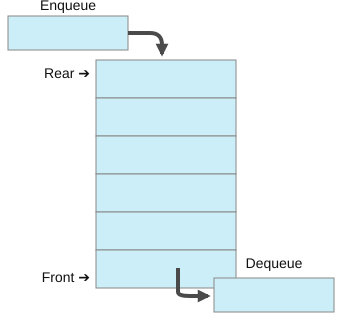{height="13.1em"}
:::
::::

## Stacks {.fit1}

:::: {.columns}
::: {.column width="56%"}
::: {.sm}
- Linear data structure following the **LIFO** principle, i.e. Last In, First Out
- Two operations:
  - PUSH($S$, $v$) adds an element $v$ to the top of the stack $S$
  - POP($S$) removes and returns the most recently added element, i.e. the top of the stack $S$
- Example applications:
  - Stack segment of the memory
    - management of layered execution of sub-routines
  - Recursion, with more details in the Recursion session
:::
:::

::: {.column width="44%"}
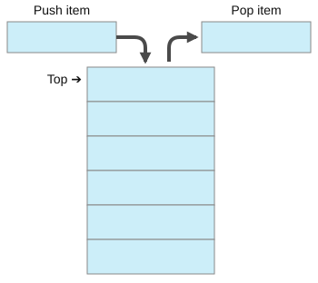{height="13.9em"}
:::
::::

## Graphs: motivation

:::: {.columns}
::: {.column width="48%"}
::: {}
**Leonhard Euler: Seven bridges of Königsberg**

**Problem:** Find a path that uses every bridge exactly once and ends in the same place.

Example of a graph representation in a problem that motivated graph theory
:::
:::

::: {.column width="52%"}
::: {.center-h}
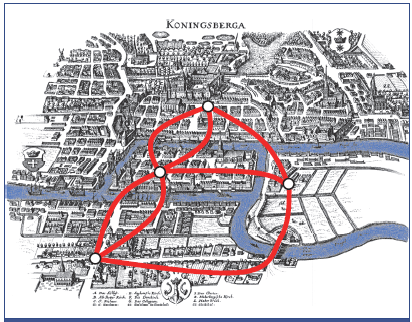{height="10.0em"}
:::

::: {.source}
By Peter Berger: *Einführung in die Graphentheorie*
:::
:::
::::

## Graph examples

::: {}
Many real-world structures can be represented as a graph. Examples are:
:::

:::: {.columns}
::: {.column width="33%"}
::: {.center-h}
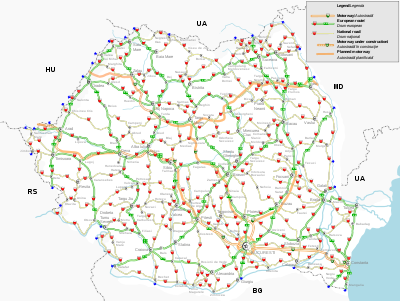{height="5.1em"}

::: {.xs}
A road map
:::

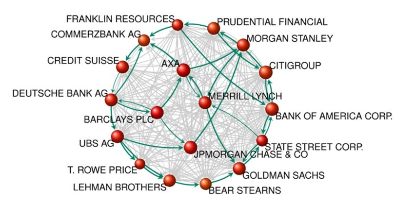{height="5.1em"}

::: {.xs}
Company ownerships
:::
:::
:::

::: {.column width="33%"}
::: {.center-h}
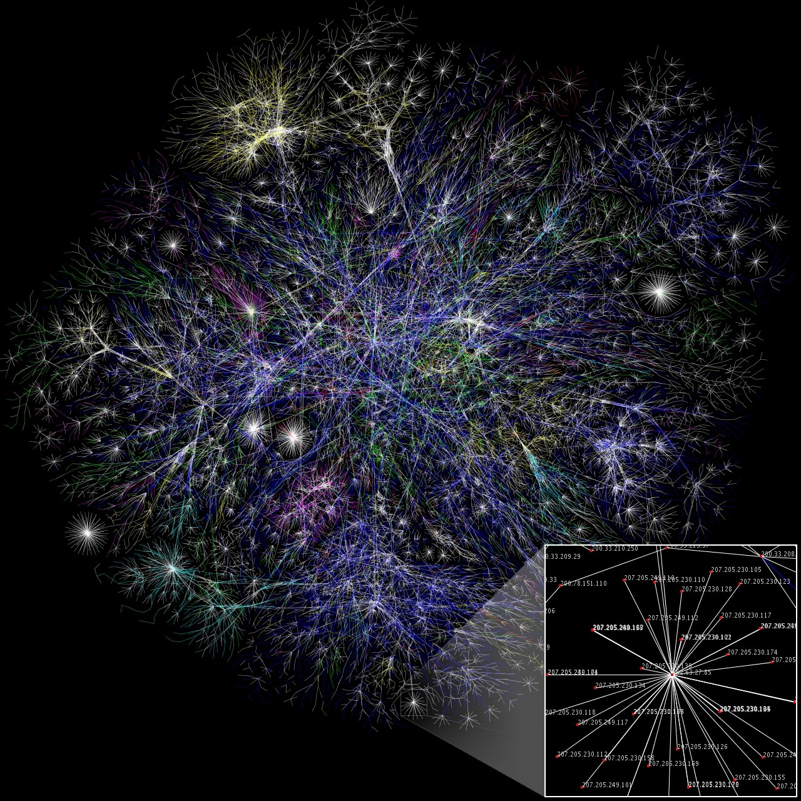{height="5.1em"}

::: {.xs}
The Internet
:::

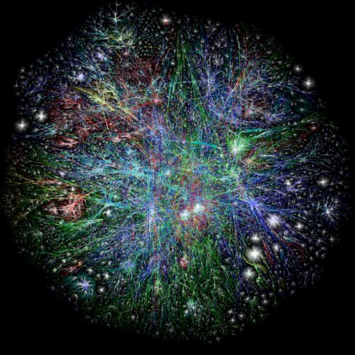{height="5.1em"}

::: {.xs}
The Web
:::
:::
:::

::: {.column width="33%"}
::: {.center-h}
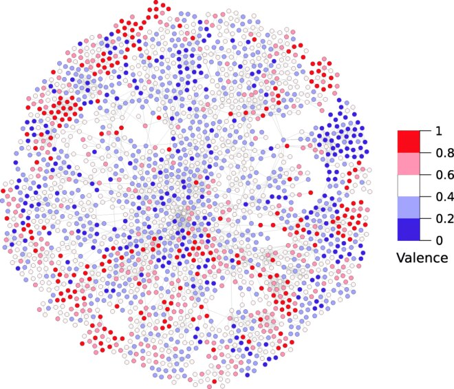{height="5.1em"}

::: {.xs}
Word associations
:::

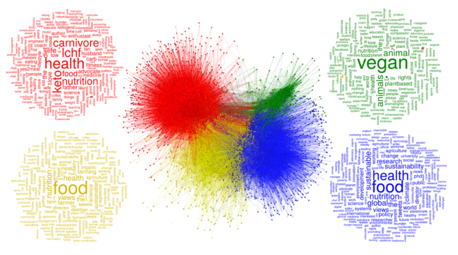{height="5.1em"}

::: {.xs}
Social relations
:::
:::
:::
::::

## Graphs

::: {.sm}
- consist of **vertices** and **edges**
- especially suitable to represent interdependencies between data points
:::

::: {.center-h}
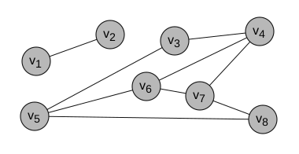{height="11.6em"}
:::

## Graphs: vertices and edges

::: {.sm}
- **vertices** represent any object
  - cities, physical states, atoms, steps in a process, persons
  - can be labeled or not
- **edges** represent the relationship between nodes
  - roads between cities, transitions between physical states, atomic bonds etc.
  - edges can have labels and variables, for example
    - physical distance (e.g. 2 Km in a map)
    - type of connection (e.g. friends or enemies)
    - weight of connection (e.g. strong versus weak)
  - can be **directed** or **undirected**
:::

## Graphs: Formalization

::: {.definition style="width:74%;margin:0.6em auto"}
::: {}
A graph $G$ is a tuple $G = (V, E)$, where

- $V$ is the set of all **vertices**
- $E$ is the set of all **edges**
:::
:::

::: {}
- For **directed** graphs, $E$ consists of ordered pairs $(v_1, v_2)$, i.e., the edge goes from $v_1$ to $v_2$
- For **undirected** graphs, $E$ consists of unordered pairs $\{v_1, v_2\}$
- How do we represent graphs as an abstract data structure?
:::

## Adjacency Matrix {.fit2}

::: {.definition}
[Definition of Adjacency Matrix]{.label}

::: {.sm}
Two vertices $v, w \in V$ of a graph $G = (V, E)$ are **adjacent** if they are connected by an edge $\{v, w\} \in E$.
The **adjacency matrix** $A(G)$ has $a_{v,w} = 1$ if $\{v, w\} \in E$ and $a_{v,w} = 0$ otherwise.
:::
:::

:::: {.columns}
::: {.column width="55%"}
{height="10.8em"}
:::

::: {.column width="45%"}
::: {.xxs}
$$A(G) = \begin{array}{c|cccccccc}
 & v_1 & v_2 & v_3 & v_4 & v_5 & v_6 & v_7 & v_8\\\hline
v_1 & 0&1&0&0&0&0&0&0\\
v_2 & 1&0&0&0&0&0&0&0\\
v_3 & 0&0&0&1&1&0&0&0\\
v_4 & 0&0&1&0&0&1&1&0\\
v_5 & 0&0&1&0&0&1&0&1\\
v_6 & 0&0&0&1&1&0&1&0\\
v_7 & 0&0&0&1&0&1&0&1\\
v_8 & 0&0&0&0&1&0&1&0
\end{array}$$
:::
:::
::::

## Adjacency list {.fit1}

::: {.sm}
**Adjacency list:** Alternative representation to adjacency matrix

- array of vertices in which all neighbors are stored as a linear list
- compressed representation of an adjacency matrix where all zeros have been eliminated
- more memory efficient for sparse graphs
:::

:::: {.columns}
::: {.column width="62%"}
{height="9.6em"}
:::

::: {.column width="38%"}
::: {.tbl-grid .sm}
| | |
|---|---|
| $v_1$ | $\rightarrow v_2$ |
| $v_2$ | $\rightarrow v_1$ |
| $v_3$ | $\rightarrow v_4 \rightarrow v_5$ |
| $v_4$ | $\rightarrow v_3 \rightarrow v_6 \rightarrow v_7$ |
| $v_5$ | $\rightarrow v_3 \rightarrow v_6 \rightarrow v_8$ |
| $v_6$ | $\rightarrow v_4 \rightarrow v_5 \rightarrow v_7$ |
| $v_7$ | $\rightarrow v_4 \rightarrow v_6 \rightarrow v_8$ |
| $v_8$ | $\rightarrow v_5 \rightarrow v_7$ |
:::
:::
::::

## Adjacency Matrix vs Adjacency List {.fit1}

:::: {.columns}
::: {.column width="48%"}
::: {.sm}
- Does an edge exist between $v_i$ and $v_j$?
  - the matrix gives direct access
  - the list iterates through the neighbors
- How many edges does $v_i$ have?
  - the matrix iterates through all vertices
  - the list iterates only through the neighbors
- Adjacency lists are more memory efficient for **sparse** networks, i.e. networks with few edges per node
:::
:::

::: {.column width="52%"}
::: {.example .sm}
[The network that would not fit, calculated]{.label}
Facebook has about $n = 3 \times 10^9$ users with about 200 friends each.

- **Adjacency matrix:** $n^2 = 9 \times 10^{18}$ cells at one bit each, i.e. about 1.1 exabytes
- **Adjacency lists:** $3 \times 10^{11}$ friendships, each stored twice, i.e. $6 \times 10^{11}$ entries of 4 bytes, about 2.4 terabytes
- The lists are about 500,000 times smaller and hold the same facts
:::
:::
::::

## Examples of Graph Problems {.fit1}

:::: {.columns}
::: {.column width="42%"}
::: {.sm}
- [**Shortest paths**]{style="color:#e07b00"} and distances between nodes
- [**Connected subgraphs**]{style="color:#00a9e0"}, with a path between every two of their nodes
- [**Central nodes**]{style="color:#3e5496"}, with the shortest average distance to the others
- [**Spanning trees**]{style="color:#2e9e4f"} that connect all nodes with the fewest edges
- **Coloring** nodes so that no two neighbors share a color
- **Isomorphism**: can two graphs be mapped onto each other?
:::
:::

::: {.column width="58%"}
::: {.center-h}
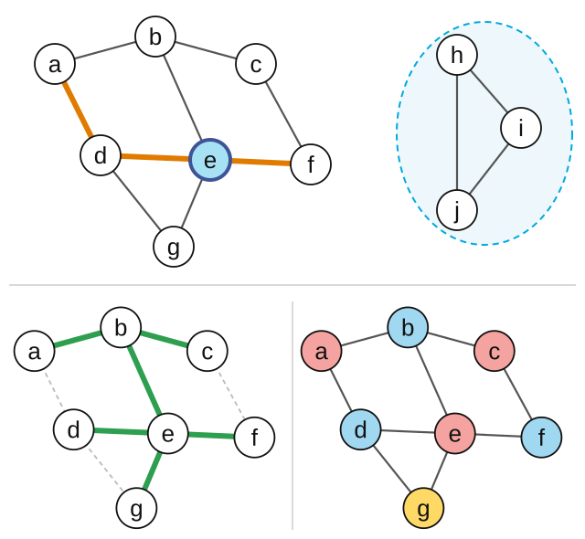{height="15.6em"}
:::
:::
::::

## Example: Finding distances {.fit1}

::: {.sm}
**Problem:** given a source node (also called starting node) $s$, find all nodes reachable from it and a shortest path to each of them
:::

:::: {.columns}
::: {.column width="55%"}
::: {.sm}
Let's consider this undirected graph $G = (V, E)$ with

- $V = \{a,b,c,d,e,f,g\}$
- $E = \{\{a,e\}, \{e,b\}, \{b,c\}, \{c,f\},$ $\{c,g\}, \{d,g\}, \{e,f\}\}$
- source node $s = c$

$\rightarrow$ To solve it we use the **Breadth-First Search (BFS)** algorithm
:::
:::

::: {.column width="45%"}
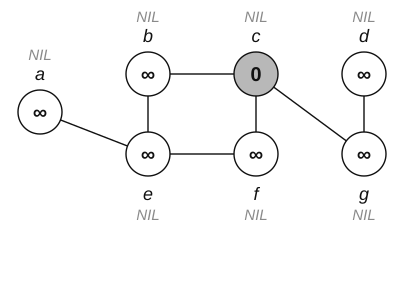{height="11.6em"}
:::
::::

## Algorithm: Breadth-First Search {.fit1}

::: {.sm}
**The first step is to initialize the graph with the INITIALIZE-BFS($G$, $s$) procedure**
:::

:::: {.columns}
::: {.column width="55%"}
::: {.codewrap style="font-size:1.10em"}
<pre class="pseudocode"><b>Procedure</b> INITIALIZE-BFS(<i>G</i>, <i>s</i>)
<i>Inputs:</i>
      <i>G</i>: an undirected graph
      <i>s</i>: the starting node
<i>Result:</i> the graph is initialized for a search from <i>s</i>
<b>For</b> each vertex <i>u</i> in <i>G</i>.<i>V</i> \ {<i>s</i>}:
      color[<i>u</i>] &larr; WHITE
      <i>d</i>[<i>u</i>] &larr; &infin;            # distance
      &pi;[<i>u</i>] &larr; NIL           # parent
color[<i>s</i>] &larr; GRAY
<i>d</i>[<i>s</i>] &larr; 0
&pi;[<i>s</i>] &larr; NIL</pre>
:::
:::

::: {.column width="45%"}
{height="9.7em"}

::: {.xs}
Initialized with starting node $s = c$. The distance is inside each node, its name above or below it, and its parent in gray capitals. The fill is the color: $c$ is GRAY and all other nodes are WHITE.
:::
:::
::::

## Algorithm: Breadth-First Search {.fit1}

::: {.codewrap style="font-size:1.00em"}
<pre class="pseudocode"><b>Procedure</b> BFS(<i>G</i>, <i>s</i>)
<i>Inputs:</i>
      <i>G</i>: an undirected graph
      <i>s</i>: the starting node
<i>Result:</i> every node reachable from <i>s</i> stores its distance <i>d</i> to <i>s</i> and its parent &pi;
INITIALIZE-BFS(<i>G</i>, <i>s</i>)
<i>Q</i> &larr; &empty;
ENQUEUE(<i>Q</i>, <i>s</i>)# put s in the queue Q
<b>While</b> <i>Q</i> &ne; &empty;:
      <i>u</i> &larr; DEQUEUE(<i>Q</i>)# take the next element from the queue Q
      <b>For</b> each vertex <i>v</i> in neighbors(<i>u</i>):# check all neighbors of u
            <b>If</b> color[<i>v</i>] = WHITE# only continue if v has not been seen yet
                  <b>then</b> color[<i>v</i>] &larr; GRAY# mark v as seen
                       <i>d</i>[<i>v</i>] &larr; <i>d</i>[<i>u</i>] + 1# one step further than u
                       &pi;[<i>v</i>] &larr; <i>u</i># u is the parent of v
                       ENQUEUE(<i>Q</i>, <i>v</i>)# put v in the queue Q
      color[<i>u</i>] &larr; BLACK# all neighbors of u have been processed</pre>
:::

## Algorithm: Breadth-First Search {.fit1}

::: {.sm}
**Next initialize the Queue $Q$**
:::

:::: {.columns}
::: {.column width="55%"}
::: {.codewrap style="font-size:1.00em"}
<pre class="pseudocode"><b>Procedure</b> BFS(<i>G</i>, <i>s</i>)
<i>Inputs:</i> &#8230;
<i>Result:</i> &#8230;
INITIALIZE-BFS(<i>G</i>, <i>s</i>)
<i>Q</i> &larr; &empty;
ENQUEUE(<i>Q</i>, <i>s</i>)
<b>While</b> <i>Q</i> &ne; &empty;:
      <i>u</i> &larr; DEQUEUE(<i>Q</i>)
      <b>For</b> each vertex <i>v</i> in neighbors(<i>u</i>):
            <b>If</b> color[<i>v</i>] = WHITE
                  <b>then</b> color[<i>v</i>] &larr; GRAY
                       <i>d</i>[<i>v</i>] &larr; <i>d</i>[<i>u</i>] + 1
                       &pi;[<i>v</i>] &larr; <i>u</i>
                       ENQUEUE(<i>Q</i>, <i>v</i>)
      color[<i>u</i>] &larr; BLACK</pre>
:::
:::

::: {.column width="45%"}
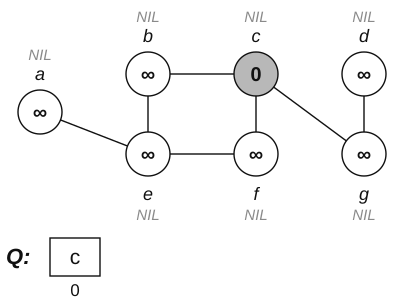{height="12.4em"}
:::
::::

## Algorithm: Breadth-First Search {.fit1}

::: {.sm}
**Iterate through the first while-loop for $u \leftarrow c$**
:::

:::: {.columns}
::: {.column width="55%"}
::: {.codewrap style="font-size:1.00em"}
<pre class="pseudocode"><b>Procedure</b> BFS(<i>G</i>, <i>s</i>)
<i>Inputs:</i> &#8230;
<i>Result:</i> &#8230;
INITIALIZE-BFS(<i>G</i>, <i>s</i>)
<i>Q</i> &larr; &empty;
ENQUEUE(<i>Q</i>, <i>s</i>)
<b>While</b> <i>Q</i> &ne; &empty;:
      <i>u</i> &larr; DEQUEUE(<i>Q</i>)
      <b>For</b> each vertex <i>v</i> in neighbors(<i>u</i>):
            <b>If</b> color[<i>v</i>] = WHITE
                  <b>then</b> color[<i>v</i>] &larr; GRAY
                       <i>d</i>[<i>v</i>] &larr; <i>d</i>[<i>u</i>] + 1
                       &pi;[<i>v</i>] &larr; <i>u</i>
                       ENQUEUE(<i>Q</i>, <i>v</i>)
      color[<i>u</i>] &larr; BLACK</pre>
:::
:::

::: {.column width="45%"}
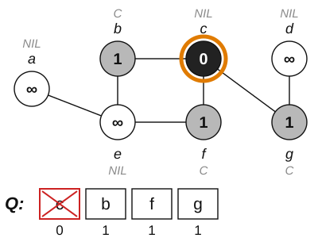{height="12.4em"}
:::
::::

## Algorithm: Breadth-First Search {.fit1}

::: {.sm}
**Iterate through the next while-loop for $u \leftarrow b$ (b is next in the queue because of FIFO)**
:::

:::: {.columns}
::: {.column width="55%"}
::: {.codewrap style="font-size:1.00em"}
<pre class="pseudocode"><b>Procedure</b> BFS(<i>G</i>, <i>s</i>)
<i>Inputs:</i> &#8230;
<i>Result:</i> &#8230;
INITIALIZE-BFS(<i>G</i>, <i>s</i>)
<i>Q</i> &larr; &empty;
ENQUEUE(<i>Q</i>, <i>s</i>)
<b>While</b> <i>Q</i> &ne; &empty;:
      <i>u</i> &larr; DEQUEUE(<i>Q</i>)
      <b>For</b> each vertex <i>v</i> in neighbors(<i>u</i>):
            <b>If</b> color[<i>v</i>] = WHITE
                  <b>then</b> color[<i>v</i>] &larr; GRAY
                       <i>d</i>[<i>v</i>] &larr; <i>d</i>[<i>u</i>] + 1
                       &pi;[<i>v</i>] &larr; <i>u</i>
                       ENQUEUE(<i>Q</i>, <i>v</i>)
      color[<i>u</i>] &larr; BLACK</pre>
:::
:::

::: {.column width="45%"}
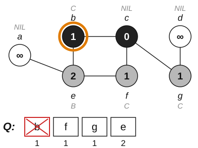{height="12.4em"}
:::
::::

## Algorithm: Breadth-First Search {.fit1}

::: {.sm}
**Iterate through the next while-loop for $u \leftarrow f$**
:::

:::: {.columns}
::: {.column width="55%"}
::: {.codewrap style="font-size:1.00em"}
<pre class="pseudocode"><b>Procedure</b> BFS(<i>G</i>, <i>s</i>)
<i>Inputs:</i> &#8230;
<i>Result:</i> &#8230;
INITIALIZE-BFS(<i>G</i>, <i>s</i>)
<i>Q</i> &larr; &empty;
ENQUEUE(<i>Q</i>, <i>s</i>)
<b>While</b> <i>Q</i> &ne; &empty;:
      <i>u</i> &larr; DEQUEUE(<i>Q</i>)
      <b>For</b> each vertex <i>v</i> in neighbors(<i>u</i>):
            <b>If</b> color[<i>v</i>] = WHITE
                  <b>then</b> color[<i>v</i>] &larr; GRAY
                       <i>d</i>[<i>v</i>] &larr; <i>d</i>[<i>u</i>] + 1
                       &pi;[<i>v</i>] &larr; <i>u</i>
                       ENQUEUE(<i>Q</i>, <i>v</i>)
      color[<i>u</i>] &larr; BLACK</pre>
:::
:::

::: {.column width="45%"}
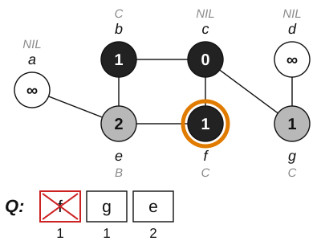{height="12.4em"}
:::
::::

## Algorithm: Breadth-First Search {.fit1}

::: {.sm}
**Iterate through the next while-loop for $u \leftarrow g$**
:::

:::: {.columns}
::: {.column width="55%"}
::: {.codewrap style="font-size:1.00em"}
<pre class="pseudocode"><b>Procedure</b> BFS(<i>G</i>, <i>s</i>)
<i>Inputs:</i> &#8230;
<i>Result:</i> &#8230;
INITIALIZE-BFS(<i>G</i>, <i>s</i>)
<i>Q</i> &larr; &empty;
ENQUEUE(<i>Q</i>, <i>s</i>)
<b>While</b> <i>Q</i> &ne; &empty;:
      <i>u</i> &larr; DEQUEUE(<i>Q</i>)
      <b>For</b> each vertex <i>v</i> in neighbors(<i>u</i>):
            <b>If</b> color[<i>v</i>] = WHITE
                  <b>then</b> color[<i>v</i>] &larr; GRAY
                       <i>d</i>[<i>v</i>] &larr; <i>d</i>[<i>u</i>] + 1
                       &pi;[<i>v</i>] &larr; <i>u</i>
                       ENQUEUE(<i>Q</i>, <i>v</i>)
      color[<i>u</i>] &larr; BLACK</pre>
:::
:::

::: {.column width="45%"}
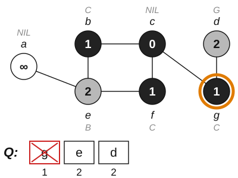{height="12.4em"}
:::
::::

## Algorithm: Breadth-First Search {.fit1}

::: {.sm}
**Iterate through the next while-loop for $u \leftarrow e$**
:::

:::: {.columns}
::: {.column width="55%"}
::: {.codewrap style="font-size:1.00em"}
<pre class="pseudocode"><b>Procedure</b> BFS(<i>G</i>, <i>s</i>)
<i>Inputs:</i> &#8230;
<i>Result:</i> &#8230;
INITIALIZE-BFS(<i>G</i>, <i>s</i>)
<i>Q</i> &larr; &empty;
ENQUEUE(<i>Q</i>, <i>s</i>)
<b>While</b> <i>Q</i> &ne; &empty;:
      <i>u</i> &larr; DEQUEUE(<i>Q</i>)
      <b>For</b> each vertex <i>v</i> in neighbors(<i>u</i>):
            <b>If</b> color[<i>v</i>] = WHITE
                  <b>then</b> color[<i>v</i>] &larr; GRAY
                       <i>d</i>[<i>v</i>] &larr; <i>d</i>[<i>u</i>] + 1
                       &pi;[<i>v</i>] &larr; <i>u</i>
                       ENQUEUE(<i>Q</i>, <i>v</i>)
      color[<i>u</i>] &larr; BLACK</pre>
:::
:::

::: {.column width="45%"}
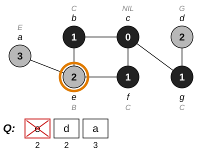{height="12.4em"}
:::
::::

## Algorithm: Breadth-First Search {.fit1}

::: {.sm}
**The while-loop for $u \leftarrow e$ finishes**
:::

:::: {.columns}
::: {.column width="55%"}
::: {.codewrap style="font-size:1.00em"}
<pre class="pseudocode"><b>Procedure</b> BFS(<i>G</i>, <i>s</i>)
<i>Inputs:</i> &#8230;
<i>Result:</i> &#8230;
INITIALIZE-BFS(<i>G</i>, <i>s</i>)
<i>Q</i> &larr; &empty;
ENQUEUE(<i>Q</i>, <i>s</i>)
<b>While</b> <i>Q</i> &ne; &empty;:
      <i>u</i> &larr; DEQUEUE(<i>Q</i>)
      <b>For</b> each vertex <i>v</i> in neighbors(<i>u</i>):
            <b>If</b> color[<i>v</i>] = WHITE
                  <b>then</b> color[<i>v</i>] &larr; GRAY
                       <i>d</i>[<i>v</i>] &larr; <i>d</i>[<i>u</i>] + 1
                       &pi;[<i>v</i>] &larr; <i>u</i>
                       ENQUEUE(<i>Q</i>, <i>v</i>)
      color[<i>u</i>] &larr; BLACK</pre>
:::
:::

::: {.column width="45%"}
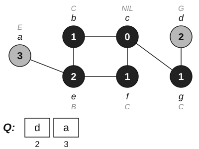{height="12.4em"}
:::
::::

## Algorithm: Breadth-First Search {.fit1}

::: {.sm}
**Iterate through the next while-loop for $u \leftarrow d$**
:::

:::: {.columns}
::: {.column width="55%"}
::: {.codewrap style="font-size:1.00em"}
<pre class="pseudocode"><b>Procedure</b> BFS(<i>G</i>, <i>s</i>)
<i>Inputs:</i> &#8230;
<i>Result:</i> &#8230;
INITIALIZE-BFS(<i>G</i>, <i>s</i>)
<i>Q</i> &larr; &empty;
ENQUEUE(<i>Q</i>, <i>s</i>)
<b>While</b> <i>Q</i> &ne; &empty;:
      <i>u</i> &larr; DEQUEUE(<i>Q</i>)
      <b>For</b> each vertex <i>v</i> in neighbors(<i>u</i>):
            <b>If</b> color[<i>v</i>] = WHITE
                  <b>then</b> color[<i>v</i>] &larr; GRAY
                       <i>d</i>[<i>v</i>] &larr; <i>d</i>[<i>u</i>] + 1
                       &pi;[<i>v</i>] &larr; <i>u</i>
                       ENQUEUE(<i>Q</i>, <i>v</i>)
      color[<i>u</i>] &larr; BLACK</pre>
:::
:::

::: {.column width="45%"}
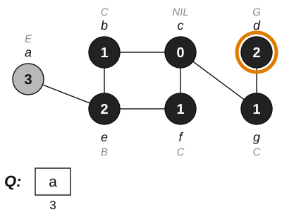{height="12.4em"}
:::
::::

## Algorithm: Breadth-First Search {.fit1}

::: {.sm}
**Iterate through the next while-loop for $u \leftarrow a$. The queue is empty, so BFS stops**
:::

:::: {.columns}
::: {.column width="55%"}
::: {.codewrap style="font-size:1.00em"}
<pre class="pseudocode"><b>Procedure</b> BFS(<i>G</i>, <i>s</i>)
<i>Inputs:</i> &#8230;
<i>Result:</i> &#8230;
INITIALIZE-BFS(<i>G</i>, <i>s</i>)
<i>Q</i> &larr; &empty;
ENQUEUE(<i>Q</i>, <i>s</i>)
<b>While</b> <i>Q</i> &ne; &empty;:
      <i>u</i> &larr; DEQUEUE(<i>Q</i>)
      <b>For</b> each vertex <i>v</i> in neighbors(<i>u</i>):
            <b>If</b> color[<i>v</i>] = WHITE
                  <b>then</b> color[<i>v</i>] &larr; GRAY
                       <i>d</i>[<i>v</i>] &larr; <i>d</i>[<i>u</i>] + 1
                       &pi;[<i>v</i>] &larr; <i>u</i>
                       ENQUEUE(<i>Q</i>, <i>v</i>)
      color[<i>u</i>] &larr; BLACK</pre>
:::
:::

::: {.column width="45%"}
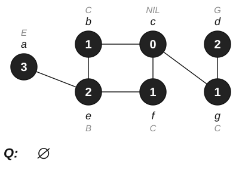{height="12.4em"}
:::
::::

## Why does this matter? Practical Python examples

:::: {.columns}
::: {.column width="55%"}
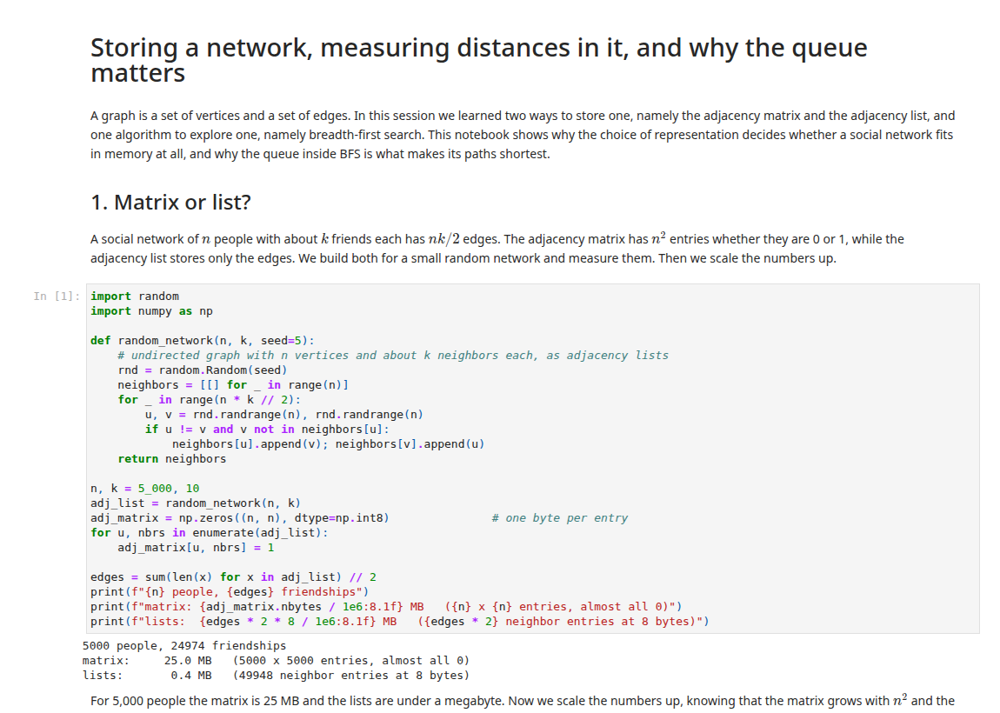{width="100%"}
:::

::: {.column width="45%"}
::: {.sm}
- **Matrix or list:** the memory that both representations need for a network of 100,000 people
- **BFS and six degrees:** the distances from one person to everyone else in a network of 5,000 people
- **Queue or stack:** changing one method call makes the recorded distances wrong
:::
:::
::::

::: {.source}
<https://github.com/dgarcia-eu/ICSS/blob/main/PythonExamples/Examples05-Algorithms.ipynb>
:::

## Summary

- An **algorithm** is a finite, well-defined sequence of steps
- It needs a clear **specification** and must be **finite**, **definite** and **correct**
- **Pseudocode** and **flowcharts** describe algorithms for humans
- **Queues** are first in, first out; **stacks** are last in, first out
- A **graph** $G = (V, E)$ is stored as an adjacency **matrix** or adjacency **lists**
- **Breadth-first search** uses a queue to find shortest distances

**Next session:** Recursion
