## Course Outline

:::: {.columns}
::: {.column width="50%"}
::: {}
- *Session 1: Introduction*
- *Session 2: Information Coding*
- *Session 3: Data Structures*
- *Session 4: Software*
- *Session 5: Algorithms*
- **Session 6: Recursion**
- Session 7: Sorting Algorithms
:::
:::

::: {.column width="50%"}
::: {}
- Session 8: Time Complexity
- Session 9: Theoretical Computer Science
- Session 10: Databases
- Session 11: Machine Learning
- Session 12: Parallel Programming
- Session 13: Social Science Applications
- Session 14: Exam Review
:::
:::
::::

<!-- MOTIVATION:M06-B:BEGIN -->
## The comment thread with no bottom {.fit1}

::: {.motivation}
[Motivating example]{.label}
A discussion thread has replies, replies to replies, and replies to those. To
count the posts or to measure how deep an argument went, a procedure has to go
through the whole structure, and the structure is **defined in terms of itself**.
:::

:::: {.columns}
::: {.column width="46%"}
::: {.definition}
[A comment is]{.label}
a post, plus a list of **comments**.
:::

[When the *data* is defined in terms of itself, what should the *procedure* look like?]{.ask}
:::

::: {.column width="54%"}
::: {.center-h}
{height="9.7em"}
:::
:::
::::
<!-- MOTIVATION:M06-B:END -->

<!-- MOTIVATION:M06-D:BEGIN -->
## The car software that could run out of stack {.fit1}

::: {.motivation}
[Motivating example]{.label}
Between 2009 and 2011 Toyota recalled millions of cars after reports of
unintended acceleration. In the trial *Bookout v. Toyota* (2013), the software
expert Michael Barr testified that the engine control software of the Camry
used **recursion** and could run out of **stack memory**.
:::

:::: {.figures}
::: {.fq}
[41%]{.big}[of the stack used at most, according to Toyota]{.cap}
:::
::: {.fq}
[94%]{.big}[of the stack used, according to the expert, before counting the recursion]{.cap}
:::
::: {.fq}
[no check]{.big}[at run time that would notice a stack overflow]{.cap}
:::
::::

[Why does a function that calls itself need more memory with every call, and what happens when that memory runs out?]{.ask}

::: {.source}
Barr, M. (2013). *Bookout v. Toyota: 2005 Camry L4 software analysis*. Koopman, P. (2014). *A case study of Toyota unintended acceleration and software safety*
:::
<!-- MOTIVATION:M06-D:END -->

## Example: Citizens of Simpleland

::: {.center-h}
{height="13.4em"}
:::

## Example: Citizens of Simpleland {.fit1}

::: {.sm}
A person (P) is a citizen of Simpleland if it satisfies any of these conditions:

- P was born in Simpleland
- either of P's parents are citizens of Simpleland
:::

::: {.stage-bottom}

:::

## Example: Citizens of Simpleland {.fit1}

::: {.sm}
A person (P) is a citizen of Simpleland if it satisfies any of these conditions:

- P was born in Simpleland
- either of P's parents are citizens of Simpleland
:::

::: {.sm}
**Is P a citizen of Simpleland?**
:::

::: {.stage-bottom}
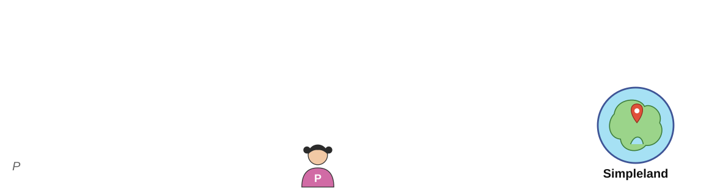
:::

## Example: Citizens of Simpleland {.fit1}

::: {.sm}
A person (P) is a citizen of Simpleland if it satisfies any of these conditions:

- [P was born in Simpleland]{.hl}
- either of P's parents are citizens of Simpleland
:::

::: {.sm}
**Is P a citizen of Simpleland?**
:::

::: {.stage-bottom}

:::

## Example: Citizens of Simpleland {.fit1}

::: {.sm}
A person (P) is a citizen of Simpleland if it satisfies any of these conditions:

- P was born in Simpleland
- either of P's parents are citizens of Simpleland
:::

::: {.sm}
**Is P a citizen of Simpleland?**
:::

::: {.stage-bottom}
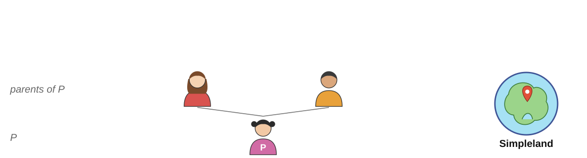
:::

## Example: Citizens of Simpleland {.fit1}

::: {.sm}
A person (P) is a citizen of Simpleland if it satisfies any of these conditions:

- P was born in Simpleland
- [either of P's parents are citizens of Simpleland]{.hl}
:::

::: {.sm}
**Is P a citizen of Simpleland?**
:::

::: {.stage-bottom}

:::

## Example: Citizens of Simpleland {.fit1}

::: {.sm}
A person (P) is a citizen of Simpleland if it satisfies any of these conditions:

- P was born in Simpleland
- either of P's parents are citizens of Simpleland
:::

::: {.sm}
**Is P a citizen of Simpleland?**
:::

::: {.stage-bottom}
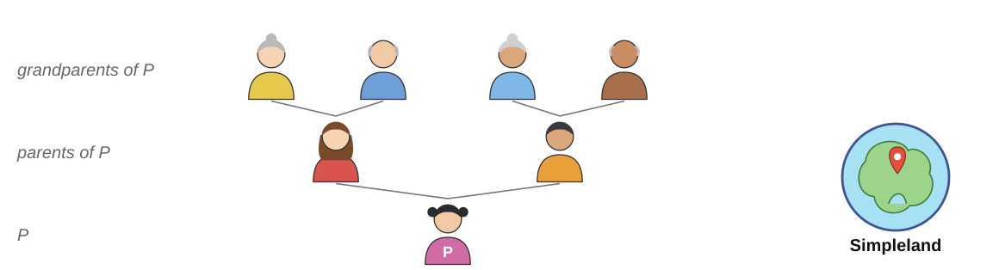
:::

## Components of Recursion {.fit1}

::: {.sm}
A person (P) is a citizen of Simpleland if it satisfies any of these conditions:

- P was born in Simpleland &nbsp;&nbsp; [**Base case**]{.hl}
- either of P's parents are citizens of Simpleland
:::

::: {.sm}
**Is P a citizen of Simpleland?**
:::

::: {.stage-bottom}

:::

## Components of Recursion {.fit1}

::: {.sm}
A person (P) is a citizen of Simpleland if it satisfies any of these conditions:

- P was born in Simpleland
- either of P's parents are citizens of Simpleland &nbsp;&nbsp; [**Recursion case**]{.hl}
:::

::: {.sm}
**Is P a citizen of Simpleland?**
:::

::: {.stage-bottom}

:::

## Recursion {.fit1}

::: {.definition}
[Definition of recursion]{.label}

::: {.sm}
Recursion is a technique in mathematics, logic and computer science to specify a function through itself (a *recursive definition*). The fundamental principle of recursion is to define the value of a function $f$ through previously calculated values of the same function $f(n)$, $f(n-1)$, …
:::
:::

::: {}
- as long as the start value of the function $f$ is known for sufficiently many arguments (**base cases**), any value of $f$ can be calculated
- a recursive call of the function $f$ keeps calling itself until
  - the function converges to a specific target value
  - or a pre-defined **abort condition** has been met
:::

## Issues with Recursion {.fit1}

::: {.sm}
A person (P) is a citizen of Simpleland if it satisfies any of these conditions:

- P was born in Simpleland
- either of P's parents are citizens of Simpleland
:::

::: {.sm}
**What if we don't know all ancestors of P?**
:::

::: {.stage-bottom}
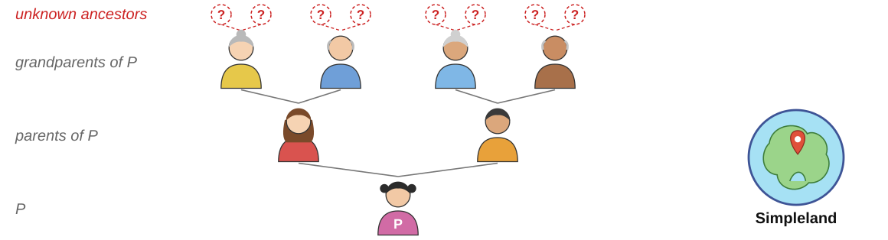
:::

## Issues with Recursion {.fit1}

::: {.sm}
A person (P) is a citizen of Simpleland if it satisfies any of these conditions:

- P was born in Simpleland
- either of P's parents are citizens of Simpleland
- if we don't know P's parents, P is not a citizen of Simpleland &nbsp;&nbsp; [**Abort case**]{.hl}
:::

::: {.stage-bottom}

:::

## Example: Seating four diners

::: {}
How many different ways exist for arranging the four diners?
:::

::: {.center-h}
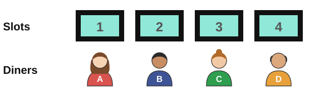{height="9.5em"}
:::

## Example: Seating four diners

::: {}
How many different ways exist for arranging the four diners?
:::

::: {.center-h}
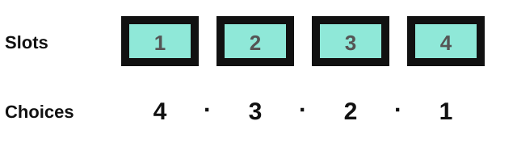{height="9.5em"}
:::

## Example: Seating four diners

::: {}
How many different ways exist for arranging the four diners?
:::

::: {.center-h}
{height="9.5em"}
:::

::: {.center-h}
$4! = 4 \cdot 3 \cdot 2 \cdot 1 = 24$ arrangements
:::

## Factorial: A Recursive Definition

::: {.definition}
[Iterative definition]{.label}
$n! = n \, (n-1) \, (n-2) \cdots 1$, for example $4! = 4 \cdot 3 \cdot 2 \cdot 1 = 24$
:::

::: {.definition}
[Recursive definition]{.label}
$n! = n \, (n-1)!$, for example $4! = 4 \cdot 3! = 4 \cdot 3 \cdot 2! = 4 \cdot 3 \cdot 2 \cdot 1! = 24$
:::

::: {.sm}
- The recursive definition uses the factorial itself, one number smaller
- It needs a place to stop: without $1! = 1$ the unfolding would never end
:::

## Factorial: A Recursive Definition

::: {.definition}
[Iterative definition]{.label}
$n! = n \, (n-1) \, (n-2) \cdots 1$, for example $4! = 4 \cdot 3 \cdot 2 \cdot 1 = 24$
:::

::: {.definition}
[Recursive definition]{.label}
$n! = n \, (n-1)!$, for example $4! = 4 \cdot 3! = 4 \cdot 3 \cdot 2! = 4 \cdot 3 \cdot 2 \cdot 1! = 24$
:::

::: {.center-h}
$$n! = \begin{cases} 1 & \text{if } n = 1 \quad \text{(base case)}\\
n \cdot (n-1)! & \text{if } n > 1 \quad \text{(recursion case)} \end{cases}$$
:::

## Factorial: Iterative Implementation

::: {.codewrap style="font-size:1.50em"}
<pre class="pseudocode" style="width:60%;margin:0.4em auto"><b>Procedure</b> ITERATIVE-FACTORIAL(<i>n</i>)
<i>Inputs:</i>
  <i>n</i>: a positive integer
<i>Result:</i> the factorial of <i>n</i>
<i>result</i> &larr; 1
<b>While</b> <i>n</i> &gt; 1:
      <i>result</i> &larr; <i>result</i> · <i>n</i>
      <i>n</i> &larr; <i>n</i> - 1
<b>return</b> <i>result</i></pre>
:::

::: {.center-h .sm}
$n! = n \, (n-1) \, (n-2) \dots (1)$
:::

## Factorial: Recursive Implementation

::: {.codewrap style="font-size:1.50em"}
<pre class="pseudocode" style="width:64%;margin:0.4em auto"><b>Procedure</b> RECURSIVE-FACTORIAL(<i>n</i>)
<i>Inputs:</i>
  <i>n</i>: a positive integer
<i>Result:</i> the factorial of <i>n</i>
<b>If</b> <i>n</i> = 1
      <b>then return</b> 1
      <b>else return</b> <i>n</i> · RECURSIVE-FACTORIAL(<i>n</i> - 1)</pre>
:::

::: {.center-h .sm}
$n! = n \, (n-1)!$ &nbsp;&nbsp;&nbsp; $1! = 1$
:::

## Recursive factorial in Python

::: {.pycode}
```{.python code-line-numbers="false"}
# assumes input is a positive integer
# returns n!
def recursive_factorial(n):
    if n == 1:
        return 1
    else:
        return n * recursive_factorial(n-1)
```
:::

::: {.center-h .sm}
$n! = n \, (n-1)!$ &nbsp;&nbsp;&nbsp; $1! = 1$
:::

## Factorial: Recursive Execution

::: {.sm}
- The calculation of `fac(4)` can be represented as a tree
:::

::: {.imgrow .middle style="flex-wrap:wrap;gap:0.6em 1.4em"}
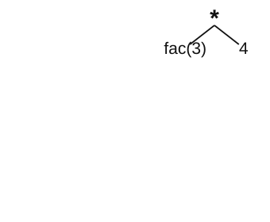{height="5.4em"}
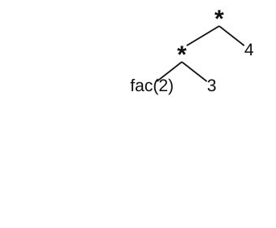{height="5.4em"}
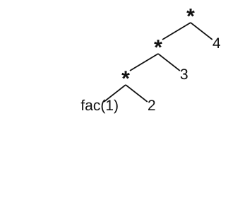{height="5.4em"}
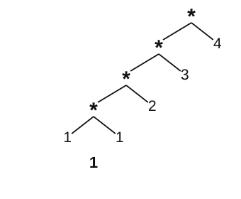{height="5.4em"}
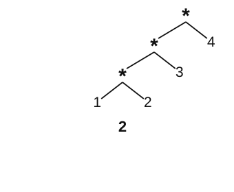{height="5.4em"}
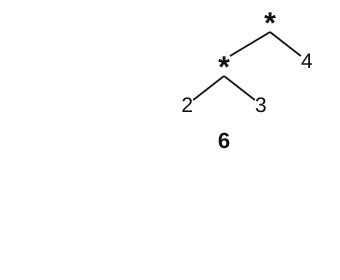{height="5.4em"}
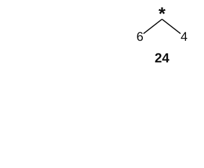{height="5.4em"}
:::

## Factorial: Recursive Execution

::: {.sm}
- The calculation of `fac(4)` can be represented as a tree
:::

::: {.center-h}
{height="11.4em"}
:::

## Factorial: Recursive Execution

::: {.sm}
- The calculation of `fac(4)` can be represented as a tree
:::

::: {.center-h}
{height="11.4em"}
:::

## Factorial: Recursive Execution

::: {.sm}
- The calculation of `fac(4)` can be represented as a tree
:::

::: {.center-h}
{height="11.4em"}
:::

## Factorial: Recursive Execution

::: {.sm}
- The calculation of `fac(4)` can be represented as a tree
:::

::: {.center-h}
{height="11.4em"}
:::

## Factorial: Recursive Execution

::: {.sm}
- The calculation of `fac(4)` can be represented as a tree
:::

::: {.center-h}
{height="11.4em"}
:::

## Factorial: Recursive Execution

::: {.sm}
- The calculation of `fac(4)` can be represented as a tree
:::

::: {.center-h}
{height="11.4em"}
:::

## Factorial: Recursive Execution

::: {.sm}
- The calculation of `fac(4)` can be represented as a tree
:::

::: {.center-h}
{height="11.4em"}
:::

::: {.center-h .sm}
$\Rightarrow$ `fac(4)` = 24
:::

## Factorial: Recursive Execution

::: {.sm}
**The call `recursive_factorial(3)` creates a frame with n = 3**
:::

<!-- CALLSTACK:1:BEGIN -->
```{=html}
<svg xmlns="http://www.w3.org/2000/svg" viewBox="0 0 1160 596" class="callstack" font-family="Arial, Helvetica, sans-serif">
  <defs><marker id="a" viewBox="0 0 10 10" refX="9" refY="5" markerWidth="6" markerHeight="6" orient="auto-start-reverse"><path d="M0,0 L10,5 L0,10 z" fill="#111"/></marker><marker id="ar" viewBox="0 0 10 10" refX="9" refY="5" markerWidth="5" markerHeight="5" orient="auto-start-reverse"><path d="M0,0 L10,5 L0,10 z" fill="#b03a2e"/></marker><marker id="ao" viewBox="0 0 10 10" refX="9" refY="5" markerWidth="5" markerHeight="5" orient="auto-start-reverse"><path d="M0,0 L10,5 L0,10 z" fill="#e07b00"/></marker><marker id="ak" viewBox="0 0 10 10" refX="9" refY="5" markerWidth="5" markerHeight="5" orient="auto-start-reverse"><path d="M0,0 L10,5 L0,10 z" fill="#3e5496"/></marker><marker id="ag" viewBox="0 0 10 10" refX="9" refY="5" markerWidth="5" markerHeight="5" orient="auto-start-reverse"><path d="M0,0 L10,5 L0,10 z" fill="#888"/></marker></defs>
  <text x="20" y="28" text-anchor="start" font-size="24" fill="#111" font-weight="bold" font-style="normal">recursive_factorial(3)</text>
  <path d="M 64 37 L 150 53" fill="none" stroke="#b03a2e" stroke-width="3.4" marker-end="url(#ar)"/>
  <text x="164" y="51" text-anchor="start" font-size="24" fill="#111" font-weight="bold" font-style="normal">n=3</text>
  <g opacity="1">
  <rect x="110" y="58" width="600" height="154" rx="6" fill="#f6f8fa" stroke="#c9d1d9" stroke-width="1.4"/>
  <rect x="114" y="177" width="592" height="28" rx="0" fill="#fde3a7" stroke="none" stroke-width="1.4"/>
  <text x="124" y="85" font-size="22" font-family="DejaVu Sans Mono, Menlo, Consolas, Liberation Mono, monospace" xml:space="preserve" style="white-space:pre"><tspan fill="#d73a49" font-weight="bold">def</tspan><tspan fill="#24292e"> </tspan><tspan fill="#6f42c1">recursive_factorial</tspan><tspan fill="#24292e">(n):</tspan></text>
  <text x="124" y="113" font-size="22" font-family="DejaVu Sans Mono, Menlo, Consolas, Liberation Mono, monospace" xml:space="preserve" style="white-space:pre"><tspan fill="#24292e">    </tspan><tspan fill="#d73a49" font-weight="bold">if</tspan><tspan fill="#24292e"> n == </tspan><tspan fill="#005cc5">1</tspan><tspan fill="#24292e">:</tspan></text>
  <text x="124" y="141" font-size="22" font-family="DejaVu Sans Mono, Menlo, Consolas, Liberation Mono, monospace" xml:space="preserve" style="white-space:pre"><tspan fill="#24292e">        </tspan><tspan fill="#d73a49" font-weight="bold">return</tspan><tspan fill="#24292e"> </tspan><tspan fill="#005cc5">1</tspan></text>
  <text x="124" y="169" font-size="22" font-family="DejaVu Sans Mono, Menlo, Consolas, Liberation Mono, monospace" xml:space="preserve" style="white-space:pre"><tspan fill="#24292e">    </tspan><tspan fill="#d73a49" font-weight="bold">else</tspan><tspan fill="#24292e">:</tspan></text>
  <text x="124" y="197" font-size="22" font-family="DejaVu Sans Mono, Menlo, Consolas, Liberation Mono, monospace" xml:space="preserve" style="white-space:pre"><tspan fill="#24292e">        </tspan><tspan fill="#d73a49" font-weight="bold">return</tspan><tspan fill="#24292e"> n * recursive_factorial(n-</tspan><tspan fill="#005cc5">1</tspan><tspan fill="#24292e">)</tspan></text>
  <text x="750" y="99" text-anchor="end" font-size="24" fill="#111" font-weight="bold" font-style="normal">n:</text>
  <rect x="758" y="71" width="42" height="38" rx="0" fill="#fff" stroke="#b03a2e" stroke-width="2.4"/>
  <text x="779" y="99" text-anchor="middle" font-size="24" fill="#111" font-weight="bold" font-style="normal">3</text>
  </g>
</svg>
```
<!-- CALLSTACK:1:END -->

## Factorial: Recursive Execution

::: {.sm}
**n is not 1, so the function calls itself with n = 2 and waits for the result**
:::

<!-- CALLSTACK:2:BEGIN -->
```{=html}
<svg xmlns="http://www.w3.org/2000/svg" viewBox="0 0 1160 596" class="callstack" font-family="Arial, Helvetica, sans-serif">
  <defs><marker id="a" viewBox="0 0 10 10" refX="9" refY="5" markerWidth="6" markerHeight="6" orient="auto-start-reverse"><path d="M0,0 L10,5 L0,10 z" fill="#111"/></marker><marker id="ar" viewBox="0 0 10 10" refX="9" refY="5" markerWidth="5" markerHeight="5" orient="auto-start-reverse"><path d="M0,0 L10,5 L0,10 z" fill="#b03a2e"/></marker><marker id="ao" viewBox="0 0 10 10" refX="9" refY="5" markerWidth="5" markerHeight="5" orient="auto-start-reverse"><path d="M0,0 L10,5 L0,10 z" fill="#e07b00"/></marker><marker id="ak" viewBox="0 0 10 10" refX="9" refY="5" markerWidth="5" markerHeight="5" orient="auto-start-reverse"><path d="M0,0 L10,5 L0,10 z" fill="#3e5496"/></marker><marker id="ag" viewBox="0 0 10 10" refX="9" refY="5" markerWidth="5" markerHeight="5" orient="auto-start-reverse"><path d="M0,0 L10,5 L0,10 z" fill="#888"/></marker></defs>
  <text x="20" y="28" text-anchor="start" font-size="24" fill="#111" font-weight="bold" font-style="normal">recursive_factorial(3)</text>
  <path d="M 64 37 L 150 53" fill="none" stroke="#b03a2e" stroke-width="3.4" marker-end="url(#ar)"/>
  <text x="164" y="51" text-anchor="start" font-size="24" fill="#111" font-weight="bold" font-style="normal">n=3</text>
  <g opacity="1">
  <rect x="110" y="58" width="600" height="154" rx="6" fill="#f6f8fa" stroke="#c9d1d9" stroke-width="1.4"/>
  <text x="124" y="85" font-size="22" font-family="DejaVu Sans Mono, Menlo, Consolas, Liberation Mono, monospace" xml:space="preserve" style="white-space:pre"><tspan fill="#d73a49" font-weight="bold">def</tspan><tspan fill="#24292e"> </tspan><tspan fill="#6f42c1">recursive_factorial</tspan><tspan fill="#24292e">(n):</tspan></text>
  <text x="124" y="113" font-size="22" font-family="DejaVu Sans Mono, Menlo, Consolas, Liberation Mono, monospace" xml:space="preserve" style="white-space:pre"><tspan fill="#24292e">    </tspan><tspan fill="#d73a49" font-weight="bold">if</tspan><tspan fill="#24292e"> n == </tspan><tspan fill="#005cc5">1</tspan><tspan fill="#24292e">:</tspan></text>
  <text x="124" y="141" font-size="22" font-family="DejaVu Sans Mono, Menlo, Consolas, Liberation Mono, monospace" xml:space="preserve" style="white-space:pre"><tspan fill="#24292e">        </tspan><tspan fill="#d73a49" font-weight="bold">return</tspan><tspan fill="#24292e"> </tspan><tspan fill="#005cc5">1</tspan></text>
  <text x="124" y="169" font-size="22" font-family="DejaVu Sans Mono, Menlo, Consolas, Liberation Mono, monospace" xml:space="preserve" style="white-space:pre"><tspan fill="#24292e">    </tspan><tspan fill="#d73a49" font-weight="bold">else</tspan><tspan fill="#24292e">:</tspan></text>
  <text x="124" y="197" font-size="22" font-family="DejaVu Sans Mono, Menlo, Consolas, Liberation Mono, monospace" xml:space="preserve" style="white-space:pre"><tspan fill="#24292e">        </tspan><tspan fill="#d73a49" font-weight="bold">return</tspan><tspan fill="#24292e"> n * recursive_factorial(n-</tspan><tspan fill="#005cc5">1</tspan><tspan fill="#24292e">)</tspan></text>
  <text x="750" y="99" text-anchor="end" font-size="24" fill="#111" font-weight="bold" font-style="normal">n:</text>
  <rect x="758" y="71" width="42" height="38" rx="0" fill="#fff" stroke="#b03a2e" stroke-width="2.4"/>
  <text x="779" y="99" text-anchor="middle" font-size="24" fill="#111" font-weight="bold" font-style="normal">3</text>
  </g>
  <path d="M 521 215 L 560 241" fill="none" stroke="#b03a2e" stroke-width="3.4" marker-end="url(#ar)"/>
  <text x="576" y="232" text-anchor="start" font-size="24" fill="#111" font-weight="bold" font-style="normal">n=2</text>
  <g opacity="1">
  <rect x="250" y="246" width="600" height="154" rx="6" fill="#f6f8fa" stroke="#c9d1d9" stroke-width="1.4"/>
  <rect x="254" y="365" width="592" height="28" rx="0" fill="#fde3a7" stroke="none" stroke-width="1.4"/>
  <text x="264" y="273" font-size="22" font-family="DejaVu Sans Mono, Menlo, Consolas, Liberation Mono, monospace" xml:space="preserve" style="white-space:pre"><tspan fill="#d73a49" font-weight="bold">def</tspan><tspan fill="#24292e"> </tspan><tspan fill="#6f42c1">recursive_factorial</tspan><tspan fill="#24292e">(n):</tspan></text>
  <text x="264" y="301" font-size="22" font-family="DejaVu Sans Mono, Menlo, Consolas, Liberation Mono, monospace" xml:space="preserve" style="white-space:pre"><tspan fill="#24292e">    </tspan><tspan fill="#d73a49" font-weight="bold">if</tspan><tspan fill="#24292e"> n == </tspan><tspan fill="#005cc5">1</tspan><tspan fill="#24292e">:</tspan></text>
  <text x="264" y="329" font-size="22" font-family="DejaVu Sans Mono, Menlo, Consolas, Liberation Mono, monospace" xml:space="preserve" style="white-space:pre"><tspan fill="#24292e">        </tspan><tspan fill="#d73a49" font-weight="bold">return</tspan><tspan fill="#24292e"> </tspan><tspan fill="#005cc5">1</tspan></text>
  <text x="264" y="357" font-size="22" font-family="DejaVu Sans Mono, Menlo, Consolas, Liberation Mono, monospace" xml:space="preserve" style="white-space:pre"><tspan fill="#24292e">    </tspan><tspan fill="#d73a49" font-weight="bold">else</tspan><tspan fill="#24292e">:</tspan></text>
  <text x="264" y="385" font-size="22" font-family="DejaVu Sans Mono, Menlo, Consolas, Liberation Mono, monospace" xml:space="preserve" style="white-space:pre"><tspan fill="#24292e">        </tspan><tspan fill="#d73a49" font-weight="bold">return</tspan><tspan fill="#24292e"> n * recursive_factorial(n-</tspan><tspan fill="#005cc5">1</tspan><tspan fill="#24292e">)</tspan></text>
  <text x="890" y="287" text-anchor="end" font-size="24" fill="#111" font-weight="bold" font-style="normal">n:</text>
  <rect x="898" y="259" width="42" height="38" rx="0" fill="#fff" stroke="#b03a2e" stroke-width="2.4"/>
  <text x="919" y="287" text-anchor="middle" font-size="24" fill="#111" font-weight="bold" font-style="normal">2</text>
  </g>
</svg>
```
<!-- CALLSTACK:2:END -->

## Factorial: Recursive Execution

::: {.sm}
**The call with n = 1 reaches the base case**
:::

<!-- CALLSTACK:3:BEGIN -->
```{=html}
<svg xmlns="http://www.w3.org/2000/svg" viewBox="0 0 1160 596" class="callstack" font-family="Arial, Helvetica, sans-serif">
  <defs><marker id="a" viewBox="0 0 10 10" refX="9" refY="5" markerWidth="6" markerHeight="6" orient="auto-start-reverse"><path d="M0,0 L10,5 L0,10 z" fill="#111"/></marker><marker id="ar" viewBox="0 0 10 10" refX="9" refY="5" markerWidth="5" markerHeight="5" orient="auto-start-reverse"><path d="M0,0 L10,5 L0,10 z" fill="#b03a2e"/></marker><marker id="ao" viewBox="0 0 10 10" refX="9" refY="5" markerWidth="5" markerHeight="5" orient="auto-start-reverse"><path d="M0,0 L10,5 L0,10 z" fill="#e07b00"/></marker><marker id="ak" viewBox="0 0 10 10" refX="9" refY="5" markerWidth="5" markerHeight="5" orient="auto-start-reverse"><path d="M0,0 L10,5 L0,10 z" fill="#3e5496"/></marker><marker id="ag" viewBox="0 0 10 10" refX="9" refY="5" markerWidth="5" markerHeight="5" orient="auto-start-reverse"><path d="M0,0 L10,5 L0,10 z" fill="#888"/></marker></defs>
  <text x="20" y="28" text-anchor="start" font-size="24" fill="#111" font-weight="bold" font-style="normal">recursive_factorial(3)</text>
  <path d="M 64 37 L 150 53" fill="none" stroke="#b03a2e" stroke-width="3.4" marker-end="url(#ar)"/>
  <text x="164" y="51" text-anchor="start" font-size="24" fill="#111" font-weight="bold" font-style="normal">n=3</text>
  <g opacity="1">
  <rect x="110" y="58" width="600" height="154" rx="6" fill="#f6f8fa" stroke="#c9d1d9" stroke-width="1.4"/>
  <text x="124" y="85" font-size="22" font-family="DejaVu Sans Mono, Menlo, Consolas, Liberation Mono, monospace" xml:space="preserve" style="white-space:pre"><tspan fill="#d73a49" font-weight="bold">def</tspan><tspan fill="#24292e"> </tspan><tspan fill="#6f42c1">recursive_factorial</tspan><tspan fill="#24292e">(n):</tspan></text>
  <text x="124" y="113" font-size="22" font-family="DejaVu Sans Mono, Menlo, Consolas, Liberation Mono, monospace" xml:space="preserve" style="white-space:pre"><tspan fill="#24292e">    </tspan><tspan fill="#d73a49" font-weight="bold">if</tspan><tspan fill="#24292e"> n == </tspan><tspan fill="#005cc5">1</tspan><tspan fill="#24292e">:</tspan></text>
  <text x="124" y="141" font-size="22" font-family="DejaVu Sans Mono, Menlo, Consolas, Liberation Mono, monospace" xml:space="preserve" style="white-space:pre"><tspan fill="#24292e">        </tspan><tspan fill="#d73a49" font-weight="bold">return</tspan><tspan fill="#24292e"> </tspan><tspan fill="#005cc5">1</tspan></text>
  <text x="124" y="169" font-size="22" font-family="DejaVu Sans Mono, Menlo, Consolas, Liberation Mono, monospace" xml:space="preserve" style="white-space:pre"><tspan fill="#24292e">    </tspan><tspan fill="#d73a49" font-weight="bold">else</tspan><tspan fill="#24292e">:</tspan></text>
  <text x="124" y="197" font-size="22" font-family="DejaVu Sans Mono, Menlo, Consolas, Liberation Mono, monospace" xml:space="preserve" style="white-space:pre"><tspan fill="#24292e">        </tspan><tspan fill="#d73a49" font-weight="bold">return</tspan><tspan fill="#24292e"> n * recursive_factorial(n-</tspan><tspan fill="#005cc5">1</tspan><tspan fill="#24292e">)</tspan></text>
  <text x="750" y="99" text-anchor="end" font-size="24" fill="#111" font-weight="bold" font-style="normal">n:</text>
  <rect x="758" y="71" width="42" height="38" rx="0" fill="#fff" stroke="#b03a2e" stroke-width="2.4"/>
  <text x="779" y="99" text-anchor="middle" font-size="24" fill="#111" font-weight="bold" font-style="normal">3</text>
  </g>
  <path d="M 521 215 L 560 241" fill="none" stroke="#b03a2e" stroke-width="3.4" marker-end="url(#ar)"/>
  <text x="576" y="232" text-anchor="start" font-size="24" fill="#111" font-weight="bold" font-style="normal">n=2</text>
  <g opacity="1">
  <rect x="250" y="246" width="600" height="154" rx="6" fill="#f6f8fa" stroke="#c9d1d9" stroke-width="1.4"/>
  <text x="264" y="273" font-size="22" font-family="DejaVu Sans Mono, Menlo, Consolas, Liberation Mono, monospace" xml:space="preserve" style="white-space:pre"><tspan fill="#d73a49" font-weight="bold">def</tspan><tspan fill="#24292e"> </tspan><tspan fill="#6f42c1">recursive_factorial</tspan><tspan fill="#24292e">(n):</tspan></text>
  <text x="264" y="301" font-size="22" font-family="DejaVu Sans Mono, Menlo, Consolas, Liberation Mono, monospace" xml:space="preserve" style="white-space:pre"><tspan fill="#24292e">    </tspan><tspan fill="#d73a49" font-weight="bold">if</tspan><tspan fill="#24292e"> n == </tspan><tspan fill="#005cc5">1</tspan><tspan fill="#24292e">:</tspan></text>
  <text x="264" y="329" font-size="22" font-family="DejaVu Sans Mono, Menlo, Consolas, Liberation Mono, monospace" xml:space="preserve" style="white-space:pre"><tspan fill="#24292e">        </tspan><tspan fill="#d73a49" font-weight="bold">return</tspan><tspan fill="#24292e"> </tspan><tspan fill="#005cc5">1</tspan></text>
  <text x="264" y="357" font-size="22" font-family="DejaVu Sans Mono, Menlo, Consolas, Liberation Mono, monospace" xml:space="preserve" style="white-space:pre"><tspan fill="#24292e">    </tspan><tspan fill="#d73a49" font-weight="bold">else</tspan><tspan fill="#24292e">:</tspan></text>
  <text x="264" y="385" font-size="22" font-family="DejaVu Sans Mono, Menlo, Consolas, Liberation Mono, monospace" xml:space="preserve" style="white-space:pre"><tspan fill="#24292e">        </tspan><tspan fill="#d73a49" font-weight="bold">return</tspan><tspan fill="#24292e"> n * recursive_factorial(n-</tspan><tspan fill="#005cc5">1</tspan><tspan fill="#24292e">)</tspan></text>
  <text x="890" y="287" text-anchor="end" font-size="24" fill="#111" font-weight="bold" font-style="normal">n:</text>
  <rect x="898" y="259" width="42" height="38" rx="0" fill="#fff" stroke="#b03a2e" stroke-width="2.4"/>
  <text x="919" y="287" text-anchor="middle" font-size="24" fill="#111" font-weight="bold" font-style="normal">2</text>
  </g>
  <path d="M 661 403 L 700 429" fill="none" stroke="#b03a2e" stroke-width="3.4" marker-end="url(#ar)"/>
  <text x="716" y="420" text-anchor="start" font-size="24" fill="#111" font-weight="bold" font-style="normal">n=1</text>
  <g opacity="1">
  <rect x="390" y="434" width="600" height="154" rx="6" fill="#f6f8fa" stroke="#c9d1d9" stroke-width="1.4"/>
  <rect x="394" y="497" width="592" height="28" rx="0" fill="#fde3a7" stroke="none" stroke-width="1.4"/>
  <text x="404" y="461" font-size="22" font-family="DejaVu Sans Mono, Menlo, Consolas, Liberation Mono, monospace" xml:space="preserve" style="white-space:pre"><tspan fill="#d73a49" font-weight="bold">def</tspan><tspan fill="#24292e"> </tspan><tspan fill="#6f42c1">recursive_factorial</tspan><tspan fill="#24292e">(n):</tspan></text>
  <text x="404" y="489" font-size="22" font-family="DejaVu Sans Mono, Menlo, Consolas, Liberation Mono, monospace" xml:space="preserve" style="white-space:pre"><tspan fill="#24292e">    </tspan><tspan fill="#d73a49" font-weight="bold">if</tspan><tspan fill="#24292e"> n == </tspan><tspan fill="#005cc5">1</tspan><tspan fill="#24292e">:</tspan></text>
  <text x="404" y="517" font-size="22" font-family="DejaVu Sans Mono, Menlo, Consolas, Liberation Mono, monospace" xml:space="preserve" style="white-space:pre"><tspan fill="#24292e">        </tspan><tspan fill="#d73a49" font-weight="bold">return</tspan><tspan fill="#24292e"> </tspan><tspan fill="#005cc5">1</tspan></text>
  <text x="404" y="545" font-size="22" font-family="DejaVu Sans Mono, Menlo, Consolas, Liberation Mono, monospace" xml:space="preserve" style="white-space:pre"><tspan fill="#24292e">    </tspan><tspan fill="#d73a49" font-weight="bold">else</tspan><tspan fill="#24292e">:</tspan></text>
  <text x="404" y="573" font-size="22" font-family="DejaVu Sans Mono, Menlo, Consolas, Liberation Mono, monospace" xml:space="preserve" style="white-space:pre"><tspan fill="#24292e">        </tspan><tspan fill="#d73a49" font-weight="bold">return</tspan><tspan fill="#24292e"> n * recursive_factorial(n-</tspan><tspan fill="#005cc5">1</tspan><tspan fill="#24292e">)</tspan></text>
  <text x="1030" y="475" text-anchor="end" font-size="24" fill="#111" font-weight="bold" font-style="normal">n:</text>
  <rect x="1038" y="447" width="42" height="38" rx="0" fill="#fff" stroke="#b03a2e" stroke-width="2.4"/>
  <text x="1059" y="475" text-anchor="middle" font-size="24" fill="#111" font-weight="bold" font-style="normal">1</text>
  </g>
</svg>
```
<!-- CALLSTACK:3:END -->

## Factorial: Recursive Execution

::: {.sm}
**The base case returns 1 to the call that is waiting with n = 2**
:::

<!-- CALLSTACK:4:BEGIN -->
```{=html}
<svg xmlns="http://www.w3.org/2000/svg" viewBox="0 0 1160 596" class="callstack" font-family="Arial, Helvetica, sans-serif">
  <defs><marker id="a" viewBox="0 0 10 10" refX="9" refY="5" markerWidth="6" markerHeight="6" orient="auto-start-reverse"><path d="M0,0 L10,5 L0,10 z" fill="#111"/></marker><marker id="ar" viewBox="0 0 10 10" refX="9" refY="5" markerWidth="5" markerHeight="5" orient="auto-start-reverse"><path d="M0,0 L10,5 L0,10 z" fill="#b03a2e"/></marker><marker id="ao" viewBox="0 0 10 10" refX="9" refY="5" markerWidth="5" markerHeight="5" orient="auto-start-reverse"><path d="M0,0 L10,5 L0,10 z" fill="#e07b00"/></marker><marker id="ak" viewBox="0 0 10 10" refX="9" refY="5" markerWidth="5" markerHeight="5" orient="auto-start-reverse"><path d="M0,0 L10,5 L0,10 z" fill="#3e5496"/></marker><marker id="ag" viewBox="0 0 10 10" refX="9" refY="5" markerWidth="5" markerHeight="5" orient="auto-start-reverse"><path d="M0,0 L10,5 L0,10 z" fill="#888"/></marker></defs>
  <text x="20" y="28" text-anchor="start" font-size="24" fill="#111" font-weight="bold" font-style="normal">recursive_factorial(3)</text>
  <path d="M 64 37 L 150 53" fill="none" stroke="#b03a2e" stroke-width="3.4" marker-end="url(#ar)"/>
  <text x="164" y="51" text-anchor="start" font-size="24" fill="#111" font-weight="bold" font-style="normal">n=3</text>
  <g opacity="1">
  <rect x="110" y="58" width="600" height="154" rx="6" fill="#f6f8fa" stroke="#c9d1d9" stroke-width="1.4"/>
  <text x="124" y="85" font-size="22" font-family="DejaVu Sans Mono, Menlo, Consolas, Liberation Mono, monospace" xml:space="preserve" style="white-space:pre"><tspan fill="#d73a49" font-weight="bold">def</tspan><tspan fill="#24292e"> </tspan><tspan fill="#6f42c1">recursive_factorial</tspan><tspan fill="#24292e">(n):</tspan></text>
  <text x="124" y="113" font-size="22" font-family="DejaVu Sans Mono, Menlo, Consolas, Liberation Mono, monospace" xml:space="preserve" style="white-space:pre"><tspan fill="#24292e">    </tspan><tspan fill="#d73a49" font-weight="bold">if</tspan><tspan fill="#24292e"> n == </tspan><tspan fill="#005cc5">1</tspan><tspan fill="#24292e">:</tspan></text>
  <text x="124" y="141" font-size="22" font-family="DejaVu Sans Mono, Menlo, Consolas, Liberation Mono, monospace" xml:space="preserve" style="white-space:pre"><tspan fill="#24292e">        </tspan><tspan fill="#d73a49" font-weight="bold">return</tspan><tspan fill="#24292e"> </tspan><tspan fill="#005cc5">1</tspan></text>
  <text x="124" y="169" font-size="22" font-family="DejaVu Sans Mono, Menlo, Consolas, Liberation Mono, monospace" xml:space="preserve" style="white-space:pre"><tspan fill="#24292e">    </tspan><tspan fill="#d73a49" font-weight="bold">else</tspan><tspan fill="#24292e">:</tspan></text>
  <text x="124" y="197" font-size="22" font-family="DejaVu Sans Mono, Menlo, Consolas, Liberation Mono, monospace" xml:space="preserve" style="white-space:pre"><tspan fill="#24292e">        </tspan><tspan fill="#d73a49" font-weight="bold">return</tspan><tspan fill="#24292e"> n * recursive_factorial(n-</tspan><tspan fill="#005cc5">1</tspan><tspan fill="#24292e">)</tspan></text>
  <text x="750" y="99" text-anchor="end" font-size="24" fill="#111" font-weight="bold" font-style="normal">n:</text>
  <rect x="758" y="71" width="42" height="38" rx="0" fill="#fff" stroke="#b03a2e" stroke-width="2.4"/>
  <text x="779" y="99" text-anchor="middle" font-size="24" fill="#111" font-weight="bold" font-style="normal">3</text>
  </g>
  <path d="M 521 215 L 560 241" fill="none" stroke="#b03a2e" stroke-width="3.4" marker-end="url(#ar)"/>
  <text x="576" y="232" text-anchor="start" font-size="24" fill="#111" font-weight="bold" font-style="normal">n=2</text>
  <g opacity="1">
  <rect x="250" y="246" width="600" height="154" rx="6" fill="#f6f8fa" stroke="#c9d1d9" stroke-width="1.4"/>
  <rect x="254" y="365" width="592" height="28" rx="0" fill="#fde3a7" stroke="none" stroke-width="1.4"/>
  <text x="264" y="273" font-size="22" font-family="DejaVu Sans Mono, Menlo, Consolas, Liberation Mono, monospace" xml:space="preserve" style="white-space:pre"><tspan fill="#d73a49" font-weight="bold">def</tspan><tspan fill="#24292e"> </tspan><tspan fill="#6f42c1">recursive_factorial</tspan><tspan fill="#24292e">(n):</tspan></text>
  <text x="264" y="301" font-size="22" font-family="DejaVu Sans Mono, Menlo, Consolas, Liberation Mono, monospace" xml:space="preserve" style="white-space:pre"><tspan fill="#24292e">    </tspan><tspan fill="#d73a49" font-weight="bold">if</tspan><tspan fill="#24292e"> n == </tspan><tspan fill="#005cc5">1</tspan><tspan fill="#24292e">:</tspan></text>
  <text x="264" y="329" font-size="22" font-family="DejaVu Sans Mono, Menlo, Consolas, Liberation Mono, monospace" xml:space="preserve" style="white-space:pre"><tspan fill="#24292e">        </tspan><tspan fill="#d73a49" font-weight="bold">return</tspan><tspan fill="#24292e"> </tspan><tspan fill="#005cc5">1</tspan></text>
  <text x="264" y="357" font-size="22" font-family="DejaVu Sans Mono, Menlo, Consolas, Liberation Mono, monospace" xml:space="preserve" style="white-space:pre"><tspan fill="#24292e">    </tspan><tspan fill="#d73a49" font-weight="bold">else</tspan><tspan fill="#24292e">:</tspan></text>
  <text x="264" y="385" font-size="22" font-family="DejaVu Sans Mono, Menlo, Consolas, Liberation Mono, monospace" xml:space="preserve" style="white-space:pre"><tspan fill="#24292e">        </tspan><tspan fill="#d73a49" font-weight="bold">return</tspan><tspan fill="#24292e"> n * recursive_factorial(n-</tspan><tspan fill="#005cc5">1</tspan><tspan fill="#24292e">)</tspan></text>
  <text x="890" y="287" text-anchor="end" font-size="24" fill="#111" font-weight="bold" font-style="normal">n:</text>
  <rect x="898" y="259" width="42" height="38" rx="0" fill="#fff" stroke="#b03a2e" stroke-width="2.4"/>
  <text x="919" y="287" text-anchor="middle" font-size="24" fill="#111" font-weight="bold" font-style="normal">2</text>
  <text x="862" y="385" font-size="22" font-family="DejaVu Sans Mono, Menlo, Consolas, Liberation Mono, monospace" fill="#b03a2e" font-weight="bold" xml:space="preserve" style="white-space:pre">= 2 * 1</text>
  </g>
  <path d="M 661 403 L 700 429" fill="none" stroke="#b03a2e" stroke-width="3.4" marker-end="url(#ar)"/>
  <text x="716" y="420" text-anchor="start" font-size="24" fill="#111" font-weight="bold" font-style="normal">n=1</text>
  <g opacity="0.45">
  <rect x="390" y="434" width="600" height="154" rx="6" fill="#f6f8fa" stroke="#c9d1d9" stroke-width="1.4"/>
  <text x="404" y="461" font-size="22" font-family="DejaVu Sans Mono, Menlo, Consolas, Liberation Mono, monospace" xml:space="preserve" style="white-space:pre"><tspan fill="#d73a49" font-weight="bold">def</tspan><tspan fill="#24292e"> </tspan><tspan fill="#6f42c1">recursive_factorial</tspan><tspan fill="#24292e">(n):</tspan></text>
  <text x="404" y="489" font-size="22" font-family="DejaVu Sans Mono, Menlo, Consolas, Liberation Mono, monospace" xml:space="preserve" style="white-space:pre"><tspan fill="#24292e">    </tspan><tspan fill="#d73a49" font-weight="bold">if</tspan><tspan fill="#24292e"> n == </tspan><tspan fill="#005cc5">1</tspan><tspan fill="#24292e">:</tspan></text>
  <text x="404" y="517" font-size="22" font-family="DejaVu Sans Mono, Menlo, Consolas, Liberation Mono, monospace" xml:space="preserve" style="white-space:pre"><tspan fill="#24292e">        </tspan><tspan fill="#d73a49" font-weight="bold">return</tspan><tspan fill="#24292e"> </tspan><tspan fill="#005cc5">1</tspan></text>
  <text x="404" y="545" font-size="22" font-family="DejaVu Sans Mono, Menlo, Consolas, Liberation Mono, monospace" xml:space="preserve" style="white-space:pre"><tspan fill="#24292e">    </tspan><tspan fill="#d73a49" font-weight="bold">else</tspan><tspan fill="#24292e">:</tspan></text>
  <text x="404" y="573" font-size="22" font-family="DejaVu Sans Mono, Menlo, Consolas, Liberation Mono, monospace" xml:space="preserve" style="white-space:pre"><tspan fill="#24292e">        </tspan><tspan fill="#d73a49" font-weight="bold">return</tspan><tspan fill="#24292e"> n * recursive_factorial(n-</tspan><tspan fill="#005cc5">1</tspan><tspan fill="#24292e">)</tspan></text>
  <text x="1030" y="475" text-anchor="end" font-size="24" fill="#111" font-weight="bold" font-style="normal">n:</text>
  <rect x="1038" y="447" width="42" height="38" rx="0" fill="#fff" stroke="#b03a2e" stroke-width="2.4"/>
  <text x="1059" y="475" text-anchor="middle" font-size="24" fill="#111" font-weight="bold" font-style="normal">1</text>
  </g>
  <path d="M 387 511 C 297 525 250 491 306 405" fill="none" stroke="#b03a2e" stroke-width="3.4" marker-end="url(#ar)"/>
  <text x="266" y="475" text-anchor="middle" font-size="24" fill="#b03a2e" font-weight="bold" font-style="normal">1</text>
</svg>
```
<!-- CALLSTACK:4:END -->

## Factorial: Recursive Execution

::: {.sm}
**That call returns 2 · 1 = 2 to the call that is waiting with n = 3**
:::

<!-- CALLSTACK:5:BEGIN -->
```{=html}
<svg xmlns="http://www.w3.org/2000/svg" viewBox="0 0 1160 596" class="callstack" font-family="Arial, Helvetica, sans-serif">
  <defs><marker id="a" viewBox="0 0 10 10" refX="9" refY="5" markerWidth="6" markerHeight="6" orient="auto-start-reverse"><path d="M0,0 L10,5 L0,10 z" fill="#111"/></marker><marker id="ar" viewBox="0 0 10 10" refX="9" refY="5" markerWidth="5" markerHeight="5" orient="auto-start-reverse"><path d="M0,0 L10,5 L0,10 z" fill="#b03a2e"/></marker><marker id="ao" viewBox="0 0 10 10" refX="9" refY="5" markerWidth="5" markerHeight="5" orient="auto-start-reverse"><path d="M0,0 L10,5 L0,10 z" fill="#e07b00"/></marker><marker id="ak" viewBox="0 0 10 10" refX="9" refY="5" markerWidth="5" markerHeight="5" orient="auto-start-reverse"><path d="M0,0 L10,5 L0,10 z" fill="#3e5496"/></marker><marker id="ag" viewBox="0 0 10 10" refX="9" refY="5" markerWidth="5" markerHeight="5" orient="auto-start-reverse"><path d="M0,0 L10,5 L0,10 z" fill="#888"/></marker></defs>
  <text x="20" y="28" text-anchor="start" font-size="24" fill="#111" font-weight="bold" font-style="normal">recursive_factorial(3)</text>
  <path d="M 64 37 L 150 53" fill="none" stroke="#b03a2e" stroke-width="3.4" marker-end="url(#ar)"/>
  <text x="164" y="51" text-anchor="start" font-size="24" fill="#111" font-weight="bold" font-style="normal">n=3</text>
  <g opacity="1">
  <rect x="110" y="58" width="600" height="154" rx="6" fill="#f6f8fa" stroke="#c9d1d9" stroke-width="1.4"/>
  <rect x="114" y="177" width="592" height="28" rx="0" fill="#fde3a7" stroke="none" stroke-width="1.4"/>
  <text x="124" y="85" font-size="22" font-family="DejaVu Sans Mono, Menlo, Consolas, Liberation Mono, monospace" xml:space="preserve" style="white-space:pre"><tspan fill="#d73a49" font-weight="bold">def</tspan><tspan fill="#24292e"> </tspan><tspan fill="#6f42c1">recursive_factorial</tspan><tspan fill="#24292e">(n):</tspan></text>
  <text x="124" y="113" font-size="22" font-family="DejaVu Sans Mono, Menlo, Consolas, Liberation Mono, monospace" xml:space="preserve" style="white-space:pre"><tspan fill="#24292e">    </tspan><tspan fill="#d73a49" font-weight="bold">if</tspan><tspan fill="#24292e"> n == </tspan><tspan fill="#005cc5">1</tspan><tspan fill="#24292e">:</tspan></text>
  <text x="124" y="141" font-size="22" font-family="DejaVu Sans Mono, Menlo, Consolas, Liberation Mono, monospace" xml:space="preserve" style="white-space:pre"><tspan fill="#24292e">        </tspan><tspan fill="#d73a49" font-weight="bold">return</tspan><tspan fill="#24292e"> </tspan><tspan fill="#005cc5">1</tspan></text>
  <text x="124" y="169" font-size="22" font-family="DejaVu Sans Mono, Menlo, Consolas, Liberation Mono, monospace" xml:space="preserve" style="white-space:pre"><tspan fill="#24292e">    </tspan><tspan fill="#d73a49" font-weight="bold">else</tspan><tspan fill="#24292e">:</tspan></text>
  <text x="124" y="197" font-size="22" font-family="DejaVu Sans Mono, Menlo, Consolas, Liberation Mono, monospace" xml:space="preserve" style="white-space:pre"><tspan fill="#24292e">        </tspan><tspan fill="#d73a49" font-weight="bold">return</tspan><tspan fill="#24292e"> n * recursive_factorial(n-</tspan><tspan fill="#005cc5">1</tspan><tspan fill="#24292e">)</tspan></text>
  <text x="750" y="99" text-anchor="end" font-size="24" fill="#111" font-weight="bold" font-style="normal">n:</text>
  <rect x="758" y="71" width="42" height="38" rx="0" fill="#fff" stroke="#b03a2e" stroke-width="2.4"/>
  <text x="779" y="99" text-anchor="middle" font-size="24" fill="#111" font-weight="bold" font-style="normal">3</text>
  <text x="722" y="197" font-size="22" font-family="DejaVu Sans Mono, Menlo, Consolas, Liberation Mono, monospace" fill="#b03a2e" font-weight="bold" xml:space="preserve" style="white-space:pre">= 3 * 2</text>
  </g>
  <path d="M 521 215 L 560 241" fill="none" stroke="#b03a2e" stroke-width="3.4" marker-end="url(#ar)"/>
  <text x="576" y="232" text-anchor="start" font-size="24" fill="#111" font-weight="bold" font-style="normal">n=2</text>
  <g opacity="0.45">
  <rect x="250" y="246" width="600" height="154" rx="6" fill="#f6f8fa" stroke="#c9d1d9" stroke-width="1.4"/>
  <text x="264" y="273" font-size="22" font-family="DejaVu Sans Mono, Menlo, Consolas, Liberation Mono, monospace" xml:space="preserve" style="white-space:pre"><tspan fill="#d73a49" font-weight="bold">def</tspan><tspan fill="#24292e"> </tspan><tspan fill="#6f42c1">recursive_factorial</tspan><tspan fill="#24292e">(n):</tspan></text>
  <text x="264" y="301" font-size="22" font-family="DejaVu Sans Mono, Menlo, Consolas, Liberation Mono, monospace" xml:space="preserve" style="white-space:pre"><tspan fill="#24292e">    </tspan><tspan fill="#d73a49" font-weight="bold">if</tspan><tspan fill="#24292e"> n == </tspan><tspan fill="#005cc5">1</tspan><tspan fill="#24292e">:</tspan></text>
  <text x="264" y="329" font-size="22" font-family="DejaVu Sans Mono, Menlo, Consolas, Liberation Mono, monospace" xml:space="preserve" style="white-space:pre"><tspan fill="#24292e">        </tspan><tspan fill="#d73a49" font-weight="bold">return</tspan><tspan fill="#24292e"> </tspan><tspan fill="#005cc5">1</tspan></text>
  <text x="264" y="357" font-size="22" font-family="DejaVu Sans Mono, Menlo, Consolas, Liberation Mono, monospace" xml:space="preserve" style="white-space:pre"><tspan fill="#24292e">    </tspan><tspan fill="#d73a49" font-weight="bold">else</tspan><tspan fill="#24292e">:</tspan></text>
  <text x="264" y="385" font-size="22" font-family="DejaVu Sans Mono, Menlo, Consolas, Liberation Mono, monospace" xml:space="preserve" style="white-space:pre"><tspan fill="#24292e">        </tspan><tspan fill="#d73a49" font-weight="bold">return</tspan><tspan fill="#24292e"> n * recursive_factorial(n-</tspan><tspan fill="#005cc5">1</tspan><tspan fill="#24292e">)</tspan></text>
  <text x="890" y="287" text-anchor="end" font-size="24" fill="#111" font-weight="bold" font-style="normal">n:</text>
  <rect x="898" y="259" width="42" height="38" rx="0" fill="#fff" stroke="#b03a2e" stroke-width="2.4"/>
  <text x="919" y="287" text-anchor="middle" font-size="24" fill="#111" font-weight="bold" font-style="normal">2</text>
  <text x="862" y="385" font-size="22" font-family="DejaVu Sans Mono, Menlo, Consolas, Liberation Mono, monospace" fill="#b03a2e" font-weight="bold" xml:space="preserve" style="white-space:pre">= 2 * 1</text>
  </g>
  <path d="M 661 403 L 700 429" fill="none" stroke="#b03a2e" stroke-width="3.4" marker-end="url(#ar)"/>
  <text x="716" y="420" text-anchor="start" font-size="24" fill="#111" font-weight="bold" font-style="normal">n=1</text>
  <g opacity="0.45">
  <rect x="390" y="434" width="600" height="154" rx="6" fill="#f6f8fa" stroke="#c9d1d9" stroke-width="1.4"/>
  <text x="404" y="461" font-size="22" font-family="DejaVu Sans Mono, Menlo, Consolas, Liberation Mono, monospace" xml:space="preserve" style="white-space:pre"><tspan fill="#d73a49" font-weight="bold">def</tspan><tspan fill="#24292e"> </tspan><tspan fill="#6f42c1">recursive_factorial</tspan><tspan fill="#24292e">(n):</tspan></text>
  <text x="404" y="489" font-size="22" font-family="DejaVu Sans Mono, Menlo, Consolas, Liberation Mono, monospace" xml:space="preserve" style="white-space:pre"><tspan fill="#24292e">    </tspan><tspan fill="#d73a49" font-weight="bold">if</tspan><tspan fill="#24292e"> n == </tspan><tspan fill="#005cc5">1</tspan><tspan fill="#24292e">:</tspan></text>
  <text x="404" y="517" font-size="22" font-family="DejaVu Sans Mono, Menlo, Consolas, Liberation Mono, monospace" xml:space="preserve" style="white-space:pre"><tspan fill="#24292e">        </tspan><tspan fill="#d73a49" font-weight="bold">return</tspan><tspan fill="#24292e"> </tspan><tspan fill="#005cc5">1</tspan></text>
  <text x="404" y="545" font-size="22" font-family="DejaVu Sans Mono, Menlo, Consolas, Liberation Mono, monospace" xml:space="preserve" style="white-space:pre"><tspan fill="#24292e">    </tspan><tspan fill="#d73a49" font-weight="bold">else</tspan><tspan fill="#24292e">:</tspan></text>
  <text x="404" y="573" font-size="22" font-family="DejaVu Sans Mono, Menlo, Consolas, Liberation Mono, monospace" xml:space="preserve" style="white-space:pre"><tspan fill="#24292e">        </tspan><tspan fill="#d73a49" font-weight="bold">return</tspan><tspan fill="#24292e"> n * recursive_factorial(n-</tspan><tspan fill="#005cc5">1</tspan><tspan fill="#24292e">)</tspan></text>
  <text x="1030" y="475" text-anchor="end" font-size="24" fill="#111" font-weight="bold" font-style="normal">n:</text>
  <rect x="1038" y="447" width="42" height="38" rx="0" fill="#fff" stroke="#b03a2e" stroke-width="2.4"/>
  <text x="1059" y="475" text-anchor="middle" font-size="24" fill="#111" font-weight="bold" font-style="normal">1</text>
  </g>
  <path d="M 387 511 C 297 525 250 491 306 405" fill="none" stroke="#b03a2e" stroke-width="3.4" marker-end="url(#ar)"/>
  <text x="266" y="475" text-anchor="middle" font-size="24" fill="#b03a2e" font-weight="bold" font-style="normal">1</text>
  <path d="M 247 379 C 157 393 110 303 166 217" fill="none" stroke="#b03a2e" stroke-width="3.4" marker-end="url(#ar)"/>
  <text x="126" y="287" text-anchor="middle" font-size="24" fill="#b03a2e" font-weight="bold" font-style="normal">2</text>
</svg>
```
<!-- CALLSTACK:5:END -->

## Factorial: Recursive Execution

::: {.sm}
**The first call returns 3 · 2 = 6**
:::

<!-- CALLSTACK:6:BEGIN -->
```{=html}
<svg xmlns="http://www.w3.org/2000/svg" viewBox="0 0 1160 596" class="callstack" font-family="Arial, Helvetica, sans-serif">
  <defs><marker id="a" viewBox="0 0 10 10" refX="9" refY="5" markerWidth="6" markerHeight="6" orient="auto-start-reverse"><path d="M0,0 L10,5 L0,10 z" fill="#111"/></marker><marker id="ar" viewBox="0 0 10 10" refX="9" refY="5" markerWidth="5" markerHeight="5" orient="auto-start-reverse"><path d="M0,0 L10,5 L0,10 z" fill="#b03a2e"/></marker><marker id="ao" viewBox="0 0 10 10" refX="9" refY="5" markerWidth="5" markerHeight="5" orient="auto-start-reverse"><path d="M0,0 L10,5 L0,10 z" fill="#e07b00"/></marker><marker id="ak" viewBox="0 0 10 10" refX="9" refY="5" markerWidth="5" markerHeight="5" orient="auto-start-reverse"><path d="M0,0 L10,5 L0,10 z" fill="#3e5496"/></marker><marker id="ag" viewBox="0 0 10 10" refX="9" refY="5" markerWidth="5" markerHeight="5" orient="auto-start-reverse"><path d="M0,0 L10,5 L0,10 z" fill="#888"/></marker></defs>
  <text x="20" y="28" text-anchor="start" font-size="24" fill="#111" font-weight="bold" font-style="normal">recursive_factorial(3)</text>
  <path d="M 64 37 L 150 53" fill="none" stroke="#b03a2e" stroke-width="3.4" marker-end="url(#ar)"/>
  <text x="164" y="51" text-anchor="start" font-size="24" fill="#111" font-weight="bold" font-style="normal">n=3</text>
  <g opacity="0.45">
  <rect x="110" y="58" width="600" height="154" rx="6" fill="#f6f8fa" stroke="#c9d1d9" stroke-width="1.4"/>
  <text x="124" y="85" font-size="22" font-family="DejaVu Sans Mono, Menlo, Consolas, Liberation Mono, monospace" xml:space="preserve" style="white-space:pre"><tspan fill="#d73a49" font-weight="bold">def</tspan><tspan fill="#24292e"> </tspan><tspan fill="#6f42c1">recursive_factorial</tspan><tspan fill="#24292e">(n):</tspan></text>
  <text x="124" y="113" font-size="22" font-family="DejaVu Sans Mono, Menlo, Consolas, Liberation Mono, monospace" xml:space="preserve" style="white-space:pre"><tspan fill="#24292e">    </tspan><tspan fill="#d73a49" font-weight="bold">if</tspan><tspan fill="#24292e"> n == </tspan><tspan fill="#005cc5">1</tspan><tspan fill="#24292e">:</tspan></text>
  <text x="124" y="141" font-size="22" font-family="DejaVu Sans Mono, Menlo, Consolas, Liberation Mono, monospace" xml:space="preserve" style="white-space:pre"><tspan fill="#24292e">        </tspan><tspan fill="#d73a49" font-weight="bold">return</tspan><tspan fill="#24292e"> </tspan><tspan fill="#005cc5">1</tspan></text>
  <text x="124" y="169" font-size="22" font-family="DejaVu Sans Mono, Menlo, Consolas, Liberation Mono, monospace" xml:space="preserve" style="white-space:pre"><tspan fill="#24292e">    </tspan><tspan fill="#d73a49" font-weight="bold">else</tspan><tspan fill="#24292e">:</tspan></text>
  <text x="124" y="197" font-size="22" font-family="DejaVu Sans Mono, Menlo, Consolas, Liberation Mono, monospace" xml:space="preserve" style="white-space:pre"><tspan fill="#24292e">        </tspan><tspan fill="#d73a49" font-weight="bold">return</tspan><tspan fill="#24292e"> n * recursive_factorial(n-</tspan><tspan fill="#005cc5">1</tspan><tspan fill="#24292e">)</tspan></text>
  <text x="750" y="99" text-anchor="end" font-size="24" fill="#111" font-weight="bold" font-style="normal">n:</text>
  <rect x="758" y="71" width="42" height="38" rx="0" fill="#fff" stroke="#b03a2e" stroke-width="2.4"/>
  <text x="779" y="99" text-anchor="middle" font-size="24" fill="#111" font-weight="bold" font-style="normal">3</text>
  <text x="722" y="197" font-size="22" font-family="DejaVu Sans Mono, Menlo, Consolas, Liberation Mono, monospace" fill="#b03a2e" font-weight="bold" xml:space="preserve" style="white-space:pre">= 3 * 2</text>
  </g>
  <path d="M 521 215 L 560 241" fill="none" stroke="#b03a2e" stroke-width="3.4" marker-end="url(#ar)"/>
  <text x="576" y="232" text-anchor="start" font-size="24" fill="#111" font-weight="bold" font-style="normal">n=2</text>
  <g opacity="0.45">
  <rect x="250" y="246" width="600" height="154" rx="6" fill="#f6f8fa" stroke="#c9d1d9" stroke-width="1.4"/>
  <text x="264" y="273" font-size="22" font-family="DejaVu Sans Mono, Menlo, Consolas, Liberation Mono, monospace" xml:space="preserve" style="white-space:pre"><tspan fill="#d73a49" font-weight="bold">def</tspan><tspan fill="#24292e"> </tspan><tspan fill="#6f42c1">recursive_factorial</tspan><tspan fill="#24292e">(n):</tspan></text>
  <text x="264" y="301" font-size="22" font-family="DejaVu Sans Mono, Menlo, Consolas, Liberation Mono, monospace" xml:space="preserve" style="white-space:pre"><tspan fill="#24292e">    </tspan><tspan fill="#d73a49" font-weight="bold">if</tspan><tspan fill="#24292e"> n == </tspan><tspan fill="#005cc5">1</tspan><tspan fill="#24292e">:</tspan></text>
  <text x="264" y="329" font-size="22" font-family="DejaVu Sans Mono, Menlo, Consolas, Liberation Mono, monospace" xml:space="preserve" style="white-space:pre"><tspan fill="#24292e">        </tspan><tspan fill="#d73a49" font-weight="bold">return</tspan><tspan fill="#24292e"> </tspan><tspan fill="#005cc5">1</tspan></text>
  <text x="264" y="357" font-size="22" font-family="DejaVu Sans Mono, Menlo, Consolas, Liberation Mono, monospace" xml:space="preserve" style="white-space:pre"><tspan fill="#24292e">    </tspan><tspan fill="#d73a49" font-weight="bold">else</tspan><tspan fill="#24292e">:</tspan></text>
  <text x="264" y="385" font-size="22" font-family="DejaVu Sans Mono, Menlo, Consolas, Liberation Mono, monospace" xml:space="preserve" style="white-space:pre"><tspan fill="#24292e">        </tspan><tspan fill="#d73a49" font-weight="bold">return</tspan><tspan fill="#24292e"> n * recursive_factorial(n-</tspan><tspan fill="#005cc5">1</tspan><tspan fill="#24292e">)</tspan></text>
  <text x="890" y="287" text-anchor="end" font-size="24" fill="#111" font-weight="bold" font-style="normal">n:</text>
  <rect x="898" y="259" width="42" height="38" rx="0" fill="#fff" stroke="#b03a2e" stroke-width="2.4"/>
  <text x="919" y="287" text-anchor="middle" font-size="24" fill="#111" font-weight="bold" font-style="normal">2</text>
  <text x="862" y="385" font-size="22" font-family="DejaVu Sans Mono, Menlo, Consolas, Liberation Mono, monospace" fill="#b03a2e" font-weight="bold" xml:space="preserve" style="white-space:pre">= 2 * 1</text>
  </g>
  <path d="M 661 403 L 700 429" fill="none" stroke="#b03a2e" stroke-width="3.4" marker-end="url(#ar)"/>
  <text x="716" y="420" text-anchor="start" font-size="24" fill="#111" font-weight="bold" font-style="normal">n=1</text>
  <g opacity="0.45">
  <rect x="390" y="434" width="600" height="154" rx="6" fill="#f6f8fa" stroke="#c9d1d9" stroke-width="1.4"/>
  <text x="404" y="461" font-size="22" font-family="DejaVu Sans Mono, Menlo, Consolas, Liberation Mono, monospace" xml:space="preserve" style="white-space:pre"><tspan fill="#d73a49" font-weight="bold">def</tspan><tspan fill="#24292e"> </tspan><tspan fill="#6f42c1">recursive_factorial</tspan><tspan fill="#24292e">(n):</tspan></text>
  <text x="404" y="489" font-size="22" font-family="DejaVu Sans Mono, Menlo, Consolas, Liberation Mono, monospace" xml:space="preserve" style="white-space:pre"><tspan fill="#24292e">    </tspan><tspan fill="#d73a49" font-weight="bold">if</tspan><tspan fill="#24292e"> n == </tspan><tspan fill="#005cc5">1</tspan><tspan fill="#24292e">:</tspan></text>
  <text x="404" y="517" font-size="22" font-family="DejaVu Sans Mono, Menlo, Consolas, Liberation Mono, monospace" xml:space="preserve" style="white-space:pre"><tspan fill="#24292e">        </tspan><tspan fill="#d73a49" font-weight="bold">return</tspan><tspan fill="#24292e"> </tspan><tspan fill="#005cc5">1</tspan></text>
  <text x="404" y="545" font-size="22" font-family="DejaVu Sans Mono, Menlo, Consolas, Liberation Mono, monospace" xml:space="preserve" style="white-space:pre"><tspan fill="#24292e">    </tspan><tspan fill="#d73a49" font-weight="bold">else</tspan><tspan fill="#24292e">:</tspan></text>
  <text x="404" y="573" font-size="22" font-family="DejaVu Sans Mono, Menlo, Consolas, Liberation Mono, monospace" xml:space="preserve" style="white-space:pre"><tspan fill="#24292e">        </tspan><tspan fill="#d73a49" font-weight="bold">return</tspan><tspan fill="#24292e"> n * recursive_factorial(n-</tspan><tspan fill="#005cc5">1</tspan><tspan fill="#24292e">)</tspan></text>
  <text x="1030" y="475" text-anchor="end" font-size="24" fill="#111" font-weight="bold" font-style="normal">n:</text>
  <rect x="1038" y="447" width="42" height="38" rx="0" fill="#fff" stroke="#b03a2e" stroke-width="2.4"/>
  <text x="1059" y="475" text-anchor="middle" font-size="24" fill="#111" font-weight="bold" font-style="normal">1</text>
  </g>
  <path d="M 387 511 C 297 525 250 491 306 405" fill="none" stroke="#b03a2e" stroke-width="3.4" marker-end="url(#ar)"/>
  <text x="266" y="475" text-anchor="middle" font-size="24" fill="#b03a2e" font-weight="bold" font-style="normal">1</text>
  <path d="M 247 379 C 157 393 110 303 166 217" fill="none" stroke="#b03a2e" stroke-width="3.4" marker-end="url(#ar)"/>
  <text x="126" y="287" text-anchor="middle" font-size="24" fill="#b03a2e" font-weight="bold" font-style="normal">2</text>
  <path d="M 107 191 C 47 221 22 180 34 40" fill="none" stroke="#b03a2e" stroke-width="3.4" marker-end="url(#ar)"/>
  <text x="14" y="150" text-anchor="middle" font-size="24" fill="#b03a2e" font-weight="bold" font-style="normal">6</text>
</svg>
```
<!-- CALLSTACK:6:END -->

## Factorial: Recursive Execution

::: {.sm}
**Memory costs: every call that is waiting keeps its own frame with its own n**
:::

<!-- CALLSTACK:7:BEGIN -->
```{=html}
<svg xmlns="http://www.w3.org/2000/svg" viewBox="0 0 1160 596" class="callstack" font-family="Arial, Helvetica, sans-serif">
  <defs><marker id="a" viewBox="0 0 10 10" refX="9" refY="5" markerWidth="6" markerHeight="6" orient="auto-start-reverse"><path d="M0,0 L10,5 L0,10 z" fill="#111"/></marker><marker id="ar" viewBox="0 0 10 10" refX="9" refY="5" markerWidth="5" markerHeight="5" orient="auto-start-reverse"><path d="M0,0 L10,5 L0,10 z" fill="#b03a2e"/></marker><marker id="ao" viewBox="0 0 10 10" refX="9" refY="5" markerWidth="5" markerHeight="5" orient="auto-start-reverse"><path d="M0,0 L10,5 L0,10 z" fill="#e07b00"/></marker><marker id="ak" viewBox="0 0 10 10" refX="9" refY="5" markerWidth="5" markerHeight="5" orient="auto-start-reverse"><path d="M0,0 L10,5 L0,10 z" fill="#3e5496"/></marker><marker id="ag" viewBox="0 0 10 10" refX="9" refY="5" markerWidth="5" markerHeight="5" orient="auto-start-reverse"><path d="M0,0 L10,5 L0,10 z" fill="#888"/></marker></defs>
  <text x="20" y="28" text-anchor="start" font-size="24" fill="#111" font-weight="bold" font-style="normal">recursive_factorial(3)</text>
  <path d="M 64 37 L 150 53" fill="none" stroke="#b03a2e" stroke-width="3.4" marker-end="url(#ar)"/>
  <text x="164" y="51" text-anchor="start" font-size="24" fill="#111" font-weight="bold" font-style="normal">n=3</text>
  <g opacity="1">
  <rect x="110" y="58" width="600" height="154" rx="6" fill="#f6f8fa" stroke="#c9d1d9" stroke-width="1.4"/>
  <text x="124" y="85" font-size="22" font-family="DejaVu Sans Mono, Menlo, Consolas, Liberation Mono, monospace" xml:space="preserve" style="white-space:pre"><tspan fill="#d73a49" font-weight="bold">def</tspan><tspan fill="#24292e"> </tspan><tspan fill="#6f42c1">recursive_factorial</tspan><tspan fill="#24292e">(n):</tspan></text>
  <text x="124" y="113" font-size="22" font-family="DejaVu Sans Mono, Menlo, Consolas, Liberation Mono, monospace" xml:space="preserve" style="white-space:pre"><tspan fill="#24292e">    </tspan><tspan fill="#d73a49" font-weight="bold">if</tspan><tspan fill="#24292e"> n == </tspan><tspan fill="#005cc5">1</tspan><tspan fill="#24292e">:</tspan></text>
  <text x="124" y="141" font-size="22" font-family="DejaVu Sans Mono, Menlo, Consolas, Liberation Mono, monospace" xml:space="preserve" style="white-space:pre"><tspan fill="#24292e">        </tspan><tspan fill="#d73a49" font-weight="bold">return</tspan><tspan fill="#24292e"> </tspan><tspan fill="#005cc5">1</tspan></text>
  <text x="124" y="169" font-size="22" font-family="DejaVu Sans Mono, Menlo, Consolas, Liberation Mono, monospace" xml:space="preserve" style="white-space:pre"><tspan fill="#24292e">    </tspan><tspan fill="#d73a49" font-weight="bold">else</tspan><tspan fill="#24292e">:</tspan></text>
  <text x="124" y="197" font-size="22" font-family="DejaVu Sans Mono, Menlo, Consolas, Liberation Mono, monospace" xml:space="preserve" style="white-space:pre"><tspan fill="#24292e">        </tspan><tspan fill="#d73a49" font-weight="bold">return</tspan><tspan fill="#24292e"> n * recursive_factorial(n-</tspan><tspan fill="#005cc5">1</tspan><tspan fill="#24292e">)</tspan></text>
  <text x="750" y="99" text-anchor="end" font-size="24" fill="#111" font-weight="bold" font-style="normal">n:</text>
  <rect x="758" y="71" width="42" height="38" rx="0" fill="#fff" stroke="#b03a2e" stroke-width="2.4"/>
  <text x="779" y="99" text-anchor="middle" font-size="24" fill="#111" font-weight="bold" font-style="normal">3</text>
  <text x="722" y="197" font-size="22" font-family="DejaVu Sans Mono, Menlo, Consolas, Liberation Mono, monospace" fill="#b03a2e" font-weight="bold" xml:space="preserve" style="white-space:pre">= 3 * 2</text>
  </g>
  <path d="M 521 215 L 560 241" fill="none" stroke="#b03a2e" stroke-width="3.4" marker-end="url(#ar)"/>
  <text x="576" y="232" text-anchor="start" font-size="24" fill="#111" font-weight="bold" font-style="normal">n=2</text>
  <g opacity="1">
  <rect x="250" y="246" width="600" height="154" rx="6" fill="#f6f8fa" stroke="#c9d1d9" stroke-width="1.4"/>
  <text x="264" y="273" font-size="22" font-family="DejaVu Sans Mono, Menlo, Consolas, Liberation Mono, monospace" xml:space="preserve" style="white-space:pre"><tspan fill="#d73a49" font-weight="bold">def</tspan><tspan fill="#24292e"> </tspan><tspan fill="#6f42c1">recursive_factorial</tspan><tspan fill="#24292e">(n):</tspan></text>
  <text x="264" y="301" font-size="22" font-family="DejaVu Sans Mono, Menlo, Consolas, Liberation Mono, monospace" xml:space="preserve" style="white-space:pre"><tspan fill="#24292e">    </tspan><tspan fill="#d73a49" font-weight="bold">if</tspan><tspan fill="#24292e"> n == </tspan><tspan fill="#005cc5">1</tspan><tspan fill="#24292e">:</tspan></text>
  <text x="264" y="329" font-size="22" font-family="DejaVu Sans Mono, Menlo, Consolas, Liberation Mono, monospace" xml:space="preserve" style="white-space:pre"><tspan fill="#24292e">        </tspan><tspan fill="#d73a49" font-weight="bold">return</tspan><tspan fill="#24292e"> </tspan><tspan fill="#005cc5">1</tspan></text>
  <text x="264" y="357" font-size="22" font-family="DejaVu Sans Mono, Menlo, Consolas, Liberation Mono, monospace" xml:space="preserve" style="white-space:pre"><tspan fill="#24292e">    </tspan><tspan fill="#d73a49" font-weight="bold">else</tspan><tspan fill="#24292e">:</tspan></text>
  <text x="264" y="385" font-size="22" font-family="DejaVu Sans Mono, Menlo, Consolas, Liberation Mono, monospace" xml:space="preserve" style="white-space:pre"><tspan fill="#24292e">        </tspan><tspan fill="#d73a49" font-weight="bold">return</tspan><tspan fill="#24292e"> n * recursive_factorial(n-</tspan><tspan fill="#005cc5">1</tspan><tspan fill="#24292e">)</tspan></text>
  <text x="890" y="287" text-anchor="end" font-size="24" fill="#111" font-weight="bold" font-style="normal">n:</text>
  <rect x="898" y="259" width="42" height="38" rx="0" fill="#fff" stroke="#b03a2e" stroke-width="2.4"/>
  <text x="919" y="287" text-anchor="middle" font-size="24" fill="#111" font-weight="bold" font-style="normal">2</text>
  <text x="862" y="385" font-size="22" font-family="DejaVu Sans Mono, Menlo, Consolas, Liberation Mono, monospace" fill="#b03a2e" font-weight="bold" xml:space="preserve" style="white-space:pre">= 2 * 1</text>
  </g>
  <path d="M 661 403 L 700 429" fill="none" stroke="#b03a2e" stroke-width="3.4" marker-end="url(#ar)"/>
  <text x="716" y="420" text-anchor="start" font-size="24" fill="#111" font-weight="bold" font-style="normal">n=1</text>
  <g opacity="1">
  <rect x="390" y="434" width="600" height="154" rx="6" fill="#f6f8fa" stroke="#c9d1d9" stroke-width="1.4"/>
  <text x="404" y="461" font-size="22" font-family="DejaVu Sans Mono, Menlo, Consolas, Liberation Mono, monospace" xml:space="preserve" style="white-space:pre"><tspan fill="#d73a49" font-weight="bold">def</tspan><tspan fill="#24292e"> </tspan><tspan fill="#6f42c1">recursive_factorial</tspan><tspan fill="#24292e">(n):</tspan></text>
  <text x="404" y="489" font-size="22" font-family="DejaVu Sans Mono, Menlo, Consolas, Liberation Mono, monospace" xml:space="preserve" style="white-space:pre"><tspan fill="#24292e">    </tspan><tspan fill="#d73a49" font-weight="bold">if</tspan><tspan fill="#24292e"> n == </tspan><tspan fill="#005cc5">1</tspan><tspan fill="#24292e">:</tspan></text>
  <text x="404" y="517" font-size="22" font-family="DejaVu Sans Mono, Menlo, Consolas, Liberation Mono, monospace" xml:space="preserve" style="white-space:pre"><tspan fill="#24292e">        </tspan><tspan fill="#d73a49" font-weight="bold">return</tspan><tspan fill="#24292e"> </tspan><tspan fill="#005cc5">1</tspan></text>
  <text x="404" y="545" font-size="22" font-family="DejaVu Sans Mono, Menlo, Consolas, Liberation Mono, monospace" xml:space="preserve" style="white-space:pre"><tspan fill="#24292e">    </tspan><tspan fill="#d73a49" font-weight="bold">else</tspan><tspan fill="#24292e">:</tspan></text>
  <text x="404" y="573" font-size="22" font-family="DejaVu Sans Mono, Menlo, Consolas, Liberation Mono, monospace" xml:space="preserve" style="white-space:pre"><tspan fill="#24292e">        </tspan><tspan fill="#d73a49" font-weight="bold">return</tspan><tspan fill="#24292e"> n * recursive_factorial(n-</tspan><tspan fill="#005cc5">1</tspan><tspan fill="#24292e">)</tspan></text>
  <text x="1030" y="475" text-anchor="end" font-size="24" fill="#111" font-weight="bold" font-style="normal">n:</text>
  <rect x="1038" y="447" width="42" height="38" rx="0" fill="#fff" stroke="#b03a2e" stroke-width="2.4"/>
  <text x="1059" y="475" text-anchor="middle" font-size="24" fill="#111" font-weight="bold" font-style="normal">1</text>
  </g>
  <path d="M 387 511 C 297 525 250 491 306 405" fill="none" stroke="#b03a2e" stroke-width="3.4" marker-end="url(#ar)"/>
  <text x="266" y="475" text-anchor="middle" font-size="24" fill="#b03a2e" font-weight="bold" font-style="normal">1</text>
  <path d="M 247 379 C 157 393 110 303 166 217" fill="none" stroke="#b03a2e" stroke-width="3.4" marker-end="url(#ar)"/>
  <text x="126" y="287" text-anchor="middle" font-size="24" fill="#b03a2e" font-weight="bold" font-style="normal">2</text>
  <path d="M 107 191 C 47 221 22 180 34 40" fill="none" stroke="#b03a2e" stroke-width="3.4" marker-end="url(#ar)"/>
  <text x="14" y="150" text-anchor="middle" font-size="24" fill="#b03a2e" font-weight="bold" font-style="normal">6</text>
  <rect x="930" y="60" width="200" height="36" rx="3" fill="#59d8c4" stroke="none" stroke-width="1.4"/>
  <text x="1030.0" y="86" text-anchor="middle" font-size="24" fill="#111" font-weight="bold" font-style="normal">Memory costs</text>
  <path d="M 938 78 L 804 90" fill="none" stroke="#111" stroke-width="2" marker-end="url(#a)"/>
  <path d="M 1010 96 L 922 255" fill="none" stroke="#111" stroke-width="2" marker-end="url(#a)"/>
  <path d="M 1070 96 L 1062 443" fill="none" stroke="#111" stroke-width="2" marker-end="url(#a)"/>
</svg>
```
<!-- CALLSTACK:7:END -->

## Factorial: Recursive Execution

::: {.sm}
**Time costs: every call and every return takes time**
:::

<!-- CALLSTACK:8:BEGIN -->
```{=html}
<svg xmlns="http://www.w3.org/2000/svg" viewBox="0 0 1160 596" class="callstack" font-family="Arial, Helvetica, sans-serif">
  <defs><marker id="a" viewBox="0 0 10 10" refX="9" refY="5" markerWidth="6" markerHeight="6" orient="auto-start-reverse"><path d="M0,0 L10,5 L0,10 z" fill="#111"/></marker><marker id="ar" viewBox="0 0 10 10" refX="9" refY="5" markerWidth="5" markerHeight="5" orient="auto-start-reverse"><path d="M0,0 L10,5 L0,10 z" fill="#b03a2e"/></marker><marker id="ao" viewBox="0 0 10 10" refX="9" refY="5" markerWidth="5" markerHeight="5" orient="auto-start-reverse"><path d="M0,0 L10,5 L0,10 z" fill="#e07b00"/></marker><marker id="ak" viewBox="0 0 10 10" refX="9" refY="5" markerWidth="5" markerHeight="5" orient="auto-start-reverse"><path d="M0,0 L10,5 L0,10 z" fill="#3e5496"/></marker><marker id="ag" viewBox="0 0 10 10" refX="9" refY="5" markerWidth="5" markerHeight="5" orient="auto-start-reverse"><path d="M0,0 L10,5 L0,10 z" fill="#888"/></marker></defs>
  <text x="20" y="28" text-anchor="start" font-size="24" fill="#111" font-weight="bold" font-style="normal">recursive_factorial(3)</text>
  <path d="M 64 37 L 150 53" fill="none" stroke="#b03a2e" stroke-width="3.4" marker-end="url(#ar)"/>
  <text x="164" y="51" text-anchor="start" font-size="24" fill="#111" font-weight="bold" font-style="normal">n=3</text>
  <g opacity="1">
  <rect x="110" y="58" width="600" height="154" rx="6" fill="#f6f8fa" stroke="#c9d1d9" stroke-width="1.4"/>
  <text x="124" y="85" font-size="22" font-family="DejaVu Sans Mono, Menlo, Consolas, Liberation Mono, monospace" xml:space="preserve" style="white-space:pre"><tspan fill="#d73a49" font-weight="bold">def</tspan><tspan fill="#24292e"> </tspan><tspan fill="#6f42c1">recursive_factorial</tspan><tspan fill="#24292e">(n):</tspan></text>
  <text x="124" y="113" font-size="22" font-family="DejaVu Sans Mono, Menlo, Consolas, Liberation Mono, monospace" xml:space="preserve" style="white-space:pre"><tspan fill="#24292e">    </tspan><tspan fill="#d73a49" font-weight="bold">if</tspan><tspan fill="#24292e"> n == </tspan><tspan fill="#005cc5">1</tspan><tspan fill="#24292e">:</tspan></text>
  <text x="124" y="141" font-size="22" font-family="DejaVu Sans Mono, Menlo, Consolas, Liberation Mono, monospace" xml:space="preserve" style="white-space:pre"><tspan fill="#24292e">        </tspan><tspan fill="#d73a49" font-weight="bold">return</tspan><tspan fill="#24292e"> </tspan><tspan fill="#005cc5">1</tspan></text>
  <text x="124" y="169" font-size="22" font-family="DejaVu Sans Mono, Menlo, Consolas, Liberation Mono, monospace" xml:space="preserve" style="white-space:pre"><tspan fill="#24292e">    </tspan><tspan fill="#d73a49" font-weight="bold">else</tspan><tspan fill="#24292e">:</tspan></text>
  <text x="124" y="197" font-size="22" font-family="DejaVu Sans Mono, Menlo, Consolas, Liberation Mono, monospace" xml:space="preserve" style="white-space:pre"><tspan fill="#24292e">        </tspan><tspan fill="#d73a49" font-weight="bold">return</tspan><tspan fill="#24292e"> n * recursive_factorial(n-</tspan><tspan fill="#005cc5">1</tspan><tspan fill="#24292e">)</tspan></text>
  <text x="750" y="99" text-anchor="end" font-size="24" fill="#111" font-weight="bold" font-style="normal">n:</text>
  <rect x="758" y="71" width="42" height="38" rx="0" fill="#fff" stroke="#b03a2e" stroke-width="2.4"/>
  <text x="779" y="99" text-anchor="middle" font-size="24" fill="#111" font-weight="bold" font-style="normal">3</text>
  <text x="722" y="197" font-size="22" font-family="DejaVu Sans Mono, Menlo, Consolas, Liberation Mono, monospace" fill="#b03a2e" font-weight="bold" xml:space="preserve" style="white-space:pre">= 3 * 2</text>
  </g>
  <path d="M 521 215 L 560 241" fill="none" stroke="#b03a2e" stroke-width="3.4" marker-end="url(#ar)"/>
  <text x="576" y="232" text-anchor="start" font-size="24" fill="#111" font-weight="bold" font-style="normal">n=2</text>
  <g opacity="1">
  <rect x="250" y="246" width="600" height="154" rx="6" fill="#f6f8fa" stroke="#c9d1d9" stroke-width="1.4"/>
  <text x="264" y="273" font-size="22" font-family="DejaVu Sans Mono, Menlo, Consolas, Liberation Mono, monospace" xml:space="preserve" style="white-space:pre"><tspan fill="#d73a49" font-weight="bold">def</tspan><tspan fill="#24292e"> </tspan><tspan fill="#6f42c1">recursive_factorial</tspan><tspan fill="#24292e">(n):</tspan></text>
  <text x="264" y="301" font-size="22" font-family="DejaVu Sans Mono, Menlo, Consolas, Liberation Mono, monospace" xml:space="preserve" style="white-space:pre"><tspan fill="#24292e">    </tspan><tspan fill="#d73a49" font-weight="bold">if</tspan><tspan fill="#24292e"> n == </tspan><tspan fill="#005cc5">1</tspan><tspan fill="#24292e">:</tspan></text>
  <text x="264" y="329" font-size="22" font-family="DejaVu Sans Mono, Menlo, Consolas, Liberation Mono, monospace" xml:space="preserve" style="white-space:pre"><tspan fill="#24292e">        </tspan><tspan fill="#d73a49" font-weight="bold">return</tspan><tspan fill="#24292e"> </tspan><tspan fill="#005cc5">1</tspan></text>
  <text x="264" y="357" font-size="22" font-family="DejaVu Sans Mono, Menlo, Consolas, Liberation Mono, monospace" xml:space="preserve" style="white-space:pre"><tspan fill="#24292e">    </tspan><tspan fill="#d73a49" font-weight="bold">else</tspan><tspan fill="#24292e">:</tspan></text>
  <text x="264" y="385" font-size="22" font-family="DejaVu Sans Mono, Menlo, Consolas, Liberation Mono, monospace" xml:space="preserve" style="white-space:pre"><tspan fill="#24292e">        </tspan><tspan fill="#d73a49" font-weight="bold">return</tspan><tspan fill="#24292e"> n * recursive_factorial(n-</tspan><tspan fill="#005cc5">1</tspan><tspan fill="#24292e">)</tspan></text>
  <text x="890" y="287" text-anchor="end" font-size="24" fill="#111" font-weight="bold" font-style="normal">n:</text>
  <rect x="898" y="259" width="42" height="38" rx="0" fill="#fff" stroke="#b03a2e" stroke-width="2.4"/>
  <text x="919" y="287" text-anchor="middle" font-size="24" fill="#111" font-weight="bold" font-style="normal">2</text>
  <text x="862" y="385" font-size="22" font-family="DejaVu Sans Mono, Menlo, Consolas, Liberation Mono, monospace" fill="#b03a2e" font-weight="bold" xml:space="preserve" style="white-space:pre">= 2 * 1</text>
  </g>
  <path d="M 661 403 L 700 429" fill="none" stroke="#b03a2e" stroke-width="3.4" marker-end="url(#ar)"/>
  <text x="716" y="420" text-anchor="start" font-size="24" fill="#111" font-weight="bold" font-style="normal">n=1</text>
  <g opacity="1">
  <rect x="390" y="434" width="600" height="154" rx="6" fill="#f6f8fa" stroke="#c9d1d9" stroke-width="1.4"/>
  <text x="404" y="461" font-size="22" font-family="DejaVu Sans Mono, Menlo, Consolas, Liberation Mono, monospace" xml:space="preserve" style="white-space:pre"><tspan fill="#d73a49" font-weight="bold">def</tspan><tspan fill="#24292e"> </tspan><tspan fill="#6f42c1">recursive_factorial</tspan><tspan fill="#24292e">(n):</tspan></text>
  <text x="404" y="489" font-size="22" font-family="DejaVu Sans Mono, Menlo, Consolas, Liberation Mono, monospace" xml:space="preserve" style="white-space:pre"><tspan fill="#24292e">    </tspan><tspan fill="#d73a49" font-weight="bold">if</tspan><tspan fill="#24292e"> n == </tspan><tspan fill="#005cc5">1</tspan><tspan fill="#24292e">:</tspan></text>
  <text x="404" y="517" font-size="22" font-family="DejaVu Sans Mono, Menlo, Consolas, Liberation Mono, monospace" xml:space="preserve" style="white-space:pre"><tspan fill="#24292e">        </tspan><tspan fill="#d73a49" font-weight="bold">return</tspan><tspan fill="#24292e"> </tspan><tspan fill="#005cc5">1</tspan></text>
  <text x="404" y="545" font-size="22" font-family="DejaVu Sans Mono, Menlo, Consolas, Liberation Mono, monospace" xml:space="preserve" style="white-space:pre"><tspan fill="#24292e">    </tspan><tspan fill="#d73a49" font-weight="bold">else</tspan><tspan fill="#24292e">:</tspan></text>
  <text x="404" y="573" font-size="22" font-family="DejaVu Sans Mono, Menlo, Consolas, Liberation Mono, monospace" xml:space="preserve" style="white-space:pre"><tspan fill="#24292e">        </tspan><tspan fill="#d73a49" font-weight="bold">return</tspan><tspan fill="#24292e"> n * recursive_factorial(n-</tspan><tspan fill="#005cc5">1</tspan><tspan fill="#24292e">)</tspan></text>
  <text x="1030" y="475" text-anchor="end" font-size="24" fill="#111" font-weight="bold" font-style="normal">n:</text>
  <rect x="1038" y="447" width="42" height="38" rx="0" fill="#fff" stroke="#b03a2e" stroke-width="2.4"/>
  <text x="1059" y="475" text-anchor="middle" font-size="24" fill="#111" font-weight="bold" font-style="normal">1</text>
  </g>
  <path d="M 387 511 C 297 525 250 491 306 405" fill="none" stroke="#b03a2e" stroke-width="3.4" marker-end="url(#ar)"/>
  <text x="266" y="475" text-anchor="middle" font-size="24" fill="#b03a2e" font-weight="bold" font-style="normal">1</text>
  <path d="M 247 379 C 157 393 110 303 166 217" fill="none" stroke="#b03a2e" stroke-width="3.4" marker-end="url(#ar)"/>
  <text x="126" y="287" text-anchor="middle" font-size="24" fill="#b03a2e" font-weight="bold" font-style="normal">2</text>
  <path d="M 107 191 C 47 221 22 180 34 40" fill="none" stroke="#b03a2e" stroke-width="3.4" marker-end="url(#ar)"/>
  <text x="14" y="150" text-anchor="middle" font-size="24" fill="#b03a2e" font-weight="bold" font-style="normal">6</text>
  <rect x="20" y="540" width="160" height="36" rx="3" fill="#59d8c4" stroke="none" stroke-width="1.4"/>
  <text x="100.0" y="566" text-anchor="middle" font-size="24" fill="#111" font-weight="bold" font-style="normal">Time costs</text>
  <path d="M 60 538 L 14 162" fill="none" stroke="#111" stroke-width="2" marker-end="url(#a)"/>
  <path d="M 96 538 L 130 299" fill="none" stroke="#111" stroke-width="2" marker-end="url(#a)"/>
  <path d="M 132 538 L 270 487" fill="none" stroke="#111" stroke-width="2" marker-end="url(#a)"/>
</svg>
```
<!-- CALLSTACK:8:END -->

## Memory of a running program {.fit1}

:::: {.columns}
::: {.column width="56%"}
::: {.sm}
A program being run in a machine is called a **process**. Processes require memory to run, which is organized as follows:

- **Code Segment (CS)** with the instructions of the program
- **Data Segment or Heap (DS)** with the data that the program creates
- **Stack Segment (SS)** with what the running function calls have to remember

The heap and the stack grow and shrink while the program runs.
:::
:::

::: {.column width="44%"}
::: {.center-h}
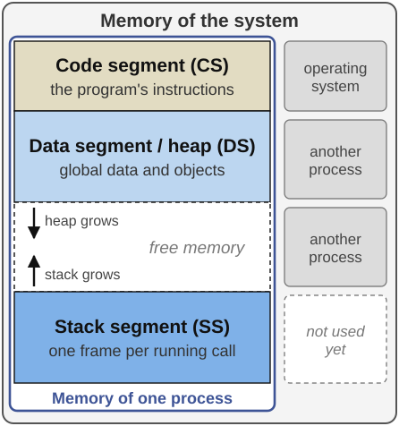{height="15.4em"}
:::
:::
::::

## Memory of a running program {.fit1}

:::: {.columns}
::: {.column width="56%"}
::: {.sm}
A program being run in a machine is called a **process**. Processes require memory to run, which is organized as follows:

- **Code Segment (CS)**
  - contains executable instructions, i.e., a program loaded from hard disk
  - typically read-only and of fixed size
- Data Segment or Heap (DS)
- Stack Segment (SS)
:::
:::

::: {.column width="44%"}
::: {.center-h}
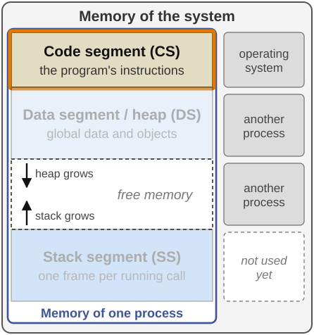{height="15.4em"}
:::
:::
::::

## Memory of a running program {.fit1}

:::: {.columns}
::: {.column width="56%"}
::: {.sm}
A program being run in a machine is called a **process**. Processes require memory to run, which is organized as follows:

- Code Segment (CS)
- **Data Segment or Heap (DS)**
  - contains global data, and Python manages all objects in a (private) heap
  - typically no execute (NX)
  - size is limited by main memory (RAM) or by explicit parameter when run
- Stack Segment (SS)
:::
:::

::: {.column width="44%"}
::: {.center-h}
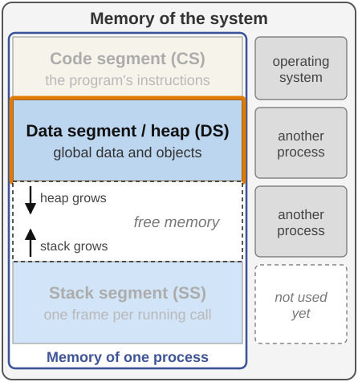{height="15.4em"}
:::
:::
::::

## Memory of a running program {.fit1}

:::: {.columns}
::: {.column width="56%"}
::: {.sm}
A program being run in a machine is called a **process**. Processes require memory to run, which is organized as follows:

- Code Segment (CS)
- Data Segment or Heap (DS)
- **Stack Segment (SS)**
  - contains local variables, parameters, return address
  - typically no execute (NX)
  - limited in size, e.g. 8 MB for Linux, 1 MB for Windows and Java
:::
:::

::: {.column width="44%"}
::: {.center-h}
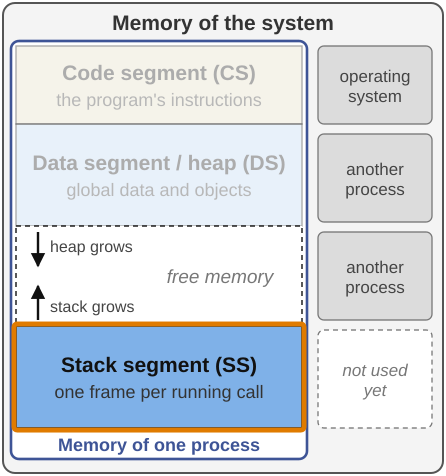{height="15.4em"}
:::
:::
::::

## Recursion in memory: one stack frame per call {.fit1}

:::: {.columns}
::: {.column width="56%"}
::: {.sm}
- Every function call puts a **frame** on the stack that contains:
  - its parameters and local variables
  - the **return address**, i.e. where the program continues after the call
- The frame is removed when the call returns its value
- A recursive call does not replace the frame of its caller. It adds a new frame on top
- `recursive_factorial(3)` needs three frames at its deepest point, so the stack grows and shrinks with every call
:::
:::

::: {.column width="44%"}
::: {.center-h}
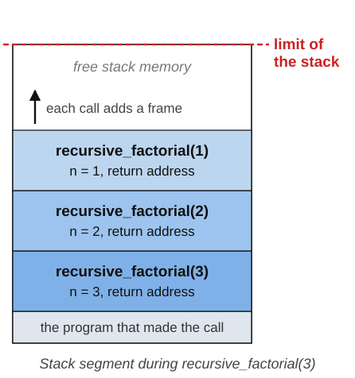{height="15.4em"}
:::
:::
::::

## How a stack overflow happens {.fit1}

:::: {.columns}
::: {.column width="56%"}
::: {.sm}
- The stack has a **maximum size**, e.g. 8 MB for Linux
- If the base case is missing or is never reached, no call returns and every call adds a frame
- A correct recursion can also be too deep, e.g. one call per element of a list with a million elements
- When the next frame does not fit, we have a **stack overflow**
  - the program crashes or, in languages like C, it overwrites other memory
  - Python stops earlier, by default after 1,000 nested calls, with a `RecursionError`
:::
:::

::: {.column width="44%"}
::: {.center-h}
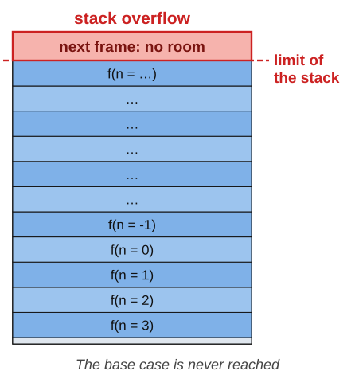{height="15.4em"}
:::
:::
::::

## Memes warned you about recursion {.fit1}

:::: {.columns}
::: {.column width="40%"}
::: {}
**3 Steps to being a good Programmer**

1. Avoid recursion
2. Repeat steps 1 and 2
3. Always have an exit condition
4. Beware of being off by one
:::

{height="5.9em"}
:::

::: {.column width="60%"}
{width="100%"}
:::
::::

## Outline

::: {.outline .focus}
1. Recursion
2. [Recursive Algorithms]{.current}
3. Memoization
:::

## The Greatest Common Divisor

::: {.center-h}
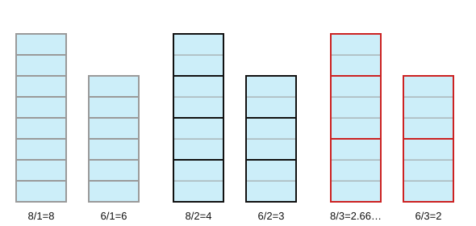{height="14.5em"}
:::

## [Recursive algorithm 1]{.pretitle} Euclid's algorithm

::: {}
Uses the mathematical property: $\gcd(a,b) = \gcd(b,\ a \bmod b)$
:::

::: {.codewrap style="font-size:1.50em"}
<pre class="pseudocode"><b>Procedure</b> GCD(<i>a</i>, <i>b</i>)
<i>Inputs:</i>
      <i>a</i>, <i>b</i>: natural numbers (<i>a</i>, <i>b</i> &isin; &#8469;) with <i>a</i> &ge; <i>b</i>
<i>Result:</i> the greatest common divisor of <i>a</i> and <i>b</i>
<b>If</b> <i>b</i> = 0
      <b>then return</b> <i>a</i>
      <b>else return</b> GCD(<i>b</i>, <i>a</i> <b>mod</b> <i>b</i>)</pre>
:::

## Euclid's algorithm

::: {.sm}
Uses the mathematical property: $\gcd(a,b) = \gcd(b,\ a \bmod b)$
:::

:::: {.columns}
::: {.column width="62%"}
::: {.codewrap style="font-size:1.50em"}
<pre class="pseudocode"><b>Procedure</b> GCD(<i>a</i>, <i>b</i>)
<i>Inputs:</i>
      <i>a</i>, <i>b</i>: natural numbers (<i>a</i>, <i>b</i> &isin; &#8469;) with <i>a</i> &ge; <i>b</i>
<i>Result:</i> the greatest common divisor of <i>a</i> and <i>b</i>
<b>If</b> <i>b</i> = 0
      <b>then return</b> <i>a</i>
      <b>else return</b> GCD(<i>b</i>, <i>a</i> <b>mod</b> <i>b</i>)</pre>
:::
:::

::: {.column width="38%"}
::: {.sm}
- $\gcd(270, 192)$
  - $270 \bmod 192 = 78$
  - $\gcd(192, 78)$
    - $192 \bmod 78 = 36$
    - $\gcd(78, 36)$
      - $78 \bmod 36 = 6$
      - $\gcd(36, 6)$
        - $36 \bmod 6 = 0$
        - $\gcd(6, 0)$
          - **return 6**
:::
:::
::::

## Euclid and the GCD {.fit1}

:::: {.columns}
::: {.column width="60%"}
::: {.sm}
- Euclid (~300 BC) Greek mathematician
- "Euclid of Alexandria" but little is actually known about his life, neither birth year nor place
- Commonly known as the father of geometry
- Euclid's most influential book is *Elements*, which includes the algorithm to calculate the gcd
- The original version of the algorithm did subtractions on the terms instead of modulo operations but it was recursive. However, it required more steps
- One of his lesser known books is titled *Data* (Δεδομένα), on how to study given information geometrically
:::
:::

::: {.column width="40%"}
::: {.center-h}
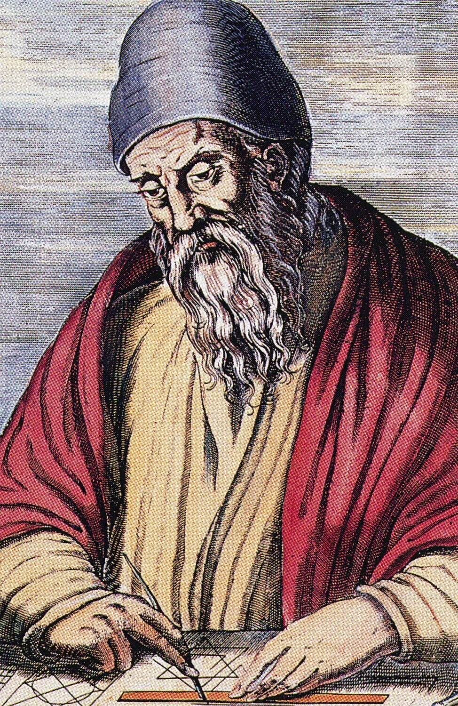{height="13.4em"}

::: {.xs}
Imagination of how Euclid could have looked like
:::
:::
:::
::::

## [Recursive algorithm 2]{.pretitle} Depth-First Search in Directed Graphs

::: {.center-h}
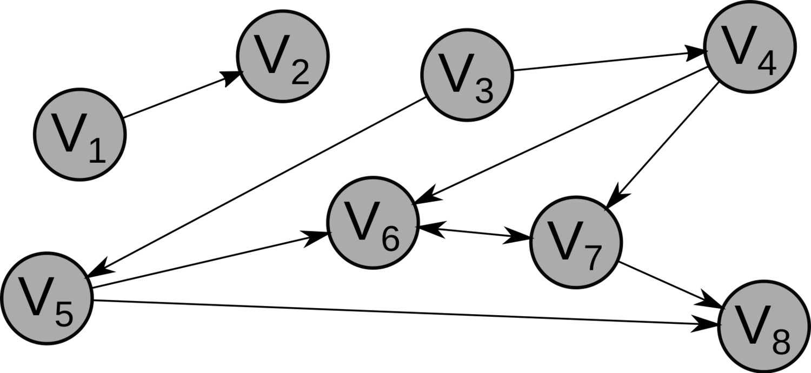{height="7.7em"}
:::

::: {.sm}
Several problems can be solved with depth-first search, such as:

- Is node $x$ included in the graph?
- Does a graph have a cycle?
- Does the graph have a strongly connected component?
:::

## Depth-First Search {.fit1}

:::: {.columns}
::: {.column width="50%"}
::: {.codewrap style="font-size:1.30em"}
<pre class="pseudocode"><b>Procedure</b> DFS(<i>G</i>)
<i>Inputs:</i>
  <i>G</i>: a graph
<i>Result:</i> every vertex stores its discovery time <i>d</i>,
its finishing time <i>f</i> and its parent &pi;
<span class="hl"><b>For</b> each vertex <i>u</i> in <i>G</i>.<i>V</i>:</span>
<span class="hl">      color[<i>u</i>] &larr; WHITE</span>
<span class="hl">      &pi;[<i>u</i>] &larr; NIL              # parent</span>
<i>time</i> &larr; 0                      # global counter
<b>For</b> each vertex <i>u</i> in <i>G</i>.<i>V</i>:
      <b>If</b> color[<i>u</i>] = WHITE
            <b>then</b> DFS-VISIT(<i>G</i>, <i>u</i>)</pre>
:::
:::

::: {.column width="50%"}
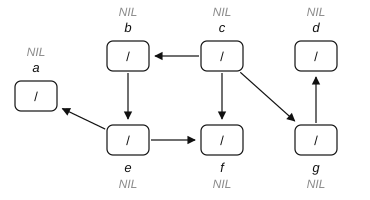{height="9.2em"}

::: {.sm}
Example: the For loop takes vertex $c$ first<br>and neighbors are taken alphabetically<br>time = 0<br>Enter For-Loop:<br>call `DFS-VISIT(G, c)`
:::
:::
::::

## Depth-First Search {.fit1}

:::: {.columns}
::: {.column width="50%"}
::: {.codewrap style="font-size:1.00em"}
<pre class="pseudocode"><b>Procedure</b> DFS-VISIT(<i>G</i>, <i>u</i>)
<i>Inputs:</i>
  <i>G</i>: a graph
  <i>u</i>: the vertex to be processed
<i>Result:</i> <i>u</i> and every vertex reachable from it are visited
<span class="hl"><i>time</i> &larr; <i>time</i> + 1</span>
<span class="hl"><i>d</i>[<i>u</i>] &larr; <i>time</i>                 # discovered</span>
<span class="hl">color[<i>u</i>] &larr; GRAY</span>
<span class="hl"><b>For</b> each vertex <i>v</i> in neighbors(<i>u</i>):</span>
<span class="hl">      <b>If</b> color[<i>v</i>] = WHITE</span>
<span class="hl">            <b>then</b> &pi;[<i>v</i>] &larr; <i>u</i></span>
<span class="hl">                 DFS-VISIT(<i>G</i>, <i>v</i>)</span>
color[<i>u</i>] &larr; BLACK
<i>time</i> &larr; <i>time</i> + 1
<i>f</i>[<i>u</i>] &larr; <i>time</i>                 # finished</pre>
:::
:::

::: {.column width="50%"}
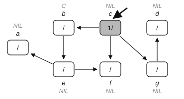{height="9.2em"}

::: {.sm}
call `DFS-VISIT(G, c)`<br>time = 1<br>Enter For-Loop:<br>next adjacent white node: b<br>add parent of b<br>call `DFS-VISIT(G, b)`
:::
:::
::::

## Depth-First Search {.fit1}

:::: {.columns}
::: {.column width="50%"}
::: {.codewrap style="font-size:1.00em"}
<pre class="pseudocode"><b>Procedure</b> DFS-VISIT(<i>G</i>, <i>u</i>)
<i>Inputs:</i>
  <i>G</i>: a graph
  <i>u</i>: the vertex to be processed
<i>Result:</i> <i>u</i> and every vertex reachable from it are visited
<span class="hl"><i>time</i> &larr; <i>time</i> + 1</span>
<span class="hl"><i>d</i>[<i>u</i>] &larr; <i>time</i>                 # discovered</span>
<span class="hl">color[<i>u</i>] &larr; GRAY</span>
<span class="hl"><b>For</b> each vertex <i>v</i> in neighbors(<i>u</i>):</span>
<span class="hl">      <b>If</b> color[<i>v</i>] = WHITE</span>
<span class="hl">            <b>then</b> &pi;[<i>v</i>] &larr; <i>u</i></span>
<span class="hl">                 DFS-VISIT(<i>G</i>, <i>v</i>)</span>
color[<i>u</i>] &larr; BLACK
<i>time</i> &larr; <i>time</i> + 1
<i>f</i>[<i>u</i>] &larr; <i>time</i>                 # finished</pre>
:::
:::

::: {.column width="50%"}
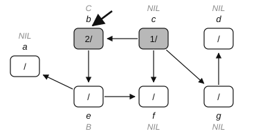{height="9.2em"}

::: {.sm}
call `DFS-VISIT(G, b)`<br>time = 2<br>Enter For-Loop:<br>next adjacent white node: e<br>add parent of e<br>call `DFS-VISIT(G, e)`
:::
:::
::::

## Depth-First Search {.fit1}

:::: {.columns}
::: {.column width="50%"}
::: {.codewrap style="font-size:1.00em"}
<pre class="pseudocode"><b>Procedure</b> DFS-VISIT(<i>G</i>, <i>u</i>)
<i>Inputs:</i>
  <i>G</i>: a graph
  <i>u</i>: the vertex to be processed
<i>Result:</i> <i>u</i> and every vertex reachable from it are visited
<span class="hl"><i>time</i> &larr; <i>time</i> + 1</span>
<span class="hl"><i>d</i>[<i>u</i>] &larr; <i>time</i>                 # discovered</span>
<span class="hl">color[<i>u</i>] &larr; GRAY</span>
<span class="hl"><b>For</b> each vertex <i>v</i> in neighbors(<i>u</i>):</span>
<span class="hl">      <b>If</b> color[<i>v</i>] = WHITE</span>
<span class="hl">            <b>then</b> &pi;[<i>v</i>] &larr; <i>u</i></span>
<span class="hl">                 DFS-VISIT(<i>G</i>, <i>v</i>)</span>
color[<i>u</i>] &larr; BLACK
<i>time</i> &larr; <i>time</i> + 1
<i>f</i>[<i>u</i>] &larr; <i>time</i>                 # finished</pre>
:::
:::

::: {.column width="50%"}
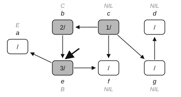{height="9.2em"}

::: {.sm}
call `DFS-VISIT(G, e)`<br>time = 3<br>Enter For-Loop:<br>next adjacent white node: a<br>add parent of a<br>call `DFS-VISIT(G, a)`
:::
:::
::::

## Depth-First Search {.fit1}

:::: {.columns}
::: {.column width="50%"}
::: {.codewrap style="font-size:1.00em"}
<pre class="pseudocode"><b>Procedure</b> DFS-VISIT(<i>G</i>, <i>u</i>)
<i>Inputs:</i>
  <i>G</i>: a graph
  <i>u</i>: the vertex to be processed
<i>Result:</i> <i>u</i> and every vertex reachable from it are visited
<span class="hl"><i>time</i> &larr; <i>time</i> + 1</span>
<span class="hl"><i>d</i>[<i>u</i>] &larr; <i>time</i>                 # discovered</span>
<span class="hl">color[<i>u</i>] &larr; GRAY</span>
<span class="hl"><b>For</b> each vertex <i>v</i> in neighbors(<i>u</i>):</span>
<span class="hl">      <b>If</b> color[<i>v</i>] = WHITE</span>
            <b>then</b> &pi;[<i>v</i>] &larr; <i>u</i>
                 DFS-VISIT(<i>G</i>, <i>v</i>)
color[<i>u</i>] &larr; BLACK
<i>time</i> &larr; <i>time</i> + 1
<i>f</i>[<i>u</i>] &larr; <i>time</i>                 # finished</pre>
:::
:::

::: {.column width="50%"}
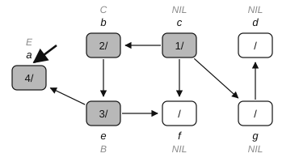{height="9.2em"}

::: {.sm}
call `DFS-VISIT(G, a)`<br>time = 4<br>Enter For-Loop:<br>no adjacent white nodes<br>finish `DFS-VISIT(G, a)`
:::
:::
::::

## Depth-First Search {.fit1}

:::: {.columns}
::: {.column width="50%"}
::: {.codewrap style="font-size:1.00em"}
<pre class="pseudocode"><b>Procedure</b> DFS-VISIT(<i>G</i>, <i>u</i>)
<i>Inputs:</i>
  <i>G</i>: a graph
  <i>u</i>: the vertex to be processed
<i>Result:</i> <i>u</i> and every vertex reachable from it are visited
<i>time</i> &larr; <i>time</i> + 1
<i>d</i>[<i>u</i>] &larr; <i>time</i>                 # discovered
color[<i>u</i>] &larr; GRAY
<b>For</b> each vertex <i>v</i> in neighbors(<i>u</i>):
      <b>If</b> color[<i>v</i>] = WHITE
            <b>then</b> &pi;[<i>v</i>] &larr; <i>u</i>
                 DFS-VISIT(<i>G</i>, <i>v</i>)
<span class="hl">color[<i>u</i>] &larr; BLACK</span>
<span class="hl"><i>time</i> &larr; <i>time</i> + 1</span>
<span class="hl"><i>f</i>[<i>u</i>] &larr; <i>time</i>                 # finished</span></pre>
:::
:::

::: {.column width="50%"}
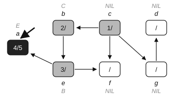{height="9.2em"}

::: {.sm}
finish `DFS-VISIT(G, a)`<br>time = 5<br>return to For-Loop of `DFS-VISIT(G, e)`
:::
:::
::::

## Depth-First Search {.fit1}

:::: {.columns}
::: {.column width="50%"}
::: {.codewrap style="font-size:1.00em"}
<pre class="pseudocode"><b>Procedure</b> DFS-VISIT(<i>G</i>, <i>u</i>)
<i>Inputs:</i>
  <i>G</i>: a graph
  <i>u</i>: the vertex to be processed
<i>Result:</i> <i>u</i> and every vertex reachable from it are visited
<i>time</i> &larr; <i>time</i> + 1
<i>d</i>[<i>u</i>] &larr; <i>time</i>                 # discovered
color[<i>u</i>] &larr; GRAY
<span class="hl"><b>For</b> each vertex <i>v</i> in neighbors(<i>u</i>):</span>
<span class="hl">      <b>If</b> color[<i>v</i>] = WHITE</span>
<span class="hl">            <b>then</b> &pi;[<i>v</i>] &larr; <i>u</i></span>
<span class="hl">                 DFS-VISIT(<i>G</i>, <i>v</i>)</span>
color[<i>u</i>] &larr; BLACK
<i>time</i> &larr; <i>time</i> + 1
<i>f</i>[<i>u</i>] &larr; <i>time</i>                 # finished</pre>
:::
:::

::: {.column width="50%"}
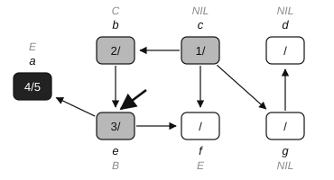{height="9.2em"}

::: {.sm}
return to For-Loop of `DFS-VISIT(G, e)`<br>time = 5<br>Back in the For-Loop:<br>next adjacent white node: f<br>add parent of f<br>call `DFS-VISIT(G, f)`
:::
:::
::::

## Depth-First Search {.fit1}

:::: {.columns}
::: {.column width="50%"}
::: {.codewrap style="font-size:1.00em"}
<pre class="pseudocode"><b>Procedure</b> DFS-VISIT(<i>G</i>, <i>u</i>)
<i>Inputs:</i>
  <i>G</i>: a graph
  <i>u</i>: the vertex to be processed
<i>Result:</i> <i>u</i> and every vertex reachable from it are visited
<span class="hl"><i>time</i> &larr; <i>time</i> + 1</span>
<span class="hl"><i>d</i>[<i>u</i>] &larr; <i>time</i>                 # discovered</span>
<span class="hl">color[<i>u</i>] &larr; GRAY</span>
<span class="hl"><b>For</b> each vertex <i>v</i> in neighbors(<i>u</i>):</span>
<span class="hl">      <b>If</b> color[<i>v</i>] = WHITE</span>
            <b>then</b> &pi;[<i>v</i>] &larr; <i>u</i>
                 DFS-VISIT(<i>G</i>, <i>v</i>)
color[<i>u</i>] &larr; BLACK
<i>time</i> &larr; <i>time</i> + 1
<i>f</i>[<i>u</i>] &larr; <i>time</i>                 # finished</pre>
:::
:::

::: {.column width="50%"}
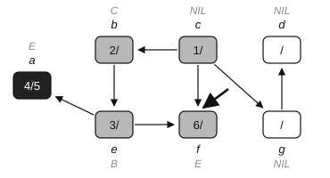{height="9.2em"}

::: {.sm}
call `DFS-VISIT(G, f)`<br>time = 6<br>Enter the For-Loop:<br>no adjacent white nodes<br>finish `DFS-VISIT(G, f)`
:::
:::
::::

## Depth-First Search {.fit1}

:::: {.columns}
::: {.column width="50%"}
::: {.codewrap style="font-size:1.00em"}
<pre class="pseudocode"><b>Procedure</b> DFS-VISIT(<i>G</i>, <i>u</i>)
<i>Inputs:</i>
  <i>G</i>: a graph
  <i>u</i>: the vertex to be processed
<i>Result:</i> <i>u</i> and every vertex reachable from it are visited
<i>time</i> &larr; <i>time</i> + 1
<i>d</i>[<i>u</i>] &larr; <i>time</i>                 # discovered
color[<i>u</i>] &larr; GRAY
<b>For</b> each vertex <i>v</i> in neighbors(<i>u</i>):
      <b>If</b> color[<i>v</i>] = WHITE
            <b>then</b> &pi;[<i>v</i>] &larr; <i>u</i>
                 DFS-VISIT(<i>G</i>, <i>v</i>)
<span class="hl">color[<i>u</i>] &larr; BLACK</span>
<span class="hl"><i>time</i> &larr; <i>time</i> + 1</span>
<span class="hl"><i>f</i>[<i>u</i>] &larr; <i>time</i>                 # finished</span></pre>
:::
:::

::: {.column width="50%"}
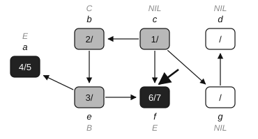{height="9.2em"}

::: {.sm}
finish `DFS-VISIT(G, f)`<br>time = 7<br>return to For-Loop of `DFS-VISIT(G, e)`
:::
:::
::::

## Depth-First Search {.fit1}

:::: {.columns}
::: {.column width="50%"}
::: {.codewrap style="font-size:1.00em"}
<pre class="pseudocode"><b>Procedure</b> DFS-VISIT(<i>G</i>, <i>u</i>)
<i>Inputs:</i>
  <i>G</i>: a graph
  <i>u</i>: the vertex to be processed
<i>Result:</i> <i>u</i> and every vertex reachable from it are visited
<i>time</i> &larr; <i>time</i> + 1
<i>d</i>[<i>u</i>] &larr; <i>time</i>                 # discovered
color[<i>u</i>] &larr; GRAY
<span class="hl"><b>For</b> each vertex <i>v</i> in neighbors(<i>u</i>):</span>
<span class="hl">      <b>If</b> color[<i>v</i>] = WHITE</span>
            <b>then</b> &pi;[<i>v</i>] &larr; <i>u</i>
                 DFS-VISIT(<i>G</i>, <i>v</i>)
color[<i>u</i>] &larr; BLACK
<i>time</i> &larr; <i>time</i> + 1
<i>f</i>[<i>u</i>] &larr; <i>time</i>                 # finished</pre>
:::
:::

::: {.column width="50%"}
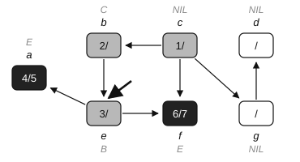{height="9.2em"}

::: {.sm}
return to For-Loop of `DFS-VISIT(G, e)`<br>time = 7<br>Back in the For-Loop:<br>no adjacent white nodes<br>finish `DFS-VISIT(G, e)`
:::
:::
::::

## Depth-First Search {.fit1}

:::: {.columns}
::: {.column width="50%"}
::: {.codewrap style="font-size:1.00em"}
<pre class="pseudocode"><b>Procedure</b> DFS-VISIT(<i>G</i>, <i>u</i>)
<i>Inputs:</i>
  <i>G</i>: a graph
  <i>u</i>: the vertex to be processed
<i>Result:</i> <i>u</i> and every vertex reachable from it are visited
<i>time</i> &larr; <i>time</i> + 1
<i>d</i>[<i>u</i>] &larr; <i>time</i>                 # discovered
color[<i>u</i>] &larr; GRAY
<b>For</b> each vertex <i>v</i> in neighbors(<i>u</i>):
      <b>If</b> color[<i>v</i>] = WHITE
            <b>then</b> &pi;[<i>v</i>] &larr; <i>u</i>
                 DFS-VISIT(<i>G</i>, <i>v</i>)
<span class="hl">color[<i>u</i>] &larr; BLACK</span>
<span class="hl"><i>time</i> &larr; <i>time</i> + 1</span>
<span class="hl"><i>f</i>[<i>u</i>] &larr; <i>time</i>                 # finished</span></pre>
:::
:::

::: {.column width="50%"}
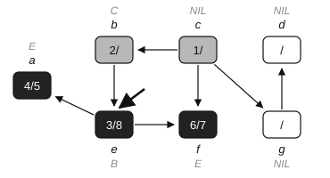{height="9.2em"}

::: {.sm}
finish `DFS-VISIT(G, e)`<br>time = 8<br>return to For-Loop of `DFS-VISIT(G, b)`
:::
:::
::::

## Depth-First Search {.fit1}

:::: {.columns}
::: {.column width="50%"}
::: {.codewrap style="font-size:1.00em"}
<pre class="pseudocode"><b>Procedure</b> DFS-VISIT(<i>G</i>, <i>u</i>)
<i>Inputs:</i>
  <i>G</i>: a graph
  <i>u</i>: the vertex to be processed
<i>Result:</i> <i>u</i> and every vertex reachable from it are visited
<i>time</i> &larr; <i>time</i> + 1
<i>d</i>[<i>u</i>] &larr; <i>time</i>                 # discovered
color[<i>u</i>] &larr; GRAY
<span class="hl"><b>For</b> each vertex <i>v</i> in neighbors(<i>u</i>):</span>
<span class="hl">      <b>If</b> color[<i>v</i>] = WHITE</span>
            <b>then</b> &pi;[<i>v</i>] &larr; <i>u</i>
                 DFS-VISIT(<i>G</i>, <i>v</i>)
color[<i>u</i>] &larr; BLACK
<i>time</i> &larr; <i>time</i> + 1
<i>f</i>[<i>u</i>] &larr; <i>time</i>                 # finished</pre>
:::
:::

::: {.column width="50%"}
{height="9.2em"}

::: {.sm}
return to For-Loop of `DFS-VISIT(G, b)`<br>time = 8<br>Back in the For-Loop:<br>no adjacent white nodes<br>finish `DFS-VISIT(G, b)`
:::
:::
::::

## Depth-First Search {.fit1}

:::: {.columns}
::: {.column width="50%"}
::: {.codewrap style="font-size:1.00em"}
<pre class="pseudocode"><b>Procedure</b> DFS-VISIT(<i>G</i>, <i>u</i>)
<i>Inputs:</i>
  <i>G</i>: a graph
  <i>u</i>: the vertex to be processed
<i>Result:</i> <i>u</i> and every vertex reachable from it are visited
<i>time</i> &larr; <i>time</i> + 1
<i>d</i>[<i>u</i>] &larr; <i>time</i>                 # discovered
color[<i>u</i>] &larr; GRAY
<b>For</b> each vertex <i>v</i> in neighbors(<i>u</i>):
      <b>If</b> color[<i>v</i>] = WHITE
            <b>then</b> &pi;[<i>v</i>] &larr; <i>u</i>
                 DFS-VISIT(<i>G</i>, <i>v</i>)
<span class="hl">color[<i>u</i>] &larr; BLACK</span>
<span class="hl"><i>time</i> &larr; <i>time</i> + 1</span>
<span class="hl"><i>f</i>[<i>u</i>] &larr; <i>time</i>                 # finished</span></pre>
:::
:::

::: {.column width="50%"}
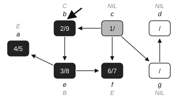{height="9.2em"}

::: {.sm}
finish `DFS-VISIT(G, b)`<br>time = 9<br>return to For-Loop of `DFS-VISIT(G, c)`
:::
:::
::::

## Depth-First Search {.fit1}

:::: {.columns}
::: {.column width="50%"}
::: {.codewrap style="font-size:1.00em"}
<pre class="pseudocode"><b>Procedure</b> DFS-VISIT(<i>G</i>, <i>u</i>)
<i>Inputs:</i>
  <i>G</i>: a graph
  <i>u</i>: the vertex to be processed
<i>Result:</i> <i>u</i> and every vertex reachable from it are visited
<i>time</i> &larr; <i>time</i> + 1
<i>d</i>[<i>u</i>] &larr; <i>time</i>                 # discovered
color[<i>u</i>] &larr; GRAY
<span class="hl"><b>For</b> each vertex <i>v</i> in neighbors(<i>u</i>):</span>
<span class="hl">      <b>If</b> color[<i>v</i>] = WHITE</span>
<span class="hl">            <b>then</b> &pi;[<i>v</i>] &larr; <i>u</i></span>
<span class="hl">                 DFS-VISIT(<i>G</i>, <i>v</i>)</span>
color[<i>u</i>] &larr; BLACK
<i>time</i> &larr; <i>time</i> + 1
<i>f</i>[<i>u</i>] &larr; <i>time</i>                 # finished</pre>
:::
:::

::: {.column width="50%"}
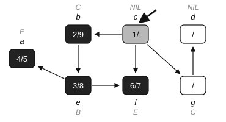{height="9.2em"}

::: {.sm}
return to For-Loop of `DFS-VISIT(G, c)`<br>time = 9<br>Back in the For-Loop:<br>next adjacent white node: g<br>add parent of g<br>call `DFS-VISIT(G, g)`
:::
:::
::::

## Depth-First Search {.fit1}

:::: {.columns}
::: {.column width="50%"}
::: {.codewrap style="font-size:1.00em"}
<pre class="pseudocode"><b>Procedure</b> DFS-VISIT(<i>G</i>, <i>u</i>)
<i>Inputs:</i>
  <i>G</i>: a graph
  <i>u</i>: the vertex to be processed
<i>Result:</i> <i>u</i> and every vertex reachable from it are visited
<span class="hl"><i>time</i> &larr; <i>time</i> + 1</span>
<span class="hl"><i>d</i>[<i>u</i>] &larr; <i>time</i>                 # discovered</span>
<span class="hl">color[<i>u</i>] &larr; GRAY</span>
<span class="hl"><b>For</b> each vertex <i>v</i> in neighbors(<i>u</i>):</span>
<span class="hl">      <b>If</b> color[<i>v</i>] = WHITE</span>
<span class="hl">            <b>then</b> &pi;[<i>v</i>] &larr; <i>u</i></span>
<span class="hl">                 DFS-VISIT(<i>G</i>, <i>v</i>)</span>
color[<i>u</i>] &larr; BLACK
<i>time</i> &larr; <i>time</i> + 1
<i>f</i>[<i>u</i>] &larr; <i>time</i>                 # finished</pre>
:::
:::

::: {.column width="50%"}
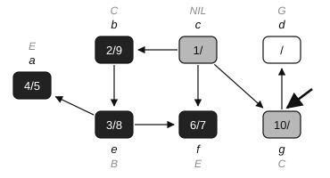{height="9.2em"}

::: {.sm}
call `DFS-VISIT(G, g)`<br>time = 10<br>Enter the For-Loop:<br>next adjacent white node: d<br>add parent of d<br>call `DFS-VISIT(G, d)`
:::
:::
::::

## Depth-First Search {.fit1}

:::: {.columns}
::: {.column width="50%"}
::: {.codewrap style="font-size:1.00em"}
<pre class="pseudocode"><b>Procedure</b> DFS-VISIT(<i>G</i>, <i>u</i>)
<i>Inputs:</i>
  <i>G</i>: a graph
  <i>u</i>: the vertex to be processed
<i>Result:</i> <i>u</i> and every vertex reachable from it are visited
<span class="hl"><i>time</i> &larr; <i>time</i> + 1</span>
<span class="hl"><i>d</i>[<i>u</i>] &larr; <i>time</i>                 # discovered</span>
<span class="hl">color[<i>u</i>] &larr; GRAY</span>
<span class="hl"><b>For</b> each vertex <i>v</i> in neighbors(<i>u</i>):</span>
<span class="hl">      <b>If</b> color[<i>v</i>] = WHITE</span>
            <b>then</b> &pi;[<i>v</i>] &larr; <i>u</i>
                 DFS-VISIT(<i>G</i>, <i>v</i>)
color[<i>u</i>] &larr; BLACK
<i>time</i> &larr; <i>time</i> + 1
<i>f</i>[<i>u</i>] &larr; <i>time</i>                 # finished</pre>
:::
:::

::: {.column width="50%"}
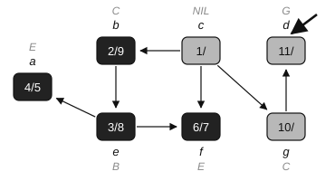{height="9.2em"}

::: {.sm}
call `DFS-VISIT(G, d)`<br>time = 11<br>Enter the For-Loop:<br>no adjacent white nodes<br>finish `DFS-VISIT(G, d)`
:::
:::
::::

## Depth-First Search {.fit1}

:::: {.columns}
::: {.column width="50%"}
::: {.codewrap style="font-size:1.00em"}
<pre class="pseudocode"><b>Procedure</b> DFS-VISIT(<i>G</i>, <i>u</i>)
<i>Inputs:</i>
  <i>G</i>: a graph
  <i>u</i>: the vertex to be processed
<i>Result:</i> <i>u</i> and every vertex reachable from it are visited
<i>time</i> &larr; <i>time</i> + 1
<i>d</i>[<i>u</i>] &larr; <i>time</i>                 # discovered
color[<i>u</i>] &larr; GRAY
<b>For</b> each vertex <i>v</i> in neighbors(<i>u</i>):
      <b>If</b> color[<i>v</i>] = WHITE
            <b>then</b> &pi;[<i>v</i>] &larr; <i>u</i>
                 DFS-VISIT(<i>G</i>, <i>v</i>)
<span class="hl">color[<i>u</i>] &larr; BLACK</span>
<span class="hl"><i>time</i> &larr; <i>time</i> + 1</span>
<span class="hl"><i>f</i>[<i>u</i>] &larr; <i>time</i>                 # finished</span></pre>
:::
:::

::: {.column width="50%"}
{height="9.2em"}

::: {.sm}
finish `DFS-VISIT(G, d)`<br>time = 12<br>return to For-Loop of `DFS-VISIT(G, g)`
:::
:::
::::

## Depth-First Search {.fit1}

:::: {.columns}
::: {.column width="50%"}
::: {.codewrap style="font-size:1.00em"}
<pre class="pseudocode"><b>Procedure</b> DFS-VISIT(<i>G</i>, <i>u</i>)
<i>Inputs:</i>
  <i>G</i>: a graph
  <i>u</i>: the vertex to be processed
<i>Result:</i> <i>u</i> and every vertex reachable from it are visited
<i>time</i> &larr; <i>time</i> + 1
<i>d</i>[<i>u</i>] &larr; <i>time</i>                 # discovered
color[<i>u</i>] &larr; GRAY
<span class="hl"><b>For</b> each vertex <i>v</i> in neighbors(<i>u</i>):</span>
<span class="hl">      <b>If</b> color[<i>v</i>] = WHITE</span>
            <b>then</b> &pi;[<i>v</i>] &larr; <i>u</i>
                 DFS-VISIT(<i>G</i>, <i>v</i>)
color[<i>u</i>] &larr; BLACK
<i>time</i> &larr; <i>time</i> + 1
<i>f</i>[<i>u</i>] &larr; <i>time</i>                 # finished</pre>
:::
:::

::: {.column width="50%"}
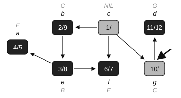{height="9.2em"}

::: {.sm}
return to For-Loop of `DFS-VISIT(G, g)`<br>time = 12<br>Back in the For-Loop:<br>no adjacent white nodes<br>finish `DFS-VISIT(G, g)`
:::
:::
::::

## Depth-First Search {.fit1}

:::: {.columns}
::: {.column width="50%"}
::: {.codewrap style="font-size:1.00em"}
<pre class="pseudocode"><b>Procedure</b> DFS-VISIT(<i>G</i>, <i>u</i>)
<i>Inputs:</i>
  <i>G</i>: a graph
  <i>u</i>: the vertex to be processed
<i>Result:</i> <i>u</i> and every vertex reachable from it are visited
<i>time</i> &larr; <i>time</i> + 1
<i>d</i>[<i>u</i>] &larr; <i>time</i>                 # discovered
color[<i>u</i>] &larr; GRAY
<b>For</b> each vertex <i>v</i> in neighbors(<i>u</i>):
      <b>If</b> color[<i>v</i>] = WHITE
            <b>then</b> &pi;[<i>v</i>] &larr; <i>u</i>
                 DFS-VISIT(<i>G</i>, <i>v</i>)
<span class="hl">color[<i>u</i>] &larr; BLACK</span>
<span class="hl"><i>time</i> &larr; <i>time</i> + 1</span>
<span class="hl"><i>f</i>[<i>u</i>] &larr; <i>time</i>                 # finished</span></pre>
:::
:::

::: {.column width="50%"}
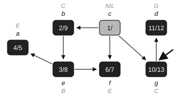{height="9.2em"}

::: {.sm}
finish `DFS-VISIT(G, g)`<br>time = 13<br>return to For-Loop of `DFS-VISIT(G, c)`
:::
:::
::::

## Depth-First Search {.fit1}

:::: {.columns}
::: {.column width="50%"}
::: {.codewrap style="font-size:1.00em"}
<pre class="pseudocode"><b>Procedure</b> DFS-VISIT(<i>G</i>, <i>u</i>)
<i>Inputs:</i>
  <i>G</i>: a graph
  <i>u</i>: the vertex to be processed
<i>Result:</i> <i>u</i> and every vertex reachable from it are visited
<i>time</i> &larr; <i>time</i> + 1
<i>d</i>[<i>u</i>] &larr; <i>time</i>                 # discovered
color[<i>u</i>] &larr; GRAY
<span class="hl"><b>For</b> each vertex <i>v</i> in neighbors(<i>u</i>):</span>
<span class="hl">      <b>If</b> color[<i>v</i>] = WHITE</span>
            <b>then</b> &pi;[<i>v</i>] &larr; <i>u</i>
                 DFS-VISIT(<i>G</i>, <i>v</i>)
color[<i>u</i>] &larr; BLACK
<i>time</i> &larr; <i>time</i> + 1
<i>f</i>[<i>u</i>] &larr; <i>time</i>                 # finished</pre>
:::
:::

::: {.column width="50%"}
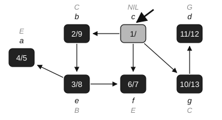{height="9.2em"}

::: {.sm}
return to For-Loop of `DFS-VISIT(G, c)`<br>time = 13<br>Back in the For-Loop:<br>no adjacent white nodes<br>finish `DFS-VISIT(G, c)`
:::
:::
::::

## Depth-First Search {.fit1}

:::: {.columns}
::: {.column width="50%"}
::: {.codewrap style="font-size:1.00em"}
<pre class="pseudocode"><b>Procedure</b> DFS-VISIT(<i>G</i>, <i>u</i>)
<i>Inputs:</i>
  <i>G</i>: a graph
  <i>u</i>: the vertex to be processed
<i>Result:</i> <i>u</i> and every vertex reachable from it are visited
<i>time</i> &larr; <i>time</i> + 1
<i>d</i>[<i>u</i>] &larr; <i>time</i>                 # discovered
color[<i>u</i>] &larr; GRAY
<b>For</b> each vertex <i>v</i> in neighbors(<i>u</i>):
      <b>If</b> color[<i>v</i>] = WHITE
            <b>then</b> &pi;[<i>v</i>] &larr; <i>u</i>
                 DFS-VISIT(<i>G</i>, <i>v</i>)
<span class="hl">color[<i>u</i>] &larr; BLACK</span>
<span class="hl"><i>time</i> &larr; <i>time</i> + 1</span>
<span class="hl"><i>f</i>[<i>u</i>] &larr; <i>time</i>                 # finished</span></pre>
:::
:::

::: {.column width="50%"}
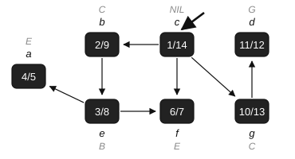{height="9.2em"}

::: {.sm}
finish `DFS-VISIT(G, c)`<br>time = 14<br>All nodes finished<br>&rarr; **FINISHED**
:::
:::
::::

## Depth-First Search

::: {}
More on Depth-First Search: See Cormen (2009)
:::

::: {.imgrow .middle}
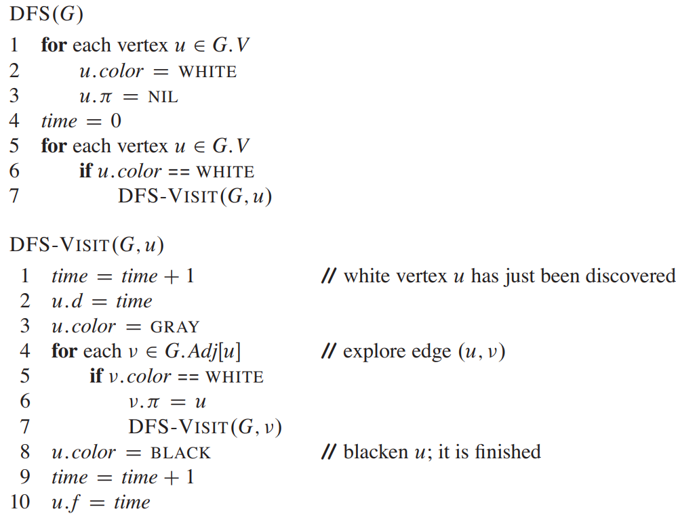{height="11.7em"}
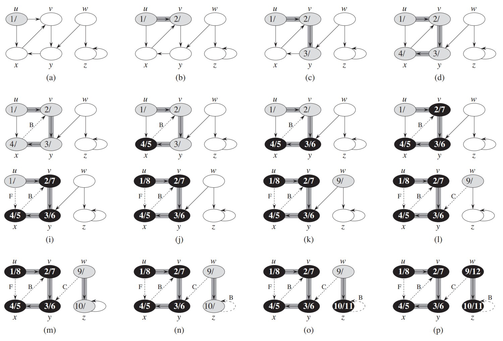{height="11.7em"}
:::

::: {.source}
From *Introduction to Algorithms* by Thomas Cormen (2009)
:::

## DFS for planning: topological sorting {.fit1}

:::: {.columns}
::: {.column width="44%"}
::: {.sm}
- Tasks often depend on each other, e.g. data has to be collected before it is analyzed
- A directed graph without cycles describes the plan, with an edge $u \rightarrow v$ if $u$ has to be done before $v$
- **Topological sorting** finds an order that respects all dependencies:
  1. run DFS on the graph
  2. sort the vertices by **decreasing finishing time** $f$
- A vertex finishes after all vertices that depend on it
:::
:::

::: {.column width="56%"}
::: {.center-h}
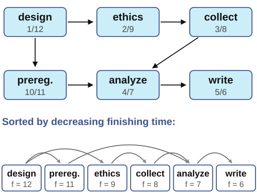{height="15.0em"}
:::
:::
::::

## DFS for finding cycles {.fit1}

:::: {.columns}
::: {.column width="46%"}
::: {.sm}
- A cycle in a plan means that it cannot be carried out, e.g. a course that requires itself through other courses. Such a graph has no topological order
- While `DFS-VISIT(G, u)` runs, the GRAY vertices are the ones whose calls are waiting on the stack
- If a neighbor $v$ of $u$ is **GRAY**, there is a path from $v$ to $u$ and an edge from $u$ to $v$, i.e. a **cycle**
:::
:::

::: {.column width="54%"}
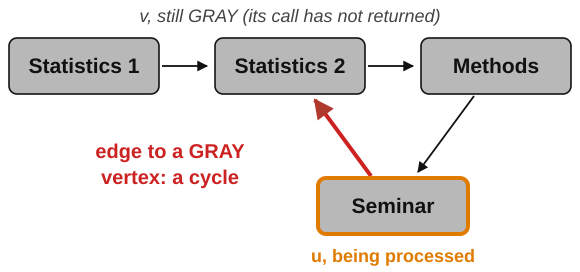{width="100%"}

::: {.codewrap style="font-size:1.0em"}
<pre class="pseudocode"><b>For</b> each vertex <i>v</i> in neighbors(<i>u</i>):
<span class="hl">      <b>If</b> color[<i>v</i>] = GRAY</span>
<span class="hl">            <b>then</b> report a cycle</span>
      <b>If</b> color[<i>v</i>] = WHITE
            <b>then</b> &pi;[<i>v</i>] &larr; <i>u</i>
                 DFS-VISIT(<i>G</i>, <i>v</i>)</pre>
:::
:::
::::

## Types of recursive algorithms

:::::: {.rtypes}
::::: {.rt}
:::: {.rt-row}
::: {.rt-l}
**Linear recursion:** the procedure calls itself once
:::
::: {.rt-r}
$\text{FACTORIAL}(n) = n \cdot \text{FACTORIAL}(n-1)$
:::
::::

::::: {.rt .rt-inner}
:::: {.rt-row}
::: {.rt-l}
**Tail-end recursion** is a special case of linear recursion: the recursive call is the last step, so its result is returned without any further calculation
:::
::: {.rt-r}
$\text{GCD}(a, b) = \text{GCD}(b,\ a \bmod b)$
:::
::::
:::::
:::::

::::: {.rt}
:::: {.rt-row}
::: {.rt-l}
**Tree** or **cascade recursion:** the procedure calls itself several times
:::
::: {.rt-r}
$\text{FIB}(n) = \text{FIB}(n-1) + \text{FIB}(n-2)$<br>DFS-VISIT, with one call per white neighbor
:::
::::
:::::

::::: {.rt}
:::: {.rt-row}
::: {.rt-l}
**Nested recursion:** the parameters of a recursive call contain another recursive call, e.g. the Ackermann function
:::
::: {.rt-r}
$ack(0, m) = m + 1$<br>$ack(n+1, 0) = ack(n, 1)$<br>$ack(n+1, m+1) = ack(n,\ ack(n+1, m))$
:::
::::
:::::
::::::

## Outline

::: {.outline .focus}
1. Recursion
2. Recursive Algorithms
3. [Memoization]{.current}
:::

## Example: Fibonacci numbers

::: {.codewrap style="font-size:1.48em"}
<pre class="pseudocode" style="width:66%;margin:0.4em auto"><b>Procedure</b> FIB(<i>n</i>)                  # recursive version
<i>Inputs:</i>
  <i>n</i>: a natural number (<i>n</i> &isin; &#8469;)
<i>Result:</i> the <i>n</i>-th Fibonacci number
<b>If</b> <i>n</i> = 0
      <b>then return</b> 0
<b>If</b> <i>n</i> = 1
      <b>then return</b> 1
<b>return</b> FIB(<i>n</i> - 1) + FIB(<i>n</i> - 2)</pre>
:::

::: {.center-h .sm}
The number of calls to `fib(n)` grows **exponentially** with $n$
:::

## Why is the recursive version slow? {.fit1}

::: {.center-h}
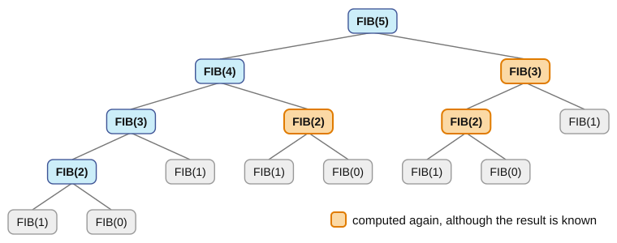{.nostretch height="9.6em"}
:::

::: {.sm}
- FIB(5) makes 15 calls, although there are only 6 different sub-problems, namely FIB(0) to FIB(5)
- The number of calls grows fast with $n$, e.g. FIB(30) makes about 2.7 million calls
:::

## Memoization: saving results in an array {.fit1}

::: {.definition}
[Definition of memoization]{.label}

::: {.sm}
Memoization means **saving the result** of each sub-problem the first time it is calculated, for example in an array, so that we do not have to compute that same sub-problem again.
:::
:::

::: {.center-h}
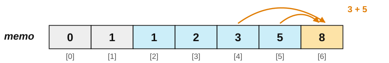{.nostretch height="4.2em"}
:::

::: {.sm}
- Each sub-problem is solved only once, which makes the algorithm faster in exchange for the memory of the array
- With the array we can also rewrite the recursion as a loop that fills the array from the smallest sub-problem
- Saving and reusing the results of sub-problems is the idea behind **dynamic programming**
:::

## Example: Fibonacci numbers

::: {.codewrap style="font-size:1.06em"}
<pre class="pseudocode" style="width:70%;margin:0.4em auto"><b>Procedure</b> FIB(<i>n</i>)                  # recursive, with memoization
<i>Inputs:</i>
  <i>n</i>: a natural number (<i>n</i> &isin; &#8469;)
<i>Data:</i> <i>memo</i>: an array indexed from 0 to <i>n</i>, initially all NIL
<i>Result:</i> the <i>n</i>-th Fibonacci number
<b>If</b> <i>n</i> = 0
      <b>then return</b> 0
<b>If</b> <i>n</i> = 1
      <b>then return</b> 1
<b>If</b> <i>memo</i>[<i>n</i>] &ne; NIL
      <b>then return</b> <i>memo</i>[<i>n</i>]
<i>memo</i>[<i>n</i>] &larr; FIB(<i>n</i> - 1) + FIB(<i>n</i> - 2)
<b>return</b> <i>memo</i>[<i>n</i>]</pre>
:::

## Example: Fibonacci numbers

::: {.codewrap style="font-size:1.06em"}
<pre class="pseudocode" style="width:70%;margin:0.4em auto"><b>Procedure</b> FIB(<i>n</i>)                  # recursive, with memoization
<i>Inputs:</i>
  <i>n</i>: a natural number (<i>n</i> &isin; &#8469;)
<i>Data:</i> <i>memo</i>: an array indexed from 0 to <i>n</i>, initially all NIL
<i>Result:</i> the <i>n</i>-th Fibonacci number
<b>If</b> <i>n</i> = 0
      <b>then return</b> 0
<b>If</b> <i>n</i> = 1
      <b>then return</b> 1
<b>If</b> <i>memo</i>[<i>n</i>] &ne; NIL
      <b>then return</b> <i>memo</i>[<i>n</i>]
<i>memo</i>[<i>n</i>] &larr; FIB(<i>n</i> - 1) + FIB(<i>n</i> - 2)
<b>return</b> <i>memo</i>[<i>n</i>]</pre>
:::

::: {.center-h .sm}
Previously calculated results are saved in `memo`
:::

## Example: Fibonacci numbers

::: {.codewrap style="font-size:1.50em"}
<pre class="pseudocode" style="width:66%;margin:0.4em auto"><b>Procedure</b> FIB(<i>n</i>)                  # fully iterative
<i>Inputs:</i>
  <i>n</i>: a natural number (<i>n</i> &isin; &#8469;)
<i>Data:</i> <i>memo</i>: an array indexed from 0 to <i>n</i>
<i>Result:</i> the <i>n</i>-th Fibonacci number
<i>memo</i>[0] &larr; 0
<i>memo</i>[1] &larr; 1
<b>For</b> <i>i</i> = 2 to <i>n</i>:
      <i>memo</i>[<i>i</i>] &larr; <i>memo</i>[<i>i</i> - 1] + <i>memo</i>[<i>i</i> - 2]
<b>return</b> <i>memo</i>[<i>n</i>]</pre>
:::

## Memoization and memory: the stack or the array? {.fit1}

::: {.tbl-grid .tbl-roomy}
| Version of FIB($n$) | Calls for $n = 30$ | Stack | Array |
|---|:---:|:---:|:---:|
| recursive | about 2.7 million | up to $n$ frames | none |
| recursive with memoization | 59 | up to $n$ frames | $n + 1$ entries |
| iterative with an array | 1 | 1 frame | $n + 1$ entries |
| iterative with two variables | 1 | 1 frame | none |
:::

::: {.sm}
- Memoization uses **more memory** than the plain recursion, because it keeps the array in addition to the stack
- The iterative version uses **less memory** than both recursive versions, because it needs the array but no stack frames, so it cannot overflow the stack
- If only the last results are needed, as in Fibonacci, the array can be replaced by two variables
:::

## Outtake &ndash; Types of algorithms you will encounter {.fit1}

:::::: {.rtypes .atypes}
::::: {.rt}
:::: {.rt-row}
::: {.rt-l}
**Recursion**

- solves a problem through calls to itself on smaller inputs, e.g. DFS
- requires specifying sensible abort conditions
:::
::: {.rt-r}
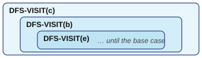
:::
::::
:::::

::::: {.rt}
:::: {.rt-row}
::: {.rt-l}
**Greedy**

- successive extension of partial solutions, e.g. BFS extends the visited nodes with the closest ones
- determines locally optimal choice at each step, then moves on
- only correct if local optimum also leads to globally optimal solutions
:::
::: {.rt-r}
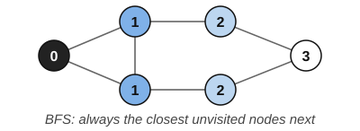
:::
::::
:::::

::::: {.rt}
:::: {.rt-row}
::: {.rt-l}
**Divide and Conquer**

- separate the problem into decoupled/non-overlapping smaller sub-problems. [More next session!]{.hl-orange}
- solve sub-problems independently
- if necessary, collapse all sub-results to global results
:::
::: {.rt-r}
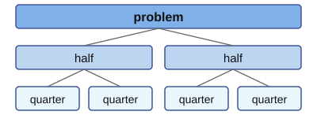
:::
::::
:::::
::::::

## Why does this matter? Practical Python examples

:::: {.columns}
::: {.column width="55%"}
{width="100%"}
:::

::: {.column width="45%"}
::: {.sm}
- **Fibonacci with a memo:** the function as written makes millions of calls, with saved results it makes 59
- **The stack is finite:** a recursive depth-first search fails on a chain of 5,000 nodes
- **Euclid's algorithm:** the gcd of two 18-digit numbers is found in 16 calls
:::
:::
::::

::: {.source}
<https://github.com/dgarcia-eu/ICSS/blob/main/PythonExamples/Examples06-Recursion.ipynb>
:::

## Summary

- Recursion needs a **base case** and a **recursive case** that moves towards it
- Every call waits on the **program stack** until its own calls return, and a recursion that is too deep causes a **stack overflow**
- **Factorial** and **Euclid's algorithm** run their recursive definitions
- **Depth-first search** records times that sort tasks and reveal cycles
- Recursion can be **linear** (**tail-end** as a special case), **tree** or **nested**
- **Memoization** saves results in an array and calculates each only once

**Next session:** Sorting Algorithms

## Evaluation for Introduction to Programming with Python

::: {.center-h}
{height="10.4em"}

<https://evasys.uni-konstanz.de/evasys/online.php?pswd=HYFEH>

::: {.sm}
The survey is open until 27.11.2026 at 18:00
:::
:::
