# Session 3: Data Structures

<style>
figure, .figure, .float { margin: 1.4em 0 1.8em 0; }
figure img, .float img { display: block; max-width: 100%; }
figcaption, .figcaption, .figure p.caption { margin-top: 0.3em; font-size: 0.88em; color: #555; }
</style>

*Introduction to Computing for the Social Sciences · lecture transcript*

**Reading for this session:** Chapter 10 of Cormen, Leiserson, Rivest & Stein,
*Introduction to Algorithms* (2009). More references area available at the end.

---

## Contents

1. [Data structures and arrays](#arrays)
2. [Linked lists](#linked-lists)
3. [Binary search trees](#binary-search-trees)
4. [Hash tables](#hash-tables)

---

## Motivating examples

### A · Two million respondents, one duplicate

Deduplication is the least glamorous task in empirical research and one of
the most common. Two million responses have come in, some people answered
twice, and you need to find them before anything else happens. The direct
translation of the question into code compares every response with every
other one:

```
For each response i:
      For each response j after i:
            If i and j match, then record a duplicate
```

That is $\binom{2\,000\,000}{2} \approx 2 \times 10^{12}$ comparisons, two
million million. Even at ten million comparisons per second, this would take over two days. Now the same
task with a hash set:

```
seen ← ∅
For each response r:
      If r.key ∈ seen
            then record a duplicate
            else add r.key to seen
```

This looks at each response once, i.e. two million operations and a couple of
seconds. Nothing clever happened to the comparison itself. What changed is
that the second version never searches. Instead, it computes, from the value itself,
where that value would be stored, and looks only there.
That single move, to stop searching and start indexing, is the most valuable skill you
will learn in this session and it will recur often in later sessions.

### B · Six thousand rows, and the answer in thirteen steps

Recoding is the other unglamorous constant of empirical work. You have 40
million observations carrying an occupation code, a region code or a product
number, and a codebook of 6,000 entries that says what each code means. The
straightforward loop checks the codebook entries one after another until it
finds a match. On average that is half the codebook, 3,000 comparisons, and
6,000 in the worst case. Times 40 million observations, it is on the order of
$10^{11}$ comparisons, which is an overnight job. If the codebook is sorted,
binary search applies. We look at the middle entry, decide whether the target is
in the left or in the right half, and repeat. Each step halves the range, so
the number of steps is $\lceil \log_2 6\,000 \rceil = 13$. With this, the whole recoding effort
drops from $10^{11}$ comparisons to about $5 \times 10^8$, from overnight to
under a minute.
That is a factor of 460 for free, except that it is not totally free and this session you will learn what is the cost.
The list has to be sorted, which
costs something up front and session 07 will help us understand how much.

---

## 1. What are data structures? {#arrays}
A *data structure* is a set of data types together with the operations defined
on them that enable and realize access and management of that data. The
word "together" is the important one in this definition. A data structure is
not just a way of laying data out in memory. Rather, it is a layout plus a set of
operations, and the layout is chosen to make those operations have some desired properties, like speed.
Every structure in this lecture stores the same thing (a collection of items) and the
only thing that distinguishes them is the cost of the operations we perform on
the collection, such as looking something up, inserting something, and deleting
something. There is no universally best data structure. There is a best structure
for a given pattern of operations, and choosing it is a real engineering
decision.

Each item in these collections has a *key*, the part we search by, such as a
respondent ID or a name, and a *value*, the content stored with it, such as
the answers of that respondent. A search is not just to check whether a key
is there, it can also be used to retrieve the value stored with the key. Diagrams in this session and in many learning materials often show only the keys, assuming that the values are implicitely associated with them.

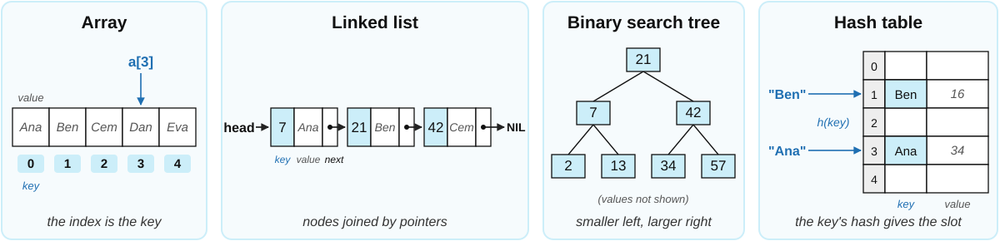

The table below summarizes what we will learn in this session. Here, you will start having an understanding about why some data structures are faster for some operations than others, in session 8 we will learn more precisely how to formalize concepts like "instant" or "slow".

| Structure | Look up by index | Look up by key | Insert / delete |
|---|---|---|---|
| Array | instant | slow | slow |
| Linked list | slow | slow | fast |
| Binary search tree | not possible | fast (if balanced) | fast |
| Hash table | not possible | usually instant | usually instant |

---

## 2. Arrays

An *array* is a systematic arrangement of similar objects, usually in rows and optionally also in columns. We access its elements by *index*. In most programming languages the indices of an array of length $n$ run from $0$ to $n-1$, while in MATLAB, in R and in our pseudocode they run from $1$ to $n$, as explained in the
[conventions](00-Conventions.md).

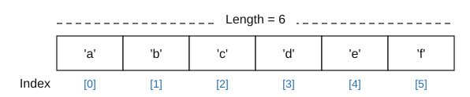

The great advantage of an array is very fast access. If you know the index, one
operation is enough, because the address of `A[i]` is computed arithmetically
from the address of `A[1]` and the size of an element. No searching is involved, you just need to multiply and add a few numbers and memory positions. Arrays are also the standard data structure implemented in every language and the way in which the information is arranged in the memory of the computer.
However, they have three disadvantages that motivate the the other data structures we learn in this session:

1. The memory requirement of an array depends on the range of index values and not on how many things you store. Imagine that you are storing data about ids between 1 and 1,000,000 and you have only four entries to fill spread between that id range. If you use an array for that, all but
four of them are empty but still use memory. The figure below illustrates that problem.  
2. If you
fill the array linearly, inserting or removing an element in the middle either
leaves gaps or requires moving the rest of the content to fill the gaps.  
3. Indices must be
integers, so you cannot index an array by strings, for example a student's name.

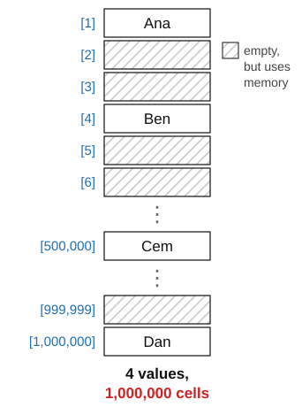

---

## 3. Linked lists {#linked-lists}
A *linked list* is a linear collection of data elements called *nodes*. Each node contains the node key, its value or associated data, and a reference to the next node by means of a *pointer*. We call this pointer `next` and access it as `node.next`, the list is reached through a pointer `head` to the first node, and the last node has NIL as the pointer to the next node. The list is
held together by the pointers and not by being contiguous in memory, in fact the positions of nodes can be spread in any way possible around the memory. Keys can
be anything that can be checked for equality when searching, not necessarily integers, for example strings or other pointers.


The attributes of a node are written with a dot after it, so `node.key` is its key
and `node.next` is the pointer to the node after it. A chain of dots follows the
pointers one at a time, and that is how the figure names the nodes. `head` is
the node with key 7, so `head.key` is 7. Then `head.next` is the node with key 13,
and `head.next.next` the node with key 21. The last node has `node.next = NIL`.
Searching a linked list is nothing more than following `next` until the key
turns up or the list runs out:

```
Procedure LIST-SEARCH(head, k)
Inputs:
      head: the first node of a linked list
      k: the key to find
Result: the node with key k, or NIL if k is not in the list
node ← head
While node ≠ NIL and node.key ≠ k:
      node ← node.next
return node
```

This makes a linked list easy and cheap to edit, because deleting a node only changes
the pointer of its predecessor, and inserting a node only changes the pointers
of its neighbors, so nothing has to be shifted.

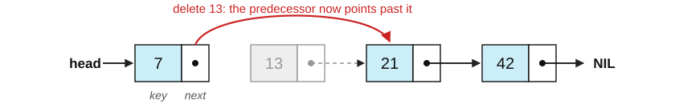

Memory grows only with the number of nodes and not with the range of any index. The price is paid on other operations. A linked list is hard to index, because there is no arithmetic that gets you to the 500th element and you must follow 500 pointers to reach it. It is slow to iterate through for the same reason, and also
because the nodes may be scattered in memory, which is bad for the cache of the
processor. And the pointers themselves have to be stored, which costs memory. That is why linked lists are mostly used for applications where searching by position is not a usual operation.

---

## 4. The linked list trade-off: editing versus searching {#binary-search-trees}

Put side by side, arrays and linked lists have complementary weaknesses, and
one weakness in common. It helps to keep apart two ways of looking something
up, i.e. *by index* ("give me the 4th element") and *by value* ("where is 13?").

The array in the figure below holds the unsorted values 9, 2, 13, 7, 21 and 4.
Reading `A[4]` takes one step, because the address of position 4 is computed
from the index. However, finding where the value 13 is stored means checking
the cells one by one until we hit it, which takes up to $n$ comparisons.
Editing is also expensive whenever the order of the elements matters.
Inserting 8 at position 3 means shifting 13, 7, 21 and 4 one place to the
right, and deleting an element leaves a gap that has to be closed the same way.

The linked list in the figure holds 9, 2, 13 and 7. Inserting 8 after the node
with 2 changes two pointers, and nothing is shifted. However, a linked list is
slow for both kinds of lookup. Finding the value 13 means following pointers
from the head until we reach it, and so does reaching the 3rd node, because
there is no arithmetic that takes us there.

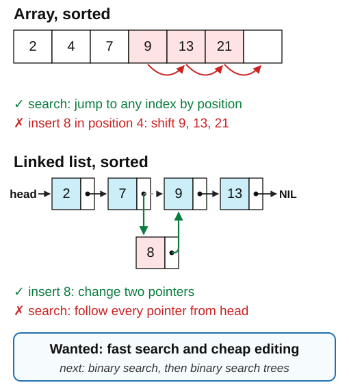

Therefore, neither structure can find a value faster than linear time, and the
one that is good at editing is slow even by index. Remember that we do not
search just for keys, because we also retrieve the values associated with them
once we find the right one. Searching by value is what most applications need,
for example a student by name, a user by id or a word in a codebook. This raises
the question for the rest of the session. Can we have a search that is faster
than linear but still allows editing without moving all the data?

A first, partial answer needs one extra condition. If the elements of an array
are kept *sorted* by value, we no longer have to look at every cell, because we
can compare with the middle element and discard half of the array at every
step. That is binary search.

---

## 5. Binary search

```
Procedure BINARY-SEARCH(A, n, x)
Inputs:
      A: a sorted array
      n: the number of elements in A
      x: the value to find
Result: an index i with A[i] = x, or NOT-FOUND if x is not in A
p ← 1; r ← n
While p ≤ r:
      q ← ⌊(p + r)/2⌋
      If A[q] = x
            then return q
      else if A[q] > x
            then r ← q - 1
      else p ← q + 1
return NOT-FOUND
```

The variables $p$ and $r$ bracket the part of the array that could still
contain $x$, and $q$ is the middle of that bracket. Each comparison throws away
half of what is left. As a worked example, let us find 43 in the sorted array
`15 28 30 34 36 43 62 73 81 82`. In the first step $p=1$ and $r=10$, so $q =
\lfloor 11/2 \rfloor = 5$. Since $A[5] = 36 < 43$, positions 1 to 5 are
discarded and $p$ becomes 6. In the second step $p=6$ and $r=10$, so $q = 8$.
Since $A[8] = 73 > 43$, positions 8 to 10 are discarded and $r$ becomes 7. In
the third step $p=6$ and $r=7$, so $q = 6$, and $A[6] = 43$ is the value we are
looking for, so the procedure returns 6.

The figures show the three pointers in every step. A pointer that has just been
updated is drawn in orange, and the grey cells are the part of the array that
has been discarded.

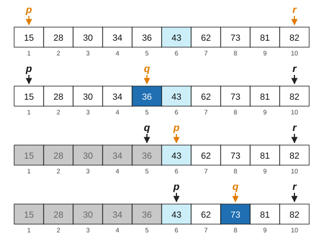

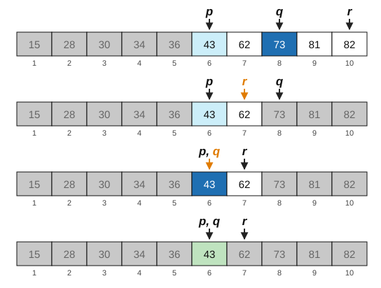

That is three comparisons instead of up to ten. In general binary search needs
about $\log_2 n$ comparisons, which is why doubling the data adds only one
step. The catch is that the array has to be sorted, and keeping an array sorted under insertion means first searching the position and then shifting elements, so we have fast search and slow editing again. The fix is to stop storing the order in the positions and start storing it in the pointers.

---

## 6. Binary trees and binary search trees

A *binary tree* is a tree data structure that is either empty or consists of a
node, the *root* $S$, with at most two children, the left child $L$ and the
right child $R$, both of which are themselves binary trees. Note that the
definition is recursive, i.e. a tree is defined in terms of trees. Session 6 makes
that pattern its main topic, but it is already doing work here, because it
means that any algorithm on a tree can be written as "do something to the root,
then do the same thing to the two subtrees". The vocabulary is the one of a
family tree. The root is the top node, a *leaf* is a node with no children,
parent and child are the two ends of an edge, siblings share a parent, and a
*subtree* is a node together with everything below it.

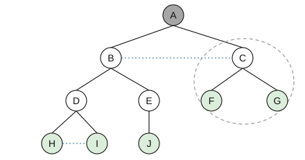

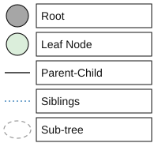

A *binary search tree* (BST) is a binary tree with comparable keys in which the
key at the root has to be

- larger than or equal to all keys in the left subtree, and
- strictly smaller than all keys in the right subtree,

and the same holds recursively at every node. There are two housekeeping notes. Every element has a key and
attached data, where the key is what we order by and the data is what we
actually want. And in this course we assume that there are no duplicate keys.


We access the nodes of a tree the same way as those of a linked list. Every
node has three attributes, namely its key `node.key` and two pointers, `node.left` and
`node.right`, to its children. A missing child is NIL, so a leaf is a node with
`node.left = NIL` and `node.right = NIL`. Many implementations also store a
pointer `node.parent` to go back up. The tree is reached through a pointer
`root` to its top node, exactly as a linked list is reached through `head`, and
a chain of dots names any node by the path to it. In the example `root.key` is
10, `root.left.key` is 4, `root.right.right.key` is 21 and
`root.right.left.right.key` is 12.


With this notation the rule between a node and its children reads
`node.left.key ≤ node.key < node.right.key`, for every node whose children are
not NIL. The full rule is stronger, because it is about all the keys in the
two subtrees and not just the children. A root 10 with left child 4 and a key
12 as the right child of that 4 passes the test between every node and its
children, $4 < 12$ and $4 \le 10$, but it is not a BST, because 12 sits in the
left subtree of 10.

The BST property is a condition on every node, not just on the root, and it is
worth seeing it applied level by level. At the root, everything in the left
subtree is at most 10 and everything in the right subtree is greater than 10.
At the second level, the same holds for 4 and for 13 with respect to their own
subtrees, and so on down to the leaves.


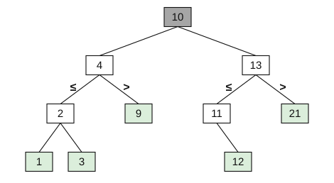


Is this tree a binary search tree?


It is not, and it breaks the rule in three places that we circled in red. The node 15 is the left child of 13, but a left child must be at most 13. The node 5 is the left child of 2 and in the left subtree of 4, but it is larger than both. And the node 11 is the right child of 15, but a right child must be strictly
greater than 15.

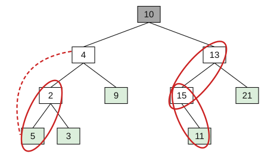

Checking whether a tree is a
BST means checking the property at every node against all of its ancestors.

---

## 7. Operations on a BST

### Searching

To search for a key, compare it with the root. If it is smaller, continue in
the left subtree. If it is larger, continue in the right subtree. And when you
run out of tree, the key is not there. Searching for 11 in the tree example below takes three steps. First $11 > 10$ at the root, so we go right. Then $11 < 13$, so
we go left. Finally $11 = 11$, and we have found it. This is binary search again,
but now the halving is built into the shape of the structure rather than
computed from indices.

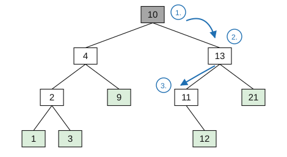

Written as pseudocode, the search moves a pointer `node` down the tree, to
`node.left` or to `node.right` depending on the comparison, until it finds the
key or falls off the tree at NIL. Compared with LIST-SEARCH, the only
difference is that at every step there are two pointers to choose from instead
of one.

```
Procedure TREE-SEARCH(root, k)
Inputs:
      root: the root node of a binary search tree
      k: the key to find
Result: the node with key k, or NIL if k is not in the tree
node ← root
While node ≠ NIL and node.key ≠ k:
      If k < node.key
            then node ← node.left
            else node ← node.right
return node
```

### Inserting

To insert a key, assuming that it is not already in the tree, search for it.
The search will run out of tree at some empty position, and that empty
position is where the new key is added, as a leaf. This is the only place it
can go without breaking the BST property. Adding 6 to the tree of the lecture,
$6 < 10$ sends us left, $6 > 4$ sends us right, $6 < 9$ sends us left, and
since 9 has no left child, 6 becomes it.


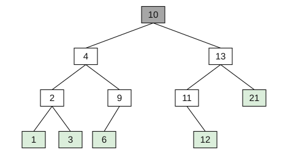

### Deleting

Deleting a key has three cases of increasing difficulty. In the first case
the node is a leaf, so we search for the key, then remove the reference to it in its   parent. Deleting the leaf 6 that we just inserted returns the tree to its
original form.

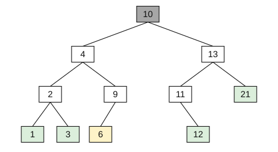


In the second case the node has one child, and it is replaced by that child.
The whole subtree of the child keeps satisfying the property, because it was
already on the correct side of everything above. In the lecture's example, 11
has the single child 12, so deleting 11 makes 12 the left child of 13.

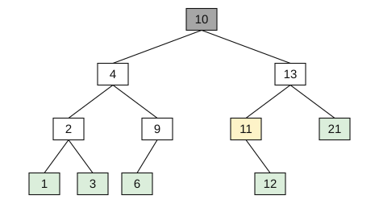

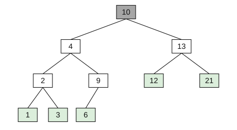

In the third case the node has two children, and this is an interesting and most common case in large trees.
The node is replaced with either the leftmost node of its right subtree, which
is its *successor*, the smallest key larger than it, or with the rightmost
node of its left subtree, which is its *predecessor*. Either choice preserves
the ordering, because that node is by construction between the two subtrees in
value. Then the node that was moved is deleted from its old position, which is
a deletion of the first or the second kind, since the leftmost node of a
subtree cannot have a left child. Deleting the root 10 of the example, the
leftmost node of the right subtree is 11, so 11 becomes the root. Since 11 had one
child, 12, so we finish with a deletion of the second kind and 12 moves up.

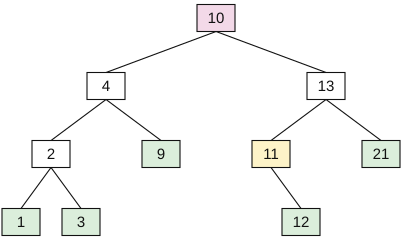

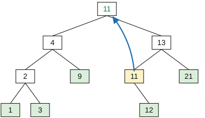

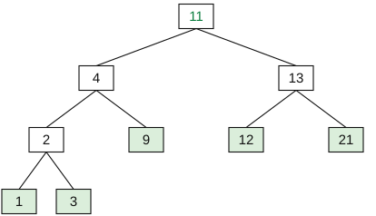

### Advantages and applications

In a binary search tree, lookup is much faster than in an unsorted array and as
fast as binary search on a sorted array, while adding and removing values is
much faster than in a sorted array, because only pointers are updated, as in a
linked list, instead of shifting every element to the right of the key. That
is the answer to the question of editing and search, because a BST gives logarithmic search and cheap editing at the same time. In practice BSTs are used for lookup
tables and dynamic sets, that is, collections that change in size but still
need efficient bookkeeping of their keys. BSTs are most useful when the key
is paired with data, for example in the indices of a database, which we will
see in the Databases session.

### The catch: balance

Lookup takes a number of steps that depends on the *depth* of the tree. If keys
are added in an unlucky order, for example already sorted, every new key goes
to the same side and the tree degenerates into a linked list. Then search is
linear again and we have gained nothing and wasted some memory in left pointers. Real implementations therefore use
self-balancing trees (AVL trees, red-black trees, B-trees) that rearrange
themselves on insertion to keep the depth around $\log_2 n$. We do not cover
the balancing algorithms in this course, but keep in mind that the problem
exists and that you can find a solution if you have it.

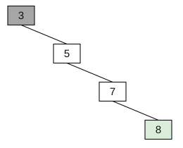

---

## 8. Hashing and hash tables {#hash-tables}
Let us go back to the array. Its problems were that memory is tied to the range
of the indices and that indices must be integers. Hashing attempts to solve both by addressing two questions. i) Can we have very fast lookup, about one operation per access, without the index range problem of arrays? And can we use other indices besides integers? We can see this with two examples. Student ID numbers have six digits, so there are 1,000,000 possible values, but only about 10,000 are in use at any time. Therefore, an array indexed by ID would waste 99% of its memory, so we would like to map all possible IDs onto 10,000 slots. Book titles in a library have about 100 characters, so there are around $30^{100}$ possible titles, while the library has about 2 million books. Indexing by title directly is not merely wasteful, it is practically unfeasible (even if theoretically possible).

### Hash functions

A *hash function* $h: K \rightarrow \{0, 1, \dots, m-1\}$ assigns to any given
key $k$ an index $0 \le h(k) \le m-1$. A good hash function has to satisfy
several requirements:  

- There are many more possible keys than slots, $|K| \gg m$.   
- It has to be easy and fast to compute.  
- It has to distribute the keys evenly over the available indices, to avoid collisions.  
- It has to be fully deterministic, so that the same key always gives the same slot, because otherwise we could never find anything again.  
- And ideally it can be adjusted when the number of slots $m$ changes. 

Hash functions are usually
built on natural numbers, so a key that is not a number, such as a character
string, is first turned into one, for example reading its binary representation as an integer.

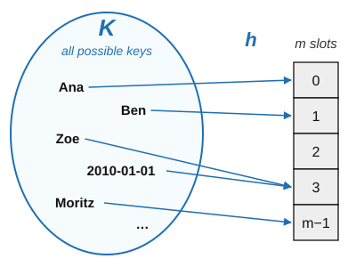

With a hash function, every operation on a hash table starts by computing the
position $h(k)$ of the key $k$. To search, compute $h(k)$ and read position
$h(k)$. To add, compute $h(k)$ and write at position $h(k)$, which raises the
question of what to do if the position is already used. We will see some solutions below. To delete, compute $h(k)$ and empty position $h(k)$. In the best case each operation takes a single step.

### Choosing $m$: the modulo function

The modulo operation automatically yields values in $0 \dots m-1$ and
distributes values evenly, so $h(k) = k \bmod m$ is the standard starting
point. But the choice of $m$ matters a lot. The best choice is a prime number
and the worst choice is a power of the base of the number system in which the
keys are written. This happens for example when dates are written as numbers, as in the table below.

| key $k$ | $k \bmod 97$ | $k \bmod 100$ |
|---|---|---|
| 20100101 | 52 | 1 |
| 20100227 | 81 | **27** |
| 20100427 | 87 | **27** |
| 20110527 | **2** | **27** |
| 20090811 | 74 | **11** |
| 20101224 | 11 | **24** |
| 20111111 | **4** | **11** |
| 20120229 | **4** | 29 |
| 20091224 | **2** | **24** |

Collisions are in bold. Taking $k \bmod 100$ just keeps the last two digits,
which are the day of the month, so every date with the same day collides. Seven
of the nine dates share a slot with another one and only 31 are in use. The prime 97 mixes the whole
number and spreads the keys out but it is not free of collisions, since 20110527
and 20091224 both go to slot 2. However, collisions with 97 are rarer and not tied to the day. The general lesson is that if $m$ shares
structure with or has some relationship to the keys, the hash function inherits that structure.

### Collisions

*Hash collisions* happen when two keys are mapped to the same position by the
hash function. Collisions are not a failure of the hash function, they are eventually unavoidable. By the pigeonhole principle, because there are more possible keys than slots, some keys must share a slot. The question is only what to do about collisions when they happen.

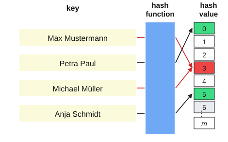

### Separate chaining

The first solution to collisions is *separate chaining*, in which every slot of the hash
table holds the first node of a linked list of all the keys hashed to it. When there is a collision, new entries are appended to the list. This way we can reimplement the basic operations of a hash table as:

- Searching for an entrymeans computing $h(k)$ and searching the linked list at that slot from front to end. 

- Inserting means computing $h(k)$, searching the list and appending the new element if it is not there. 

- Deleting means computing $h(k)$, searching the list and removing the element from it. 

The example of the figure uses $m = 7$ and $h(k) = k \bmod 7$. The key 50 goes to slot 1, 700
to slot 0, 76 to slot 6, 85 to slot 1 (a collision, so it is appended after
50), 92 to slot 1 again, and 73 and 101 both to slot 3.

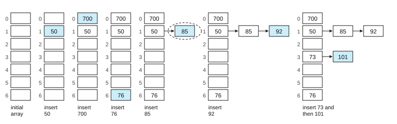

The time required is one step in the best case and $n$ steps in the worst case,
where $n$ is the number of entries stored. The worst case is every key hashing
to the same slot, which turns the table back into a linked list. This is why
the quality of the hash function is not just a detail but an essential design decision.

### Probing

The alternative is *open addressing*, which stores every key in the table
itself. A way to implement this is *linear probing*, if slot $h(k)$ is taken, we try $h(k)+1$, $h(k)+2$, and so on (modulo $m$).  Writing puts the key in the first free slot of this sequence. Reading follows the same probes until it finds the key or an empty slot, which means the key is not there. In the example of the lecture,
with $m = 7$ and $h(k) = k \bmod 7$, the table already holds 700, 50 and 76.
Inserting 85 ($h = 1$) finds slot 1 taken and writes to slot 2, 92 ($h = 1$)
tries 1 and 2 and writes to 3, and 101 ($h = 3$) tries 3 and writes to 4. Searching
for 101 probes slot 3, which holds 92, and finds 101 in slot 4. Searching for
64 ($h = 1$) probes slots 1 to 4 and stops at the empty slot 5, indicating that 64 is not in the
table.

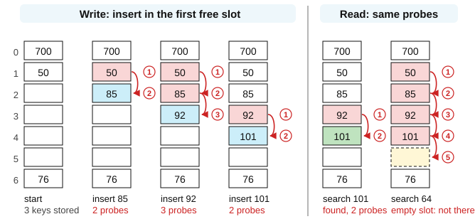

With *random probing*, the sequence is $h(k)+r_1$, $h(k)+r_2$, and so on, with a
fixed pseudo-random sequence $r$ (in the example 3, 6, 2, 5, 1, 4) that a
search can repeat, so the keys are spread out instead of forming one run. It is not really *random* but looks like it, often we call this pseudo-random. The sequence can be calculated deterministically but it is hard to predict a pattern of where the positions are, leading to the spread of positions in a way that is unrelated to keys nor values.

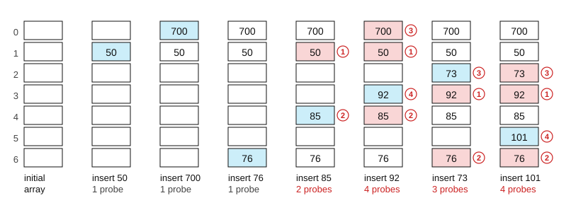

We should note three important points about probing:

- **Clustering:** with linear probing, occupied slots form runs, and every key that hashes into a run walks to its end and makes it longer. In the example, a new key hashing to any slot except 5 ends in slot 5. Random probing avoids these runs, but its sequence must be reproducible, fixed or computed from the key. Otherwise a search would not be able to find the key again. 

- **Load:** both probing strategies slow down sharply as the table fills, so with $n$ keys in $m$ slots, the trick is to keep $n/m$ well below 1. 

- **Deletion:** emptying a slot would cut the probe sequence of the keys stored after it, so the slot is marked as *deleted* instead. Searches skip it and insertions may reuse it. 

You should try examples yourself to understand how probing works. As an exercise in the linear probing example, delete 85 by marking its slot, search for 92 and for 101, insert 64, and work out what would go wrong if slot 2 were simply emptied and not marked.

## 9. Dictionaries

A *dictionary* is an abstract data type composed of a collection of (key,
value) pairs, such that each possible key appears at most once in the
collection. Note the words "abstract data type", which mean that a dictionary says what
operations exist, namely lookup by key, insertion and deletion, and not how they
are implemented. Hash tables are one implementation but there are other ones we do not cover in this session.  In a dictionary the keys are generalized, so they can be characters, words or names rather than just indices, and they are not necessarily evenly distributed, so an array spanning the whole range of possible values would waste memory. If you keep the keys in a plain list, lookup is a sequential search whose worst case looks at all $n$ entries, and this is exactly what hashing avoids.

Python stores its dictionaries in hash tables and solves collisions with random
probing as explained above. A dictionary
starts with 8 slots and is resized when it is about two thirds full, because
as a hash table fills up, collisions become common and performance degrades.
Resizing means re-hashing everything into a bigger table, which is expensive
but rare, so the average cost per insertion stays low. In the figure, "Ana" and
"Ben" go straight to slots 3 and 5, while "Cem" also hashes to slot 3, finds it
taken, and probes on to slot 0 using the "random" sequence. The lookup `ages["Ben"]` computes the hash of "Ben", goes to slot 5, checks that the key matches and returns 16.

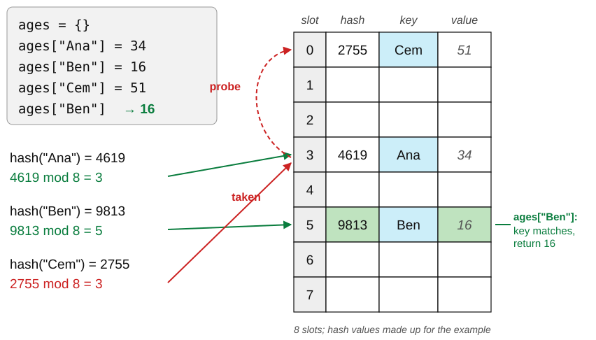

If you want to look up the value associated with the key "Cem", the hash table takes you to slot 5, but there you see that the value is stored for a different key ("Ben"), thus you use the "random" probing sequence that takes you to slot 0, where you have the right key and the associated value.

A practical rule for your own code in Python is to use a list when you need an ordered
sequence of items, including layered lists such as a table stored as a list of
rows, and use a dictionary when you need efficient lookup by key. Dictionaries
are also good as a "super-structure", for example to store ordered items as
lists inside a dictionary keyed by whatever you group by. One performance note
is worth remembering. The test `key in d` hashes the key and takes one step,
and so does `key in d.keys()` in Python 3, because the view of the keys uses
the same hash table. But `key in list(d)` or a loop over the keys scans them
one by one, which turns an instant operation into a linear scan, and in a loop
that becomes a quadratic algorithm, as we will learn how to calculate in session 8.


## 10. Why this matters for social science

Hashing is also a tool for research data when we want to pseydonymize a field. If a dataset has an identifying
column, replacing each value $v$ by $h(v)$ gives a column you can still group
and join on, because the same name always gives the same code. In the survey dataset example below, Ana Weber answered in two waves, and both of her rows
get the code `c3305900d9`, so her answers can still be linked even in a dataset where her name has been removed and only the person pseudonym is available.

| name | wave | age | vote |  | person | wave | age | vote |
|---|---|---|---|---|---|---|---|---|
| Ana Weber | 1 | 34 | yes | &rarr; | `c3305900d9` | 1 | 34 | yes |
| Ben Koch | 1 | 27 | no | &rarr; | `f61798a8f3` | 1 | 27 | no |
| Clara Roth | 1 | 45 | yes | &rarr; | `f109d00beb` | 1 | 45 | yes |
| Ana Weber | 2 | 35 | no | &rarr; | `c3305900d9` | 2 | 35 | no |

A hash cannot be turned back into the name, but it can be guessed with some
effort, for example by hashing every name in a phone book and comparing. The approach is to hash
the name together with a *secret* that only the research team knows. The codes
above are the first 10 characters of SHA-256 of the secret followed by the
name. And pseudonymized is not anonymous, because age and answers together may still
identify a person and determining what is identfiable information is a research field in itself.

Efficient data access is a precondition for most practical data analysis, and
since Python uses hashing for `dict`, you are already relying on it whether you
name it or not. An example tool built around hash tables is the AWK scripting language. AWK is a small, specialized language for string processing and a
quiet favorite of many data scientists. It was created at Bell Labs by Alfred
Aho, Peter Weinberger and Brian Kernighan, whose initials give it its name, and
it is a key component of UNIX. It is extremely fast for what it does thanks to
two things, namely regular expressions, which we will learn in session 9, and hash
tables. Its default array type is an associative array backed by a hash table,
which is why counting things in AWK is a one-liner:

```awk
{ count[$1]++ }  END { for (k in count) print k, count[k] }
```

That is a word-frequency counter, and the `count` array is a hash table. MAWK
is a faster and more memory-efficient implementation of the same language and a trick when sequential data analysis gets complicated but you need a simple and quick solution.

---

## 11. Check yourself

**1.** You need to store 100,000 records and look them up by a 12-digit national ID. Array, BST or hash table?

<details><summary>Answer</summary>

A hash table. An array indexed by the ID would need $10^{12}$ cells for 100,000
records. A BST would work and give you logarithmic lookup plus the ability to
iterate in sorted order, so choose it if you need the ordering. If you only
ever look up by exact ID, the hash table is faster.

</details>

**2.** Insert 1, 2, 3, 4, 5 into an empty BST in that order. Draw it. What went wrong?

<details><summary>Answer</summary>

Every key is larger than the previous one, so each goes to the right, and the
result is a chain 1, 2, 3, 4, 5 of depth 5. The tree has degenerated into a
linked list and lookup is linear. Inserting in sorted order is the worst case
for an unbalanced BST, which is why real implementations rebalance.

</details>

**3.** Why does deleting a node with two children need a special rule, while one child does not?

<details><summary>Answer</summary>

With one child there is an obvious replacement, the child, whose whole subtree
is already on the correct side of every ancestor. With two children there is no
single subtree that can move up without breaking the ordering, so you must pick
the one key that sits between the two subtrees, the predecessor or the
successor, and promote that.

</details>

**4.** A hash table with m = 10 stores phone numbers using h(k) = k mod 10. Why is this bad?

<details><summary>Answer</summary>

The value of `k mod 10` is the last digit of the number. Last digits of phone
numbers are not uniformly distributed, because blocks are allocated, some
digits are reserved and people choose memorable numbers, so the table will be
lumpy. Worse, 10 is a power of the base of the number system, which is the
failure mode shown in the dates table. Use a prime.

</details>

**5.** Is hashing a column of names enough to anonymize a dataset?

<details><summary>Answer</summary>

No. Hashing is deterministic, so anyone who can guess the set of possible names
can hash them all and build a lookup table, which is called a dictionary
attack. Real pseudonymization adds a secret salt, and even then, joining a
pseudonymized dataset with another one can re-identify people.
Pseudonymization is not anonymization.

</details>

---

## 12. References

- **Cormen, T. H., Leiserson, C. E., Rivest, R. L. & Stein, C. (2009).**
  *Introduction to Algorithms*, 3rd ed., MIT Press. Chapter 10 (elementary data
  structures) is the reading for this session; chapter 11 (hash tables) and
  chapter 12 (binary search trees) go deeper.
- **Cormen, T. H. (2013).** *Algorithms Unlocked*, MIT Press. A gentler version
  of the same material; the BINARY-SEARCH pseudocode is adapted from pp.
  28–30.
- **Python Software Foundation.** *Time complexity of Python operations*.
  <https://wiki.python.org/moin/TimeComplexity>. The practical table behind
  section 9.
- **How Python dictionaries are implemented** (probing, resizing at two
  thirds):
  <https://stackoverflow.com/questions/327311/how-are-pythons-built-in-dictionaries-implemented>
  and the comments in the CPython source file `Objects/dictobject.c`.
- **Kernighan, B. W.** on hash tables, in conversation:
  <https://www.youtube.com/watch?v=qTZJLJ3Gm6Q>
- **Aho, A. V., Kernighan, B. W. & Weinberger, P. J. (1988).** *The AWK
  Programming Language*. Addison-Wesley.
- Linked-list diagrams after the illustrations at
  <https://www.tutorialspoint.com/>
