# Session 4: Software

<style>
figure, .figure, .float { margin: 1.4em 0 1.8em 0; }
figure img, .float img { display: block; max-width: 100%; }
figcaption, .figcaption, .figure p.caption { margin-top: 0.3em; font-size: 0.88em; color: #555; }
</style>

*Introduction to Computing for the Social Sciences · lecture transcript*

**Reading for this session:** Chapters 2 and 6–8 of Zelle, *Python
Programming: An Introduction to Computer Science* (2016), and chapter 6,
"Testing and Debugging", of Guttag, *Introduction to Computation and
Programming Using Python* (2016). References at the end.

---

## Contents

1. [Programming in a nutshell](#programming)
2. [Software engineering](#software-engineering)
3. [Requirements, specifications, and design](#requirements)
4. [Testing](#testing)

---

<!-- MOTIVATION-SECTION:BEGIN -->
## Motivating examples

<!-- MOTIVATION:M04-A:BEGIN -->
### A · The app that leaked 13,000 photo IDs

[Tea](https://en.wikipedia.org/wiki/Tea_%28app%29) is a US app on which women share warnings about men they have dated. To
keep men out, it asked every new user to upload a selfie and, in many cases, a
photo of an identity document. Moderators used them to verify the gender of the account's user.
In July 2025 a user of the forum 4chan posted the address of the online
storage, a Firebase bucket, where these images were kept. The storage had no
login and no access rule, so anyone who knew the address could list and
download everything in it. About 72,000 images were copied and spread. Around
13,000 of them were selfies and photo IDs, and the rest came from posts,
comments and direct messages. Days later, a second problem exposed more than
a million private messages, so the company had to disable its messaging feature.

Many people blamed vibe coding, the practice of building software by asking
an AI tool for code and accepting what it produces. The company says the exposed data came from a
system built before February 2024, thus saying it was not vibe coded. How the code was written does not change
the lesson, which is about requirements and tests rather than about who typed
the code. *"Only moderators may see the identity photos, and only while they
verify an account"* is a requirement that anyone at the company would have
agreed with if anyone asked about it. But nobody wrote it down as part of what the system had to
do, so nothing in the system enforced it. A single test, "try to download an
ID photo without logging in", would have failed on the first day and exposed the problem.

In this session you will learn about requirements, including the ones that are
not about what the program computes but about how it must behave, such as
security, privacy and safety. We will also learn about the tests that check them.
For research software, the analogue is a script that produces the right table
and also writes the respondents' names into a file that ends up public, while it should have been anonymized or pseudonymized.

<!-- MOTIVATION:M04-A:END -->
<!-- MOTIVATION:M04-D:BEGIN -->
### B · The 5 millimeters nobody could move

In the 2000s, Symbian, the operating system of Nokia's phones, ran most of the
world's smartphones. It had grown for more than a decade, feature by feature
and phone by phone, and every new model added code to it. In 2010 Juhani
Risku, a former design executive at Nokia, told the technology magazine The
Register what this meant in practice. His team wanted to move one element on
the screen of a Nokia phone up by 5 millimeters but could not. *"We can't find
the piece of code that could shift it up 5mm. There's 20 million lines of code
in the phone, it's impossible."* When Symbian was released as open source the
same year, its own foundation estimated the code at about 40 million lines,
against about 11 million for Android. In 2011 Nokia gave up on Symbian and
moved its smartphones to Windows Phone.

Nobody wrote this code to be unchangeable. Every line was added for a reason,
and every addition worked. What was missing was what keeps a large program
changeable and manageable. The code could not be navigated and separated into parts with one clear responsibility, so that a change to the
screen layout touches one place, for example just a file. Beyond structure, this also requires documentation that says what each part does and tests that tell you whether a change has broken something else. Without them,
the safest thing to do with code nobody understands is to leave it alone, and
the program can only grow and the problem gets larger and larger.

In this session you will learn about object-oriented programming as a tool for
exactly this problem, large programs maintained by many people for many years.
We will see the place of writing code inside software engineering, where maintenance
is a stage of its own, and we will learn about the tests that make changes
safe. For research code, the analogue is the analysis script that grew over a
whole PhD, and that nobody, including its author, dares to touch the week
before submission. Then another PhD student inherits the code and lots of headaches before they can start with their research.
<!-- MOTIVATION:M04-D:END -->

---

<!-- MOTIVATION-SECTION:END -->
## 1. What programming is {#programming}
*Programming* is the process of creating a set of instructions that tell a
computer how to perform a task. A *programming language* is a formal language
for writing those instructions, either directly as machine code or as
human-readable *source code* that is translated to machine code
automatically. Programming languages are formal, which means that, unlike natural languages, they have a precise grammar that has been designed by humans and we can determine whether a text is written in a programming language or not. The translation between programming language and machine language is automatic, such that the programming language is to be written and read by humans while the machine executes something else that can be generated from the program code.

<figure style="float:right; width:50%; margin:0.3em 0 0.8em 1.2em">
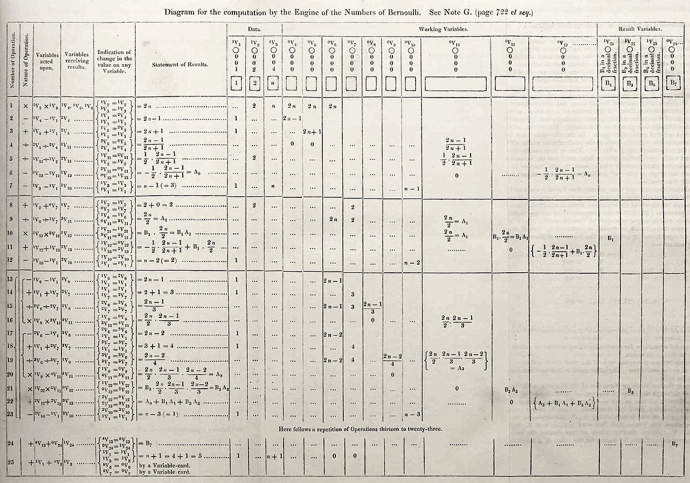
<figcaption><em>Note G, Lovelace's program for the Analytical Engine to compute the Bernoulli numbers (1843).</em></figcaption>
</figure>

The first program was written before any computer existed. In 1843 Ada
Lovelace (1815–1852), a mathematician and the daughter of the poet Lord
Byron, translated an Italian engineer's article on the *Analytical Engine*, a
mechanical computer designed by Charles Babbage. She added notes three times
as long as the article. The last one, *Note G*, is a table of instructions,
step by step, for the engine to compute the Bernoulli numbers, a sequence of
numbers used in mathematics. It is considered the first published computer
program, which makes Lovelace the first programmer. Babbage had written
simpler examples before, but never published them. The engine was never
built, so the program never ran. When it was run on modern computers, it
turned out to contain a bug. In operation 4, the division goes the wrong way
round. Lovelace also saw further than Babbage. She wrote that the engine
could act on any symbols, not only on numbers, and "might compose elaborate
and scientific pieces of music". The programming language Ada, developed for
the US Department of Defense around 1980, is named after her.

<div style="clear:both"></div>

Programming languages are placed into levels that go from close to the machine to close to the human. The same small computation, the area of a triangle, looks very
different on each level, as shown in the table below.

| Level | Examples | What it is | The same computation |
|---|---|---|---|
| High-level | Python, R, Java, C | written for humans, portable; one line becomes many machine instructions | `area = b * h / 2` |
| Low-level | assembly language | readable names for machine instructions | `LOAD r1,b` `LOAD r2,h` `MUL r1,r2` `DIV r1,#2` |
| | machine code | the binary instructions the processor executes | `0001001001000101 0010010011101100 …` |

At the bottom, *machine code* is what the processor executes, and each
processor family has its own instruction set. *Assembly language* gives
readable names to machine instructions, so `MUL r1,r2` stands for one
multiplication, and each assembly instruction becomes exactly one machine
instruction in binary code. The *high-level languages* at the top are written for humans and run on any machine, and one of their lines usually becomes many assembly lines that then are translated into many machine instructions.

The translation from high-level code to machine code happens in one of two
ways. An *interpreter* translates and runs the code one line at a time each time the program is run. It reads `x = 3`, translates and executes it, then does the same
with the next line, and so on until the lines in the input are over. Errors appear when the interpreter runs the line that contains the error. Python, R and JavaScript, the languages of
interactive data analysis, are all interpreted. 

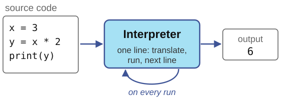

A *compiler* translates the whole
program once, before it runs, into a file of machine code that is commonly called a binary file. That file can then
run many times, fast, and many errors are found before anything runs at compilation time. Finding errors after compilation requires a special program called a debugger to find how the errors map to lines in the original code.
C and C++ are both compiled languages. Java is something close to a compiled language but instead of generating a binary that depends on the machine where it is run, it generates an intermediate code that is machine-independent and interpreted. 

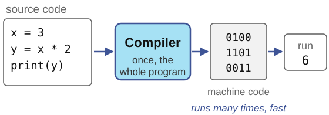

Vibe coding, which we will discuss in section 5, is a kind of programming. It also turns a description of how to perform a task into a programming language that then can be compiled or interpreted into machine code, all automatically. The difference is that the description is in natural language rather than in a formal programming language. An unavoidable difference with traditional programming is *flakiness*. A
compiler turns the same source code into the same machine code every time,
while a language model will often turn the same request into different code and different results.

---

## 2. Programming paradigms

*Programming paradigms* classify languages and programs by how they express a
computation. The basic split is between *imperative* programming and
*declarative* programming. An imperative program consists of statements that
change the state of the program step by step, so it describes how to compute
a result. A declarative program describes what the result should be and
leaves the how to the system. Within the imperative family, *object-oriented*
programming groups data and the instructions into objects.
Within the declarative family, *functional* programming expresses the result
as the value of functions applied to other functions. You will meet the
declarative style in SQL in session 11, and the functional style through
recursion in session 6. Python supports all of these paradigms, and which one
you are using depends on how you write in Python. You can even mix them in the same program. The rest of this
part covers the two you use in almost every Python program, which are imperative and
object-oriented.

---

## 3. Imperative programming

The name comes from the Latin *imperare*, to order or to command, and it
describes what the program must do. An imperative program is a sequence of
orders, carried out one after the other. The program has a *state*, the
current values of all its variables, and it runs by changing that state one
statement at a time. Four ingredients are enough to write any imperative
program. *Assignments* change the state, as in `total = 0`. *Control
structures* decide which statement runs next. Conditions run a block only if
a test is true, and loops repeat a block. *Functions* give a name to a block
of steps, so that it can be reused and, just as important, checked on its own.

```python
total = 0             # assignment
for age in [34, 41]:  # loop
    if age >= 18:     # condition
        total += age

def mean(xs):         # function
    return sum(xs) / len(xs)
```

This is also how the hardware works. A processor holds data in memory and
executes one instruction after another, which is why imperative programming
feels natural and why most courses start with it. The weaknesses of imperative programming appear when programs grow and have to deal with many files and thousands of lines of code. When any statement can change any variable, it becomes hard to
know which part of a long program is responsible for a value.

---

## 4. Object-oriented programming

### Why do we use OOP?

Large programs are written by teams and maintained for years, and most of the
work on them is changing code that someone else wrote. Object-oriented
programming gives every part of the program one responsibility, kept in one
class and owned by one person or team. Everyone else uses that class only
through its methods. As long as the methods keep doing what they promise, the
inside of the class can change without breaking anybody else's code, and when
something goes wrong, there is only one place to look.

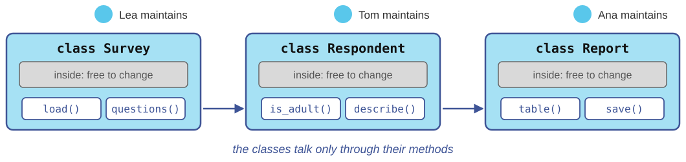

For a one-person script, OOP adds little, because there is nobody to separate
responsibilities from. But it has become a conceptual building block of many
programming languages, Python included, where every value is an object. So
even if you never write a class, you use objects all the time.

### Classes and objects

An *object* bundles data, its *attributes*, with the operations on that data,
its *methods*. A *class* is the blueprint for objects, and every object is an
*instance* of a class.  For example, a class `Respondent` might say that every respondent
has the attributes `name` and `age` and the methods `is_adult()` and
`describe()`. The objects `ana` and `ben` are two respondents, each with its
own name and age, and both able to do what the class says. You query or change
an object by calling one of its methods, with the notation
`object.method(arguments)`.

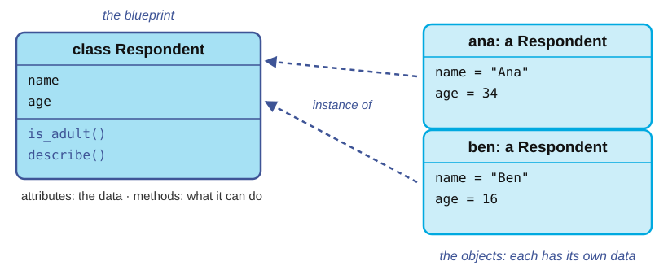

In code, creating the two objects and calling their methods looks like this.

```python
ana = Respondent("Ana", 34)
ben = Respondent("Ben", 16)
ana.describe()     # 'Ana, 34 years'
ben.is_adult()     # False
```

Each object answers with its own data. `ana.describe()` uses Ana's name and
age, and `ben.is_adult()` checks Ben's age. How the class `Respondent` itself
is written comes below, in *Your own class and objects*.

### You already use objects

Every value in Python is an object, including the strings and dictionaries of
the Python block course.

```python
s = "Konstanz"
s.upper()     # 'KONSTANZ'
s.count("n")  # 2

votes = {"yes": 12, "no": 7}
votes.get("no")        # 7
votes.get("maybe", 0)  # 0
list(votes.keys())     # ['yes', 'no']
```

`s` is an object of the class `str` and `votes` is an object of the class
`dict`. `upper`, `count`, `get` and `keys` are their methods. A dictionary is
an object like any other. Its data are its keys and values, its methods
include `get()` and `keys()`, and every dictionary you create is an instance
of the class `dict`.


Lists, sets and pandas data frames work the same way, so `ages.append(34)`
and `df.groupby("country")` are method calls on objects.

### Your own class and objects

A class definition says which attributes every object of the class has and
which methods it offers.

```python
class Respondent:
    def __init__(self, name, age):      # runs when an object is created
        self.name = name                # attributes
        self.age = age

    def is_adult(self):                 # methods; self is the object
        return self.age >= 18

    def describe(self):
        return f"{self.name}, {self.age} years"
```

```python
ana = Respondent("Ana", 34)
ben = Respondent("Ben", 16)
ana.describe()     # 'Ana, 34 years'
ben.is_adult()     # False
```

`Respondent("Ana", 34)` creates a new object and runs the special method
`__init__` on it, which stores the name and age as attributes. Inside a
method, `self` is the object the method was called on, so `ana.describe()`
reads Ana's attributes and `ben.is_adult()` reads Ben's.

### Four useful concepts in OOP

*Encapsulation* means that the data and the methods that use it live together
in one object. The object `ana` holds her name and age together with the
methods that use them, and other code asks the object, as in `ana.is_adult()`,
instead of working on the data directly.

*Abstraction* means that you use an object through its methods without knowing
how it works inside. `s.upper()` returns `'KONSTANZ'`, and you never need to
know how Python stores the characters of a string. This is also what lets
Python change that storage between versions without breaking your code.

*Inheritance* lets a new class extend an existing one and reuse its methods. A
student is a respondent who also has a study program.

```python
class Student(Respondent):
    def __init__(self, name, age, program):
        super().__init__(name, age)     # set name and age as a Respondent does
        self.program = program

bea = Student("Bea", 21, "SEDS")
bea.is_adult()     # True: inherited from Respondent
```

`Student` repeats none of the code of `Respondent`, but thanks to inheritance every student has a
name, an age, and the methods `is_adult()` and `describe()`. The test for
whether inheritance fits is the "is a" test. A student is a respondent, so it
fits. A survey has respondents, which is a different relation, so a survey
should not inherit from `Respondent`.

*Polymorphism* means that the same method call does the right thing for each
class. A class that inherits a method can replace it with its own version.

```python
class Student(Respondent):
    def describe(self):                 # replaces the inherited describe()
        return f"{self.name}: {self.program}"

ana.describe()     # 'Ana, 34 years'
bea.describe()     # 'Bea: SEDS'
```

The call `p.describe()` looks the same for both objects, and each object runs
the method of its own class, `ana` the one of `Respondent` and `bea` the one
of `Student`. Code that loops over a list of respondents and students can call
`describe()` on each of them without asking which class it has. The operator
`+` is another example of polymorphism. It adds numbers and joins strings,
which explains a classic bug of data analysis, where ages read from a file as
text are "added" by joining them into one long string.

---

## 5. Software engineering {#software-engineering}

*Software* is defined by the IEEE as "computer programs, procedures, and
possibly associated documentation and data pertaining to the operation of a
computer system". The definition is broader than code on purpose. Software
includes the programs, the data they need, such as files, settings and
databases, the documentation that says how to use and change them, and the
tests that check they work. All of it runs on the hardware, the processor,
memory and disk.

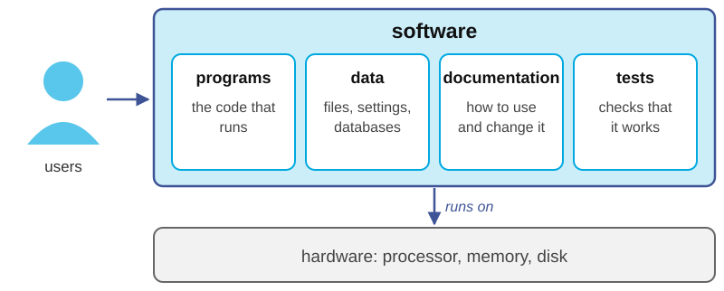

*Software engineering* is the application of a systematic, disciplined
approach to the development, operation and maintenance of software. A script
written for one analysis is one file used by one person. Software
is the same code grown into small parts, with requirements, tests,
documentation and a history of versions, used by other people on other data
for years. Research code becomes software more often than its authors expect.
It outlives the paper it was written for, other people build on it, and
published results depend on it.

A typical software engineering process has six stages. 

- The **requirements** state what problem is solved and for whom. 
- The **specification** states precisely what the program must do. 
- The **design** decides how to split the work into parts, such as functions, classes or modules, and which data structures connect them.
- **Implementation** is writing the code. 
- **Testing** checks that the code does what the specification says. 
- **Maintenance** covers using, fixing, extending and handing over the program. 

The stages are connected by feedback. A failing
test sends you back to the code. A test that reveals a gap sends you back to
the specification. New needs or new data start the cycle again from the
requirements. Real projects go around this loop many times in small steps,
which is called *iterative* development.

In a software team, each stage has an owner, a *role*. The *analyst* works
with the client to find out what is needed and writes the requirements and the
specification. The *architect* designs how the work is split into parts. The
*coder* implements the parts. The coder can be a person or a coding agent,
since both work from the same written instructions. The *tester* checks that
the code does what the specification says. The *maintainer* keeps the software
running, fixes it, and extends it when new requests arrive. Each role hands
its result to the next one as a document, such as the requirements, the
specification, the design, the code or a test report. In research and during your education you often
play every role yourself. The roles still exist, and skipping one skips its
stage.

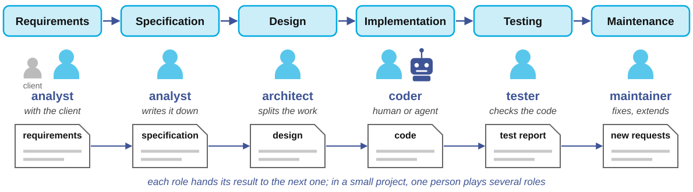

*Vibe coding*, a term coined by Andrej Karpathy in February 2025, describes
programming by describing what you want, accepting the generated code without
reading it, and seeing whether the result seems to work. In terms of the
software engineering process, a coding agent can take over one role, the
coder's. The other roles remain with people. Requirements belong to you and
your client, whoever needs the software, because only they know what it is
for. The roles of analyst, architect, tester and maintainer remain yours for
two reasons. A check written by the same system that wrote the code shares
its blind spots, and the design decides whether the pieces fit together. Both
opening examples failed outside the implementation stage, Tea in its
requirements and tests and Nokia in maintenance. With coding agents, writing
code has become the cheapest step, and everything around it is the part you should be very careful about. Coding agents can assist you in the design and implementation of tests but without the right requirements, specifications, and tests, you will never know what vibe-coded software actually does.

---

## 6. Requirements, specifications, and design {#requirements}
### Requirements

Let's follow an example of a small software project. A *panel survey* asks the same people the same question in two waves. The client, Ana, writes: 

> "We asked the same people the same question in spring and in autumn. I need everyone's two answers side
by side, to see who changed their mind. Please, no email addresses in what I
share with the team."

The figure shows an example of the data. Ana answered yes in spring
and no in autumn, but typed her address differently the second time. Ben took
part only in spring and Eva only in autumn. The result should be one row, for
Ana, under a pseudonym instead of her address.

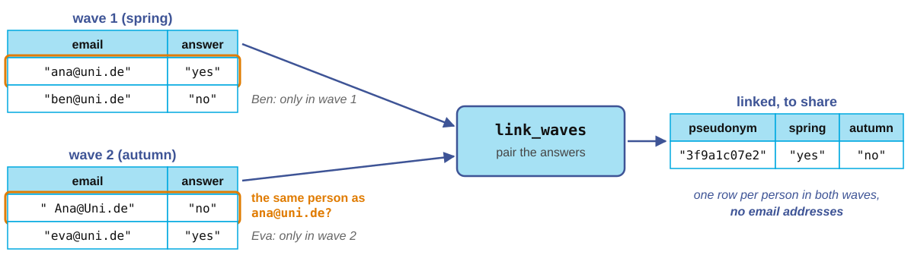

*Requirements* describe what the software must achieve, for whom, and under
which constraints, in the words of the people who need it. The *analyst*
collects them from the *client*, who may be a research team, a colleague, or
yourself in three months. Requirements describe the need, not the program.
"Everyone's two answers side by side, with no email addresses" is a
requirement, while a function with a loop is not. Four questions find most
requirements. Who uses the software? With which data? What must never happen?
When is it done? A misunderstanding found while collecting requirements costs
a conversation. A misunderstanding in requirements found after the code is written costs much more.

*Functional requirements* state what output the program gives for which
input. In the example, people in both waves are paired, also if they typed
their email address differently, and an empty wave raises an error.
*Non-functional requirements* state how the program must behave beyond its
outputs. In research software the important ones are *security* (users see
only their own data), *privacy* (no names, email addresses or other
identifiers in the output), *safety* (never delete or change the original
data), *performance* (it must finish on the full data set) and
*reproducibility* (the same input gives the same result on another machine).
Tea met its functional requirements, since the app stored the photos and
showed them to its moderators. Nobody had written down the non-functional
requirements, so nothing enforced them.

### Specifications

A *specification* is a precise description of what a program must do,
without saying how. It states the *inputs* and what may be assumed about
them, called the *preconditions*. It states the *outputs* and what is
guaranteed about them, called the *postconditions*. It says what happens in
edge cases and errors, and what the program must never do. You already know
the format, because every procedure in this course starts with `Inputs:` and
`Result:`, which is a specification in miniature. The analyst writes the
specification for two readers. The coder implements it, and the tester checks
the implementation against it.

Consider a request that sounds complete, such as "write a function that links
the two waves of our panel survey, so we can see who changed their answer". A
careful coder would come back with questions. A hurried coder, human or agent,
answers them alone and in silence. When are two records the same person, and
is `" Ana@Uni.de"` the same as `"ana@uni.de"`? What if someone answered twice
in the same wave? What happens to people who answered only once? May email
addresses appear in the result? May the function change the lists it was
given? Each question has several defensible answers, and different answers
give different panels. The specification is where you choose, as in the
following docstring.

```python
def link_waves(wave1, wave2):
    """Pair the answers of the people in both waves.

    wave1, wave2: lists of (email, answer) pairs.
    Emails match ignoring case and surrounding spaces.
    If someone answered twice in a wave, the last answer counts.
    Returns: a dict from pseudonym(email) to (answer1, answer2),
      only for the people in both waves.
    Raises: ValueError if a wave is empty.
    Never: puts an email in the result or changes the lists.
    """
```

What you see above is an example of a docstring, which is a way to write specifications of functions in Python.
Each line of the docstring answers one of the questions, and one more line
settles the empty case. None of them says how to link the waves, which is the main point of writing a specification before designing and implementing the solution directly.
The specification can be checked against any
implementation, whether you wrote it, a colleague did, or a coding agent did.
The result is keyed by `pseudonym(email)`, a hash of the cleaned email address
computed with a secret, as in the pseudonymization example of session 3. The
same person gets the same key in both waves, and nobody without the secret can
recover the address.

Whoever the coder is, the instructions they receive are a specification,
whether those instructions were written carefully or not. Compare 

> "write a function that links the two waves"

with the following:

> "Write `link_waves(wave1, wave2)`. Each wave is a list of (email, answer) pairs.
Match emails ignoring case and spaces. If someone answered twice, keep the
last answer. Return a dict from `pseudonym(email)` to the two answers, for
the people in both waves. Raise `ValueError` if a wave is empty. Never put an
email in the result or change the lists. Use only the standard library." 

The
second instructions get better code from any coder and they give you
something to check the code against. A colleague and a coding agent who
receive the same specification write different code, but their code has to
pass the same tests. The tester writes those tests from the specification
rather than from the code, so they check what was asked, not what was written.

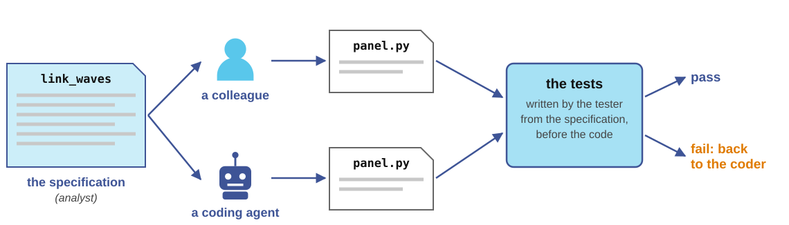

One kind of rule needs more than instructions, the rule that must never be
broken, such as "never touch the production data" or "never delete anything
outside this folder". Think about instructions as a request and not as an order that is guaranteed to be followed. Such rules have to be
enforced by the system itself, through permissions, backups and separate test
and production data, so that breaking them is impossible rather than
discouraged.

### Design

The *design* decides how the program is split into parts and how the parts
are connected. The person responsible for that is the *architect*, sometimes also called tech lead or designer.
For the panel example, a good
design has three steps and a helper:

- First, `read_wave(path)` reads one wave file into a list of (email, answer) pairs. 
- Then `link_waves(wave1, wave2)` pairs the answers of the people in both waves, as specified above. 
  - It uses the helper `pseudonym(email)`, which cleans an email address and hashes it with a secret. 
- Finally, `report(pairs)` counts how many people changed their answer. 

 Each part has one job and its own specification, and the design
states what data flows between them. Here that is two lists of pairs, then a
dictionary from pseudonym to a pair of answers.

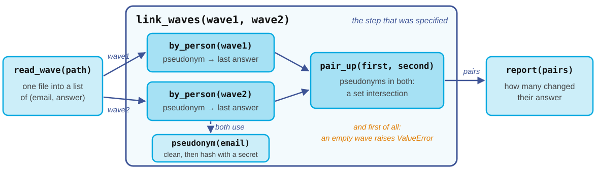

Small parts have three advantages. They are easier to test, because each can
be checked on its own with a few cases. They are easier to replace, because a
new file format only changes `read_wave`. And they are easier to hand to a
coder, one specified function at a time, rather than as a whole program at
once. Choosing the data structures is part of the design, session 3 gave
you some choices but we will learn about more in later sessions. To keep items in order, use a list, such as the (email,
answer) pairs of a wave. To look something up by a key, use a dictionary, such
as one per wave from pseudonym to answer. To check membership fast, use a set,
such as the pseudonyms that appear in both waves, which is the intersection of
the two sets of keys. To serve first come, first served, use a queue, such as a
waiting list for a seminar. The design is the architect's decision, because a
coder, human or agent, writes better code inside a structure that was chosen
for it than inside one it invented on the spot.

Skipping the design does not save the work, it moves it to later moments and makes it
larger. Without a design, every new need is patched into the program wherever
it fits. The same email cleaning ends up in three places, so a fix in one of
them leaves the other two wrong. A global variable that every function reads
and changes connects everything with everything, so nobody can tell which part
changed a value. Old functions stay forever because nobody knows whether something
still calls them. The result is called *spaghetti code*, because following one
strand means pulling at all the others. Every later change touches many parts,
and no part can be tested on its own, since each depends on the state the
others leave behind. An hour spent splitting the program
into parts with clear connections saves days of coding, debugging and testing
down the road.

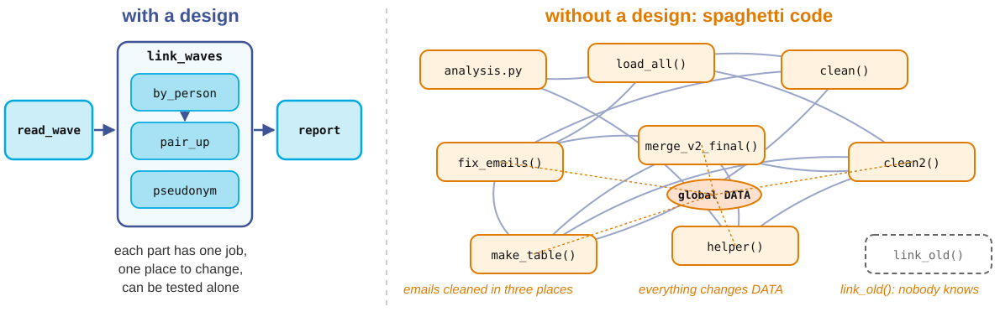

---

## 7. Testing {#testing}
A *test* is a small program that runs your code on an input whose correct
output you know, and checks that the code produces it. The specification says
what should happen, and the *tester's* tests check that it does. The simplest
test in Python is an `assert` statement. It does nothing if its condition is
true and stops the program with an error if it is false.

```python
w1 = [("ana@uni.de", "yes"), ("ben@uni.de", "no")]
w2 = [("ana@uni.de", "no"), ("eva@uni.de", "yes")]

assert list(link_waves(w1, w2).values()) == [("yes", "no")]
assert "ana@uni.de" not in str(link_waves(w1, w2))
```

Ana took part in both waves and changed her answer from yes to no. Ben took
part only in the first wave and Eva only in the second. So the result holds
one pair, and Ana's email address must not appear in it. The value of a
failing `assert` is that it turns a quiet error into a loud failure. A panel
that silently loses some of its members, or a file that silently contains
email addresses, can travel all the way into a paper or a data release but a test stops the program instead, warning everyone involved.


### Tests with pytest

For more than a few checks, a test framework keeps them organized. *pytest*
is the standard one in Python, a package installed once with `pip install
pytest`. You write each test as a function whose name starts with `test_`, in
a file whose name starts with `test_`, and you run the command `pytest` in
that folder. The command does four things. It finds every file whose name
starts with `test_`, it finds every function in those files whose name starts
with `test_`, it runs each function, and it reports the result. A test passes
if its function runs to the end. It fails if an `assert` inside it is false
or if the code raises an error that the test did not expect. The report
prints a dot for every test that passed and an `F` for every test that
failed, followed by the failed asserts with the values that did not match.
Nothing has to be called by hand, so adding a test means adding a function.

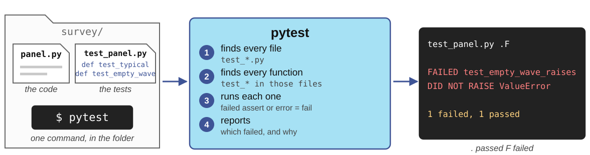

```python
# test_panel.py
import pytest
from panel import link_waves

W1 = [("ana@uni.de", "yes"), ("ben@uni.de", "no")]
W2 = [("ana@uni.de", "no"), ("eva@uni.de", "yes")]

def test_typical():
    pairs = link_waves(W1, W2)
    assert list(pairs.values()) == [("yes", "no")]

def test_case_and_spaces_are_ignored():
    w2 = [(" Ana@Uni.de", "no")]
    assert len(link_waves(W1, w2)) == 1

def test_no_emails_in_result():
    pairs = link_waves(W1, W2)
    assert "ana@uni.de" not in str(pairs)

def test_empty_wave_raises():
    with pytest.raises(ValueError):
        link_waves(W1, [])
```

Each test corresponds to a line of the specification. The third checks a
prohibition rather than an output. The fourth checks that an error is raised,
with `pytest.raises`.

### A first implementation meets the tests

Here is a plausible first implementation, of the kind a hurried coder, human
or agent, produces from the client's message alone.

```python
def link_waves(wave1, wave2):
    first = dict(wave1)
    return {email: (first[email], answer)
            for email, answer in wave2
            if email in first}
```

It is short, it runs, and on the typical case it gives the right pair.
Running the tests gives the following.

```
$ pytest -q
.FFF
FAILED test_case_and_spaces_are_ignored
  assert 0 == 1
FAILED test_no_emails_in_result
  'ana@uni.de' is contained here
FAILED test_empty_wave_raises
  DID NOT RAISE ValueError
3 failed, 1 passed
```

Three of the four tests fail. The function compares email addresses exactly,
so `" Ana@Uni.de"` in the second wave counts as a new person. Every respondent
who typed their address a little differently quietly drops out of the panel,
an error of exactly the kind that survives into tables. The function keys the
result by email address, so the privacy requirement is broken without any
error message. And with an empty wave it returns an empty dictionary instead
of raising an error, which would report a panel of nobody. The fix is to clean
each address with `strip()` and `lower()`, to key the result by
`pseudonym(email)`, and to raise `ValueError` when a wave is empty. After that,
all four tests pass. A quick look at the output of the typical case would have
shown nothing wrong.

### Choosing test cases

Good tests sit where the specification draws a line, with at least one test
for each of its lines. 

- A *typical* case checks the ordinary behavior. Ana in both waves, Ben and Eva in one, gives one pair, `("yes", "no")`. 
- A *spelling* case checks the matching rule. `" Ana@Uni.de"` and `"ana@uni.de"` are the
same person. 
- A *duplicates* case checks the rule for repeated submissions. If Ana answered twice in the first wave, only her last answer counts. 
- A *boundary* case checks the smallest result. If nobody took part in both waves, the result
is `{}`. 
- An *empty* case checks the error rule. `[]` as a wave raises
`ValueError`. 
- *Must-not-happen* cases check the prohibitions. No email address
appears in the result, and both lists are unchanged afterwards. 

The general
heuristic is to test missing, empty, single, repeated, largest and smallest
inputs, because bugs gather at the edges of what the programmer imagined.

### Test first, then implement

The order of work that makes any coder safe to work with is the order of the
software engineering process, with one role per step. First, the analyst
writes the specification, as a docstring. Second, the tester writes the tests
from the specification, before any code exists, so that they record what was
meant rather than what the code happens to do. Third, the coder, a person or
an agent, writes the implementation. Fourth, the tester runs the tests. A
failing test sends the code back to the coder, and someone reads the code
that passes. Fifth, every bug the maintainer finds later becomes a new test,
a *regression test*, so that the same bug can never come back unnoticed. The
tests are your measurement. They replace the *vibe* that the code works with
evidence that it does.

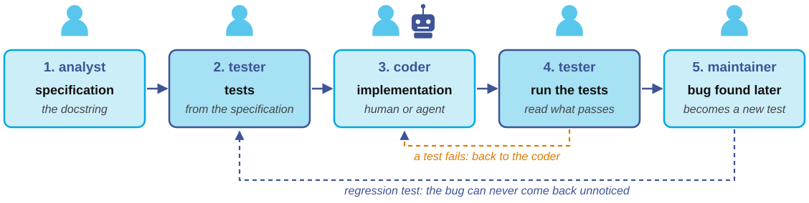

### Maintenance

A year later, Ana writes again. "Great! In spring we run a third wave. Can we
link all three?" The *maintainer* now goes through the flow again, on a small
scale. `read_wave` does not change, since wave 3 is a file like the others.
`link_waves` has to take any number of waves, so its specification changes
first, then its tests, then its code, in that order. `report` gets one more
column. `pseudonym` does not change, and must not. If the secret were lost or
replaced, wave 3 would get different pseudonyms and could not be linked to
the first two. After the change, the four old tests run again, as regression
tests, to check that linking two waves still works as before. This is where
the small parts of the design pay off, because the change touches one
function and its tests, not the whole program. It is also where Nokia failed.
When nobody can tell what a change will break, nobody dares to make it.

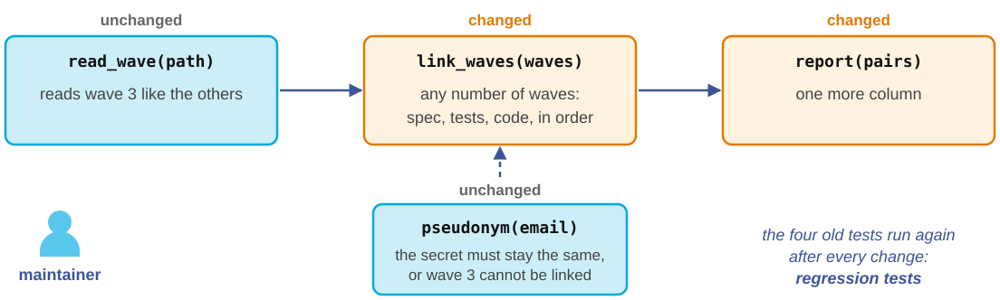

What makes this maintenance possible is that the earlier stages left
something behind. Each stage of the flow produces a document. The
requirements are written down, the specification lives in the docstrings,
the design is a diagram of the parts and their connections, the code is
readable and commented, the tests form a suite that runs in seconds, and
maintenance keeps a change log and the history of versions. Together these
are the documentation of the software. The next iteration starts from it,
instead of guessing from the code what each part does and what a change
might break. Symbian shows what happens without it. With 20 million lines of
code and no map of them, moving an element on the screen by 5 millimeters
first required finding which part draws the screen and what depends on it.
A design document would have said where, and tests would have said what
breaks.

### What tests cannot do

Edsger Dijkstra put the limit of testing in one sentence in 1970. "Program
testing can be used to show the presence of bugs, but never to show their
absence." Tests check only the cases someone thought of, so a specification
that misses a requirement produces tests that miss it too, as the Tea app
shows. *Software verification* goes further. It proves, with mathematical
methods, that a program meets its specification for every possible input, not
only for the inputs that were tried. Verification is expensive and needs a
specification written in a formal language, so it is used where failure is
unacceptable, for example in flight control software, railway signaling and
the cores of operating systems. For research code, the practical combination
is a clear specification, tests derived from it, and reading the code you did
not write before running it on real data. Within those limits, tests are the
cheapest form of quality control available to you. Keep them small and fast,
and run them after every change.

A small verification can be done by hand, as a proof instead of a test.
Take the mean of a list, written with an explicit loop.

```python
def mean(xs):
    """xs: a non-empty list of numbers.
    Returns: their mean."""
    total = 0
    i = 0
    while i < len(xs):
        # invariant: total == sum(xs[:i])
        total = total + xs[i]
        i = i + 1
    return total / len(xs)
```

The tool is a *loop invariant*, a statement that is true before every turn of
the loop. Here the invariant is that `total` equals the sum of the first `i`
elements of the list. The argument has three steps:

1. Before the loop, `i` is 0 and `total` is 0, which is the sum of no elements, so the invariant is true at
the start. 
2. In each turn, `total` gains `xs[i]` and `i` grows by one, so if
`total` was the sum of the first `i` elements before the turn, it is the sum
of the first `i` elements after it as well. 
3. The loop ends when `i` equals
`len(xs)`, so at that point `total` is the sum of all elements, and the last
line returns the mean. 

The precondition that the list is not empty rules out
a division by zero. Together, the three steps show that the function returns
the mean for every non-empty list, not only for the lists a test happens to
try. This is the same reasoning as a proof by induction, and it is how the
textbook of session 7 argues that sorting algorithms are correct.
Verification tools such as Dafny let a computer check arguments of this kind,
line by line, which is why they need the specification and the invariant in a
formal language. For a loop of five lines you can do it by hand, and reading
code with an invariant in mind is exactly this reasoning. 

---

## 8. Check yourself

**1.** Is Python compiled or interpreted, and what does that mean for when you see an error?

<details><summary>Answer</summary>

Python is interpreted, which means that the code is translated and run line
by line, each time the program runs. Errors appear when the line that
contains them runs, so a mistake in a branch that your test data never
reaches can stay hidden until someone else runs the program on other data.
(Strictly, Python first compiles the source to an intermediate code and then
interprets that, but the practical consequence is the same.)

</details>

**2.** In `votes = {"yes": 12}; votes.get("no", 0)`, what is an object, what is a class and what is a method?

<details><summary>Answer</summary>

`votes` is an object of the class `dict`, and `get` is a method of that class,
called on `votes`. It returns 0, the default, because the key `"no"` is not in
the dictionary.

</details>

**3.** A colleague asks: "Can you write something that tells me how many people answered each option of question 5?" Write two functional and one non-functional requirement.

<details><summary>Answer</summary>

Two functional requirements are that the result gives, for every option of
question 5, the number of respondents who chose it, and that respondents who
did not answer are counted separately, not as an option. A non-functional
requirement is that the original data file is never changed (safety), or that
the result contains no respondent identifiers (privacy). Other reasonable
answers are that options nobody chose appear with 0, or that the count runs
in a few seconds on the full survey.

</details>

**4.** Write a specification, as a docstring, for a function `share_yes(answers)` that returns the share of "yes" answers, and three pytest tests for it.

<details><summary>Answer</summary>

```python
def share_yes(answers):
    """Return the share of "yes" among the valid answers.

    answers: a list of strings, each "yes", "no" or None (no answer).
    Returns: (number of "yes") / (number of "yes" or "no"), a float in [0, 1].
    Raises: ValueError if there is no "yes" or "no" answer.
    The list is not modified.
    """

def test_typical():
    assert share_yes(["yes", "no", "yes", "no"]) == 0.5

def test_missing_are_ignored():
    assert share_yes(["yes", None, "no", None]) == 0.5

def test_no_valid_answer_raises():
    with pytest.raises(ValueError):
        share_yes([None, None])
```

Counting missing answers as "no" would also be defensible, as long as it is
written down.

</details>

**5.** Your program must remember which participants have already registered for a study and tell, quickly, whether a new registration is a duplicate. Which data structure belongs in the design, and why?

<details><summary>Answer</summary>

A set of participant IDs, because checking membership in a set takes constant
time on average, whatever its size, while a list would have to be scanned. If
the program also needs data about each participant, a dictionary from ID to
that data does both jobs.

</details>


---

## 9. References

- **Zelle, J. M. (2016).** *Python Programming: An Introduction to Computer
  Science*, 3rd ed. Franklin, Beedle & Associates. Chapters 2 and 6–8 are the
  reading for this session.
- **Guttag, J. V. (2016).** *Introduction to Computation and Programming Using
  Python*, 2nd ed. MIT Press. Chapter 6, "Testing and Debugging", covers
  section 7 in more depth.
- **IEEE (1990).** *Standard Glossary of Software Engineering Terminology*,
  IEEE Std 610.12-1990. The source of the definitions of software and of
  software engineering in section 5.
- **Dijkstra, E. W. (1970).** *Notes on Structured Programming* (EWD249). The
  source of the quotation in section 7.
- **pytest documentation.** <https://docs.pytest.org/>. "Get started" is enough
  for this course.
- **PEP 257, Docstring Conventions.** <https://peps.python.org/pep-0257/>.
  How to write the docstrings that serve as specifications.
- **Karpathy, A. (2025).** The post that introduced the term "vibe coding",
  2 February 2025, on X.
- **Tea (app).** Wikipedia, <https://en.wikipedia.org/wiki/Tea_%28app%29>.
  Basic information on the app, officially *Tea Dating Advice*, its founding
  and its 2025 data leaks. Motivating example A.
- **Tea data leaks.** *TechCrunch* and *CNN*, 26 July 2025, and the reporting
  of *404 Media* on the second leak of private messages. Motivating example A.
- **Orlowski, A. (2010).** "Rescuing Nokia? A former exec has a radical plan",
  *The Register*, 22 July 2010. The interview with Juhani Risku quoted in
  motivating example B.
- **"Symbian Foundation completes move to open source".** *All About Symbian*,
  4 February 2010. The source of the line counts of Symbian and Android in
  motivating example B.
