# Session 5: Algorithms

<style>
figure, .figure, .float { margin: 1.4em 0 1.8em 0; }
figure img, .float img { display: block; max-width: 100%; }
figcaption, .figcaption, .figure p.caption { margin-top: 0.3em; font-size: 0.88em; color: #555; }
.float img, .figure img { margin-left: auto; margin-right: auto; }
.float .figcaption, .figure p.caption { text-align: center; }
.bfs-trace .float img, .bfs-trace .figure img { margin-left: 0; }
.bfs-trace .float .figcaption, .bfs-trace .figure p.caption { text-align: left; }
details { margin: -0.5em 0 2.2em 0; }
figure.wrap-right { float: right; width: 40%; margin: 0.3em 0 0.8em 1.4em; }
figure.wrap-right img { width: 100%; }
figure.wrap-right figcaption { text-align: left; }
</style>

*Introduction to Computing for the Social Sciences · lecture transcript*

**Reading for this session:** Chapter 1 of Cormen, *Algorithms Unlocked*
(2013). References at the end.

---

## Contents

1. [Algorithms](#algorithms)
2. [Representation of algorithms](#representation)
3. [Abstract data structures: queues, stacks and graphs](#abstract-data-structures)

---

<!-- MOTIVATION-SECTION:BEGIN -->
## Motivating examples

<!-- MOTIVATION:M05-B:BEGIN -->
### A · Whose contacts, within two steps?

Contact tracing is a graph problem that has to be solved quickly. People are vertices and a recorded contact is an edge. When a case of a disease is confirmed, the question is who is within one step of that person and who is within two. This sounds like a complete description, but handing "find everyone within two steps" to a machine requires answering additional questions:

- **Which person do you examine next?** If you take the most recently discovered person each time, you follow one long chain of contacts before you ever look at the second friend of the original case, so you will report people at distance 5 before people at distance 2. If you take the earliest discovered person, you finish all of distance 1 before starting distance 2. The graph and its edges are the same but the behavior is completely different. The first procedure is depth-first and the second is breadth-first, and only the second properly solves the problem.
- **How do you avoid loops?** Contact graphs are full of cycles, for example when A met B, B met C and C met A. Without marking who has already been seen, the procedure never terminates.
- **How do you know the distance?** You cannot see it by looking at a person. Instead, you record it when you first reach them, because each newly discovered person is one step further away than the person who led you to them.
- **When do you stop?** You stop when the queue is empty or, in this case, as soon as you would move beyond distance 2.

Stopping at distance 2 is what makes the procedure fast enough to be useful. The graph may have millions of vertices but you only visit the neighborhood that you need. The answer arrives in seconds rather than hours because of the procedure and not because of your computing power. Breadth-first search, an algorithm you will learn about in this session, examines each vertex once and each edge once, so its cost is proportional to the part of the network that you actually reach.

<!-- MOTIVATION:M05-B:END -->
<!-- MOTIVATION:M05-C:BEGIN -->
### B · The network that would not fit

Suppose you want to study the friendship network of Facebook, with about 3 billion users who each have perhaps a couple of hundred friends. The most obvious representation is a table with one row and one column per user that holds a 1 where two users are friends. This is called an adjacency matrix. Its problem is that its size depends only on the number of users and not on the number of friendships. For 3 billion users the matrix has $(3 \times 10^9)^2 = 9 \times 10^{18}$ cells. Even if each cell took only one bit, which is a very generous assumption, this would be about 1.1 exabytes, more than a million terabytes, and the study would be over before it starts. Now we store for each user only a list of the users they are actually friends with. This is called an adjacency list. Its size depends on the number of friendships, which is about $3 \times 10^9 \times 200 / 2 = 3 \times 10^{11}$, and each friendship is stored in the lists of its two endpoints. With 4 bytes per entry this is about 2.4 terabytes, which is large but fits on a few disks. The storage is about 500,000 times smaller although both representations record the same facts. The reason is that real social networks are sparse, i.e. people have hundreds of friends and not three billion. In the matrix only about one cell in fifteen million holds a 1, so almost all of its storage records the absence of a relationship, while the list records only the friendships that exist.

The choice between the two representations is a real trade-off, which makes it a design question. We can compare them on three questions:

- **Are $u$ and $v$ friends?** The matrix looks at one cell, which takes one step, while a can the list of $u$, which takes a number of steps that equals the degree of $u$ (the number of neighbors).
- **Who are the friends of $u$?** The matrix scans a whole row, which takes an amount of time of about the number of vertices in the graph, while the lists just read the list of $u$, which takes an effort as the degree of $u$.
- **How much space is needed?** The matrix needs the square of the number of vertices in the graph, while lists need about the sume of the number of vertices plus twice the number of edges.

The matrix is faster for the first question and worse for the other two. The algorithm of this session, breadth-first search, asks the second question again and again, and so does depth-first search in the Recursion session. For the work we do here, the lists are therefore better both in time and in space.

<!-- MOTIVATION:M05-C:END -->

---

<!-- MOTIVATION-SECTION:END -->
## 1. What is an algorithm? {#algorithms}
An *algorithm* is a self-contained, step-by-step set of operations to solve a
given problem. Algorithms perform calculation, data processing and automated
reasoning tasks. The word comes from Muhammad ibn Musa abu Djafar al-Khwarizmi
(c. 780–850), who was born in Khwarazm, in present-day Uzbekistan, and worked in
Baghdad. He popularized algebra and published the first systematic way to
solve linear and quadratic equations. His book on calculating with
Hindu-Arabic numerals was translated into Latin as *Algoritmi de Numero
Indorum*. The word "Algoritmi" later became "algorithmus" as a mix with the Greek
*arithmos*, which means number. Algorithms clearly predate him, because Babylon, Egypt,
India and Greece all had them. What he popularized was the idea of a
systematic treatment of data and of doing it in as few steps as possible. For this reason he preferred decimal arithmetic with pen and paper to an abacus with
Roman numerals.

The word is also used with slightly different meanings in
public debate and in artificial intelligence research, which often causes confusion. There are two such meanings:

- **The algorithm as the method that fits a predictive model.** This can be as simple as least squares for a linear regression or as complicated as distributed stochastic gradient descent for a neural network.
- **The algorithm as the model after training.** This meaning focuses on the fitted model as a program whose behavior was not carefully designed but learned from empirical data.

Terms like *algorithmic bias*, *algorithmic media*, *machine behavior*, *algorithm
auditing* and *algorithmic decision-making* use the word in one of these two
senses. In this course, unless we say otherwise, an algorithm is a designed,
step-by-step method in the sense of the definition above.

---

## 2. Properties of algorithms

We will use a running example to define the properties of an algorithm,
namely finding the $k$-th smallest element of a list. It reads as follows in pseudocode and in Python.

```
Procedure K-SMALLEST-ELEMENT(M, n, k)
Inputs:
      M: an array
      n: the number of elements in M
      k: the rank to find (k = 1 is the minimum)
Result: the k-th smallest element of M
For i = 1 to k:
      smallest ← i
      For j = i + 1 to n:
            If M[j] < M[smallest]
                  then smallest ← j
      swap M[i] with M[smallest]
return M[k]
```

```python
def min_k(M, k):
    for i in range(0, k):
        m = i
        min_val = M[i]
        for j in range(i + 1, len(M)):
            if M[j] < min_val:
                m = j
                min_val = M[j]
        M[i], M[m] = M[m], M[i]
    return M[k-1]
```

Note that this algorithm is selection sort stopped after $k$ rounds. We will already saw selection sort on the first session and we will learn more about it in the Sorting Algorithms session. Note also that the
pseudocode counts from 1 while Python counts from 0, so `M[k-1]` in Python
is $M[k]$ in the pseudocode.

An algorithm is described by the following properties:

- **Specification.** The *input specification* states the input required so that a given output can be produced. Note that there can be many inputs or none. The *output specification* states the result to be produced by the algorithm. In the example, the input is a list $M$ of length $n$ and an index $k$, and the output is the $k$-th smallest element.
- **Transferability.** The input should be parameterizable, so that different instances of the problem are allowed as inputs. Our example accepts lists of any length and any value of $k$. A procedure that only works for one specific list is not an algorithm, because it only gives the answer for that list.
- **Description.** An algorithm must have *finiteness*, meaning that it terminates after a finite number of steps, and *definiteness*, meaning that each step is clear, well-defined and precise, with no ambiguity.
- **Execution and return.** An algorithm can be *deterministic*, giving the same output for the same inputs, or *stochastic*, when a random component makes the output vary for the same inputs. Both kinds are useful, for example randomized quicksort and Monte Carlo methods are stochastic. However, you must know which kind you have because it changes how you test it.
- **Time and memory complexity.** The *time complexity* is the effort that the algorithm needs for completion. It depends on the specific implementation and is measured by counting key operations, for example the comparisons in a sorting algorithm. The *memory complexity* is the memory required during execution, measured by the maximum memory space that the algorithm needs. We will learn how to calculate both in the Time Complexity session.
- **Correctness.** Correctness has two parts. The first is *partial correctness*, meaning that whenever the algorithm terminates its output is correct. The second is *termination*, meaning that for correct inputs the algorithm always terminates in a finite number of steps. An algorithm can fail either of the two. For example, a loop that computes the right thing but never stops is not correct.

---

## 3. Representing algorithms {#representation}
How do you create a new program? First, you evaluate your requirements. Then, you define a structure for the program with a
method of representation for its algorithm, which can be pseudocode, a
structogram, a flow diagram or the Unified Modeling Language (UML). Finally, and
only then, you start programming. The two representations that we use in this course
are **pseudocode and flowcharts**. Programming comes last on purpose, because writing the
algorithm down before you write code is how you find
out whether you have understood the problem.

---

## 4. Pseudocode

*Pseudocode* is a representation of the steps of an algorithm as a combination
of natural language and mathematical notation. It often uses the structural
conventions of a programming language. However, it is not meant for machine
interpretation but for illustration among humans. In this course every
procedure has a header with a name, its inputs, any auxiliary data it uses
and its result. The header is followed by the steps, with blocks marked by indentation:

```
Procedure NAME(inputs)
Inputs: input variables
Data: auxiliary variables
Result: output variables
preparation
While not the trivial case:
      work
bookkeeping
```

Good pseudocode specifies the input and the output if they are not clear from
the problem. If it uses auxiliary data structures, it comments how they are
accessed and edited. It also makes the scopes of loops and conditionals unambiguous
by using indentation. The bottom line is that another human has to be able to follow the
instructions of your pseudocode to solve the problem with pen and paper, and
later to program it. Pseudocode that only you can follow is therefore not good enough.

---

## 5. Flowcharts

A *flowchart* is a graphical representation of the execution of an algorithm
using symbols and transitions. It shows the steps as boxes and their order by
connecting the boxes with arrows. Four symbols are enough for this course:

- A **rounded box** marks the start and the end of a program or sub-process.
- A **parallelogram** marks data, i.e. the input of data by entering it and the output of data by displaying it.
- A **rectangle** marks the execution of operations, i.e. a set of operations that changes the value, form or location of data.
- A **diamond** marks a conditional split, i.e. a conditional operation that determines the program path. It is commonly a yes/no question or a true/false test.

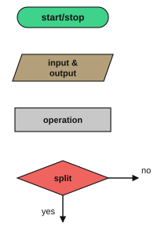

The example below computes the profit or loss of a sale. The
program starts and reads the selling price as `SP`. Then it reads the cost price
as `CP` and tests whether `SP` is larger than or equal to `CP`. If the
condition is true, it takes the right path, where it calculates the profit as `SP -
CP` and outputs it. If the condition is false, it takes the bottom path, where it
calculates the loss as `CP - SP` and outputs it. Then the program ends. Notice
that the two paths join again before the stop symbol. A flowchart with paths
that never rejoin usually indicates a program with several exits. This is
legal but harder to reason about and harder to test, because each exit is a
separate case to check, as we saw in the Software session.

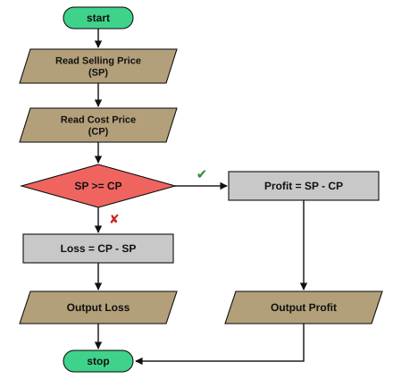

Pseudocode and flowcharts express the same thing, and translating between them
is a standard exercise. Each construct of pseudocode has a corresponding shape in a flowchart:

- A **statement** becomes a rectangle.
- An **`If … then … else`** becomes a diamond with two outgoing arrows.
- A **`While`** becomes a diamond whose false branch exits and whose true branch loops back.
- A **`For i = 1 to n`** becomes the initialization of a counter, a diamond testing the counter and an increment inside the loop.
- A **`return`** becomes a parallelogram followed by the stop symbol.

The case of `For` is worth remembering, because a `For` loop is a `While` loop in which the bookkeeping of the counter is
implicit. So when you convert a flowchart with a counter back into pseudocode,
you can almost always write it as a `For`.

We can apply these rules to the running example of this session,
K-SMALLEST-ELEMENT. The figure below shows its flowchart, and each symbol has
a clear role in it:

- **Start and stop.** The rounded boxes mark where the program begins and
  where it ends, after the result has been output.
- **Data.** The parallelogram at the top reads the inputs $M$, $n$ and $k$,
  and the one on the left outputs the result $M[k]$.
- **Operations.** The rectangles change values. $i \leftarrow 1$ and
  $smallest \leftarrow i$, $j \leftarrow i + 1$ initialize the counters of the
  two loops, $smallest \leftarrow j$ records a new smallest element, and the
  box on the right swaps $M[i]$ with $M[smallest]$ and moves on to the next
  $i$.
- **Conditions.** The diamonds $i \le k$ and $j \le n$ are the tests of the two
  `For` loops, and they decide whether a loop runs again. The diamond
  $M[j] < M[smallest]$ is the `If` of the pseudocode, and it decides whether a
  smaller element was found.
- **Arrows back up.** The arrow from $j \leftarrow j + 1$ back to $j \le n$ is the
  inner loop, and the arrow from the swap back to $i \le k$ is the outer loop.
  These backward arrows are how a flowchart shows repetition.

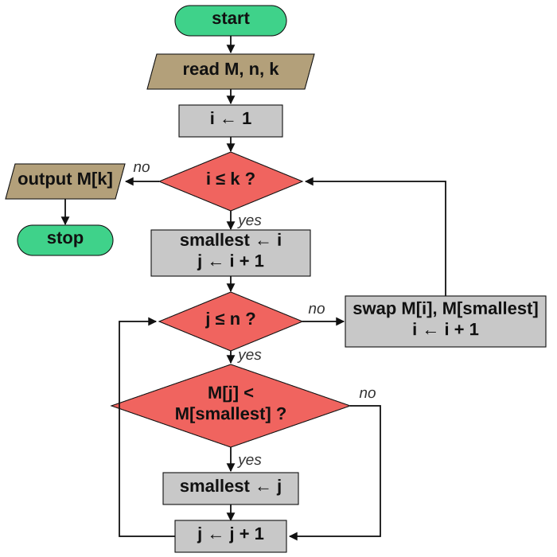

---

## 6. Abstract data structures: queues and stacks {#abstract-data-structures}
*Abstract data structures* represent data in the way best suited to our
algorithmic needs, so the arrangement, the coding and the links among the data
all matter. They allow the administration of and access to data in an
efficient way. Their exact specification depends on the implementation
and the use case. We have already seen arrays, linked lists, binary search
trees and associative arrays (dictionaries), and we have seen that the
choice of data structure matters a lot for the performance of specific
algorithms. In this session we need two more structures, queues and stacks, which are both simple.

A *queue* is a linear data structure following the FIFO principle, i.e. first in,
first out. It has two operations. ENQUEUE($Q$, $v$) adds the element $v$ to
the rear of the queue $Q$ and DEQUEUE($Q$) removes and returns the element at
the front of $Q$. Queues are used to process requests in order, and several
queues can be combined to implement priorities.

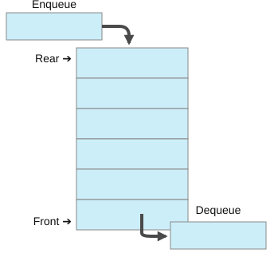

A *stack* is a linear data structure following the LIFO principle, i.e. last in,
first out. It also has two operations. PUSH($S$, $v$) adds the element $v$ to
the top of the stack $S$ and POP($S$) removes and returns the most recently
added element, i.e. the top of the stack. Stacks are used in the stack
segment of memory, which manages the layered execution of subroutines, and in
recursion, which we will learn in the Recursion session.

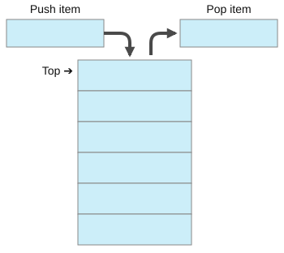

These two structures matter here because the order in
which you take elements out of a container determines the kind of search
that you perform. Breadth-first search, which we will see below, uses a queue and explores the graph level by
level. Depth-first search, which we will learn in the Recursion session, uses a stack and goes as deep as it
can first. The graph and the structure of the algorithm are the same, but a different container gives a
completely different traversal.

---

## 7. Graphs

<figure class="wrap-right">
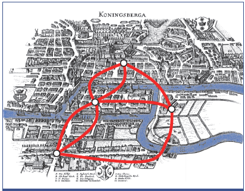
<figcaption><em>The seven bridges of Königsberg, from Peter Berger, Einführung in die Graphentheorie.</em></figcaption>
</figure>

We can motivate graphs with the seven bridges of Königsberg. Leonhard
Euler asked whether there is a path that uses every bridge of the city exactly
once and ends where it started. He proved that there is no such path. His argument
counted how many bridges meet at each land mass and it started graph
theory. The argument worked thanks to abstraction, i.e. he ignored the geography
and kept only which land masses are connected by how many bridges. This kind of abstraction is what we call a graph (more precisely, this case is a multi-graph because there are two edges between two nodes). Many real-world structures can be represented as graphs,
for example road maps, the ownership relations between companies, the Internet,
the Web, word associations and social relations.

<div style="clear: both;"></div>

A graph consists of *vertices* and *edges* and it is especially suitable for
representing interdependencies between data points.

- **Vertices** represent any kind of object, such as cities, physical states, atoms, steps in a process or persons. They can be labeled or not.
- **Edges** represent the relationship between vertices, such as roads between cities, transitions between physical states or atomic bonds. Edges can have labels and variables, for example a physical distance such as 2 km on a map, a type of connection such as friends or enemies, or a weight such as strong versus weak. They can also be directed or undirected. If they are directed, each edge has an origin and a destination, and it is possible to have one edge and the same but in the opposite direction.

Formally, a graph $G$ is a tuple $G = (V, E)$, where $V$ is the
set of all vertices and $E$ is the set of all edges. For directed graphs, $E$
consists of ordered pairs $(v_1, v_2)$, meaning that the edge goes from $v_1$
to $v_2$. For undirected graphs, $E$ consists of unordered pairs $\{v_1,
v_2\}$.

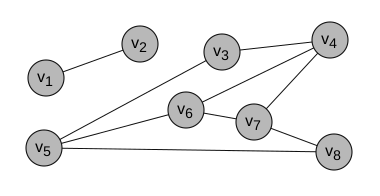

---

## 8. Representing graphs in a computer

The formal definition does not tell a computer how to store a graph. Two common ways of storing graphs are adjacency matrices and the adjacency lists. If $G = (V, E)$ is a graph, two vertices $v, w \in V$
are *adjacent* if they are connected by an edge $\{v, w\} \in E$. The
*adjacency matrix* $A(G)$ is the matrix with $a_{v,w} = 1$ when $\{v, w\} \in
E$ and $a_{v,w} = 0$ otherwise. The adjacency matrix of the example graph of the figure above is the following.

$$A(G) = \begin{array}{c|cccccccc}
 & v_1 & v_2 & v_3 & v_4 & v_5 & v_6 & v_7 & v_8\\\hline
v_1 & 0&1&0&0&0&0&0&0\\
v_2 & 1&0&0&0&0&0&0&0\\
v_3 & 0&0&0&1&1&0&0&0\\
v_4 & 0&0&1&0&0&1&1&0\\
v_5 & 0&0&1&0&0&1&0&1\\
v_6 & 0&0&0&1&1&0&1&0\\
v_7 & 0&0&0&1&0&1&0&1\\
v_8 & 0&0&0&0&1&0&1&0
\end{array}$$

For an undirected graph the matrix is symmetric, while for a directed graph it usually is
not. For a weighted graph the weight is stored instead of 1. The
alternative is the *adjacency list*, which is an array of vertices in which all the
neighbors of each vertex are stored as a linear list. It is a compressed
representation of the adjacency matrix in which all the zeros have been
eliminated. It is therefore more memory-efficient for *sparse* graphs, i.e.
graphs with few edges per vertex. Sometimes this is implemented as a hash table that maps vertex identifiers to list pointers, and lists as linked lists that can have variable length.

| vertex | neighbors |
|---|---|
| $v_1$ | $\rightarrow v_2$ |
| $v_2$ | $\rightarrow v_1$ |
| $v_3$ | $\rightarrow v_4 \rightarrow v_5$ |
| $v_4$ | $\rightarrow v_3 \rightarrow v_6 \rightarrow v_7$ |
| $v_5$ | $\rightarrow v_3 \rightarrow v_6 \rightarrow v_8$ |
| $v_6$ | $\rightarrow v_4 \rightarrow v_5 \rightarrow v_7$ |
| $v_7$ | $\rightarrow v_4 \rightarrow v_6 \rightarrow v_8$ |
| $v_8$ | $\rightarrow v_5 \rightarrow v_7$ |

Which representation to use depends on the questions you ask most and on how
dense the graph is. We can compare them with two example questions:

- **Does an edge exist between $v_i$ and $v_j$?** The adjacency matrix gives direct access to one cell, while the adjacency list requires iterating through all the neighbors of $v_i$.
- **How many edges does a vertex $v_i$ have?** The adjacency matrix requires iterating through all the vertices of its row, while the adjacency list only iterates through the neighbors.

For large graphs, memory decides the choice. If Facebook stored the
friendship network of 2.7 billion users as an adjacency matrix with one bit
per entry, storing the upper half of the symmetric matrix would take 455
petabytes, i.e. 455,000 terabytes, just to record the presence or absence
of friendships between users. The reason is that the matrix grows with
$|V|^2$ while the list grows with $|V| + |E|$, and social networks are
extremely sparse. An average person has a few hundred friends out of billions,
so almost every bit of that matrix would be a zero.

To measure the memory and the speed of both representations on a random network, follow section 1 of the [Python examples notebook of this session](https://github.com/dgarcia-eu/ICSS/blob/main/PythonExamples/Examples05-Algorithms.ipynb).

Once a graph is stored, we can pose many problems on it. Some examples are the following:

- Finding **distances** and shortest paths between nodes.
- Finding **connected subgraphs**, i.e. maximal subgraphs in which there is a path between every two nodes.
- **Coloring** nodes so that two neighbors never have the same color.
- Finding the nodes with the shortest **average distance** to all others.
- **Ranking** nodes by the number of shortest paths that pass through them.
- Finding a **tree** (a connected graph without cycles) that connects all nodes with the fewest edges.
- Finding a **path** that connects all nodes using each edge at most once, which is Euler's problem.
- Deciding whether two graphs can be mapped onto each other, which is the **isomorphism** problem.

Some of these problems have efficient algorithms and others do not, as we will learn in the Theoretical Computer Science session.

---

## 9. Breadth-First Search

Consider the following problem: Given a source node $s$, also called the starting node or the source, we want to
find all the nodes reachable from it and a shortest path from $s$ to
each of them. The example graph below is undirected, with $V =
\{a,b,c,d,e,f,g\}$ and $E = \{\{a,e\}, \{e,b\}, \{b,c\}, \{c,f\}, \{c,g\},
\{d,g\}, \{e,f\}\}$. The algorithm that solves the problem is
*breadth-first search* (BFS). It uses three pieces of information per vertex,
which are also described in the conventions page:

- The **color** is WHITE for vertices not seen yet, GRAY for vertices seen but not finished, and BLACK for finished vertices.
- The **distance** $d[u]$ is the number of steps from the source to $u$.
- The **parent** $\pi[u]$ is the vertex from which $u$ was discovered, which makes it the parent of $u$ in the search tree.

The first step initializes them.

```
Procedure INITIALIZE-BFS(G, s)
Inputs:
      G: an undirected graph
      s: the starting node
Result: the graph is initialized for a breadth-first search starting at s
For each vertex u in G.V \ {s}:
      color[u] ← WHITE
      d[u] ← ∞                  # distance
      π[u] ← NIL                # parent
color[s] ← GRAY
d[s] ← 0
π[s] ← NIL
```

::: {.bfs-trace}
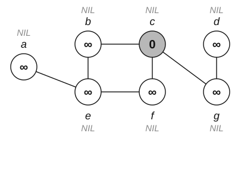
:::

In the figures, the distance is written inside the node, the name of the node
is just outside it and the parent is the gray capital letter beyond that. The
algorithm itself keeps a queue of the vertices that have been seen but whose
neighbors have not been examined yet.

```
Procedure BFS(G, s)
Inputs:
      G: an undirected graph
      s: the starting node
Result: every node reachable from s stores its distance d to s
        and its parent π
INITIALIZE-BFS(G, s)
Q ← ∅
ENQUEUE(Q, s)                              # put s in the queue Q
While Q ≠ ∅:
      u ← DEQUEUE(Q)                       # take the next element from Q
      For each vertex v in neighbors(u):   # check all neighbors of u
            If color[v] = WHITE            # only continue if v has not been seen yet
                  then color[v] ← GRAY     # mark v as seen
                       d[v] ← d[u] + 1     # one step further than u
                       π[v] ← u            # u is the parent of v
                       ENQUEUE(Q, v)       # put v in the queue
      color[u] ← BLACK                     # all neighbors of u processed
```

Three details make the algorithm work:

- **The color** prevents visiting a vertex twice. Without it, an undirected edge would send the search back to where it came from and the algorithm would never stop.
- **The queue** makes the search breadth-first, because vertices come out in the order they went in. So everything at distance 1 is processed before anything at distance 2.
- **The assignment** $d[v] \leftarrow d[u] + 1$ is executed only once per vertex, the first time it is discovered. Because of the queue, that first discovery happens along a shortest path.

### Full trace, starting from $s = c$

In the figures the queue is drawn below the graph and a crossed cell has just
been dequeued. After the initialization, $c$ is enqueued.

::: {.bfs-trace}
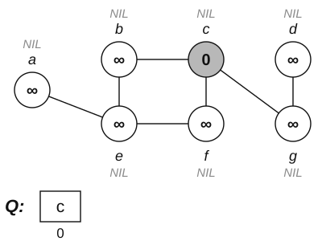
:::

We dequeue $c$ and look at its white neighbors. Taken in alphabetical order as the
conventions require, they are $b$, $f$ and $g$. All three get distance 1 and parent
$C$ and are enqueued.

::: {.bfs-trace}
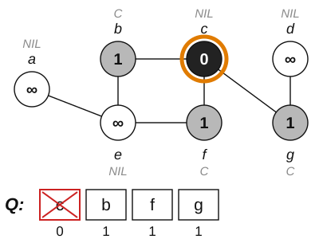
:::

Then we dequeue $b$, which is next in the queue because the queue is FIFO. Its only
white neighbor is $e$, which gets distance 2 and parent $B$.

::: {.bfs-trace}
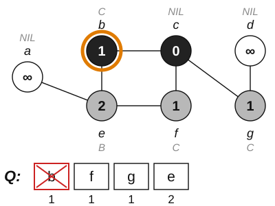
:::

Next we dequeue $f$. Its neighbors $c$ and $e$ have already been seen, so nothing
changes.

::: {.bfs-trace}
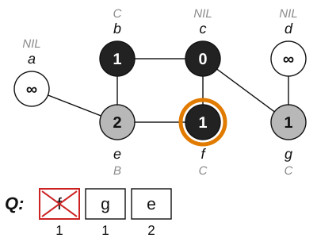
:::

We dequeue $g$ and its white neighbor $d$ gets distance 2 and parent $G$.

::: {.bfs-trace}
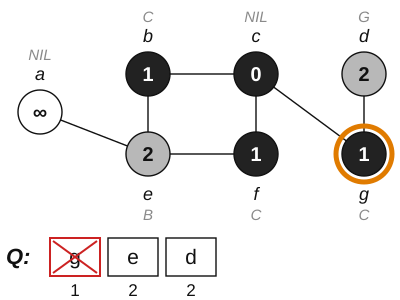
:::

We dequeue $e$ and its white neighbor $a$ gets distance 3 and parent $E$.

::: {.bfs-trace}
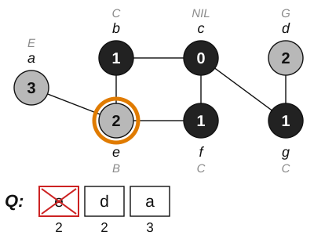
:::

Finally, we dequeue $d$ and then $a$, and neither of them has white neighbors.

::: {.bfs-trace}
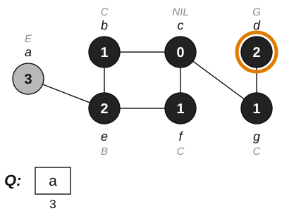
:::

Now the queue is empty, so the algorithm stops.

::: {.bfs-trace}
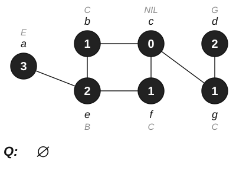
:::

The final distances from $c$ are $b=1$, $f=1$, $g=1$, $e=2$, $d=2$ and $a=3$.
Following the parent pointers backwards from any node gives a shortest path to
$c$, for example $a \rightarrow e \rightarrow b \rightarrow c$, which has length 3. A
common mistake is to update $d[v]$ every time $v$ is seen. This is wrong because the
test `If color[v] = WHITE` means that each node is assigned a distance exactly
once. If you find yourself lowering a distance, you have either made an error
or you are solving a weighted shortest-path problem. That problem needs a different
algorithm, such as the Bellman-Ford algorithm of the exercise sheet of this session.

To run BFS on a network of 5,000 people and to see what happens to the distances when the queue is replaced by a stack, follow sections 2 and 3 of the [Python examples notebook of this session](https://github.com/dgarcia-eu/ICSS/blob/main/PythonExamples/Examples05-Algorithms.ipynb).

---

## 10. Why does this matter? Practical Python examples

Check the [practical Python examples in this Jupyter notebook](https://github.com/dgarcia-eu/ICSS/blob/main/PythonExamples/Examples05-Algorithms.ipynb).
There, you will see how much memory an adjacency matrix and an adjacency list need for a network of 100,000 people, and how breadth-first search finds the short distances of a social network only when it uses a queue.

---

## 11. Check yourself

**1.** Why does BFS find shortest paths, while a search that used a stack would not?

<details><summary>Answer</summary>

BFS uses a queue, which processes nodes in the order they were discovered. All
nodes at distance $k$ are therefore finished before any node at distance $k+1$ is
dequeued, so the first time a node is discovered is along a shortest
path. A stack follows one branch first, so the first time it reaches a node
may be by a long detour.

</details>

**2.** A graph has 1,000 vertices and 3,000 edges. How much memory does the adjacency matrix need compared with the adjacency list?

<details><summary>Answer</summary>

The matrix has $1{,}000^2 = 10^6$ entries regardless of the number of edges. The
lists have about $|V| + 2|E| = 1{,}000 + 6{,}000 = 7{,}000$ entries, because each
undirected edge appears in two lists. The difference is more than two orders of magnitude
and it grows with $|V|$.

</details>

**3.** Is "sort this list" an algorithm? Is selection sort a problem?

<details><summary>Answer</summary>

Neither is the case. "Sort this list" is a problem, i.e. a specification of what must
hold of the output. Selection sort is an algorithm, i.e. a method that achieves it.
It is useful to keep the two apart because a
problem can have many algorithms, and the complexity classes of the Theoretical Computer Science session
classify problems rather than algorithms.

</details>

**4.** In BFS, what would go wrong if you removed the color and instead checked `if d[v] = ∞`?

<details><summary>Answer</summary>

Nothing would go wrong, because the test is equivalent, i.e. a node has infinite distance
exactly when it has not been discovered. The colors carry more information
than BFS needs. However, they matter in depth-first search in the Recursion session, where GRAY and BLACK must be
distinguished to detect cycles. We use colors in both algorithms to keep them
comparable.

</details>

---

## 13. References

- **Cormen, T. H. (2013).** *Algorithms Unlocked*, MIT Press, chapter 1. The
  reading for this session and the source of the framing of the properties of an
  algorithm and of the pseudocode style.
- **Cormen, T. H., Leiserson, C. E., Rivest, R. L. & Stein, C. (2009).**
  *Introduction to Algorithms*, 3rd ed., MIT Press, chapter 22 (elementary
  graph algorithms). The BFS pseudocode, the colors and the $\pi$ notation are
  theirs.
- **Euler, L. (1736).** "Solutio problematis ad geometriam situs pertinentis".
  *Commentarii academiae scientiarum Petropolitanae* 8, 128–140. The paper on the
  Königsberg bridges, which founded graph theory.
- **Berger, P.** *Einführung in die Graphentheorie.* Source of the Königsberg
  illustration used in the slides.
- **Newman, M. E. J. (2018).** *Networks*, 2nd ed., Oxford University Press.
  A standard reference that connects graph algorithms and social network analysis.
  Chapters 6 and 8 cover representation and BFS-based measures.
- **Wasserman, S. & Faust, K. (1994).** *Social Network Analysis: Methods and
  Applications*. Cambridge University Press. The classic sociological
  reference for graphs in social science.
