# Session 6: Recursion

<style>
figure, .figure, .float { margin: 1.4em 0 1.8em 0; }
figure img, .float img { display: block; max-width: 100%; }
figcaption, .figcaption, .figure p.caption { margin-top: 0.3em; font-size: 0.88em; color: #555; }
.float img, .figure img { margin-left: auto; margin-right: auto; }
.float .figcaption, .figure p.caption { text-align: center; }
details { margin: -0.5em 0 2.2em 0; }
table { width: auto !important; margin: 1.2em auto 1.8em auto; }
table th, table td { padding: 0.35em 1.1em !important; }
span.math.inline, .MathJax, mjx-container { white-space: nowrap; }
.stepper { width: 27em; max-width: 100%; box-sizing: border-box; margin: 1.4em auto 1.8em auto; border: 1px solid #c9d1d9; border-radius: 8px; padding: 0.6em 0.8em 0.6em 0.8em; background: #fff; }
.stepper-frame { height: 12em; display: flex; align-items: center; justify-content: center; }
.stepper img { display: none; height: 12em; max-width: 100%; margin: 0; }
.stepper img.on { display: block; }
.stepper-bar { display: grid; grid-template-columns: 5.6em 1fr 5.6em; align-items: center; column-gap: 0.6em; height: 3em; margin-top: 0.5em; }
.stepper-bar button { width: 5.6em; height: 2em; box-sizing: border-box; border: 1px solid #3e5496; background: #fff; color: #3e5496; border-radius: 5px; padding: 0; cursor: pointer; white-space: nowrap; }
.stepper-bar button.prev { grid-column: 1; justify-self: start; }
.stepper-bar button.next { grid-column: 3; justify-self: end; }
.stepper-bar button:disabled { border-color: #ccc; color: #bbb; cursor: default; }
.stepper-cap { grid-column: 2; text-align: center; font-size: 0.88em; line-height: 1.3; font-style: italic; color: #555; max-height: 2.6em; overflow: hidden; }
</style>

*Introduction to Computing for the Social Sciences · lecture transcript*

**Reading for this session:** Chapter 13 of Zelle, *Python Programming*
(2016). References at the end.

---

## Contents

1. [Recursion](#recursion)
2. [Recursive algorithms](#recursive-algorithms)
3. [Memoization](#memoization)

---

<!-- MOTIVATION-SECTION:BEGIN -->
## Motivating examples

<!-- MOTIVATION:M06-B:BEGIN -->
### A · The comment thread with no bottom

Online discussions are often studied in computational social
science, but its data has a structure that is not easy to process. A thread is
a tree and not a list of posts, because a top-level post has replies, those
replies have replies, and there is no fixed limit to the depth. A heated
exchange between two people can run forty levels deep while the rest of the
thread is flat. Think about how you would define the data type. A comment
consists of an author, a timestamp, some text and a list of comments, so the
definition uses the word that it is defining. This is the correct description
of the data and it is the reason why loops are hard to write for it.

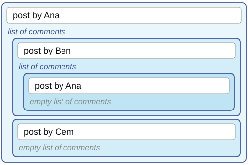

Any question that you want to ask about a thread refers to itself in the same
way:

- **How many posts are in this thread?** The answer is one plus the number of
  posts in each reply.
- **How deep does it go?** The depth is one plus the depth of the deepest
  reply.
- **How many distinct people are involved?** They are the author of this post
  together with the people involved in each reply.
- **When did the argument end?** It ended at the latest timestamp among this
  post and all its replies.

Each of these questions is answered by a short recursive procedure, while the
corresponding loop is much harder to write. For example, the depth of a thread
can be computed like this:

```
Procedure THREAD-DEPTH(comment)
Inputs:
      comment: a comment with a (possibly empty) list of replies
Result: the number of levels in the subtree rooted at this comment
If comment has no replies
      then return 1
best ← 0
For each reply r of comment:
      best ← max(best, THREAD-DEPTH(r))
return 1 + best
```

When the structure of the data is recursive, the procedure that goes through
it should usually be recursive too. The code then has the same structure as
the data it describes, so recursive solutions for recursive data are usually
shorter and it is easier to check that they are correct.

In this session you will learn about the base case and the recursion case of a
recursive definition. Here the base case is a comment with no replies, and it
guarantees that the procedure terminates as long as the thread really is a
tree and has no cycle. We will also learn about the call stack and the
practical limit that it imposes. For example, a thread 40,000 levels deep
would exceed Python's default recursion limit of about 1,000 calls. Finally,
we will learn to distinguish tree recursion, which makes one call per child,
from linear recursion. When you write a procedure like these for your own
data, write the definition of the data first, because the procedure follows
from it almost mechanically.

<!-- MOTIVATION:M06-B:END -->
<!-- MOTIVATION:M06-D:BEGIN -->
### B · The car software that could run out of stack

Between 2009 and 2011 Toyota recalled millions of cars after drivers reported
that their cars accelerated without them pressing the pedal. In 2013 a court
in Oklahoma heard the case of a 2005 Camry that had crashed in this way, which
is known as *Bookout v. Toyota*. The software expert Michael Barr had studied
the source code of the engine control unit, i.e. the small computer that
decides how far the throttle opens, and he explained to the jury what he
found. One of his findings was about a part of the memory called the *stack*.
Every time a function is called, the computer reserves a piece of the stack
for it and frees that piece when the function returns. Toyota had reported
that its software never used more than 41% of the stack. Barr's analysis found
that it could use 94% instead.

A recursive function reserves a new piece of the stack with every call, so the
memory that it needs depends on how deep the recursion goes, and that depth
cannot be read directly from the code. For this reason the coding standard of
the car industry, which is called MISRA C, tells programmers to avoid
recursion. If the stack is full and one more function is called, the new piece
is written over memory that belongs to something else. This is called a *stack
overflow*. According to Barr, the software had no check at run time that would
notice a stack overflow, and the memory next to the stack held data that the
operating system needed to keep the tasks of the engine control unit running.
The jury found Toyota liable. In this session you will learn what the computer stores on the stack for every
call of a function and why a recursive function needs one more frame for every
call that is waiting.

<!-- MOTIVATION:M06-D:END -->

---

<!-- MOTIVATION-SECTION:END -->
## 1. A first recursion example {#recursion}
Let's start with a country called Simpleland and its citizenship law, which
says that:

> a person P is a citizen of Simpleland if  
  - P was born in Simpleland,  
  - or if either of P's parents is a citizen of Simpleland.

How can we tell if a given person P a citizen of Simpleland? The rule does not always answer the question directly.
To apply the second clause you have to ask the same question about P's mother
and father, and to answer that you might have to ask about P's grandparents, so the
question keeps referring back to itself. This is *recursion*, i.e. a
definition that is stated in terms of itself. This is not the same as a circular definition because it can stop at some point and give us the final answer.

---

## 2. The three parts of a recursive definition

The first clause of the law, that P was born in Simpleland, does not refer to
the rule again. It can be checked directly, so we call it the **base case**.
Every recursive definition needs at least one base case, because without it
the recursion never ends. The second clause, that either of P's parents is a
citizen, reduces the question to the same question about a different input, so
we call it the **recursion case**. The recursion case works under two
conditions. First, the sub-problem must be of the same kind as the original,
so that the same rule applies. Second, the sub-problem must be closer to the
base case, so that the process eventually terminates.

There is also a practical problem. What if we do not know all of P's
ancestors? Real records are incomplete, and the recursion would keep asking
questions that cannot be answered. The solution is to add a clause that says
that if we do not know P's parents, then P is not a citizen of Simpleland.
This clause is an *abort case*, i.e. a condition that stops the recursion when
it cannot proceed, even though it is not the natural base case. In programs,
abort cases protect against inputs that would otherwise make the recursion run
forever, for example a negative number given to a function that counts down to
zero.

Formally, recursion is a technique in mathematics, logic and computer science
to specify a function through itself, which is called a *recursive
definition*. The fundamental principle of recursion is to define the value of
a function $f$ through previously calculated values of the same function, i.e. $f(n)$, $f(n-1)$, and so on. As long as the start value of $f$ is known for sufficiently many arguments, which are the base cases, any value of $f$ can be calculated. A recursive call of $f$ keeps calling itself until either the
function converges to a target value or a predefined abort condition is met.

Recursion appears in many places besides laws and mathematical functions. For
example, a binary tree is defined in terms of binary trees, as we learned in
the Data Structures session. 

---

## 3. Factorial as an example

How many different ways are there to seat four diners? For the first slot
there are 4 choices. After using one person, the second slot has 3 choices,
the third has 2 and the last has 1, so there are $4! = 4 \cdot 3 \cdot 2 \cdot 1 = 24$ arrangements.

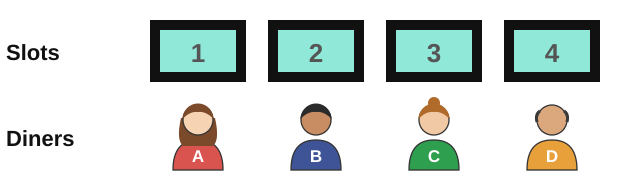

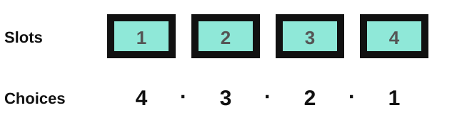

The factorial has an iterative definition, $n! = n \, (n-1) \, (n-2) \cdots (1)$, and a recursive one:

$$n! = \begin{cases} 1 & \text{if } n = 1 \quad \text{(base case)}\\ n \cdot (n-1)! & \text{if } n > 1 \quad \text{(recursion case)}\end{cases}$$

The recursive definition is shorter and it also describes the structure of the
problem better, because the number of ways to seat $n$ people is $n$ choices for the first seat times the number of ways to seat the remaining $n-1$
people. Each definition gives an implementation, and below you can see the
iterative procedure, the recursive procedure, and the recursive procedure
written in Python.

```
Procedure ITERATIVE-FACTORIAL(n)
Inputs:
      n: a positive integer
Result: the factorial of n
result ← 1
While n > 1:
      result ← result · n
      n ← n - 1
return result
```

```
Procedure RECURSIVE-FACTORIAL(n)
Inputs:
      n: a positive integer
Result: the factorial of n
If n = 1
      then return 1
      else return n · RECURSIVE-FACTORIAL(n - 1)
```

```python
def recursive_factorial(n):
    if n == 1:
        return 1
    else:
        return n * recursive_factorial(n - 1)
```

Notice how directly the recursive version follows the mathematical definition.
This is typical, because when a problem has a recursive structure, the
recursive program is often the shortest correct one. The calculation can be
drawn as a tree. When we trace `fac(4)`, the call cannot return yet because it
needs `fac(3)`, which needs `fac(2)`, which needs `fac(1)`. The calls go down
until they reach the base case, where `fac(1)` returns 1 without calling
anything. Only then do the values come back up, first $1$, then $2 \cdot 1 = 2$, then $3 \cdot 2 = 6$ and finally $4 \cdot 6 = 24$.

You can go through the seven steps of the trace with the buttons below.

```{=html}
<div class="stepper" id="factree">
<div class="stepper-frame">
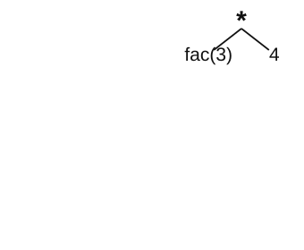
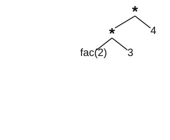
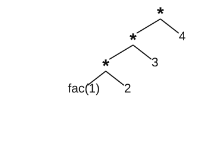
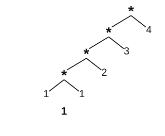
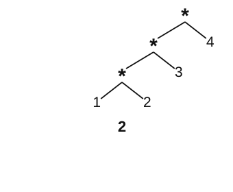
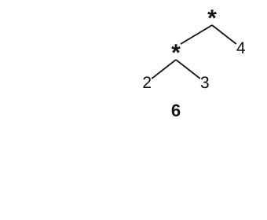
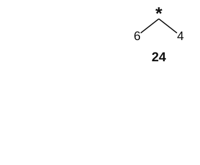
</div>
<div class="stepper-bar">
<button type="button" class="prev">&#9664; Back</button>
<span class="stepper-cap">Step 1 of 7: fac(4) needs fac(3).</span>
<button type="button" class="next">Next &#9654;</button>
</div>
</div>
<script>
document.querySelectorAll(".stepper").forEach(function (box) {
  var imgs = box.querySelectorAll("img"), cap = box.querySelector(".stepper-cap");
  var prev = box.querySelector(".prev"), next = box.querySelector(".next"), k = 0;
  function show() {
    imgs.forEach(function (im, i) { im.classList.toggle("on", i === k); });
    cap.textContent = imgs[k].getAttribute("data-cap");
    prev.disabled = k === 0;
    next.disabled = k === imgs.length - 1;
  }
  prev.addEventListener("click", function () { if (k > 0) { k--; show(); } });
  next.addEventListener("click", function () { if (k < imgs.length - 1) { k++; show(); } });
  show();
});
</script>
```

The trace goes all the way down and then all the way back up. Nothing is computed on the way down
and all the multiplications happen on the way back up.

---

## 4. Recursion and the program stack

To understand why recursion behaves like that and why it can fail, we need to
look at how a running program uses memory. A program being run on a machine is
called a *process*. The memory of the system is shared by the operating
system and all the processes that are running, and each process gets its own
part of it. The memory of a process is organized in three segments:

- The **code segment** (CS) contains the executable instructions, i.e. the
  program loaded from disk. It is typically read-only and of fixed size.
- The **data segment** or **heap** (DS) contains global data, and Python
  manages all its objects in a private heap. It is typically not executable
  and its size is limited by the main memory or by an explicit parameter
  given when the program is run.
- The **stack segment** (SS) contains local variables (i.e. variables present only inside the scope of a function), parameters and return
  addresses. It is typically not executable and it is limited in size, for
  example 8 MB on Linux and 1 MB on Windows and in Java.

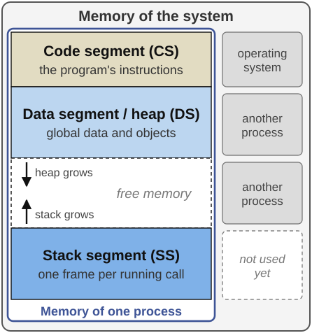

The heap and the stack grow and shrink while the program runs, but they do so
in different ways. The heap grows when the program creates data, for example a
list with a million numbers. The stack grows when the program calls a
function. Every function call puts a *frame* on the stack that contains the
parameters and the local variables of the call and the *return address*, i.e.
the place where the program continues after the call. The frame is removed
when the call returns its value. This is the LIFO behavior of the stack that
we learned in the Algorithms session, with a push on the call and a pop on the
return, and it is the reason why the innermost call must finish first.

A recursive call does not replace the frame of its caller. Instead, it adds a
new frame on top, because the caller is still waiting for the result. For
example, `recursive_factorial(3)` calls `recursive_factorial(2)`, which calls
`recursive_factorial(1)`. At that point there are three frames on the stack
and each of them has its own value of `n`. The call with `n = 1` is the base
case, so it returns 1 and its frame is removed. Then the call with `n = 2`
returns $2 \cdot 1 = 2$ and finally the call with `n = 3` returns $3 \cdot 2 = 6$. Recursion therefore has a cost in memory, namely one frame for every
call that is waiting, and a cost in time, because every call and every return
takes time.


The stack has a maximum size, so it can run out of memory. If the base case is
missing or is never reached, no call returns and every call adds a frame. A
correct recursion can also be too deep, for example a function that makes one
call per element of a list with a million elements. When the next frame does
not fit, we have a *stack overflow*. The program crashes or, in languages like
C, it writes over memory that belongs to something else, which is the failure
of the car software in the motivating example.

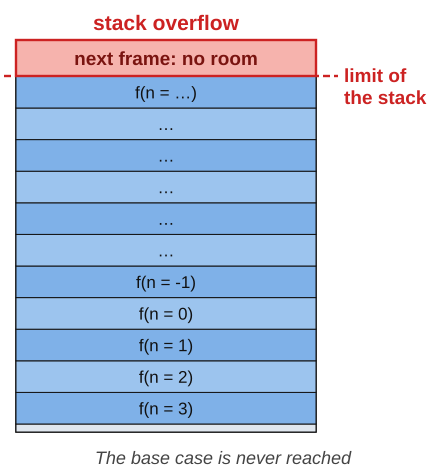

Python sets a limit of 1,000 nested calls by default so that you get a clean
error instead of a crash:

```python
>>> recursive_factorial(10000)
RecursionError: maximum recursion depth exceeded
```

You can see this limit at work in section 2 of the [Python examples notebook
of this session](https://github.com/dgarcia-eu/ICSS/blob/main/PythonExamples/Examples06-Recursion.ipynb),
where a recursive depth-first search fails on a chain of 5,000 nodes while an
iterative version with its own stack finishes.

---

## 5. Recursive algorithm 1: Euclid's algorithm {#recursive-algorithms}
The *greatest common divisor* $\gcd(a,b)$ of two numbers is the largest number
that divides both exactly. For example, 1 and 2 divide both 8 and 6 but no
larger number does, so $\gcd(8,6) = 2$. Euclid's algorithm is based on one
mathematical property:

$$\gcd(a,b) = \gcd(b,\; a \bmod b)$$

This equation is the recursion case. It replaces the problem with a smaller
instance of the same problem, because $a \bmod b < b$. The base case is $b = 0$, because the greatest common divisor of $a$ and 0 is $a$.

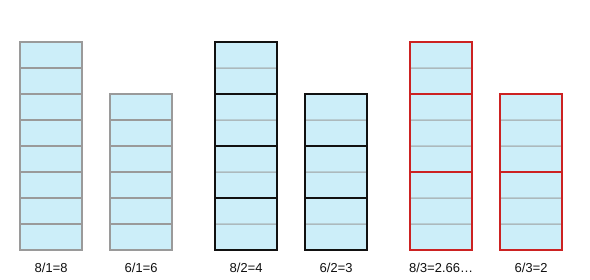

```
Procedure GCD(a, b)
Inputs:
      a, b: natural numbers (a, b ∈ ℕ) with a ≥ b
Result: the greatest common divisor of a and b
If b = 0
      then return a
      else return GCD(b, a mod b)
```

As an example, let's compute $\gcd(270, 192)$. Each line of the table is one
call of the procedure:

| Call | $a$ | $b$ | $a \bmod b$ | What the call does |
|:---:|:---:|:---:|:---:|:---|
| 1 | 270 | 192 | 78 | calls GCD(192, 78) |
| 2 | 192 | 78 | 36 | calls GCD(78, 36) |
| 3 | 78 | 36 | 6 | calls GCD(36, 6) |
| 4 | 36 | 6 | 0 | calls GCD(6, 0) |
| 5 | 6 | 0 | | $b = 0$ is the base case, so it returns 6 |

The value 6 is then returned unchanged by the four calls that were waiting, so
$\gcd(270, 192) = 6$. The algorithm
needs only five calls because the numbers shrink fast. The reason is that the
remainder $a \bmod b$ is always less than $a/2$, so the larger argument at
least halves every two calls and the number of calls is logarithmic in the
input. Section 3 of the [Python examples notebook of this session](https://github.com/dgarcia-eu/ICSS/blob/main/PythonExamples/Examples06-Recursion.ipynb)
counts the calls for two 18-digit numbers and compares them with the time
needed to try every candidate divisor.

Euclid (c. 300 BC) was a Greek mathematician. He is known as "Euclid of
Alexandria" but little else is known about his life, since neither his birth
year nor his birthplace is recorded. He is commonly called the father of
geometry, and his most influential book, the *Elements*, contains this
algorithm in Book VII. The original version used subtraction instead of the
modulo operation. It was still recursive but it needed more steps. One of his
lesser-known books is titled *Data* (Δεδομένα) and is about how to study given
information geometrically. The same algorithm has been used unchanged for
2,300 years.

---

## 6. Recursive algorithm 2: Depth-First Search {#depth-first-search}

Breadth-first search (BFS), which we learned in the Algorithms session, uses a queue
and explores the graph level by level. *Depth-first search* (DFS) explores as
deep as it can before backtracking. The natural way to write it is
recursively, because the program stack of the recursive calls does the work of the stack that is necessary for the search. Several problems can be solved with DFS, for
example whether a node $x$ is included in the graph, whether the graph has a
cycle, and whether the graph has a strongly connected component. We will see
below how to use it to plan tasks and to find cycles. The algorithm
has two procedures, namely an outer one that initializes every vertex and then
visits every vertex that is still white, and an inner one that does the actual
recursive visit.

```
Procedure DFS(G)
Inputs:
      G: a graph
Result: every vertex stores its discovery time d, its finishing time f
        and its parent π
For each vertex u in G.V:
      color[u] ← WHITE
      π[u] ← NIL                # parent
time ← 0                        # global counter
For each vertex u in G.V:
      If color[u] = WHITE
            then DFS-VISIT(G, u)
```

```
Procedure DFS-VISIT(G, u)
Inputs:
      G: a graph
      u: the vertex to be processed
Result: u and every vertex reachable from it are visited
time ← time + 1
d[u] ← time                     # discovered
color[u] ← GRAY
For each vertex v in neighbors(u):
      If color[v] = WHITE
            then π[v] ← u
                 DFS-VISIT(G, v)
color[u] ← BLACK
time ← time + 1
f[u] ← time                     # finished
```

Each vertex gets two timestamps, namely $d[u]$ when it is first discovered and $f[u]$ when all its descendants are finished. In the figures they are written
inside the node as `d/f` and the parent is the gray capital letter. The fill
of a node shows its color, i.e. white for WHITE, gray for GRAY and black for
BLACK. The graph
is directed, with edges $c \to b$, $c \to f$, $c \to g$, $b \to e$, $e \to a$, $e \to f$ and $g \to d$. The For loop of DFS takes $c$ first and neighbors are
taken in alphabetical order, as the conventions require.

### Full trace

In the initial state all times are empty.

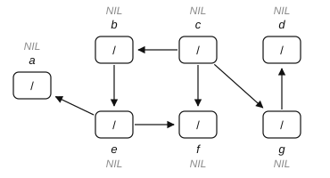

We call DFS-VISIT($c$), and the time becomes 1. The first white neighbor of $c$ is $b$, so we set $\pi[b] = C$ and recurse.

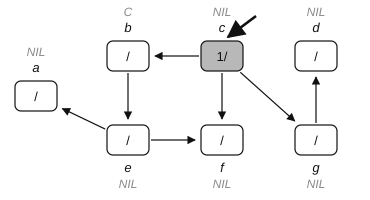

We call DFS-VISIT($b$) at time 2, and its white neighbor is $e$.

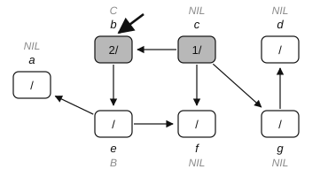

We call DFS-VISIT($e$) at time 3, and its first white neighbor is $a$.

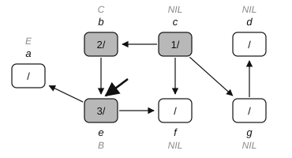

We call DFS-VISIT($a$) at time 4. Since $a$ has no white neighbors, it finishes immediately at time 5, so $a$ gets $4/5$, and we return to the loop of $e$.

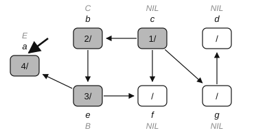

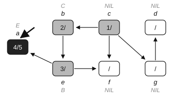

Back in the loop of $e$, the next white neighbor is $f$. We call DFS-VISIT($f$) at time 6. It has no white neighbors and finishes at time 7.

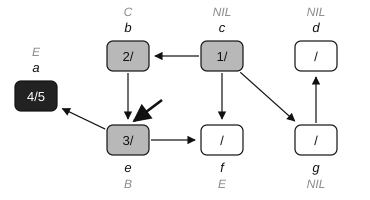

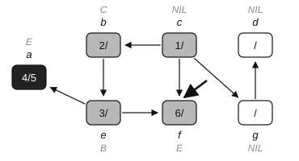

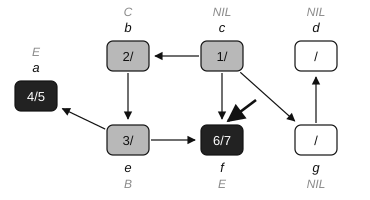

Back in the loop of $e$ nothing white is left, so $e$ finishes at time 8, and back in the loop of $b$ nothing is white either, so $b$ finishes at time 9.

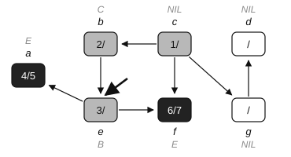

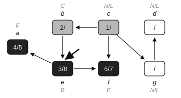


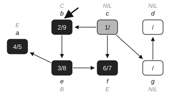

Back in the loop of $c$, the next white neighbor is $g$, because $f$ is black by now. We call DFS-VISIT($g$) at time 10, and its white neighbor is $d$.

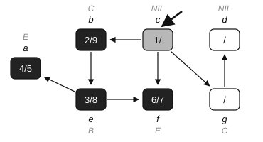

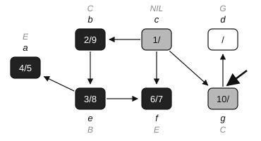

We call DFS-VISIT($d$) at time 11. It has no white neighbors and finishes at time 12. Back in the loop of $g$ nothing is white, so $g$ finishes at time 13, and back in the loop of $c$ nothing is white, so $c$ finishes at time 14.
All nodes are finished and the algorithm is done.

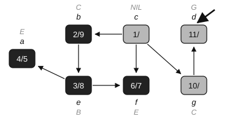


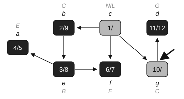

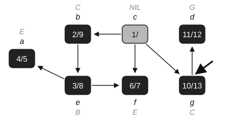

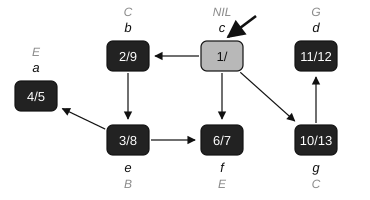

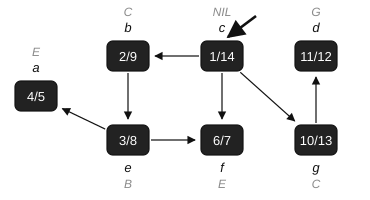

The `d/f` pairs carry useful information. Because DFS-VISIT is recursive, the
intervals $[d[u], f[u]]$ are properly nested, i.e. for any two vertices, their
intervals are either disjoint or one contains the other. This structure allows
DFS to solve problems that BFS cannot solve, and we will see two of them. The
strongly connected components of a directed graph can also be computed from
the finishing times $f$, with an algorithm that you can find in Cormen et al.
(2009).

### Planning tasks with topological sorting

Tasks often depend on each other. In a research project, for example, the data
has to be collected before it can be analyzed, and the ethics approval has to
arrive before the data is collected. We can describe such a plan as a directed
graph in which an edge $u \to v$ means that $u$ has to be done before $v$. A
*topological sorting* of the graph is an order of all its vertices in which
every edge points forward, i.e. an order of the tasks that respects all
dependencies. DFS finds it in two steps:

1. Run DFS on the graph.
2. Sort the vertices by decreasing finishing time $f$.

This works because DFS-VISIT($u$) only finishes after it has visited everything that can be reached from $u$. Every task that depends on $u$ therefore finishes earlier than $u$, so $u$ is placed before it in the order.

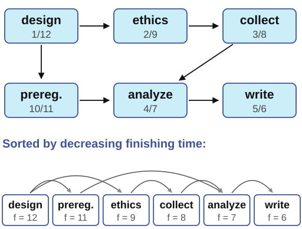

In the example of the figure, DFS starts at *design* and takes neighbors in
alphabetical order. The search goes down through *ethics*, *collect*, *analyze*
and *write*, which finish at times 6 to 9 in reverse order. Then it comes back
to *design* and visits *prereg.*, i.e. the preregistration of the study, which
finishes at time 11. Finally, *design* finishes at time 12. Sorted by
decreasing finishing time, the tasks are *design*, *prereg.*, *ethics*,
*collect*, *analyze* and *write*, and all the edges of the graph point forward
in this order.

### Finding cycles

A plan with a cycle cannot be carried out. For example, if Statistics 2 is
required for Methods, Methods for the Seminar and the Seminar for Statistics
2, then no student can ever take any of the three courses. A graph with a
cycle has no topological sorting, so it is useful to detect cycles before
planning. DFS can do it with the colors. While DFS-VISIT($u$) runs, the GRAY
vertices are the ones that are discovered but not finished, i.e. the ones
whose calls are still waiting on the stack. They form the path from the start
of the search to $u$. If a neighbor $v$ of $u$ is GRAY, then there is a path from $v$ to $u$ and also an edge from $u$ to $v$, so the graph has a cycle.

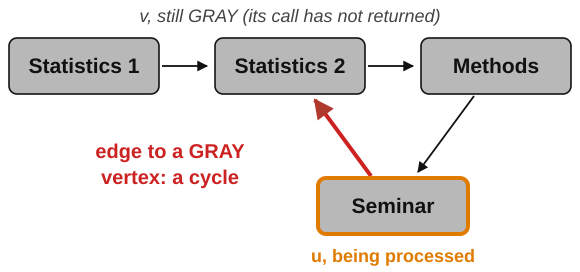

The test only needs two more lines in the For loop of DFS-VISIT:

```
For each vertex v in neighbors(u):
      If color[v] = GRAY
            then report a cycle
      If color[v] = WHITE
            then π[v] ← u
                 DFS-VISIT(G, v)
```

This is the reason why we keep three colors instead of two. An edge to a BLACK
vertex leads to a part of the graph that is already finished, which is not a
cycle in a directed graph.

---

## 7. Types of recursion

Recursive algorithms can be classified by how they call themselves:

- In **linear** recursion the procedure calls itself once, as in factorial and
  gcd.
- **Tail-end** recursion is a special case of linear recursion in which the
  recursive call is the last step, so the result of the call is returned
  without any further calculation. The gcd is tail-recursive because it
  returns `GCD(b, a mod b)` and nothing more, while factorial is not, because
  after the call returns you still have to multiply by $n$.
- In **tree** or **cascade** recursion the procedure calls itself several
  times, as in DFS and in the Fibonacci numbers that we will see below.
- In **nested** recursion the parameters of a recursive call contain another
  recursive call. The standard example is the Ackermann function defined
  below.

Recognizing tail-end recursion is useful in practice, because a tail-recursive
function can be turned into a loop mechanically. Some compilers do it
automatically, which is called tail-call optimization and removes the risk of
stack overflow.

The Ackermann function is defined by three equations:

$$\begin{aligned}
ack(0, m) &= m + 1\\
ack(n+1, 0) &= ack(n, 1)\\
ack(n+1, m+1) &= ack(n, ack(n+1, m))
\end{aligned}$$

It is computable but it grows so fast that $ack(4,3)$ has 19,729 digits. It is
used in theory as an example of a function that is computable but not
primitive recursive.

---

## 8. Memoization {#memoization}
Some recursive algorithms are slow because they solve the same sub-problem
many times. The Fibonacci numbers are the standard example. The recursive
procedure computes them directly from their definition:

```
Procedure FIB(n)                  # recursive version
Inputs:
      n: a natural number (n ∈ ℕ)
Result: the n-th Fibonacci number
If n = 0
      then return 0
If n = 1
      then return 1
return FIB(n - 1) + FIB(n - 2)
```

This is tree recursion and it repeats a lot of work. To compute `FIB(5)` the
procedure makes 15 calls, although there are only six different sub-problems,
namely `FIB(0)` to `FIB(5)`. It computes `FIB(3)` twice and `FIB(2)` three
times, and the number of calls grows exponentially with $n$.


*Memoization* means saving the result of each sub-problem the first time it is
calculated, for example in an array, so that we do not have to compute the
same sub-problem again. Before a calculation we look into the array, and after
a calculation we write the result into it:

```
Procedure FIB(n)                  # recursive, with memoization
Inputs:
      n: a natural number (n ∈ ℕ)
Data: memo: an array indexed from 0 to n, initially all NIL
Result: the n-th Fibonacci number
If n = 0
      then return 0
If n = 1
      then return 1
If memo[n] ≠ NIL
      then return memo[n]      # previously calculated
memo[n] ← FIB(n - 1) + FIB(n - 2)
return memo[n]
```

Each value is now computed once and looked up afterwards, so the running time
drops from exponential to linear with a change of three lines. Section 1 of
the [Python examples notebook of this session](https://github.com/dgarcia-eu/ICSS/blob/main/PythonExamples/Examples06-Recursion.ipynb)
counts the calls of both versions, and for $n = 30$ the version without memo
makes about 2.7 million calls while the version with memo makes 59.

With the array we can also rewrite the recursive algorithm as a loop. The
recursion only fills the array, and every entry depends on the two entries
before it, so we can fill the array directly from the smallest sub-problem:

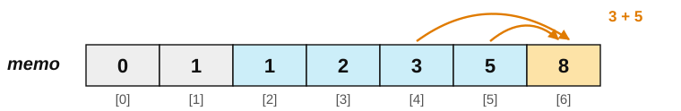

```
Procedure FIB(n)                  # fully iterative
Inputs:
      n: a natural number (n ∈ ℕ)
Data: memo: an array indexed from 0 to n
Result: the n-th Fibonacci number
memo[0] ← 0
memo[1] ← 1
For i = 2 to n:
      memo[i] ← memo[i - 1] + memo[i - 2]
return memo[n]
```

Saving and reusing the results of sub-problems in this way is the idea behind
*dynamic programming*, a family of algorithms that you can read about in
Cormen et al. (2009).

### Memory: the stack or the array?

Memoization makes an algorithm faster in exchange for memory, but how much
memory each version needs depends on its use of the stack and of the array:

| Version of FIB($n$) | Calls for $n = 30$ | Stack | Array |
|:---|:---:|:---:|:---:|
| recursive | about 2.7 million | up to $n$ frames | none |
| recursive with memoization | 59 | up to $n$ frames | $n + 1$ entries |
| iterative with an array | 1 | 1 frame | $n + 1$ entries |
| iterative with two variables | 1 | 1 frame | none |

The recursive version with memoization uses more memory than the plain
recursion, because it keeps the array in addition to the frames on the stack.
It can also still overflow the stack if $n$ is large. The iterative version
uses less memory than both recursive versions, because it needs the array but
only one stack frame, so it cannot overflow the stack. If only the last
results are needed, as in the Fibonacci numbers, the array can be replaced by
two variables and the additional memory does not grow with $n$ at all.

---

## 9. Families of algorithm design

These are the most common problem-solving heuristics that you will encounter:

- **Recursion** solves a problem through recursive function calls, as in DFS,
  and requires sensible abort conditions.
- **Greedy** algorithms extend partial solutions successively, as in BFS,
  which extends the set of visited nodes with the closest nodes that are not
  visited yet. They determine the locally optimal choice at each step
  and then move on. They are only correct if the local optimum also leads to a
  globally optimal solution, which you must check because it is often not the
  case.
- **Divide and conquer** separates the problem into decoupled, non-overlapping
  smaller sub-problems, solves the sub-problems independently and, if
  necessary, combines the sub-results into the global result. We will learn
  mergesort and quicksort as examples in the Sorting Algorithms session.

The difference between divide and conquer and memoization is whether the
sub-problems overlap. In mergesort the two halves are disjoint, so there
is nothing to reuse, while in Fibonacci the sub-problems overlap a lot, so
saving their results saves most of the work.

---

## 10. Why does this matter? Practical Python examples

Check the [practical Python examples in this Jupyter notebook](https://github.com/dgarcia-eu/ICSS/blob/main/PythonExamples/Examples06-Recursion.ipynb).
There, you will see a recursive Fibonacci function make millions of calls
where the same function with a memo makes 59, a recursive depth-first search
fail on a chain of 5,000 nodes because of Python's recursion limit, and
Euclid's algorithm find the gcd of two 18-digit numbers in 16 calls.

---

## 11. Check yourself

**1.** What happens if you call `recursive_factorial(0)`?

<details><summary>Answer</summary>

The calls never reach the base case, so the recursion is infinite and Python
stops it with a `RecursionError`. The base case tests `n == 1` and 0 never
reaches it, because the calls go 0, −1, −2, and so on. This is an example of
the rule "always have an exit condition". A correct implementation tests
`n <= 1` or defines $0! = 1$ explicitly.

</details>

**2.** Write the recursive definition of the sum of a list.

<details><summary>Answer</summary>

The base case is that the sum of an empty list is 0, and the recursion case
is that the sum of a list is its last element plus the sum of the rest.

```
Procedure SUM(A, n)
If n = 0
      then return 0
      else return A[n] + SUM(A, n - 1)
```

The procedure is not tail-recursive, because you still add `A[n]` after the
call returns.

</details>

**3.** If you run BFS and DFS on the same graph from the same start, will they always discover the same set of nodes?

<details><summary>Answer</summary>

Yes, both discover exactly the nodes reachable from the start. They differ in
the order of discovery and in the tree they build, i.e. in the $\pi$ pointers,
but the set of reachable nodes is the same. Therefore either of them can
decide whether a graph is connected, but only BFS gives shortest paths.

</details>

**4.** Why does memoizing Fibonacci help so much, but memoizing factorial not at all?

<details><summary>Answer</summary>

Memoizing helps because `FIB` calls itself twice and the two call trees overlap
heavily, so the same sub-problems appear many times. Factorial calls itself
once, so every sub-problem is already computed exactly once and there is
nothing to save. Memoization only helps when sub-problems overlap.

</details>

**5.** During a DFS you encounter a neighbor that is GRAY. What have you found, and why does WHITE/BLACK not tell you?

<details><summary>Answer</summary>

You have found a cycle. GRAY means discovered but not finished, i.e. still on
the current recursion path, so an edge to a GRAY vertex closes a loop. WHITE
means undiscovered, so the edge leads to a new branch. BLACK means finished,
so the edge leads to an already completed subtree, which is not a cycle in a
directed graph. This is why DFS uses three colors while BFS could work with
two.

</details>

---

## 12. References

- **Zelle, J. M. (2016).** *Python Programming: An Introduction to Computer
  Science*, 3rd ed., chapter 13 (algorithm design and recursion). The reading
  for this session.
- **Cormen, T. H., Leiserson, C. E., Rivest, R. L. & Stein, C. (2009).**
  *Introduction to Algorithms*, 3rd ed., MIT Press, section 22.3 (depth-first
  search), section 22.4 (topological sort) and chapter 15 (dynamic
  programming). Source of the DFS pseudocode, the colors and the
  discovery/finishing-time notation.
- **Cormen, T. H. (2013).** *Algorithms Unlocked*, MIT Press, chapter 2, pp.
  21–23, on recursion in pseudocode.
- **Barr, M. (2013).** *Bookout v. Toyota: 2005 Camry L4 software analysis*.
  Slides of the expert testimony on the engine control software, including the
  stack analysis and the recursion.
- **Koopman, P. (2014).** *A case study of Toyota unintended acceleration and
  software safety*. <https://users.ece.cmu.edu/~koopman/toyota/>
- **Euclid** (c. 300 BC). *Elements*, Book VII, Propositions 1–2. The gcd
  algorithm, in its subtraction form.
- **Ackermann, W. (1928).** "Zum Hilbertschen Aufbau der reellen Zahlen".
  *Mathematische Annalen* 99, 118–133.
- **Python's recursion limit:** `sys.setrecursionlimit`,
  <https://docs.python.org/3/library/sys.html#sys.setrecursionlimit>
